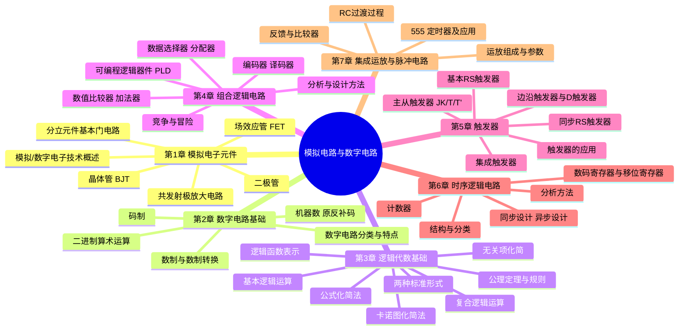
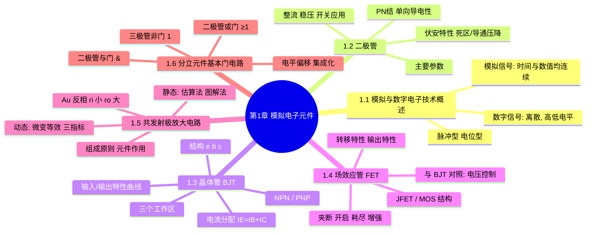
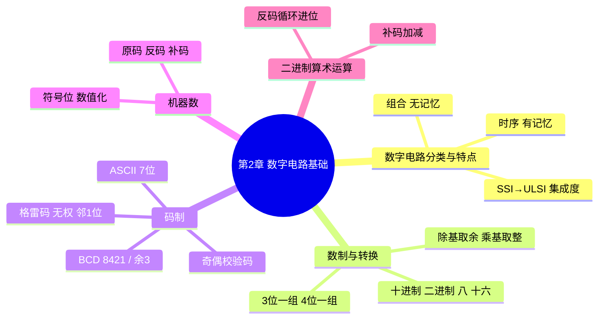
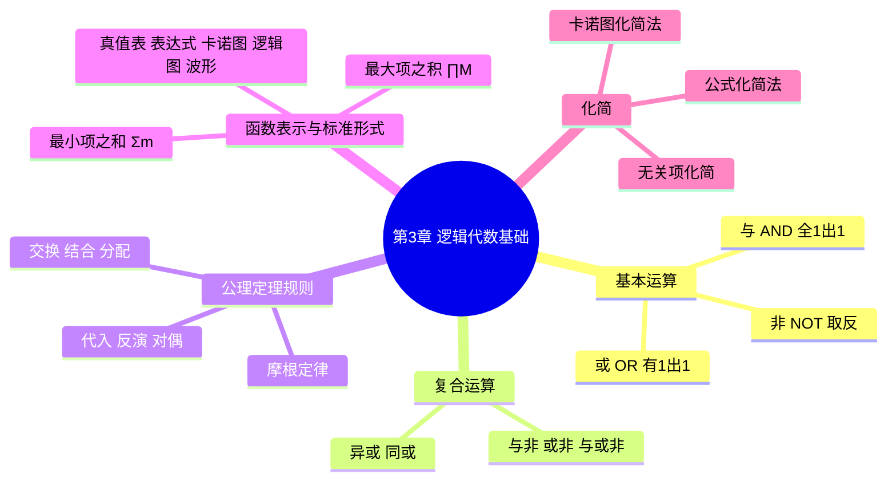
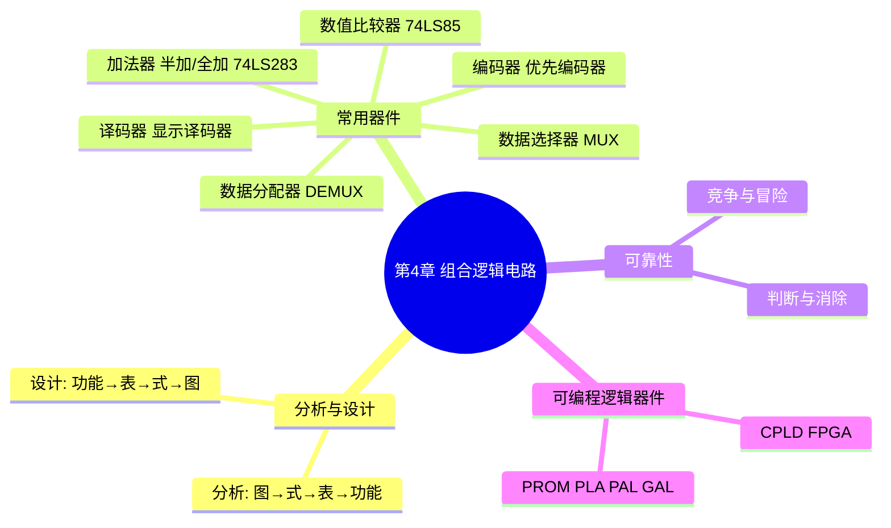
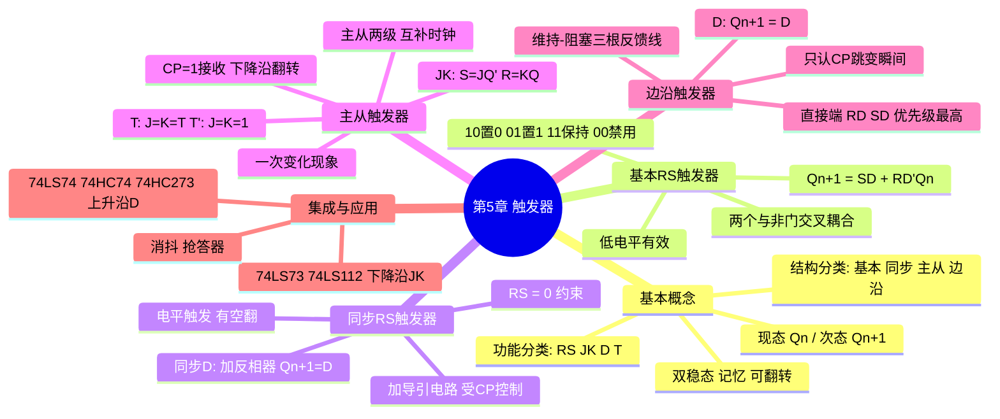
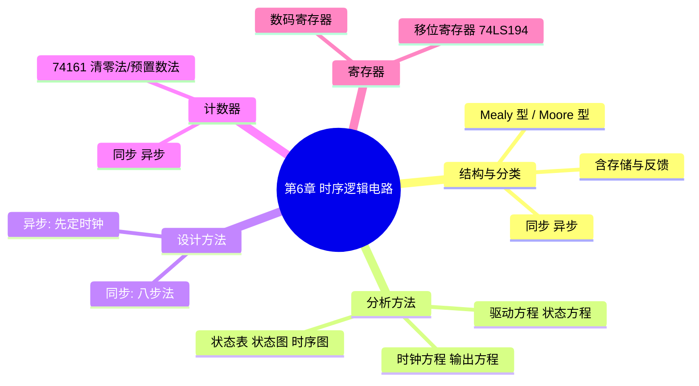
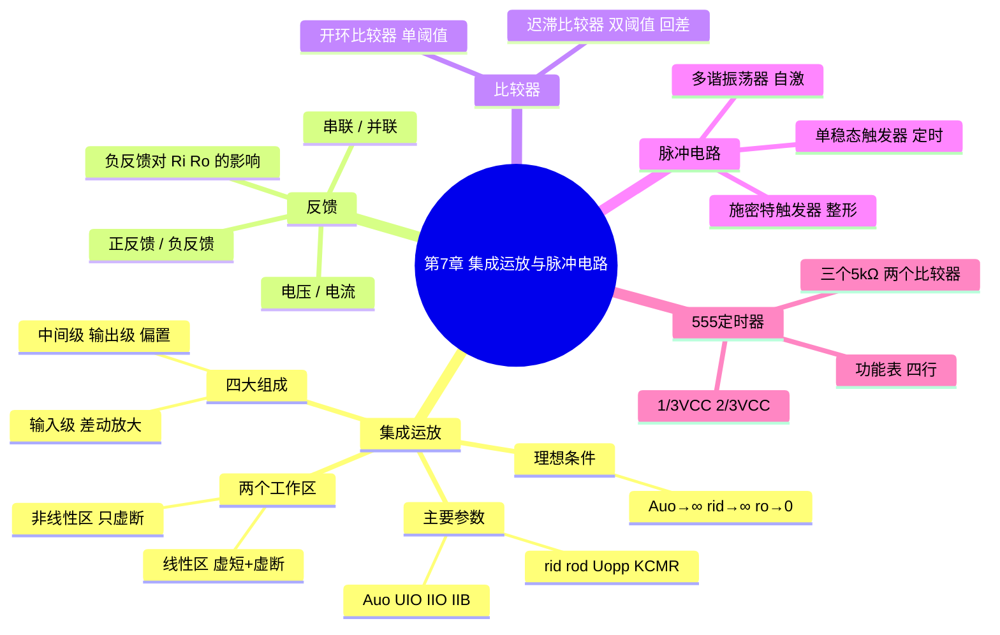

# 《模拟电路与数字电路》全书知识点讲解（日常学习）

> 教材：高明 主编《模拟电路与数字电路》（人民邮电出版社）。本册按 **2026 版教学课件（U040023XN02，23 版大纲）**
> 的章节顺序整理，覆盖 **第 1～7 章** 共 **46 个知识点**，配思维导图、核心结论、易错提醒与必背清单，供日常复习。
> 各知识点的**逐篇图文讲解**见对应章节文件夹内的 `N.M_知识点.md`。
>
> 章节对应关系（课件编号 → 本资料编号）：课件 01 模拟电子元件 → 第 1 章；02 数字电路基础 → 第 2 章；
> 03 逻辑代数 → 第 3 章；04 组合逻辑 → 第 4 章；**05 触发器 → 第 5 章**；06 时序逻辑 → 第 6 章；07 运放与脉冲 → 第 7 章。

## 课程总览

**三句话主线**：① 模拟器件（二极管/三极管/场效应管）是数字门电路的物理基础；② 逻辑代数（布尔代数）是分析/化简数字电路的数学工具；③ 组合电路"无记忆"、时序电路"有记忆"，二者构成数字系统全部逻辑；**触发器就是"记忆"的最小单位**。

---

## 第1章 模拟电子元件与分立电子元件

### 思维导图

### 核心知识点

- **模拟信号**时间、数值都连续；**数字信号**取值离散，分**脉冲型**与**电位型**两类。模拟电子技术（放大、滤波、调制、解调、模数转换）是数字系统的前端。
- **PN 结**：P 型 + N 型半导体接触，扩散与漂移动态平衡形成耗尽层，具有**单向导电性**。N 型多子为电子，P 型多子为空穴；**多子看掺杂、少子看温度**。
- **二极管**：正偏导通、反偏截止。硅管死区 **0.5 V**、导通压降 **0.7 V**；锗管 **0.2 V / 0.3 V**。四大参数：$I_{FM}$、$U_{RM}$（≈击穿电压一半）、$I_{RM}$、$f_M$。**稳压管反向击穿区**工作且必串限流电阻；电击穿可逆、热击穿不可逆。
- **三极管 BJT**：两个 PN 结、三个区、三个电极（e/b/c），分 NPN/PNP。**放大条件**：发射结正偏、集电结反偏。**电流关系** $I_E=I_B+I_C$，$I_C=\beta I_B$（放大区）。NPN 电位 $U_C>U_B>U_E$，PNP 相反。
- **三个工作区**：截止（$I_B=0$，开关断开）、放大（线性放大）、饱和（$U_{CE}\approx0$，开关闭合）。
- **场效应管 FET**：**电压控制**器件（BJT 是电流控制），输入电阻极高（$10^7\sim10^{12}\ \Omega$）。**JFET** 靠反偏 PN 结耗尽层宽度控制沟道，**耗尽型**；**MOSFET** 靠栅极电场感应沟道，分**增强型**（$U_{GS}=0$ 无沟道）与**耗尽型**（$U_{GS}=0$ 有沟道）。四个工作区：可变电阻区、饱和区（放大）、截止区、击穿区。**易被静电击穿，栅极不可悬空**。
- **共射放大电路**：三原则——保证放大状态（发射结正偏、集电结反偏）、合理输入回路、合理输出回路。$R_B$ 定 Q 点、$R_C$ 做电流→电压转换、$C_1C_2$ 隔直通交、$V_{CC}$ 供能兼偏置。
- **静态分析**：估算法 $I_B=\frac{V_{CC}-U_{BE}}{R_B}$、$I_C=\beta I_B$、$U_{CE}=V_{CC}-I_CR_C$；图解法用**直流负载线** MN（$M$ 点 $u_{CE}=V_{CC}$、$N$ 点 $i_C=V_{CC}/R_C$）与特性曲线交点定 Q。
- **动态分析**：画交流通路（$V_{CC}$ 短路、电容短路），用**微变等效模型**（$r_{be}$ + 受控源 $\beta i_b$）。$r_{be}=300+(1+\beta)\frac{26\mathrm{mV}}{I_E(\mathrm{mA})}$，$A_u=-\frac{\beta R_L'}{r_{be}}$（$R_L'=R_C\parallel R_L$，**负号表示反相**），$r_i\approx r_{be}$，$r_o\approx R_C$。**$r_i$ 越大、$r_o$ 越小越好**。
- **固定偏置的温度漂移**：$I_{CEO}$、$U_{BE}$、$\beta$ 都随温度上升使 $I_C$ 增大、Q 点上移 → 饱和失真；工程上用**分压式偏置**（$U_B\approx V_{CC}\frac{R_{B2}}{R_{B1}+R_{B2}}$ 与 β 无关）抑制。
- **分立元件基本门**：二极管**与门**（阴极共接输出、电阻接 $+U$，有 0 出 0 全 1 出 1，$F=ABC$，符号 **&**）；二极管**或门**（阳极共接输出、电阻接 $-U$，有 1 出 1 全 0 出 0，$F=A+B+C$，符号 **≥1**）；三极管**非门**（饱和/截止开关，$Y=\overline{A}$，符号 **1** + 输出小圆圈）。缺陷：**电平偏移、带载差、速度低**。

### 易错提醒与必背清单

- 电压数字要记准：死区硅 0.5 V / 锗 0.2 V，导通硅 0.7 V / 锗 0.3 V。
- **饱和区 $I_C=\beta I_B$ 失效**——先假设放大区算 $U_{CE}$，若 $U_{CE}\leq0.7$ V 则其实已饱和。
- 电位判型：找 ≈0.7 V（硅）压差定 b、e，$U_C$ 最高为 NPN、最低为 PNP。
- $I_{CEO}=(1+\beta)I_{CBO}$；开关电路**严禁停在放大区**。
- **MOS 管栅极绝对不能悬空**（静电即击穿），不用时须短接或加保护二极管。
- 共射 $A_u$ 的**负号不能漏**（反相放大是判卷得分点）；$r_{be}$ 公式里 $I_E$ 必须用 **mA**。
- 静态分析与动态分析**两套通路不能混用**：静态令 $u_i=0$、电容开路；动态令 $V_{CC}$ 短路、电容短路。
- 二极管门电路**输出电平有 0.7 V 偏移**，多级级联会累积下降——这是分立门被集成门取代的直接原因；或门电阻**必须接负电源**。

---

## 第2章 数字电路基础

### 思维导图

### 核心知识点

- **数制**：通用展开式 $S=\sum a_i N^i$，关键是**基数 $N$** 与**位权 $N^i$**。十进制→非十进制：**整数除基取余（逆序）、小数乘基取整（顺序）**。
- **分组**：二进制↔八进制 **3 位一组**；二进制↔十六进制 **4 位一组**（不足补零：整数补高位、小数补低位）。
- **BCD 码**：4 位二进制表 1 位十进制；**8421** 有权最常用，**余3码 = 8421 + 3**（无权、对 9 自补）。**格雷码**无权、相邻仅变 1 位。**奇偶校验**加 1 位校验位，只能检单比特错、不能纠错。**ASCII** 7 位、128 字符。
- **机器数**：最高位为符号位（0 正 1 负）。**原码** = 符号 + 数值（有 ±0）；**反码**（负数数值取反，有 ±0）；**补码**（负数 = 反码 + 1，**零唯一**）。
- **补码运算**：$[X\pm Y]_补=[X]_补\pm[Y]_补$，符号位参与、**进位舍弃**、负结果再求补还原。**反码**运算进位需**循环加回末位**。原码不能直接相加。

### 易错提醒与必背清单

- 补码表示范围比原码多一个数（零唯一）；负数求补**符号位不参与取反**。
- 字长 $n$ 必须明确，模数 $M=2^n$；补码转原码 = 对补码再求一次补。
- 为什么用补码？**零唯一 + 把减法统一为加法**，硬件只需一个加法器。

---

## 第3章 逻辑代数基础

### 思维导图

### 核心知识点

- **三种基本运算**：与（全 1 出 1）、或（有 1 出 1）、非（取反）。**复合运算**：与非（全 1 出 0）、或非（全 0 出 1）、与或非、异或（相异为 1）、同或（相同为 1）。
- **五大表示方法**：真值表、逻辑函数式、卡诺图、逻辑图、波形图，可互相转换。分析方法"图→式→表"，设计方法"表→式→图"。
- **标准形式**：**最小项之和 $\sum m$**（标准与或式）与**最大项之积 $\prod M$**（标准或与式）。最小项"原变量=1"，最大项"原变量=0"，编号互补。
- **核心定理——摩根定律**：$\overline{A+B}=\bar A\bar B$，$\overline{AB}=\bar A+\bar B$。**常用公式**：$A+AB=A$（吸收）、$A+\bar AB=A+B$（消去）、$AB+\bar AC+BC=AB+\bar AC$（冗余消去）、$A+BC=(A+B)(A+C)$（第二分配律）。
- **化简目标**：最简与或式 = **与项数最少、每项变量最少**。**公式法**不受变量数限制但依赖技巧；**卡诺图法**直观规律，适用于 ≤6 变量。
- **卡诺图要诀**：行列按**格雷码 00,01,11,10** 排列；圈矩形、$2^n$ 个格、尽量大尽量少、**每圈有新 1**；注意**循环相邻**（两端、四角）；**无关项**有利才圈。

### 易错提醒与必背清单

- **对偶 ≠ 反演**：对偶变量不取反，反演变量要取反——最高频错误。
- 卡诺图漏圈循环相邻、圈出 L 形/十字形、留下冗余圈是最常见的失分点。
- 圈 0 法取反后要摩根展开（$\bar L= B\bar C\bar D \Rightarrow L=\bar B+C+D$）。
- 最小项必含全部 $n$ 个变量；补项只能乘 $(X+\bar X)$。

---

## 第4章 组合逻辑电路

### 思维导图

### 核心知识点

- **组合电路**：输出仅取决于当前输入，**无反馈、无记忆**。**分析四步**：写表达式 → 化简 → 列真值表 → 定功能；**设计五步**：抽象 → 真值表 → 表达式 → 化简/变换 → 画图。
- **编码器**：$2^n$ 输入 → $n$ 输出；**优先编码器**（74LS148）按优先级编码，高位屏蔽低位。
- **译码器**：$n$ 输入 → $2^n$ 输出，$\bar Y_i=\overline{m_i}$（**低电平有效**）。74LS138 一片 + 一个与非门可实现**任意三变量函数**（最小项之和）；级联可扩展 4 线-16 线。
- **数据选择器 MUX**：$F=\sum m_i D_i$，是"逻辑函数发生器"。实现函数四步：最小项展开 → 使能 → 变量接地址 → $D_i$ 赋 **0/1/变量**。**数据分配器 DEMUX** 是其逆过程。
- **数值比较器**：一位 $F_{A>B}=A\bar B$，$F_{A<B}=\bar AB$，$F_{A=B}=\overline{A\oplus B}$；多位**高位优先**。74LS85 级联扩位，基准片接 $I_{A=B}=1$、其余置 0。
- **加法器**：半加器 $S=A\oplus B,\ C=AB$；全加器 $S_i=A_i\oplus B_i\oplus C_{i-1},\ C_i=A_iB_i+(A_i\oplus B_i)C_{i-1}$。串行进位延迟 $\approx n\,t_{pd}$；**超前进位**（74LS283）用 $G_i=A_iB_i$、$P_i=A_i\oplus B_i$ 展开并行产生进位。**减法 = 加补码**（取反 + CI=1）。
- **竞争与冒险**：竞争是信号到达有先后，冒险是输出出现**尖峰毛刺**。判断：$Y=A+\bar A$→"0"型（负尖峰），$Y=A\bar A$→"1"型（正尖峰）；卡诺图两圈**相切且未覆盖**。消除：① 消互补变量；② **加冗余项**；③ 滤波（并电容）；④ 选通。
- **PLD**：基本结构 = 输入缓冲 + **与阵列 + 或阵列** + 输出电路。**PROM**（或可编程）→ **PLA**（都可编程）→ **PAL**（与可编程、或固定）→ **GAL**（+ 可组态 OLMC）。**CPLD** 乘积项结构 + E²PROM/Flash，掉电不丢；**FPGA** = CLB + IOB + PI，主流 **LUT（SRAM）结构**，$M$ 输入需 $2^M$ 位，掉电重配。

### 易错提醒与必背清单

- 译码器输出是**低有效**，实现最小项之和要用**与非门**（不是或门）。
- 多位比较**从最高位开始**；级联输入基准电平易漏接。
- 串行进位是"与位数相关的 $n\,t_{pd}$"，两片 283 级联是"片内并行、片间串行"。
- 与阵列/或阵列可编程的归属（PROM/PLA/PAL/GAL）极易混，需重点记忆。

---

## 第5章 触发器

> 对应课件 05（课件内部编号 5.1–5.6）。触发器是**时序逻辑电路的基本单元**，也是"数字电路有没有记忆"的分水岭。本章考法稳定：波形图题、特性方程题、功能转换题、集成芯片读表题。

### 思维导图

### 核心知识点

- **触发器**：具有**记忆功能的双稳态电路**，三个性质——两个稳态、可接收保存输出、可翻转。**现态 $Q^n$** 是接收输入前的状态，**次态 $Q^{n+1}$** 是接收后的状态。与门电路的根本区别是**内部有反馈线**。
- **基本 RS 触发器**：两个**与非门交叉耦合**，输入端 $S_D$（置位）、$R_D$（复位）**低电平有效**。四种组合：**10 置 0、01 置 1、11 保持、00 禁用**。特性方程 $Q^{n+1}=S_D+\overline{R_D}Q^n$，约束 $S_D+R_D=1$；若为**或非门型**则约束变成 $S_DR_D=0$。
- **五种描述方法**（任何触发器通用）：**特性表、特性方程、驱动表、状态转换图、波形图**。驱动表的记忆法：0→1 给 $J=1$，1→0 给 $K=1$，不变时对应端给 0、另一端给 ×。
- **同步 RS 触发器** = 基本触发器 + **导引电路**：**CP 决定何时翻、R/S 决定翻成什么**。$CP=0$ 保持、$CP=1$ 按功能表动作。$Q^{n+1}=S+\overline{R}Q^n$，约束 **$RS=0$**。
- **空翻**：一个 CP 周期内触发器多次翻转。根因是**电平触发**（$CP=1$ 整段都开门）。三种解法：主从结构、维持—阻塞结构、传输延迟结构。**同步 D 触发器**用一只反相器强制 $R$、$S$ 互补，消掉约束得 $Q^{n+1}=D$，但**仍有空翻**。
- **主从触发器** = 主触发器 + 从触发器 + **互补时钟**：$CP=1$ 主级接收、从级封锁；**CP 下降沿**主级封锁、从级接收。一次 CP 只翻一次，空翻消除；但**主从 RS 仍有 $RS=0$ 约束**。
- **主从 JK 触发器**：令 $S=J\overline{Q^n}$、$R=KQ^n$，得 $Q^{n+1}=J\overline{Q^n}+\overline{K}Q^n$。因 $Q^n$ 与 $\overline{Q^n}$ 恒互补，$S$、$R$ 恒互补，**约束消失**。功能口诀：**00 保持、01 置 0、10 置 1、11 翻转**，是功能最全的触发器。
- **一次变化现象**：$CP=1$ 期间输入变化会使主触发器**错翻一次且不恢复**（反馈已锁定）。只有两种情形出错：$Q=0$ 时 $J$ 由 $0\to1$；$Q=1$ 时 $K$ 由 $0\to1$。故主从型要求 **$CP=1$ 期间输入稳定**。
- **T 与 T′ 触发器**：T 为 $J=K=T$，$Q^{n+1}=T\oplus Q^n$（$T=0$ 保持、$T=1$ 翻转）；T′ 为 $T\equiv1$，$Q^{n+1}=\overline{Q^n}$，**每来一个 CP 翻转一次 = 二分频**，是计数器基本单元。二者**无单独集成产品**。
- **边沿触发器**：次态只取决于 **CP 跳变瞬间**的输入。**维持—阻塞 D 触发器**靠三根反馈线——$L_1$、$L_2$ **维持**已翻转状态、$L_3$ **阻塞**输入通道，从根上消除空翻。**$R_D$、$S_D$ 是直接端，低电平有效，优先级最高**，不受 CP 与 D 影响。
- **D 触发器**：单输入、无约束、$Q^{n+1}=D$，驱动表 $D=Q^{n+1}$，**输出比输入晚一拍**，是寄存器与移位寄存器的核心。
- **功能转换通法**：写两个特性方程 → 恒等变形 → **对比系数**。结论：**JK→D** 用 $J=D,K=\overline{D}$；**JK→T** 用 $J=K=T$；**JK→T′** 用 $J=K=1$；**D→JK** 用 $D=J\overline{Q^n}+\overline{K}Q^n$；**D→T′** 用 $D=\overline{Q^n}$。
- **集成触发器**：**74LS73**（双 JK、只有清零 $CLR$、下降沿）、**74LS112**（双 JK、有 $R_D$+$S_D$、下降沿）、**74LS74/74HC74**（双 D、上升沿）、**74HC273**（8 路 D、公共 CP 与 $MR$、上升沿）。读真值表三步：**异步端 → 时钟沿 → 数据端**。
- **典型应用**：①**消抖**——机械开关抖动 5~20 ms，基本 RS 触发器"**只认第一次**"，把重复脉冲吃掉；②**抢答器**——按键 + RS 触发器（**记忆**）+ 交叉互锁（封锁他人）+ **公共复位** + LED。

### 易错提醒与必背清单

- **$S_D=0$ 是置 1 不是复位**（S = Set）；约束条件必须分门型：与非门型 $S_D+R_D=1$、或非门型 $S_DR_D=0$、同步 RS 型 $RS=0$。
- **触发沿**：主从 JK **下降沿**；74LS73/74LS112 **下降沿**；74LS74/74HC74/74HC273 **上升沿**。判据看符号上三角形有无小圆圈。
- 判次态用**触发沿前一瞬间**的输入，不是沿之后；$CP=0$ 期间一律保持，不要判。
- **00（或 11）之后不能写"保持"**——释放后次态**不确定**，波形图要标 ×。
- **功能转换别搞反方向**："用 X 实现 Y" = 把 **Y 的方程**改写成 X 输入的形式；JK→D 的 $K=\overline{D}$ **必须加反相器**。
- 异步端（$R_D$、$S_D$、$CLR$、$MR$）**优先级最高**，含异步端的题先判它们。
- **消抖电路的开关是"把某一端接地拉低"**，电阻接 $+V_{CC}$ 是上拉；抢答器**公共复位不能省**，否则触发器记忆锁死无法进行下一轮。

---

## 第6章 时序逻辑电路

### 思维导图

### 核心知识点

- **时序电路**：输出与**原来状态**有关，必含**存储单元（触发器）与反馈回路**。分**同步**（共用同一 CP）与**异步**；按输出分 **Mealy 型**（输出与输入、状态有关）与 **Moore 型**（输出仅与状态有关）。
- **分析六步法**：逻辑图 → 时钟方程（异步必写）→ 输出方程 → 驱动方程 → 状态方程 → 状态表/图 → 功能说明。
- **同步设计八步法**：逻辑抽象 → 原始状态图/表 → 状态化简 → 状态编码 → 选触发器 → 求激励/输出函数 → 画逻辑图 → **检查自启动**。
- **触发器特性方程**（第 5 章已详讲，此处必须能默写）：**RS**：$Q^{n+1}=S+\bar RQ^n$（约束 $RS=0$）；**JK**：$Q^{n+1}=J\bar Q^n+\bar K Q^n$；**D**：$Q^{n+1}=D$；**T**：$Q^{n+1}=T\oplus Q^n$；**T′**：$Q^{n+1}=\bar Q^n$。
- **计数器**：$N$ 进制计数器实现 **N 分频**，$f_{out}=f_{CP}/N$。74161 功能 = 异步清零、同步置数、保持、计数。构成任意进制：**清零法**（异步清零译码 M，同步清零译码 M−1）、**预置数法**（同步预置译码 **M−1** 或 **N+M−1**）、**级联法**。
- **寄存器**：数码寄存器仅存储；**移位寄存器** 74LS194 模式控制 $S_1S_0$ = **11 置数、01 右移、10 左移、00 保持**。**环形**计数器模为 $N$，**扭环形**模为 $2N$。

### 易错提醒与必背清单

- 异步清零"立刻清"、同步清零/置数"等下一个 CP 沿"——译码状态差 1，务必分清。
- 74161 计数需 **ENP 与 ENT 同时置 1**。
- 状态图箭头**起点是现态、终点是次态**；必须检查**无效状态能否回到有效循环（自启动）**。
- 环形/扭环形计数器**初态必须预设**（全 0 或全 1 会死锁）。

---

## 第7章 集成运算放大器和脉冲波形的产生与变换

> 对应课件 07（课件内部编号 7.1–7.6）。本章是模数交界的章节：运放本身是模拟器件，但它构成的比较器与脉冲单元是数字系统获取、整形脉冲的基础。

### 思维导图

### 核心知识点

- **集成运放四大组成**：**输入级**（差动放大，决定整体指标）、**中间级**（提供高电压增益）、**输出级**（驱动负载并保护）、**偏置电路**（设静态工作点）。
- **理想运放条件**：$A_{uo}\to\infty$、$r_{id}\to\infty$、$r_o\to 0$、$K_{CMR}\to\infty$、无失调。
- **两条金律**：**虚短** $u_+=u_-$（**仅线性区成立**，需存在负反馈）；**虚断** $i_+=i_-=0$（**任何工作区都成立**，源于 $r_{id}\to\infty$）。
- **非线性区**（开环或正反馈）：虚短失效，输出只有 $+U_{o(sat)}$ 与 $-U_{o(sat)}$ 两态；判据 $u_+>u_-$ 输出正饱和，$u_+<u_-$ 输出负饱和。
- **差分放大**：差模放大倍数**等于半边电路的放大倍数**；共模抑制比 $K_{CMR}=|A_d/A_c|$，dB 形式 $20\lg|A_d/A_c|$，越大越好。恒流源替代 $R_E$ 可提高 $K_{CMR}$ 而不必提高电源电压。
- **反馈四判**：正/负用**瞬时极性法**；电压/电流用**输出短路法**；串联/并联用**输入短接法**（反馈接基极为并联、接发射极为串联）。
- **负反馈影响**：$A_f=A/(1+AF)$ 降低但更稳定、减小非线性失真；**串联 $R_i\uparrow$、并联 $R_i\downarrow$**；**电压 $R_o\downarrow$、电流 $R_o\uparrow$**。
- **比较器**：开环工作，只有一个阈值 $U_R$；同相输入时 $u_i>U_R\to +U_{om}$，反相输入时逻辑相反；$U_R=0$ 即过零比较器。
- **迟滞比较器**：正反馈造出双门限 $U_H=\frac{R_1}{R_1+R_2}U_{om}$、$U_L=-U_H$，回差 $\Delta U=U_H-U_L$。
- **RC 过渡过程**：$u_C(t)=u_C(\infty)+[u_C(0)-u_C(\infty)]e^{-t/\tau}$，$\tau=RC$；**电容电压不能突变**是全部推导的前提。
- **运放多谐振荡器**：迟滞比较器 + RC 延时反馈，正反馈系数 $F=\frac{R_1}{R_1+R_2}$，$T=2RC\ln\frac{1+F}{1-F}$；$F=0.5$ 时 $T\approx 2.2RC$，输出对称方波。
- **555 内部结构**：三个 $5\,\mathrm{k}\Omega$ 分压得 $\frac13 V_{CC}$ 与 $\frac23 V_{CC}$ + 两个比较器 + RS 触发器 + 放电管 TD + 输出缓冲。
- **555 判读口诀**：**2 脚 $<\frac13V_{CC}$ 置位（输出高）**，**6 脚 $>\frac23V_{CC}$ 复位（输出低）**，**4 脚低电平强制清零（优先级最高）**，7 脚与 3 脚反相。
- **555 多谐振荡器**：2、6 脚并接于 C，7 脚接在两电阻之间；$t_{w1}\approx0.7(R_A+R_B)C$（充电经 $R_A+R_B$）、$t_{w2}\approx0.7R_BC$（放电只经 $R_B$）、$T\approx0.7(R_A+2R_B)C$、$q=\frac{R_A+R_B}{R_A+2R_B}$，**恒大于 50%**。反并联二极管分离充放电路径后 $q=\frac{R_A}{R_A+R_B}$，可调到 50%。
- **555 施密特触发器**：2、6 脚并接于输入，$V_{T+}=\frac23V_{CC}$、$V_{T-}=\frac13V_{CC}$、**回差 $\frac13V_{CC}$**；5 脚外加电压可改变阈值。回差源于 RS 触发器的**记忆特性**。
- **555 单稳态触发器**：2 脚接触发输入，6、7 脚接电容；稳态输出**低电平**，负脉冲触发进入暂稳态，电容充到 $\frac23V_{CC}$ 自动返回；$t_w=RC\ln 3\approx 1.1RC$，**只由 R、C 决定**。

### 易错提醒与必背清单

- **虚短只在负反馈时成立，虚断任何时候都成立**——这是本章最高频的判断错误。
- **比较器一个阈值，施密特触发器两个阈值**；只有一个阈值就不能叫施密特触发器。
- **555 的两个阈值是 $\frac13V_{CC}$ 与 $\frac23V_{CC}$**，不是 $\frac12V_{CC}$，且随电源变化。
- **基本型 555 多谐振荡器占空比恒 $>50\%$**，因为充电多走一个 $R_A$；要 50% 必须加二极管分离路径。
- **$t_w\approx1.1RC$ 中的 1.1 来自 $\ln3$**，因为只充到 $\frac23V_{CC}$，不是 $RC$。
- **单稳态的 R 不能太小**（放电管电流过大会损坏），也不宜太大（一般 $\le 1\,\mathrm{M\Omega}$，否则漏电流影响精度）。
- **触发脉冲必须窄于 $t_w$、两次触发之间要留恢复时间**，否则脉宽会变短或丢失触发。

---

## 附录：全书必背速查

| 项目 | 必背结论 |
|---|---|
| 二极管压降 | 硅 0.7 V（死区 0.5 V）/ 锗 0.3 V（死区 0.2 V） |
| 三极管放大条件 | 发射结正偏、集电结反偏；$I_C=\beta I_B$ |
| 场效应管 | 电压控制、输入电阻极高；增强型 $U_{GS}=0$ 无沟道；栅极不可悬空 |
| 共射三指标 | $A_u=-\frac{\beta R_L'}{r_{be}}$（反相）、$r_i\approx r_{be}$（小）、$r_o\approx R_C$（大） |
| 分立元件门 | 与门 $ABC$ 符号&；或门 $A+B+C$ 符号≥1（电阻接 $-U$）；非门 $\bar A$ 符号1+圆圈 |
| 数制转换 | 整数除基取余逆序、小数乘基取整顺序；3 位/4 位分组 |
| 码制 | 8421（有权）、余3（无权自补）、格雷码（邻 1 位）、ASCII（7 位） |
| 机器数 | 补码零唯一；$[X\pm Y]_补=[X]_补\pm[Y]_补$，进位舍弃 |
| 摩根定律 | $\overline{A+B}=\bar A\bar B$，$\overline{AB}=\bar A+\bar B$ |
| 化简目标 | 与项最少 + 每项变量最少；卡诺图格雷码排列、循环相邻、每圈有新 1 |
| 半加/全加 | $S=A\oplus B,C=AB$；$S_i=A_i\oplus B_i\oplus C_{i-1}$ |
| 译码器 | $\bar Y_i=\overline{m_i}$ 低有效；与非门实现最小项之和 |
| 数据选择器 | $F=\sum m_iD_i$；地址选变量、数据端填 0/1/变量 |
| 竞争冒险 | $A+\bar A$→0型、$A\bar A$→1型；加冗余项消除 |
| 时序三方程 | 输出方程、驱动方程、状态方程 |
| 触发器五方程 | RS：$Q^{n+1}=S+\bar RQ^n$（$RS=0$）；JK：$Q^{n+1}=J\bar Q^n+\bar KQ^n$；D：$Q^{n+1}=D$；T：$T\oplus Q^n$；T′：$\bar Q^n$ |
| 基本 RS 功能 | 与非门型低有效：**10 置 0、01 置 1、11 保持、00 禁用**；约束 $S_D+R_D=1$ |
| 触发方式三代 | 电平（有空翻）→ 脉冲/主从（有一次变化）→ 边沿（无缺陷） |
| JK 功能口诀 | 00 保持、01 置 0、10 置 1、11 翻转 |
| 触发沿 | 主从 JK↓；74LS73/74LS112↓；74LS74/74HC74/74HC273↑ |
| 功能转换 | JK→D：$J=D,K=\bar D$；JK→T：$J=K=T$；D→JK：$D=J\bar Q^n+\bar KQ^n$；D→T′：$D=\bar Q^n$ |
| 计数器 | N 进制→N 分频；74161 异步清零、同步置数 |
| 移位寄存器 | 74194：11 置数 / 01 右移 / 10 左移 / 00 保持 |
| 运放两金律 | 虚短 $u_+=u_-$（仅线性区）；虚断 $i_+=i_-=0$（恒成立） |
| 共模抑制比 | $K_{CMR}=\|A_d/A_c\|$，dB 形式 $20\lg\|A_d/A_c\|$，越大越好 |
| 负反馈影响 | 串联 $R_i\uparrow$、并联 $R_i\downarrow$；电压 $R_o\downarrow$、电流 $R_o\uparrow$ |
| 迟滞比较器 | $U_H=\frac{R_1}{R_1+R_2}U_{om}$，$U_L=-U_H$，回差 $2U_H$ |
| 555 阈值 | $\frac13V_{CC}$（2 脚置位）、$\frac23V_{CC}$（6 脚复位） |
| 555 多谐振荡 | $T\approx0.7(R_A+2R_B)C$；$q=\frac{R_A+R_B}{R_A+2R_B}>50\%$ |
| 555 施密特 | $V_{T+}=\frac23V_{CC}$，$V_{T-}=\frac13V_{CC}$，回差 $\frac13V_{CC}$ |
| 555 单稳态 | $t_w\approx1.1RC$，只由 R、C 决定 |
