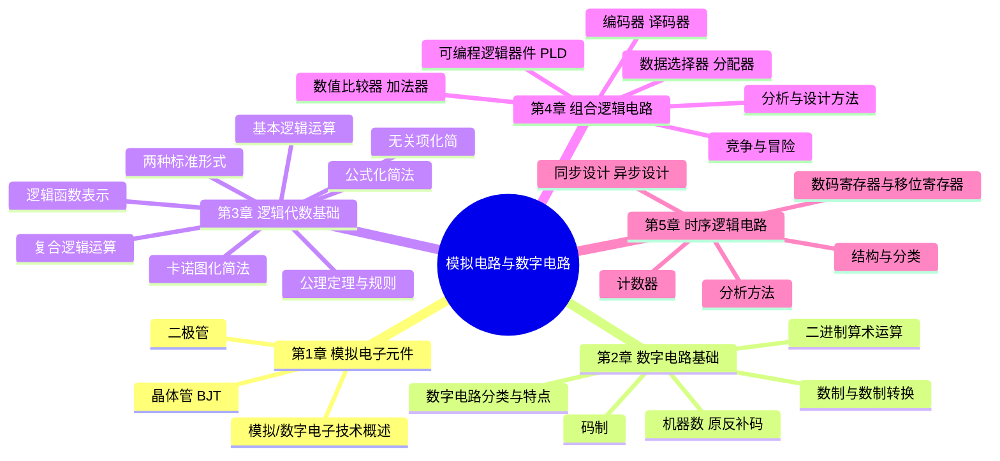
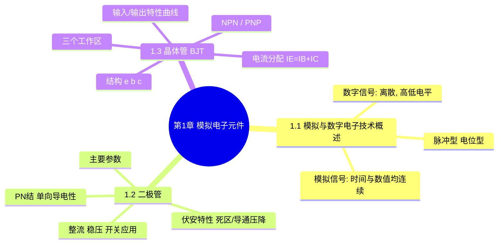
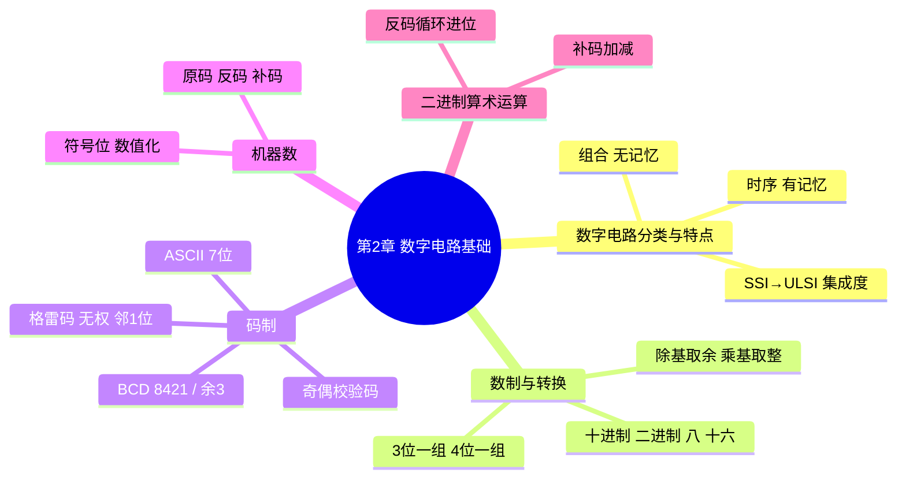
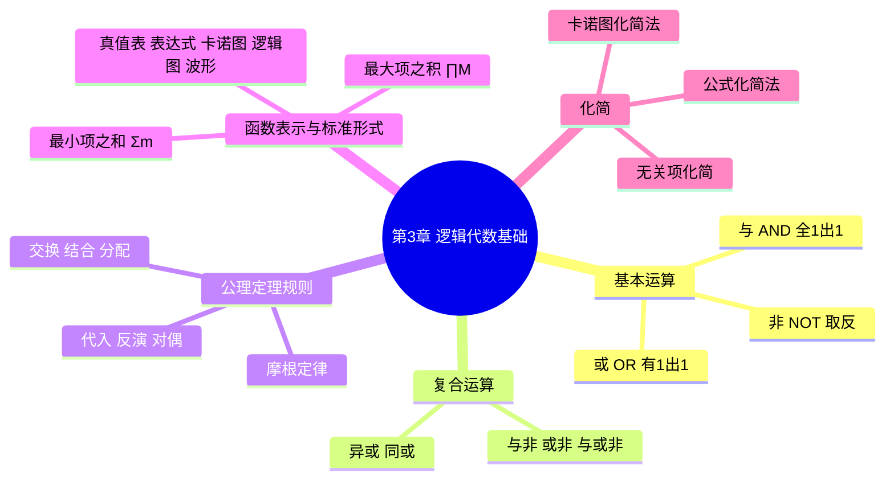
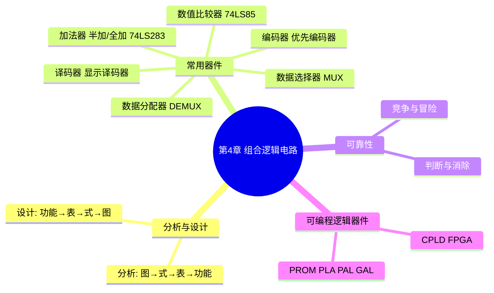

# 《模拟电路与数字电路》全书知识点讲解（日常学习）

> 教材：高明 主编《模拟电路与数字电路》（人民邮电出版社）。本册按上课 PDF 的章节顺序整理，
> 覆盖 **第 1～5 章** 共 31 个知识点，配思维导图、核心结论、易错提醒与必背清单，供日常复习。
> 各知识点的**逐篇图文讲解**见对应章节文件夹内的 `N.M_知识点.md`。

## 课程总览

**三句话主线**：① 模拟器件（二极管/三极管）是数字门电路的物理基础；② 逻辑代数（布尔代数）是分析/化简数字电路的数学工具；③ 组合电路"无记忆"、时序电路"有记忆"，二者构成数字系统全部逻辑。

---

## 第1章 模拟电子元件与分立电子元件

### 思维导图

### 核心知识点

- **模拟信号**时间、数值都连续；**数字信号**取值离散，分**脉冲型**与**电位型**两类。模拟电子技术（放大、滤波、调制、解调、模数转换）是数字系统的前端。
- **PN 结**：P 型 + N 型半导体接触，扩散与漂移动态平衡形成耗尽层，具有**单向导电性**。N 型多子为电子，P 型多子为空穴；**多子看掺杂、少子看温度**。
- **二极管**：正偏导通、反偏截止。硅管死区 **0.5 V**、导通压降 **0.7 V**；锗管 **0.2 V / 0.3 V**。四大参数：$I_{FM}$、$U_{RM}$（≈击穿电压一半）、$I_{RM}$、$f_M$。**稳压管反向击穿区**工作且必串限流电阻；电击穿可逆、热击穿不可逆。
- **三极管 BJT**：两个 PN 结、三个区、三个电极（e/b/c），分 NPN/PNP。**放大条件**：发射结正偏、集电结反偏。**电流关系** $I_E=I_B+I_C$，$I_C=\beta I_B$（放大区）。NPN 电位 $U_C>U_B>U_E$，PNP 相反。
- **三个工作区**：截止（$I_B=0$，开关断开）、放大（线性放大）、饱和（$U_{CE}\approx0$，开关闭合）。

### 易错提醒与必背清单

- 电压数字要记准：死区硅 0.5 V / 锗 0.2 V，导通硅 0.7 V / 锗 0.3 V。
- **饱和区 $I_C=\beta I_B$ 失效**——先假设放大区算 $U_{CE}$，若 $U_{CE}\leq0.7$ V 则其实已饱和。
- 电位判型：找 ≈0.7 V（硅）压差定 b、e，$U_C$ 最高为 NPN、最低为 PNP。
- $I_{CEO}=(1+\beta)I_{CBO}$；开关电路**严禁停在放大区**。

---

## 第2章 数字电路基础

### 思维导图

### 核心知识点

- **数制**：通用展开式 $S=\sum a_i N^i$，关键是**基数 $N$** 与**位权 $N^i$**。十进制→非十进制：**整数除基取余（逆序）、小数乘基取整（顺序）**。
- **分组**：二进制↔八进制 **3 位一组**；二进制↔十六进制 **4 位一组**（不足补零：整数补高位、小数补低位）。
- **BCD 码**：4 位二进制表 1 位十进制；**8421** 有权最常用，**余3码 = 8421 + 3**（无权、对 9 自补）。**格雷码**无权、相邻仅变 1 位。**奇偶校验**加 1 位校验位，只能检单比特错、不能纠错。**ASCII** 7 位、128 字符。
- **机器数**：最高位为符号位（0 正 1 负）。**原码** = 符号 + 数值（有 ±0）；**反码**（负数数值取反，有 ±0）；**补码**（负数 = 反码 + 1，**零唯一**）。
- **补码运算**：$[X\pm Y]_补=[X]_补\pm[Y]_补$，符号位参与、**进位舍弃**、负结果再求补还原。**反码**运算进位需**循环加回末位**。原码不能直接相加。

### 易错提醒与必背清单

- 补码表示范围比原码多一个数（零唯一）；负数求补**符号位不参与取反**。
- 字长 $n$ 必须明确，模数 $M=2^n$；补码转原码 = 对补码再求一次补。
- 为什么用补码？**零唯一 + 把减法统一为加法**，硬件只需一个加法器。

---

## 第3章 逻辑代数基础

### 思维导图

### 核心知识点

- **三种基本运算**：与（全 1 出 1）、或（有 1 出 1）、非（取反）。**复合运算**：与非（全 1 出 0）、或非（全 0 出 1）、与或非、异或（相异为 1）、同或（相同为 1）。
- **五大表示方法**：真值表、逻辑函数式、卡诺图、逻辑图、波形图，可互相转换。分析方法"图→式→表"，设计方法"表→式→图"。
- **标准形式**：**最小项之和 $\sum m$**（标准与或式）与**最大项之积 $\prod M$**（标准或与式）。最小项"原变量=1"，最大项"原变量=0"，编号互补。
- **核心定理——摩根定律**：$\overline{A+B}=\bar A\bar B$，$\overline{AB}=\bar A+\bar B$。**常用公式**：$A+AB=A$（吸收）、$A+\bar AB=A+B$（消去）、$AB+\bar AC+BC=AB+\bar AC$（冗余消去）、$A+BC=(A+B)(A+C)$（第二分配律）。
- **化简目标**：最简与或式 = **与项数最少、每项变量最少**。**公式法**不受变量数限制但依赖技巧；**卡诺图法**直观规律，适用于 ≤6 变量。
- **卡诺图要诀**：行列按**格雷码 00,01,11,10** 排列；圈矩形、$2^n$ 个格、尽量大尽量少、**每圈有新 1**；注意**循环相邻**（两端、四角）；**无关项**有利才圈。

### 易错提醒与必背清单

- **对偶 ≠ 反演**：对偶变量不取反，反演变量要取反——最高频错误。
- 卡诺图漏圈循环相邻、圈出 L 形/十字形、留下冗余圈是最常见的失分点。
- 圈 0 法取反后要摩根展开（$\bar L= B\bar C\bar D \Rightarrow L=\bar B+C+D$）。
- 最小项必含全部 $n$ 个变量；补项只能乘 $(X+\bar X)$。

---

## 第4章 组合逻辑电路

### 思维导图

### 核心知识点

- **组合电路**：输出仅取决于当前输入，**无反馈、无记忆**。**分析四步**：写表达式 → 化简 → 列真值表 → 定功能；**设计五步**：抽象 → 真值表 → 表达式 → 化简/变换 → 画图。
- **编码器**：$2^n$ 输入 → $n$ 输出；**优先编码器**（74LS148）按优先级编码，高位屏蔽低位。
- **译码器**：$n$ 输入 → $2^n$ 输出，$\bar Y_i=\overline{m_i}$（**低电平有效**）。74LS138 一片 + 一个与非门可实现**任意三变量函数**（最小项之和）；级联可扩展 4 线-16 线。
- **数据选择器 MUX**：$F=\sum m_i D_i$，是"逻辑函数发生器"。实现函数四步：最小项展开 → 使能 → 变量接地址 → $D_i$ 赋 **0/1/变量**。**数据分配器 DEMUX** 是其逆过程。
- **数值比较器**：一位 $F_{A>B}=A\bar B$，$F_{A<B}=\bar AB$，$F_{A=B}=\overline{A\oplus B}$；多位**高位优先**。74LS85 级联扩位，基准片接 $I_{A=B}=1$、其余置 0。
- **加法器**：半加器 $S=A\oplus B,\ C=AB$；全加器 $S_i=A_i\oplus B_i\oplus C_{i-1},\ C_i=A_iB_i+(A_i\oplus B_i)C_{i-1}$。串行进位延迟 $\approx n\,t_{pd}$；**超前进位**（74LS283）用 $G_i=A_iB_i$、$P_i=A_i\oplus B_i$ 展开并行产生进位。**减法 = 加补码**（取反 + CI=1）。
- **竞争与冒险**：竞争是信号到达有先后，冒险是输出出现**尖峰毛刺**。判断：$Y=A+\bar A$→"0"型（负尖峰），$Y=A\bar A$→"1"型（正尖峰）；卡诺图两圈**相切且未覆盖**。消除：① 消互补变量；② **加冗余项**；③ 滤波（并电容）；④ 选通。
- **PLD**：基本结构 = 输入缓冲 + **与阵列 + 或阵列** + 输出电路。**PROM**（或可编程）→ **PLA**（都可编程）→ **PAL**（与可编程、或固定）→ **GAL**（+ 可组态 OLMC）。**CPLD** 乘积项结构 + E²PROM/Flash，掉电不丢；**FPGA** = CLB + IOB + PI，主流 **LUT（SRAM）结构**，$M$ 输入需 $2^M$ 位，掉电重配。

### 易错提醒与必背清单

- 译码器输出是**低有效**，实现最小项之和要用**与非门**（不是或门）。
- 多位比较**从最高位开始**；级联输入基准电平易漏接。
- 串行进位是"与位数相关的 $n\,t_{pd}$"，两片 283 级联是"片内并行、片间串行"。
- 与阵列/或阵列可编程的归属（PROM/PLA/PAL/GAL）极易混，需重点记忆。

---

## 第5章 时序逻辑电路

### 思维导图

### 核心知识点

- **时序电路**：输出与**原来状态**有关，必含**存储单元（触发器）与反馈回路**。分**同步**（共用同一 CP）与**异步**；按输出分 **Mealy 型**（输出与输入、状态有关）与 **Moore 型**（输出仅与状态有关）。
- **分析六步法**：逻辑图 → 时钟方程（异步必写）→ 输出方程 → 驱动方程 → 状态方程 → 状态表/图 → 功能说明。
- **同步设计八步法**：逻辑抽象 → 原始状态图/表 → 状态化简 → 状态编码 → 选触发器 → 求激励/输出函数 → 画逻辑图 → **检查自启动**。
- **触发器特性方程**：**JK**：$Q^{n+1}=J\bar Q^n+\bar K Q^n$；**D**：$Q^{n+1}=D$；T：翻转。
- **计数器**：$N$ 进制计数器实现 **N 分频**，$f_{out}=f_{CP}/N$。74161 功能 = 异步清零、同步置数、保持、计数。构成任意进制：**清零法**（异步清零译码 M，同步清零译码 M−1）、**预置数法**（同步预置译码 **M−1** 或 **N+M−1**）、**级联法**。
- **寄存器**：数码寄存器仅存储；**移位寄存器** 74LS194 模式控制 $S_1S_0$ = **11 置数、01 右移、10 左移、00 保持**。**环形**计数器模为 $N$，**扭环形**模为 $2N$。

### 易错提醒与必背清单

- 异步清零"立刻清"、同步清零/置数"等下一个 CP 沿"——译码状态差 1，务必分清。
- 74161 计数需 **ENP 与 ENT 同时置 1**。
- 状态图箭头**起点是现态、终点是次态**；必须检查**无效状态能否回到有效循环（自启动）**。
- 环形/扭环形计数器**初态必须预设**（全 0 或全 1 会死锁）。

---

## 附录：全书必背速查

| 项目 | 必背结论 |
|---|---|
| 二极管压降 | 硅 0.7 V（死区 0.5 V）/ 锗 0.3 V（死区 0.2 V） |
| 三极管放大条件 | 发射结正偏、集电结反偏；$I_C=\beta I_B$ |
| 数制转换 | 整数除基取余逆序、小数乘基取整顺序；3 位/4 位分组 |
| 码制 | 8421（有权）、余3（无权自补）、格雷码（邻 1 位）、ASCII（7 位） |
| 机器数 | 补码零唯一；$[X\pm Y]_补=[X]_补\pm[Y]_补$，进位舍弃 |
| 摩根定律 | $\overline{A+B}=\bar A\bar B$，$\overline{AB}=\bar A+\bar B$ |
| 化简目标 | 与项最少 + 每项变量最少；卡诺图格雷码排列、循环相邻、每圈有新 1 |
| 半加/全加 | $S=A\oplus B,C=AB$；$S_i=A_i\oplus B_i\oplus C_{i-1}$ |
| 译码器 | $\bar Y_i=\overline{m_i}$ 低有效；与非门实现最小项之和 |
| 数据选择器 | $F=\sum m_iD_i$；地址选变量、数据端填 0/1/变量 |
| 竞争冒险 | $A+\bar A$→0型、$A\bar A$→1型；加冗余项消除 |
| 时序三方程 | 输出方程、驱动方程、状态方程 |
| 触发器 | JK：$Q^{n+1}=J\bar Q^n+\bar KQ^n$；D：$Q^{n+1}=D$ |
| 计数器 | N 进制→N 分频；74161 异步清零、同步置数 |
| 移位寄存器 | 74194：11 置数 / 01 右移 / 10 左移 / 00 保持 |
