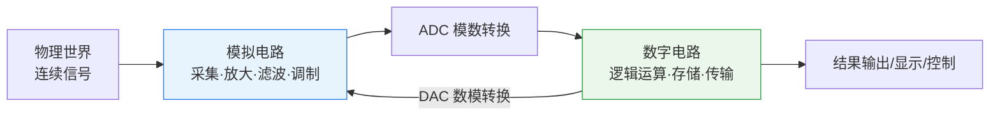

# 1.1 模拟电子技术与数字电子技术概述

## 一、是什么（概念与定位）

- **模拟信号**：信息参数在时间和数值上均**连续**变化的信号，可精确还原温度、声音、电压等物理量的平滑变化。
- **数字信号**：呈现数字量的**离散**信号，通常在两种稳定电平（高/低）之间跳变，分为**脉冲型**与**电位型**两类。
- 本课程（数字电路与逻辑）研究的是以数字信号为载体的电路；而模拟电子技术（二极管、三极管等分立元件）是其**前端基础**——真实世界的信号先经模拟电路采集、放大、调理，再经模数转换进入数字系统处理。

## 二、原理与特性

### 1. 模拟电子技术核心认知（PPT 第 6~9 页）

- 通过半导体器件实现信号的**放大、滤波、调制、解调、模数转换**五大功能。
- 核心特点：连续性（自然还原）、基础性（数字电路前端）、器件依赖性（以二极管、三极管、场效应管为核心）。
- 典型功能电路：放大电路、运算放大器、滤波器、整流电路、稳压模块。

### 2. 数字电子技术核心认知（PPT 第 10~13 页）

- 数字信号两种形式：
  - **脉冲型**：短暂突变、有明显上升/下降沿，用于数据快速传输与时钟同步；
  - **电位型**：以稳定电平表示信息，高电平=逻辑 1，低电平=逻辑 0，是最常用的信号形式。
- 数字电路三大特点：**抗干扰性强**（只识别高/低两种稳态）、**逻辑运算能力**（逻辑门实现布尔代数运算）、**模块化与可编程**（如 FPGA）。
- 数字电路分类：

| 类别 | 功能特性 | 典型器件 |
| --- | --- | --- |
| 组合逻辑电路 | 输出仅由当前输入决定，**无记忆** | 编码器、译码器、多路选择器、加法器 |
| 时序逻辑电路 | 输出还依赖历史状态，**有记忆**，随时钟同步 | D/JK 触发器、移位寄存器、计数器 |
| 存储元件系统 | 数据缓存与长期存储 | 锁存器、SRAM、ROM、Flash |

### 3. 模拟与数字信号对比

| 对比维度 | 模拟信号 | 数字信号 |
| --- | --- | --- |
| 取值 | 时间/数值均连续 | 离散，仅高/低电平两种稳态 |
| 抗干扰性 | 弱，噪声直接叠加在波形上 | 强，噪声只要不越过判决门限即可滤除 |
| 处理方式 | 放大、滤波、调制 | 逻辑运算、存储、编码 |
| 与物理世界的联系 | 直接对应物理量 | 需经 ADC/DAC 与模拟世界衔接 |
| 典型应用 | 音频功放、电源稳压、射频、传感器调理 | 计算机、通信、人工智能、FPGA |

## 三、符号与图形（图文并茂）

本节以概念性内容为主，PPT 原图多为装饰性配图（无贴切的电路图/波形图），故不嵌入现成图，用上面的 Mermaid 系统框图表达"模拟—数字"的技术链条定位。

## 四、典型例题/应用

**例题**：手机通话链路中，请指出下列环节各属于模拟还是数字技术处理：
① 麦克风拾取声波并输出音频电压；② 音频电压经 ADC 编码为比特流；③ 比特流经基带芯片逻辑运算与信道编码；④ 扬声器把驱动电流还原为声波。

**分析**：①④ 处理连续物理量，属于模拟环节；②③ 处理离散电平/比特流，属于数字环节。

**解答**：① 模拟（声→电的连续信号采集与调理）；② 数字（模数转换是"桥梁"）；③ 数字（逻辑运算与编码）；④ 模拟（电→声的连续信号还原）。

**启示**：真实电子系统都是"模拟前端 + 数字核心"的混合架构，这正是本章先学二极管、三极管再进入数字逻辑的原因。

## 五、易错点

1. **混淆"连续"的对象**：模拟信号的连续指时间和**数值**都连续；数字信号并非"时间不连续"（时间采样仍可为等间隔），关键是**取值离散化**为有限电平。
2. **认为数字信号"由模拟信号转换而来"就比模拟信号低级**：恰相反，数字化的目的正是规避衰减与干扰、提升传输精度与效率。
3. **把组合/时序电路的界限记反**：判断标准是**有无记忆（是否依赖历史状态）**，有记忆的是时序电路，不是组合电路。
4. **误以为电位型与脉冲型是两种不同电平数**：两者区别在信号**存在形式**（持续电平 vs 短暂突变），而非电平个数。

## 六、知识点总结

1. 模拟信号连续、数字信号离散（高低电平）；数字技术通过"模拟转数字"实现抗干扰与高效率。
2. 模拟电子技术五大功能：放大、滤波、调制、解调、模数转换，是数字系统的前端基础。
3. 数字信号两种形式：脉冲型（边沿/同步）与电位型（高=1、低=0）。
4. 数字电路三分支：组合逻辑（无记忆）、时序逻辑（有记忆）、存储系统。
5. 本课程定位：第 1 章的二极管/三极管是后续逻辑门电路的物理基础。
