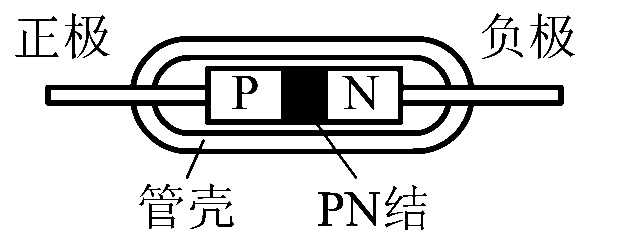
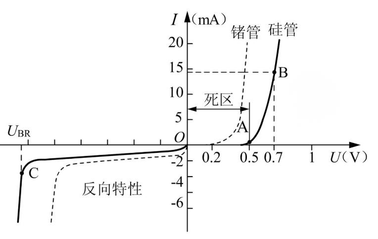
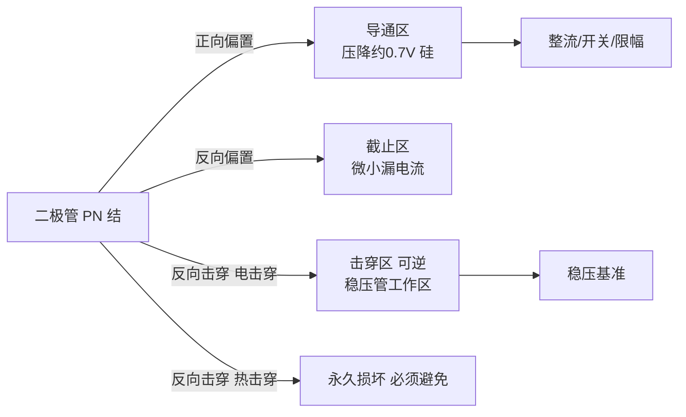

# 1.2 二极管（Diode）

## 一、是什么（概念与定位）

二极管是由 P 型与 N 型半导体结合形成的 **PN 结**构成的二端电子器件，是电路中最基础的**非线性元件**。其核心特性是**单向导电性**——正向导通、反向截止，如同电路中的"单向阀门"，广泛应用于整流、稳压、开关及信号处理场景。文字符号记作 **D**（或 V/DV），在电路中是整流电源、逻辑门输入保护等电路的基本"积木"。

## 二、原理与特性

### 1. 半导体基础（PPT 第 15~18 页）

- 半导体导电能力介于导体与绝缘体之间（电导率约 10⁻⁹～10² S/cm），硅、锗是典型材料。
- 三大特性：**光敏性**（光照激发载流子）、**热敏性**（温度升高载流子增多）、**掺杂性**（掺微量杂质导电能力提升百万倍，是最关键技术）。
- **N 型半导体**：掺五价元素（磷、砷、锑），多子为自由电子，少子为空穴。
- **P 型半导体**：掺三价元素（硼），多子为空穴，少子为自由电子。
- 多子由**掺杂**决定（主导扩散电流），少子由**温度**决定（形成漂移电流）；整体仍保持**电中性**。

### 2. PN 结的形成（PPT 第 19~21 页）

1. **扩散运动**：P 区空穴与 N 区电子因浓度差相互扩散；
2. **空间电荷区**：交界面留下不可移动的正负杂质离子，形成"耗尽层"；
3. **内电场**：方向由 N 区指向 P 区，阻碍扩散、推动少子漂移；
4. **动态平衡**：扩散速率 = 漂移速率，耗尽层宽度稳定，PN 结形成。

> 结论：PN 结的本质是**扩散与漂移的动态平衡**，势垒特性决定了单向导电性。

### 3. 单向导电性与伏安特性（PPT 第 22~24 页）

- **正偏**（P 接高电位）：削弱内电场、耗尽层变窄 → 低阻导通，电流随电压迅速上升。
- **反偏**（N 接高电位）：内电场增强 → 高阻截止，仅有极小的反向漏电流。
- **死区电压**：正向电压低于死区时电流几乎为零——**硅管约 0.5 V，锗管约 0.2 V**；导通后硅管压降约 0.7 V，锗管约 0.3 V。
- **反向击穿**（PPT 第 25 页）：反向电压达临界值时反向电流剧增。
  - **电击穿（雪崩击穿）**：强电场加速少子碰撞电离，**可逆**、非破坏性——稳压二极管的工作原理；
  - **热击穿（齐纳击穿）**：强电场破坏共价键且功耗剧增，**不可逆**，必须规避。

### 4. 主要参数（PPT 第 26 页）

| 参数 | 符号 | 含义 |
| --- | --- | --- |
| 最大正向电流 | I_FM | 长期安全工作的电流上限，超限过热损坏 |
| 最高反向工作电压 | U_RM | 防击穿的反向电压上限（通常取击穿电压的一半） |
| 最大反向电流 | I_RM | 反向漏电流，越小单向导电性越好 |
| 最高工作频率 | f_M | 超过后结电容效应加剧，单向导电性变差 |

### 5. 两种分析模型（PPT 第 27 页）

- **理想模型**（电源电压 ≫ 管压降时）：导通=短路（压降 0），截止=开路（电流 0）。
- **恒压降模型**（近似特性模型，定量计算常用）：导通时压降恒为 U_D（硅管 0.7 V），截止时电流为 0。

### 6. 特殊二极管（PPT 第 30~34 页）

- **稳压二极管**：工作在**反向击穿区**（可逆电击穿），反向电压几乎不随电流变化 → 稳压；必须**反向接入**且**串限流电阻**，电源电压须大于稳压值 U_Z；均为硅管，U_Z ≥ 3 V。参数：稳定电压 U_Z、稳定电流 I_Z、最大稳定电流 I_ZM、最大耗散功率 P_ZM。
- **发光二极管 LED**：正偏导通时电子空穴复合释放光能；发光颜色由材料能带间隙决定（GaP 绿/红、GaAs 红外、GaN 蓝光）；长引脚为阳极。
- **其他**：光电二极管（光生伏特效应，光→电）、变容二极管（结电容随反偏电压变化，用于调谐）、开关二极管（高速通断，数字/脉冲电路用）。

## 三、符号与图形（图文并茂）

二极管结构：核心是一个 PN 结，P 区引出**正极（阳极）**，N 区引出**负极（阴极）**，外加管壳封装。符号中**箭头指向即正向电流方向**（从阳极流向阴极）。

伏安特性曲线：正向区存在死区（锗 0.2 V / 硅 0.5 V），导通后电流陡增；反向区仅有微小饱和漏电流，达到 U_BR 后击穿。

用 Mermaid 概括其工作区与用途：

## 四、典型例题/应用

**例题**：硅二极管与 1 kΩ 电阻串联后接 5 V 直流电源（二极管正接）。用恒压降模型求电路电流与电阻上电压。

**思路**：电源电压 5 V 远大于 0.7 V，二极管正偏导通，采用恒压降模型 U_D = 0.7 V。

**解答**：
- 电阻电压 U_R = 5 − 0.7 = 4.3 V；
- 电流 I = U_R / R = 4.3 / 1000 = **4.3 mA**。
- 若用理想模型，则 I = 5 / 1000 = 5 mA，误差约 14%，说明电源电压与 U_D 接近时必须用恒压降模型。

**应用场景**：单相半波整流——利用二极管反向截止，把交流电的负半周"削掉"，输出脉动直流，是各类电源适配器的基础。

## 五、易错点

1. **死区电压与导通压降混淆**：死区是"开始导通的门槛"（硅 0.5 V），导通后正常压降约 0.7 V，两者数值不同。
2. **认为反向击穿=损坏**：只有**热击穿**不可逆；稳压管恰恰长期工作在（可逆的）反向电击穿区，前提是加限流电阻控制电流。
3. **稳压管正接使用**：稳压管必须**反向**接入电路才起稳压作用，正接时它只是普通导通二极管（压降 0.6~0.7 V）。
4. **漏掉限流电阻**：稳压电路中限流电阻既是稳压管的安全保障，也参与分压，缺它会导致 I_ZM 超限烧管。

## 六、知识点总结

1. PN 结 = P 型 + N 型半导体接触，扩散与漂移动态平衡形成耗尽层，具有单向导电性。
2. N 型多子是电子、P 型多子是空穴；多子看掺杂、少子看温度。
3. 正偏导通、反偏截止；硅管死区 0.5 V、导通 0.7 V，锗管 0.2 V / 0.3 V。
4. 四大参数：I_FM（电流上限）、U_RM（反向耐压，约为击穿电压一半）、I_RM（越小越好）、f_M（结电容限制）。
5. 稳压管反向击穿区工作且必串限流电阻；LED 正偏发光、长脚为正极。
