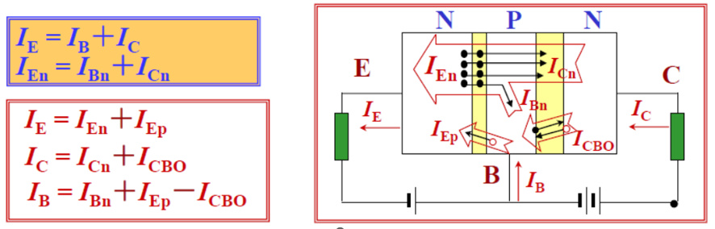
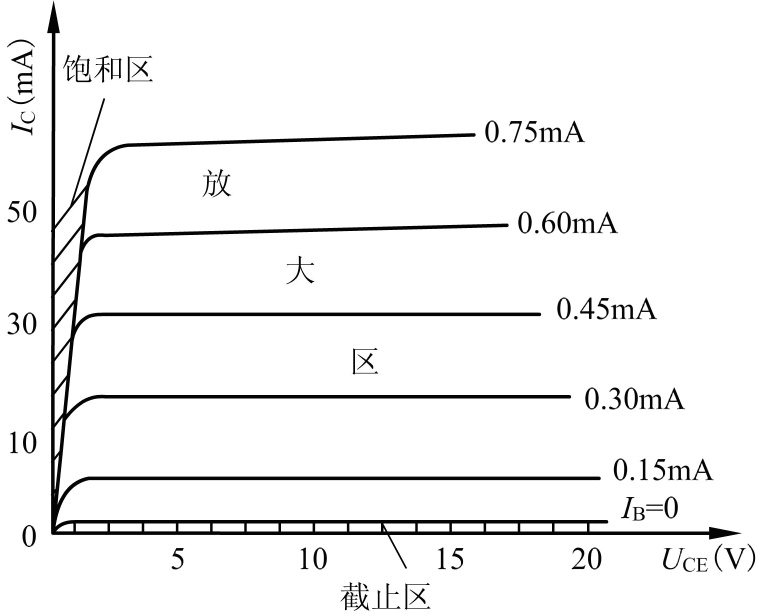
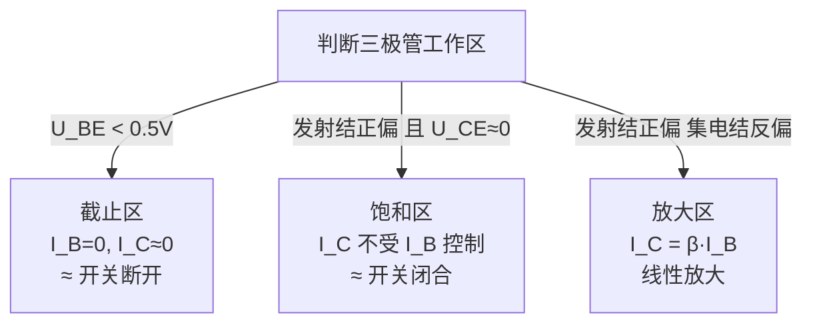

# 1.3 晶体管（三极管 BJT）

## 一、是什么（概念与定位）

半导体三极管（双极型晶体管，BJT）是**控制电流**的半导体器件，能把微弱信号放大成幅度较大的电信号，也可作**无触点开关**——它是模拟电路的"放大引擎"，也是数字逻辑门的核心开关元件。按结构分 **NPN 型**与 **PNP 型**（电流流向与电压极性相反），电路符号代号为 **Q**（部分场景用 VT）。三极管有发射极 e、基极 b、集电极 c 三个电极，选其一作公共端即得**共射（CE）、共集（CC）、共基（CB）**三种组态。

## 二、原理与特性

### 1. 结构（PPT 第 36~37 页）

- 在极薄的硅/锗基片上制作**两个 PN 结**，形成三个区：发射区、基区、集电区。
- 两个结：**发射结**（发射区—基区，工作时通常正偏）、**集电结**（集电区—基区，工作时通常反偏）。
- 结构特点：**高浓度发射区、薄且低掺杂的基区、大面积集电结**——这一不对称性是放大能力的前提。
- NPN 型 = 两块 N 夹一块 P（应用最广、开关速度快）；PNP 型 = 两块 P 夹一块 N（电流方向相反）。

### 2. 放大原理（PPT 第 38、40 页）

放大的外部条件（核心前提）：**发射结正偏、集电结反偏**（NPN 与 PNP 仅外加电压极性相反）。

- 发射区（"源头"）向基区发射大量载流子；
- 基区（"控制阀门"）薄且掺杂少，绝大多数载流子越过基区进入集电区，仅少量复合形成 I_B；
- 集电区（"收集器"）在反偏强电场下收集载流子形成 I_C。

本质：用微小电流 **I_B 控制**较大电流 **I_C**，实现"以小控大"。

**电流分配关系**（PPT 第 41 页）：

$$I_E = I_B + I_C,\qquad I_C = h_{FE} \cdot I_B \approx \beta I_B,\qquad I_E \approx I_C$$

- 直流放大系数：$h_{FE} = I_C / I_B$；
- 交流放大系数：$\beta = \Delta I_C / \Delta I_B$；
- 工程近似：两者数值接近，估算时取 β = h_FE。

**电位规律**（判断管型/工作状态常用）：
- NPN 型：$U_C > U_B > U_E$（集电极最高、发射极最低）；
- PNP 型：$U_C < U_B < U_E$（与 NPN 完全相反）。

### 3. 输入特性曲线（PPT 第 42~43 页）

以**共发射极接法**为分析基准（输入回路 b-e，输出回路 c-e）。

输入特性：$U_{CE}$ 一定时，$U_{BE}$ 与 $I_B$ 的关系曲线——形状与二极管正向特性相似，存在死区：

| 材料 | 死区电压 | 导通电压（正常放大压降） |
| --- | --- | --- |
| 硅管 | 约 0.5 V | 约 0.7 V |
| 锗管 | 约 0.2 V | 约 0.3 V |

记忆口诀："硅管 0.5 死区 0.7 通，锗管 0.2 死区 0.3 通"；估算基准用硅管 0.7 V。

### 4. 输出特性曲线与三个工作区（PPT 第 44~45 页）

输出特性：$I_B$ 一定时，$I_C$ 与 $U_{CE}$ 的关系曲线（一族曲线）。

| 工作区 | 条件 | 特征 | 开关等效 |
| --- | --- | --- | --- |
| 截止区 | 发射结反偏或零偏，I_B = 0 | I_C ≈ 0，c-e 间近似开路 | 开关**断开** |
| 放大区 | 发射结正偏、集电结反偏 | **I_C = β·I_B**，线性受控，曲线平坦 | 禁止（作开关时） |
| 饱和区 | 发射结、集电结均正偏 | U_CE ≈ 0，I_C 不再随 I_B 增大 | 开关**闭合** |

### 5. 主要参数（PPT 第 46 页）

- **电流放大系数**：β（动态）、h_FE（静态），衡量放大能力。
- **极间反向电流**：I_CBO（集基反向漏电流）；**I_CEO = (1+β)·I_CBO**（穿透电流），越小温度稳定性越好。
- **极限参数（安全红线）**：I_CM（最大允许集电极电流）、P_CM（最大耗散功率）、U_(BR)CEO（c-e 反向击穿电压），严禁超限。

### 6. 开关特性（PPT 第 47~49 页）

数字电路中三极管只在**截止**与**饱和**两态间切换：

- 截止：U_BE < 0.5 V，I_B = 0，输出**高电平**；
- 饱和：U_BE ≥ 0.7 V 且 U_CE < 0.7 V，c-e 等效短路，输出**低电平**。

状态转换需要时间：开通时间 **t_on = t_d + t_r**（延迟+上升），关闭时间 **t_off = t_s + t_f**（存储+下降）——开关时间是制约工作频率的核心因素。注意：输入低电平输出高电平、输入高电平输出低电平，开关电路输出与输入**反相**（这正是"非门"的雏形）。

## 三、符号与图形（图文并茂）

NPN 与 PNP 符号的区别在发射极箭头方向：NPN 箭头**向外**（电流 e→c 方向为 c→e 流出），PNP 箭头**向内**。

三极管内部载流子传输与电流分配（发射区注入 → 基区复合与输运 → 集电区收集，I_E = I_B + I_C）：

共射输出特性曲线（一族 I_B 对应的 I_C–U_CE 曲线，划分为截止区、放大区、饱和区）：

用 Mermaid 概括三种工作区的判据与开关等效：

## 四、典型例题/应用

**例题**：硅 NPN 管构成共射电路，U_CC = 12 V，R_C = 2 kΩ，基极回路使 I_B = 40 μA，β = 100。① 判断管子工作状态；② 求 I_C、U_CE。

**思路**：先按放大区假设求 I_C，再核算 U_CE 是否足够大（U_CE > 0.7 V 且未到饱和临界）。

**解答**：
1. 假设放大区：I_C = β·I_B = 100 × 40 μA = **4 mA**；
2. U_CE = U_CC − I_C·R_C = 12 − 4 × 2 = **4 V**；
3. 检验：U_CE = 4 V > 0.7 V，发射结正偏、集电结反偏成立，管子确实工作在**放大区**，假设成立。

（若算出 U_CE ≤ 0.7 V，则说明管子已饱和，I_C 应由外电路 U_CC/R_C 决定，而非 β·I_B。）

**应用场景**：三极管开关电路驱动继电器/LED——输入高电平（>3 V）使管子饱和导通（相当于闭合开关），输入低电平（<0.5 V）使管子截止（相当于断开开关），用小电流基极信号控制大电流负载。

## 五、易错点

1. **饱和区误用 I_C = β·I_B**：饱和时该关系失效，I_C 由外电路（U_CC − U_CES）/R_C 决定；判断工作区必须验算 U_CE。
2. **发射结/集电结偏置记反**：放大条件是"发射结**正**偏、集电结**反**偏"；饱和则两结均正偏。
3. **NPN 与 PNP 电位关系混淆**：NPN 为 U_C > U_B > U_E，PNP 完全相反；判类型可看"箭头"（e 极箭头指向外为 NPN）。
4. **h_FE 与 β 混淆**：一个是直流比值、一个是变化量比值，估算中才可互相替代；另外 ICEO = (1+β)·I_CBO，放大系数越大穿透电流越大，并非 β 越大温度稳定性越好。

## 六、知识点总结

1. 三极管 = 两个 PN 结（发射结、集电结）+ 三个区（发射区、基区、集电区），代号 Q，分 NPN/PNP。
2. 放大条件：发射结正偏、集电结反偏；本质是以 I_B 小电流控制 I_C 大电流。
3. 电流关系：I_E = I_B + I_C，I_C = β·I_B（放大区成立）；NPN 电位 U_C>U_B>U_E，PNP 相反。
4. 输入特性同二极管正向特性（硅死区 0.5 V、导通 0.7 V）；输出特性分截止、放大、饱和三区。
5. 开关应用：截止≈断开（输出高）、饱和≈闭合（输出低）；开关时间 t_on/t_off 限制最高工作频率。
