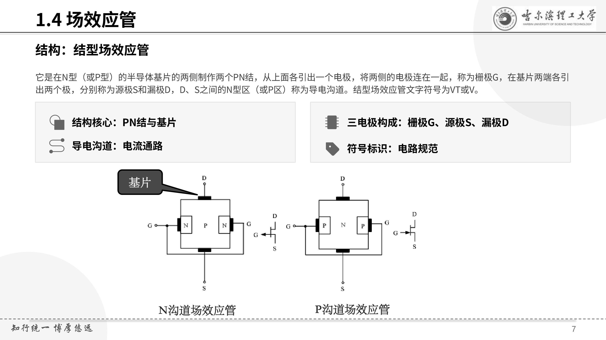
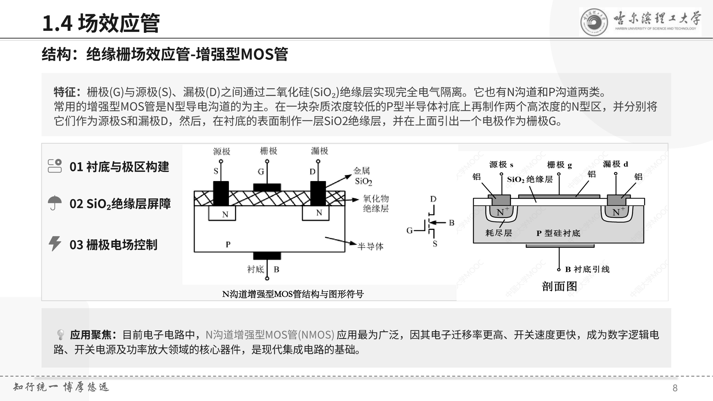
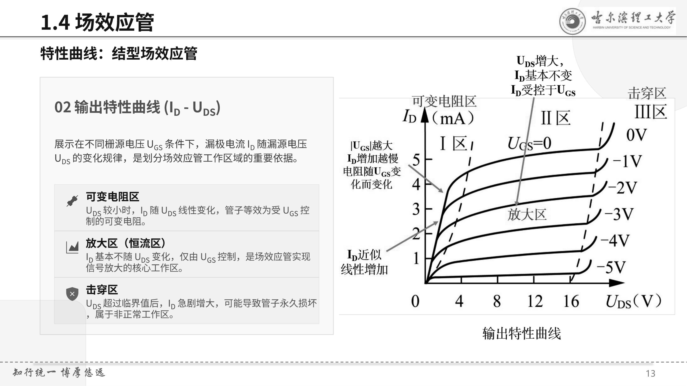
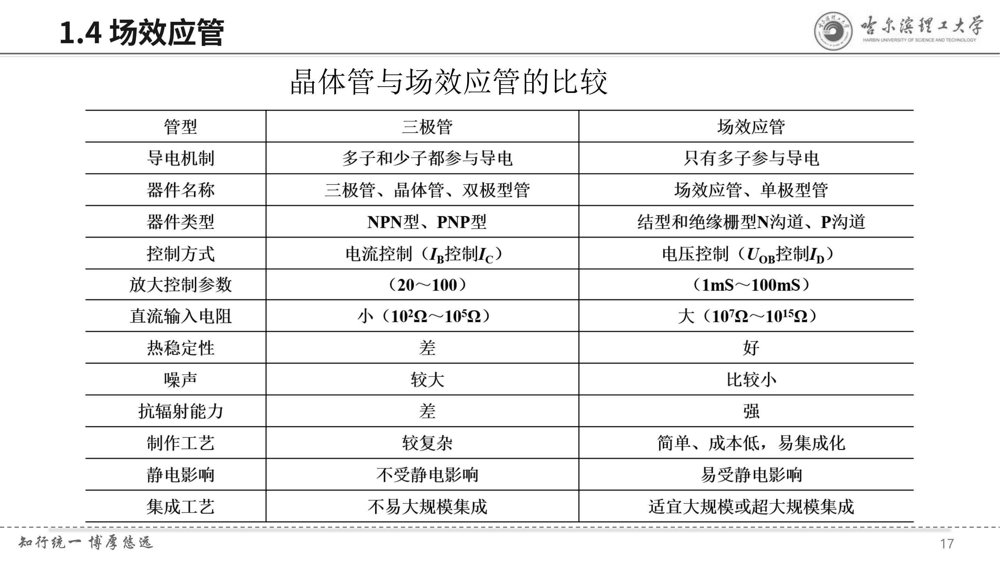

# 1.4 场效应管（FET）

## 一、是什么（概念与定位）

场效应晶体管（Field Effect Transistor，FET）是**电压控制电流**的半导体器件：利用输入回路中栅极—源极之间的电场效应，去控制输出回路漏极电流的大小。它与三极管（BJT）同属"放大元件"，但控制方式从"电流控电流"变成"电压控电流"，因此**输入电阻极高（10⁷~10¹⁵ Ω）、几乎不取信号电流、噪声低**，是模拟电路放大核心与数字电路 MOS 集成电路的基本单元。

按结构分两大类：

| 大类 | 细分 | 导电沟道 | 说明 |
| --- | --- | --- | --- |
| 结型（JFET） | N 沟道 / P 沟道 | 天生存在 | 内部有两个 PN 结，属**耗尽型**器件 |
| 绝缘栅型（MOSFET） | 增强型 N/P 沟道 | 需栅压"感应"生成 | 无原始沟道，必须 U_GS 超过开启电压才导通 |
|  | 耗尽型 N/P 沟道 | 天生存在 | 零栅压下即可导通，可正可负偏置 |

> 记忆线索：**结型=耗尽型**；MOS 管才分"增强/耗尽"，靠"有没有天生沟道"区分。

## 二、原理与特性

### 1. 结构（PPT 第 7~9 页）

- **结型场效应管**：在 N 型（或 P 型）基片两侧各做一个 PN 结，两侧电极连在一起引出**栅极 G**；基片两端引出**源极 S** 与**漏极 D**，D、S 之间的 N 型区即**导电沟道**。文字符号记作 VT 或 V。
- **增强型 MOS 管**：栅极 G 与 S、D 之间隔一层二氧化硅（SiO₂）绝缘层，完全电气隔离（故又称 IGFET）；在低掺杂 P 型衬底上做两个高浓度 N⁺ 区作 S、D，**没有原始沟道**。
- **耗尽型 MOS 管**：制造时已在 SiO₂ 中掺入正离子，**天生自带导电沟道**，零栅压即导通。

### 2. 工作原理：用电压"捏"沟道（PPT 第 10~11 页）

- **JFET**：$U_{GS}=0$ 时沟道最宽、$I_D$ 最大；$U_{GS}<0$（加反偏）时耗尽层变宽、沟道变窄、$I_D$ 减小；当 $U_{GS}$ 达到**夹断电压 $U_P$** 时沟道被完全夹断，$I_D\approx 0$。
- **增强型 MOS**：$U_{GS}=0$ 无沟道、$I_D=0$（截止）；$U_{GS}>U_t$（开启电压）后，栅极电场把衬底中的多数载流子吸到表面"感应"出反型层沟道，$I_D$ 随 $U_{GS}$ 增大而增大。

共同本质：**栅源电压控制沟道截面积 → 控制漏极电流**，栅极几乎不取电流。

### 3. 特性曲线（PPT 第 12~15 页）

**转移特性 $I_D=f(U_{GS})$**：反映栅压对漏流的控制能力，是分析放大能力的基础。

- 关键点：$U_{GS}=0$ 时的漏流为**饱和漏极电流 $I_{DSS}$**（耗尽型/结型的最大电流）；使 $I_D\to0$ 的栅压为**夹断电压 $U_P$**（结型、耗尽型）或**开启电压 $U_t$**（增强型）。

**输出特性 $I_D=f(U_{DS})$**（一族曲线，以 $U_{GS}$ 为参量）：

| 区域 | 条件 | 特征 | 用途 |
| --- | --- | --- | --- |
| 可变电阻区 | $U_{DS}$ 较小 | $I_D$ 随 $U_{DS}$ 近似线性增长 | 受 $U_{GS}$ 控制的可变电阻、电子开关 |
| 恒流区（饱和区/放大区） | $U_{DS}$ 较大且 $U_{GS}>U_t$（或 $\vert U_{GS}\vert>\vert U_P\vert$） | $I_D$ 几乎只由 $U_{GS}$ 决定 | **放大区**，作放大器 |
| 截止区 | $U_{GS}<U_t$（增强型） | $I_D\approx0$ | 开关"断开" |
| 击穿区 | $U_{DS}$ 过大 | PN 结击穿、$I_D$ 剧增 | **禁止进入** |

### 4. 主要参数（PPT 第 16 页）

- **夹断电压 $U_P$**：耗尽型/结型管 $I_D$ 减到近 0 时的栅源电压。
- **开启电压 $U_t$**：增强型 MOS 管形成沟道、开始导通的阈值。
- **饱和漏极电流 $I_{DSS}$**：$U_{GS}=0$ 时的漏极电流，体现导电能力上限。
- **跨导 $g_m=\Delta I_D/\Delta U_{GS}$**：单位栅压变化引起的漏流变化，衡量放大能力（对应 BJT 的 β）。
- **直流输入电阻 $R_{GS}$**：可达 $10^7\sim10^{15}\,\Omega$，这是 FET 相对 BJT 的最大优势。

### 5. 与三极管（BJT）的对比（PPT 第 17 页）

| 项目 | 三极管 BJT | 场效应管 FET |
| --- | --- | --- |
| 控制方式 | **电流**控制（$I_B$ 控 $I_C$） | **电压**控制（$U_{GS}$ 控 $I_D$） |
| 输入电阻 | 低（$10^2\sim10^4\,\Omega$） | 极高（$10^7\,\Omega$ 以上） |
| 载流子 | 两种载流子（双极型） | 一种载流子（单极型） |
| 导电特性 | 有**热击穿**风险，易二次击穿 | 负温度系数，**热稳定性好**，不易二次击穿 |
| 噪声 | 较大 | 小（适合前置放大） |
| 对应参数 | β（电流放大系数） | $g_m$（跨导） |
| 符号记忆 | 箭头在发射极 | 三个极 G、S、D，栅极"孤悬" |

## 三、符号与图形（图文并茂）

- **JFET**：沟道画成一条竖线，栅极箭头**指向管内**为 N 沟道、**向外**为 P 沟道。
- **增强型 MOS**：沟道用**断续的三段短线**表示"原本没有沟道"；箭头由衬底指向沟道为 N 沟道，反之 P 沟道。
- **耗尽型 MOS**：沟道用**连续实线**表示"天生有沟道"，其余同增强型。

判读口诀：**"断线增强、连线耗尽；箭头朝里 N 沟道"**。

## 四、典型例题/应用

**例 1**　某 N 沟道增强型 MOS 管 $U_t=2\ \mathrm{V}$，问 $U_{GS}=1\ \mathrm{V}$、$3\ \mathrm{V}$、$5\ \mathrm{V}$ 时管子分别处于什么状态？

**解答**：
1. $U_{GS}=1\ \mathrm{V}<U_t$：无沟道，**截止**，$I_D\approx0$；
2. $U_{GS}=3\ \mathrm{V}>U_t$：已感应出沟道；若 $U_{DS}$ 足够大则工作在**恒流区**（放大），否则在可变电阻区；
3. $U_{GS}=5\ \mathrm{V}$：沟道更厚，$I_D$ 更大，仍为导通状态（放大或开关闭合）。
**要点**：增强型管"导通与否"只看 $U_{GS}$ 与 $U_t$ 的大小关系，具体区域还要看 $U_{DS}$。

**例 2**　为什么万用表测 MOS 管栅极时容易"测坏"管子？

**解答**：栅极与沟道间是极薄的 SiO₂ 绝缘层，输入电阻高达 $10^{9}\,\Omega$ 以上。测量时人体或表笔感应的静电电荷无处泄放，会在栅极上积累出高压，把 SiO₂ 击穿（**静电击穿**）。故存放时应将三脚短接，焊接时烙铁要接地。

## 五、易错点

1. **把 FET 当"电流控制"**：FET 是电压控制器件，栅极电流近似为 0，不能用 $I_B$ 那套思路分析。
2. **$U_P$ 与 $U_t$ 混淆**：夹断电压 $U_P$ 属于**耗尽型/结型**（原本有沟道，加反偏把它夹断）；开启电压 $U_t$ 属于**增强型**（原本无沟道，加正偏把它"开启"）。
3. **N 沟道与 P 沟道符号记反**：箭头指向沟道（朝里）是 N 沟道；箭头背离沟道是 P 沟道。
4. **误以为 MOS 管输入电阻高就不会坏**：输入电阻高恰恰意味着静电难以泄放，栅极极易被静电击穿。
5. **把"可变电阻区"当成放大区**：放大必须工作在恒流区（$I_D$ 基本不随 $U_{DS}$ 变化）。

## 六、知识点总结

1. FET = 电压控制电流的器件，三个电极 G、S、D；输入电阻极高、噪声低、热稳定性好。
2. 分结型（JFET）与绝缘栅型（MOSFET）；MOS 又分增强型（无原始沟道，需 $U_{GS}>U_t$）与耗尽型（天生沟道）。
3. 工作原理：$U_{GS}$ 改变沟道截面积 → 控制 $I_D$；结型靠反偏夹断，增强型靠正偏感应沟道。
4. 两类特性曲线：转移特性（$I_D$–$U_{GS}$）与输出特性（$I_D$–$U_{DS}$，分可变电阻区、恒流区、截止区、击穿区）。
5. 关键参数：$U_P$、$U_t$、$I_{DSS}$、$g_m$、$R_{GS}$；与 BJT 的区别核心是"电压控 vs 电流控、单极型 vs 双极型"。
