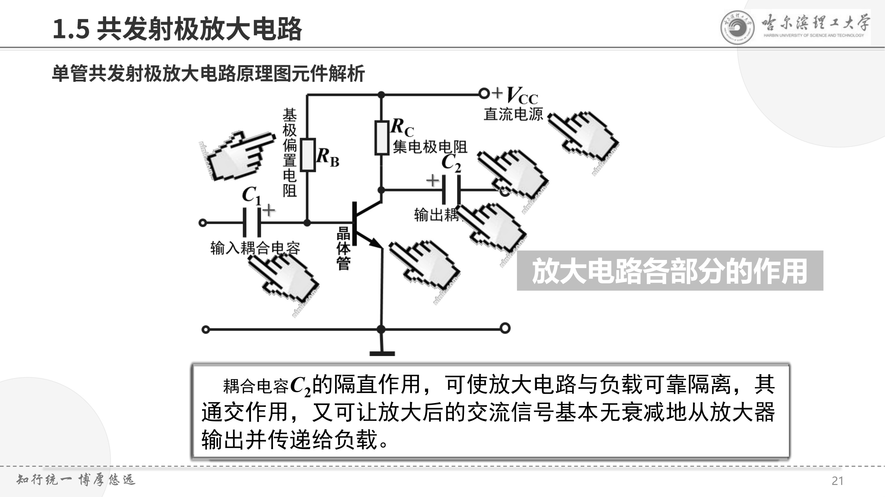
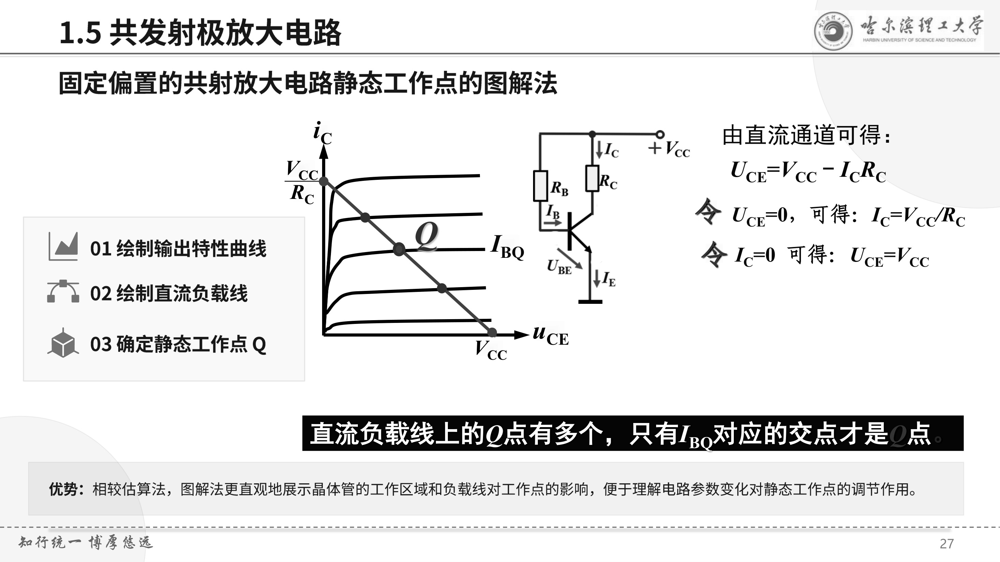
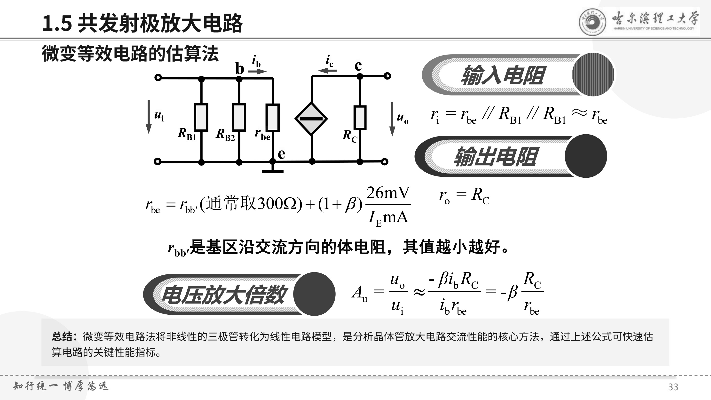

# 1.5 共发射极放大电路

## 一、是什么（概念与定位）

放大电路是把**微弱电信号放大成幅度足够大、波形不失真**的电路。它的本质不是"凭空造能量"，而是**以直流电源为能源、用小信号去控制这股能量的转换**——像用很小的力去扳动一个大水阀。

共发射极（Common Emitter，CE）放大电路以三极管发射极为输入、输出的公共端，是**最基础、应用最广**的组态：既能放大电压也能放大电流，电压放大倍数 $A_u$ 为负（输出与输入**反相**），输入电阻中等偏低、输出电阻中等偏高。

## 二、原理与特性

### 1. 组成原则与各元件作用（PPT 第 20~21 页）

一个能正常放大的电路必须满足三条：

1. **保证放大状态**：三极管工作在放大区——发射结正偏、集电结反偏；
2. **合理输入回路**：输入信号尽量不衰减地加到基极，形成变化的 $i_B$；
3. **合理输出回路**：放大后的电流经集电极电阻转换为电压输出，并能送到负载。

| 元件 | 作用 |
| --- | --- |
| 三极管 T | 核心受控元件，用小 $i_B$ 控制大 $i_C$ |
| 基极偏置电阻 $R_B$ | 提供合适的 $I_B$，建立静态工作点 |
| 集电极电阻 $R_C$ | 把放大的 $i_C$ 转换为电压 $u_{CE}$，实现"电流放大→电压放大" |
| 直流电源 $V_{CC}$ | ①提供能量；②保证发射结正偏、集电结反偏 |
| 耦合电容 $C_1$、$C_2$ | 隔直通交：让交流信号通过、把直流挡在前后级之外 |

### 2. 符号规则（PPT 第 22 页）

放大电路中直流与交流共存，书写必须区分：

| 分量 | 符号规则 | 示例 |
| --- | --- | --- |
| 直流分量（静态） | 大写字母 + 大写下标 | $I_B,\ I_C,\ U_{CE}$ |
| 交流分量（动态） | 小写字母 + 小写下标 | $i_b,\ i_c,\ u_{ce}$ |
| 交直流叠加（总量） | 小写字母 + 大写下标 | $i_B,\ i_C,\ u_{CE}$ |

即：$i_B=I_B+i_b$，$u_{CE}=U_{CE}+u_{ce}$。

### 3. 静态分析：估算法（PPT 第 24~26 页）

令 $u_i=0$（交流短路、电容开路），只看直流通路：

$$I_B=\frac{V_{CC}-U_{BE}}{R_B},\qquad I_C=\beta I_B,\qquad U_{CE}=V_{CC}-I_C R_C$$

硅管取 $U_{BE}\approx0.7\ \mathrm{V}$（锗管 0.3 V）。

**算例**：$V_{CC}=10\ \mathrm{V}$，$R_B=250\ \mathrm{k\Omega}$，$R_C=3\ \mathrm{k\Omega}$，$\beta=50$。

$$I_B=\frac{10-0.7}{250}=37.2\ \mu\mathrm{A},\quad I_C=50\times37.2\ \mu\mathrm{A}=1.86\ \mathrm{mA},\quad U_{CE}=10-1.86\times3=4.42\ \mathrm{V}$$

$U_{CE}=4.42\ \mathrm{V}$ 介于饱和压降与 $V_{CC}$ 之间，说明确实工作在放大区。

### 4. 静态分析：图解法（PPT 第 27 页）

在输出特性曲线上画**直流负载线**：由 $u_{CE}=V_{CC}-i_C R_C$ 得两点

$$M\,(u_{CE}=V_{CC},\,i_C=0),\qquad N\,(u_{CE}=0,\,i_C=V_{CC}/R_C)$$

连线 MN 即直流负载线，它与 $I_B=37.2\ \mu\mathrm{A}$ 那条输出特性曲线的交点就是**静态工作点 Q**。

图解法直观，能看出 Q 点位置对不失真的影响；估算法快，考试与工程估算常用。

### 5. 固定偏置的缺点（PPT 第 28 页）

$I_B=(V_{CC}-U_{BE})/R_B$ 只由外电路决定，与温度无关；但 $I_{CEO}$、$U_{BE}$、β 都随温度上升而增大，导致 $I_C$ 上升、Q 点上移，最终**输出饱和失真**。这就是"固定偏置"必须被分压式偏置（射极偏置）取代的原因。

### 6. 动态分析：交流通路与微变等效（PPT 第 29~33 页）

**画交流通路三条法则**：①直流电源 $V_{CC}$ 对交流视为**短路到地**；②耦合电容容量大、容抗小，视为**短路**；③按交流信号实际流向重画电阻拓扑。

把交流通路中的三极管用它在线性区的**微变等效模型**替换（b-e 间为 $r_{be}$，c-e 间为受控电流源 $\beta i_b$），得到纯线性电路，即可用电路定理求解。

$$r_{be}=300\ \Omega+(1+\beta)\frac{26\ \mathrm{mV}}{I_E(\mathrm{mA})}$$

### 7. 三个动态性能指标（PPT 第 34、37~38 页）

$$A_u=\frac{u_o}{u_i}=-\frac{\beta R_L'}{r_{be}},\qquad R_L'=R_C\parallel R_L$$

$$r_i=R_B\parallel r_{be}\approx r_{be},\qquad r_o\approx R_C$$

- **$A_u$ 为负**说明共射电路**反相**放大；
- **$r_i$ 越大**，从信号源取的电流越小、对前级影响越小 → 希望大；
- **$r_o$ 越小**，带负载能力越强 → 希望小。

共射电路的特点：$r_i$ 中等偏低（几百 Ω~几 kΩ）、$r_o$ 中等偏高（几 kΩ~几十 kΩ）、电压与电流都能放大、**反相**。

## 三、符号与图形（图文并茂）

- 电路图中"⊥"是接地符号，$V_{CC}$ 一端画成小圆圈或横线表示接电源正端。
- 画交流通路时，$V_{CC}$ 的节点与地**短接**，$R_C$ 变成从集电极到地的电阻，$R_B$ 变成从基极到地的电阻。
- 求 $A_u$ 时注意 $R_L'=R_C\parallel R_L$（带载后才接 $R_L$），空载时 $R_L'=R_C$。

## 四、典型例题/应用

**例**　分压式偏置共射电路：$V_{CC}=12\ \mathrm{V}$，$R_{B1}=20\ \mathrm{k\Omega}$，$R_{B2}=10\ \mathrm{k\Omega}$，$R_C=3\ \mathrm{k\Omega}$，$R_E=2\ \mathrm{k\Omega}$，$R_L=3\ \mathrm{k\Omega}$，$\beta=50$。求静态工作点与 $r_i$、$r_o$、$A_u$。

**解答**：
1. 基极电位（忽略 $I_B$）：$U_B\approx V_{CC}\dfrac{R_{B2}}{R_{B1}+R_{B2}}=12\times\dfrac{10}{30}=4\ \mathrm{V}$；
2. 发射极：$U_E=U_B-0.7=3.3\ \mathrm{V}$，$I_E=U_E/R_E=1.65\ \mathrm{mA}\approx I_C$；
3. $U_{CE}=V_{CC}-I_C(R_C+R_E)=12-1.65\times5=3.75\ \mathrm{V}$（在放大区）；
4. $r_{be}=300+(1+50)\dfrac{26}{1.65}\approx1.1\ \mathrm{k\Omega}$；
5. $A_u=-\dfrac{\beta(R_C\parallel R_L)}{r_{be}}=-\dfrac{50\times1.5}{1.1}\approx-68$；
6. $r_i=R_{B1}\parallel R_{B2}\parallel r_{be}\approx1.1\ \mathrm{k\Omega}$，$r_o\approx R_C=3\ \mathrm{k\Omega}$。

**结论**：中频电压放大倍数约 68 倍、反相；输入电阻约 1.1 kΩ，偏小是共射电路的固有短板。

## 五、易错点

1. **静态与动态混算**：静态分析必须令 $u_i=0$、电容开路；动态分析必须令 $V_{CC}$ 短路、电容短路。两套通路不能混用。
2. **$A_u$ 漏掉负号**：共射是反相放大，负号是判卷得分点。
3. **$R_L'$ 忘记并联 $R_L$**：带载时 $R_L'=R_C\parallel R_L$，空载才是 $R_C$。
4. **$r_{be}$ 公式中 $I_E$ 单位**：公式里 $I_E$ 必须用 **mA** 代入，用 A 会算出荒谬结果。
5. **Q 点与失真方向搞反**：Q 点过高（$I_C$ 大）易**饱和失真**（输出削底），Q 点过低易**截止失真**（输出削顶）。

## 六、知识点总结

1. 放大 = 用直流电源的能量、由输入小信号控制输出的能量转换；共射组态反相、电压电流双放大。
2. 组成三原则：保证放大状态、合理输入回路、合理输出回路；$R_B$ 定 Q 点、$R_C$ 做电流—电压转换、$C_1C_2$ 隔直通交。
3. 静态分析两法：估算法（$I_B\to I_C\to U_{CE}$）与图解法（直流负载线与特性曲线交点）。
4. 动态分析两法：图解法（交流负载线）与微变等效电路法（$r_{be}$、$\beta i_b$）。
5. 三大指标：$A_u=-\beta R_L'/r_{be}$、$r_i\approx r_{be}$、$r_o\approx R_C$；固定偏置存在温度漂移，工程上用分压式偏置抑制。
