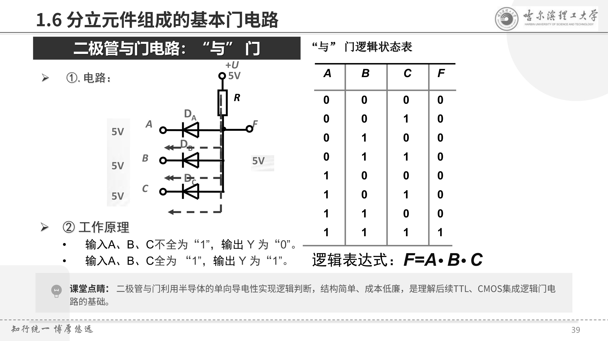
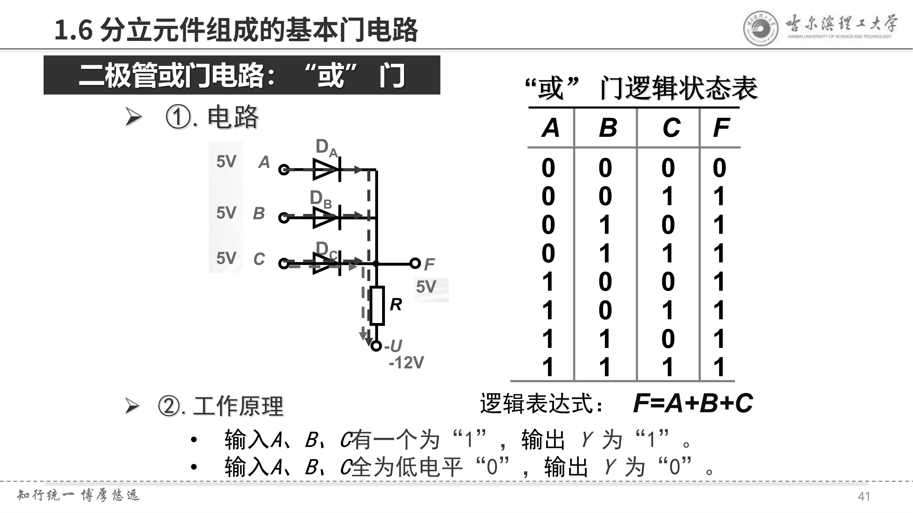
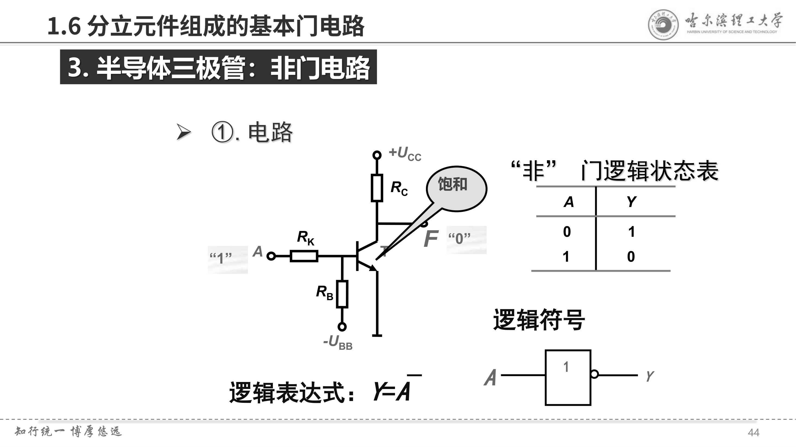

# 1.6 分立元件组成的基本门电路

> 本节对应课件《01.模拟电子元件和分立电子元件（2-2学时）》第 39~45 页，是**模拟电路通往数字电路的桥梁**：用二极管、三极管的开关特性搭出"与、或、非"三种最基本的逻辑判断，为后续 TTL、CMOS 集成门电路打底。

## 一、是什么（概念与定位）

**门电路（Gate Circuit）** 是能对输入的数字信号（高/低电平）执行基本逻辑运算、并输出相应数字信号的电子电路。因为它是构成一切组合逻辑、时序逻辑的最基本单元，被称为数字电路的"细胞"。

按制造方式分两代：

| 类别 | 构成 | 特点 | 教材定位 |
| --- | --- | --- | --- |
| **分立元件门电路** | 二极管、三极管、电阻等单个元件搭成 | 结构简单、成本低、体积大、速度慢 | 用来**讲清原理**，实际不用于产品 |
| **集成门电路** | TTL、CMOS 工艺做在芯片上 | 体积小、速度快、可靠性高 | 实际工程使用（见第 2 章） |

本节要掌握的三种分立元件门：

| 门 | 核心元件 | 利用的物理特性 | 逻辑表达式 |
| --- | --- | --- | --- |
| 二极管**与**门 | 二极管 + 电阻 | 二极管**正向导通、反向截止** | $F=A\cdot B\cdot C$ |
| 二极管**或**门 | 二极管 + 电阻 | 同上（方向反过来用） | $F=A+B+C$ |
| 三极管**非**门 | 三极管 + 电阻 | 三极管的**饱和导通/截止**两种开关状态 | $Y=\overline{A}$ |

> **关键概念：电平与逻辑值的对应**
> 本课程采用**正逻辑**约定：高电平（如 5 V）记作逻辑"1"，低电平（如 0 V）记作逻辑"0"。同一电路若改用负逻辑约定，与门会变成或门——所以题目不说明时，一律按正逻辑处理。

## 二、原理与特性

### 1. 二极管与门（PPT 第 39~40 页）

**电路结构**：三个二极管的阳极（正端）分别接输入 A、B、C，阴极（负端）连在一起作为输出 F，再经电阻 $R$ 接电源 $+U$（5 V）。

**工作原理**（抓住"二极管优先导通、阴极电位被钳位"这一条）：

- 输入中**只要有一个为 0 V（"0"）**：该二极管阳极为 0 V、阴极为 5 V，处于**正向偏置而导通**，把输出 F 钳位在 $0+0.7\ \mathrm{V}\approx0.7\ \mathrm{V}$（低电平）。此时其余二极管阳极为 5 V、阴极为 0.7 V，**反偏截止**。
- 输入**全为 5 V（"1"）**：三个二极管均导通（或均无电流），输出 F 被 $R$ 拉高到 5 V（扣掉管压降），为高电平"1"。

**结论口诀**：**有"0"出"0"，全"1"出"1"**。

| A | B | C | F |
| --- | --- | --- | --- |
| 0 | 0 | 0 | 0 |
| 0 | 0 | 1 | 0 |
| 0 | 1 | 0 | 0 |
| 0 | 1 | 1 | 0 |
| 1 | 0 | 0 | 0 |
| 1 | 0 | 1 | 0 |
| 1 | 1 | 0 | 0 |
| 1 | 1 | 1 | 1 |

逻辑表达式：$F=A\cdot B\cdot C$；逻辑符号为方框内标 **&**（国标）或 D 形符号（国际）。

**典型应用**：安全门禁（刷卡 + 密码 + 指纹**同时**满足才开门）、CPU 中 ALU 的运算单元。

### 2. 二极管或门（PPT 第 41~43 页）

**电路结构**：把与门"翻过来"——三个二极管的**阴极**分别接输入 A、B、C，**阳极**连在一起作为输出 F，再经电阻 $R$ 接负电源 $-U$（约 $-12\ \mathrm{V}$）。

**工作原理**：

- 输入中**只要有一个为 5 V（"1"）**：该二极管阳极 5 V、阴极经 $R$ 接 $-U$，**正向导通**，把输出 F 抬到 $5-0.7\approx4.3\ \mathrm{V}$（高电平），并把其余二极管的阴极电位一起抬高，使其**反偏截止**。
- 输入**全为 0 V（"0"）**：三个二极管均不导通，输出 F 被 $R$ 拉到 $-U$（低电平"0"）。这就是为什么或门必须接**负电源**——否则输入全 0 时输出悬空、无法确定低电平。

**结论口诀**：**有"1"出"1"，全"0"出"0"**。

逻辑表达式：$F=A+B+C$；逻辑符号为方框内标 **≥1**（国标）或带弧形输入端的 D 形符号（国际）。这里的"+"是**逻辑或**，不是算术加法。

**典型应用**：多路报警（任一传感器触发即报警）、信号合成、条件判断。

### 3. 三极管非门（反相器，PPT 第 44~45 页）

**电路结构**：NPN 三极管的发射极接地，集电极经 $R_C$ 接 $+U_{CC}$ 并作为输出 F，基极经 $R_B$、$R_K$ 接输入 A，另加 $-U_{BB}$ 保证可靠截止。

**工作原理**（核心是**三极管的开关特性**）：

| 输入 A | 三极管状态 | 输出 F | 说明 |
| --- | --- | --- | --- |
| "1"（高电平） | **饱和导通** | "0"（低电平，约 0.3 V） | 管子像闭合的开关，把 F 拉到地 |
| "0"（低电平） | **截止** | "1"（高电平，约 $U_{CC}$） | 管子像断开的开关，F 被 $R_C$ 拉高 |

逻辑表达式：$Y=\overline{A}$（读作"A 非"）；逻辑符号为方框内标 **1** 且输出端带**小圆圈**（小圆圈专指"取反"）。

**为什么必须工作在饱和区而不是放大区？** 放大区 $u_{CE}$ 随输入连续变化，输出既不是标准高电平也不是标准低电平，数字电路要求输出只有两种**明确、稳定、可判别**的状态，所以必须让管子**要么饱和、要么截止**，中间放大区只是过渡瞬间。

## 三、符号与图形（图文并茂）

三种门的国标（IEC）符号与国际（ANSI/IEEE）符号对照：

| 门 | 国标符号特征 | 国际符号特征 | 表达式 |
| --- | --- | --- | --- |
| 与门 | 矩形框内写 **&** | D 形（左侧平直、右侧圆弧） | $F=ABC$ |
| 或门 | 矩形框内写 **≥1** | 盾形（左侧圆弧、右侧尖） | $F=A+B+C$ |
| 非门 | 矩形框内写 **1**，输出端加**小圆圈** | 三角形 + 输出端小圆圈 | $Y=\overline{A}$ |

画图与读图要点：

1. **小圆圈 = 取反**。它画在哪个端子，哪个端子就取反；画在输入端叫"低电平有效"，画在输出端才是输出反相。
2. **输入端个数可多于 3 个**，与门、或门的表达式按输入端个数扩展，真值表行数 $=2^n$。
3. 分立元件电路中，**输出端一定带一个电阻**（与门接 $+U$、或门接 $-U$、非门接 $+U_{CC}$）——这个电阻既限制导通电流，又在所有二极管截止时确定输出电平，缺了它电路不能工作。
4. 二极管门电路的**电平有偏移**：输出高电平比输入低约 0.7 V。级联级数一多，电平会逐级下降甚至无法判别——这正是分立元件门被集成门取代的直接原因。

## 四、典型例题/应用

**例 1**　判断二极管与门在下列输入下的输出（正逻辑，二极管为理想开关，忽略管压降）：①A=0、B=1、C=1；②A=B=C=1。

**解答**：
① 只要有一个输入为 0，接该输入的那只二极管导通并把输出钳在低电平，其余反偏截止 → **F=0**。
② 三个输入全为 1，三只二极管均不承受正偏压（或均导通），输出被电阻拉到高电平 → **F=1**。
符合"有 0 出 0、全 1 出 1"的与逻辑，$F=A\cdot B\cdot C$。

**例 2**　用二极管与门、或门和三极管非门，实现 $F=\overline{AB}+C$。

**解答**：
1. A、B 送入**与门** → 得 $AB$；
2. 与门输出送入**非门** → 得 $\overline{AB}$；
3. 该结果与 C 一起送入**或门** → 输出 $F=\overline{AB}+C$。
共需 2 只二极管（与门）+ 1 只三极管（非门）+ 2 只二极管（或门）。这就是"**用基本门搭任意逻辑函数**"的最朴素演示。

**例 3**　某二极管或门的输入全为 0，输出却不是稳定的低电平，而是悬浮不定，问原因。

**解答**：或门的公共端电阻必须接**负电源** $-U$。若误接成接地或悬空，输入全 0 时所有二极管截止，输出端没有直流通路，电平由漏电流和分布参数决定，自然"悬空不定"。**接负电源是或门成立的前提条件**。

## 五、易错点

1. **与门、或门电路的接法记反**。判别口诀：**公共端接电阻的那一侧就是输出**。二极管**阴极**并在一起 → 与门（电阻接 $+U$）；二极管**阳极**并在一起 → 或门（电阻接 $-U$）。
2. **或门漏画负电源**。或门电阻必须接 $-U$，否则全 0 输入时输出不确定；与门电阻则接 $+U$。
3. **"+"误当算术加**。$F=A+B+C$ 中"+"是逻辑或：$1+1=1$，不是 2。
4. **非门做成放大状态**。反相器必须让三极管**饱和或截止**，若静态点落在放大区，输出电平不标准、抗干扰能力差。
5. **忘记二极管的正向压降**。精确计算时要扣 0.7 V（硅管），多级级联后电平偏移会累积，这是分立门不能多级串联的根源。
6. **正负逻辑混淆**。题目未说明时按正逻辑（高=1）；若明确说负逻辑，则与门、或门的功能互换，${F=ABC}$ 在负逻辑下是或功能。

## 六、知识点总结

1. **三种分立元件门 = 两种器件的开关特性**：二极管用"导通/截止"实现与、或；三极管用"饱和/截止"实现非。
2. **与门**：二极管阴极共接输出、电阻接 $+U$；**有 0 出 0、全 1 出 1**；$F=ABC$；符号 **&**。
3. **或门**：二极管阳极共接输出、电阻接 $-U$；**有 1 出 1、全 0 出 0**；$F=A+B+C$；符号 **≥1**。
4. **非门**：三极管共射开关电路；输入高则饱和输出低、输入低则截止输出高；$Y=\overline{A}$；符号 **1** 加输出小圆圈。
5. 分立元件门结构简单、便于理解原理，但存在**电平偏移、带载能力差、速度低**三大缺陷，实际工程使用 TTL/CMOS 集成门（第 2 章）。
