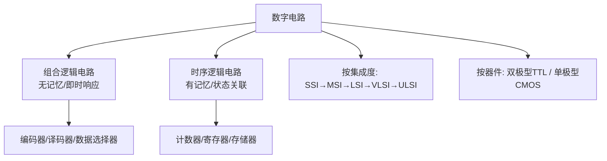

# 2.1 数字电路及其分类与特点（Digital Circuits: Classification & Features）

## 一、是什么（概念与定位）

数字电路是处理**离散（数字）信号**的电子电路，是计算机、通信系统、数字控制技术的硬件基础。它与模拟电路共同构成电子技术的两大分支。

- **模拟信号**：在时间上和数值上均**连续变化**的电信号（如温度、声音、电压波动），幅值平滑过渡、无离散跳变。
- **数字信号**：在时间上和数值上均呈**离散性**的信号，变化是非连续、跳跃式的，仅在离散时间点上取值，用有限个数字符号（0、1）表示。

本课程聚焦"数字电路基础"，即从信号与电路的本质差异出发，理解数字电路的分类、特点，以及分析 / 设计 / 测试的基本方法。

## 二、原理与特性

### 1. 模拟信号 vs 数字信号

| 对比维度 | 模拟电路 | 数字电路 |
|---|---|---|
| 处理对象 | 连续信号 | 离散信号 |
| 分析工具 | 微分方程、频率分析 | 逻辑代数（布尔代数） |
| 核心差异 | 注重**幅值**变化 | 注重**逻辑状态** |

数字信号的优势：① 极强抗干扰能力，不易受噪声影响；② 易于编码、加密、存储；③ 传输 / 复制不易失真，可纠错。

### 2. 数字信号的主要参数（P8）

- **信号幅度 Vm**：波形变化的最大值，决定能量水平与抗干扰能力。
- **周期 T 与频率 f**：完成一个完整波形所需时间即周期 T，f = 1/T，反映变化快慢。
- **脉冲宽度 tw**：脉冲保持高电平的持续时间（"脉宽"），影响传输效率与时序逻辑。
- **占空比 q**：脉宽占整个周期的百分比，`q = tw / T × 100%`。

### 3. 二值数字逻辑与逻辑电平（P9）

- **0、1 作为数码**：表示具体数量大小 → 二进制数，遵循"逢二进一"。
- **0、1 作为二值逻辑**：表示两种状态（开关、真假、高低）。
- **正逻辑约定**：高电平（High, H）→ 逻辑"1"；低电平（Low, L）→ 逻辑"0"。

电压与逻辑电平关系（正逻辑）：+5 V ↔ 1（真）↔ H；0 V ↔ 0（假）↔ L。

### 4. 数字电路的分类（P11–P13）

**按电路类型：**
- **组合逻辑电路**：无记忆性，即时响应。输出仅由当前输入决定，内部无存储单元，单向传输、无反馈。典型：编码器、译码器、数据选择器。
- **时序逻辑电路**：有记忆性，状态关联。输出由当前输入 + 原有状态共同决定，含触发器、有反馈。典型：计数器、寄存器、存储器。

**按集成电路规模（集成度 = 单芯片逻辑门数）：**

| 等级 | 门数 | 典型应用 |
|---|---|---|
| SSI 小规模 | < 10 | 基础逻辑门、触发器、简单编码器 |
| MSI 中规模 | 10 ~ 99 | 译码器、计数器、加法器、寄存器 |
| LSI 大规模 | 100 ~ 9,999 | 小型半导体存储器、门阵列 |
| VLSI 超大规模 | 10,000 ~ 99,999 | 大容量存储器、微处理器 |
| ULSI 甚大规模 | 10⁵ 以上 | CPLD、多功能专用集成电路 |

**按半导体类型：**
- **双极型（Bipolar）**：NPN/PNP 晶体管，电子 + 空穴两种载流子导电。代表：TTL、ECL、I²L。特点：速度快、驱动强、功耗较高。
- **单极型（Unipolar）**：MOS 管，单一载流子。代表：CMOS、NMOS、PMOS。特点：静态功耗极低、集成度高、抗干扰强，是 VLSI 主流。

### 5. 数字电路的特点（P14）

易设计与集成化；高稳定性抗干扰；强信息处理能力（并行、高速）；超高精度可控（增加位数即提升精度，几乎无累计误差）；信号高保真；便捷存储；适配 EDA 自动化设计；低功耗节能。

### 6. 分析、设计与测试（P15）

- **分析**：确定输入—输出逻辑映射，工具为逻辑代数，形式包括真值表、功能表、逻辑表达式、波形图。
- **设计**：从功能需求选器件构建。传统设计（分立器件）与 EDA 设计（Multisim、Quartus 仿真自动化）。
- **测试**：数字电压表（测节点电平）+ 电子示波器（观测波形与时序）。

> 完整闭环：**分析**（理解基础）→ **设计**（实现核心）→ **测试**（保障质量）。

## 三、符号与图形（图文并茂，嵌入现成图）

**数字信号的关键参数（脉冲波形）** —— 体现幅度 Vm、脉宽 tw、周期 T 与占空比 q：

**数字波形（逻辑电平对时间的图形表示）** —— 图(a)连续时间逻辑电平波形，图(b) 16 位二进制数据的波形映射，蓝=1、灰=0：

### 数字电路分类关系（Mermaid）

## 四、典型例题/应用

**例 1（参数计算）**：某脉冲信号周期 T = 20 ms，高电平持续时间 tw = 5 ms，求占空比 q。
> 解：`q = tw/T × 100% = 5/20 × 100% = 25%`。

**例 2（概念辨析）**：为什么说数字电路比模拟电路抗干扰能力强？
> 答：数字电路仅用高 / 低电平表示 0/1 两种逻辑状态，只要噪声未使电平越过判决阈值，信号就不会出错；而模拟信号幅值连续，任何噪声都会直接叠加到幅值上造成失真。

## 五、易错点

1. **正逻辑 / 负逻辑**：默认采用正逻辑（H=1、L=0）；若用负逻辑则相反，需明确约定。
2. **组合 vs 时序的本质区别**：不在于有没有时钟，而在于"输出是否依赖电路原有状态"——有时序记忆即时序电路。
3. **占空比公式**：是 `tw/T`，不是 `tw/(T-tw)`，注意百分比换算。
4. **集成度等级边界**：门数范围是"小于 10""10~99"等，考试常考边界值。

## 六、知识点总结

- 数字信号 = 时间 + 数值均离散；模拟信号 = 均连续。
- 数字电路按类型分**组合 / 时序**，按集成度分 **SSI→ULSI**，按器件分 **双极型 / 单极型**。
- 四大参数：Vm、T/f、tw、q；正逻辑下 H=1、L=0。
- 特点：抗干扰、高精度、易集成、低功耗；开发闭环：分析 → 设计 → 测试。
