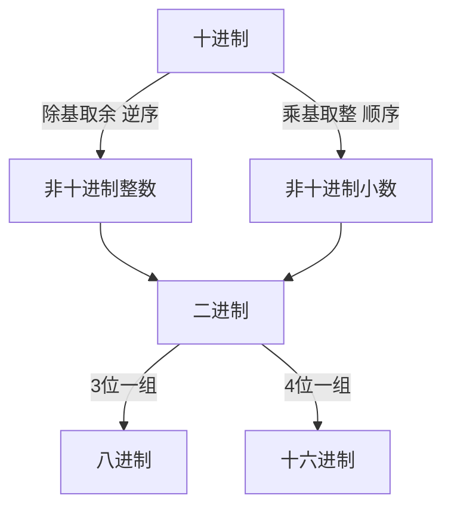

# 2.2 数制与数制转换（Number Systems & Conversion）

## 一、是什么（概念与定位）

**数制（进位计数制）**：多位数码中每一位的构成规则，以及低位向高位进位的计数规则。它决定了数值的表示与运算方式，是计算机底层处理数据的逻辑基础。

常用数制：十进制（D）、二进制（B）、八进制（O/o）、十六进制（H）。

## 二、原理与特性

### 1. 通用按权展开式（P16）

任意 N 进制数 S 可表示为：

```
        n-1
S = Σ  aᵢ × Nⁱ
       i=-m
```

- **aᵢ**：第 i 位的数码（必为 N 个基本符号之一）
- **Nⁱ**：第 i 位的**权值**（位权因子），N 为基数
- **n**：整数位数；**m**：小数位数

### 2. 四种常用数制对照

| 数制 | 基数 | 数码 | 进位规则 | 标识 | 权值 |
|---|---|---|---|---|---|
| 十进制 | 10 | 0–9 | 逢十进一 | D | 10ⁱ |
| 二进制 | 2 | 0,1 | 逢二进一 | B | 2ⁱ |
| 八进制 | 8 | 0–7 | 逢八进一 | O / 0o | 8ⁱ |
| 十六进制 | 16 | 0–9,A–F | 逢十六进一 | H | 16ⁱ |

**按权展开示例：**
- `(4587.29)D = 4×10³ + 5×10² + 8×10¹ + 7×10⁰ + 2×10⁻¹ + 9×10⁻²`
- `(1001.101)B = 1×2³ + 0×2² + 0×2¹ + 1×2⁰ + 1×2⁻¹ + 0×2⁻² + 1×2⁻³ = (9.625)D`
- `(A6.C)H = 10×16¹ + 6×16⁰ + 12×16⁻¹ = 160 + 6 + 0.75 = (166.75)D`

**十六进制优点**（P21）：① 1 位十六进制 = 4 位二进制，转换高效；② 相同位数容量最大（FFFF H = 65535 D = 64K）；③ 书写极简，是二进制的最佳"简写"。

### 3. 数制转换方法

#### (A) 十进制 → 非十进制（P22–P25）

**整数部分："除基取余，逆序排列"**
反复用十进制整数除以目标基数 N，记录余数，直到商为 0；最后将余数**逆序**排列。

**小数部分："乘基取整，顺序排列"**
反复用十进制小数乘以目标基数 N，取乘积的**整数部分**作为结果的一位（首次取整为高位），小数部分继续乘，直到小数为 0 或满足精度。

#### (B) 二进制 ↔ 八进制（P26）
- 基 8 = 2³，故**每 3 位二进制 = 1 位八进制**。
- 二进制→八进制：以小数点为界，整数从右往左、小数从左往右每 3 位一组，不足补零，每组转八进制。
- 八进制→二进制：每位八进制独立展开为 3 位二进制，拼接。

#### (C) 二进制 ↔ 十六进制（P27）
- 基 16 = 2⁴，故**每 4 位二进制 = 1 位十六进制**。
- 二进制→十六进制："四位合一"分组；十六进制→二进制："一位拆四"展开。

## 三、符号与图形（图文并茂，嵌入现成图）

**十进制整数转二进制——"除 2 取余，逆序排列"过程图**（以 37D = 100101B 为例）：


**二进制与十六进制转换——分组示例**（(111100010101110)B = (78AE)H）：


### 转换流程（Mermaid）



## 四、典型例题/应用

**例 1（整数转二进制）**：将 (13)D 转为二进制。
> 13÷2=6 余 1；6÷2=3 余 0；3÷2=1 余 1；1÷2=0 余 1。
> 余数逆序：**1101** → (13)D = (1101)B。

**例 2（小数转二进制）**：将 (0.625)D 转为二进制。
> 0.625×2 = 1.250 → 取整 **1**（高位）
> 0.250×2 = 0.500 → 取整 **0**
> 0.500×2 = 1.000 → 取整 **1**（低位）
> 顺序排列：0.101 → (0.625)D = (0.101)B。

**例 3（二进制 ↔ 八/十六进制）**：
> (10110.011)B → 分组 `010 110 . 011` → (26.3)O
> (111100010101110)B → 分组 `1111 0001 0101 1110` → (F15E)H

## 五、易错点

1. **整数取余是"逆序"、小数取整是"顺序"**，二者方向相反，切勿混淆。
2. **分组补零位置**：整数部分补在**最左（高位）**，小数部分补在**最右（低位）**。
3. **小数转换可能不终止**：如 0.39 转二进制为无限循环，需按精度要求截断（见 P25，0.1% 精度需取 10 位）。
4. **十六进制字符**：A=10, B=11, C=12, D=13, E=14, F=15，别写错。
5. **前缀/后缀**：二进制 B、八进制 O（或 0o）、十进制 D、十六进制 H。

## 六、知识点总结

- 通用式 `S = Σ aᵢ·Nⁱ`，关键是**基数 N** 与**位权 Nⁱ**。
- 十进制→非十进制：整数除基取余（逆序）、小数乘基取整（顺序）。
- 二进制⇄八进制：3 位一组；二进制⇄十六进制：4 位一组。
- 十六进制是二进制的压缩表示，1 位 = 4 位二进制。
