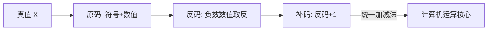

# 2.4 机器数与码制（原码、反码、补码）

## 一、是什么（概念与定位）

计算机只能识别 0/1，因此带符号数必须先把"符号"数值化，形成**机器数**。对应关系：

- **真值**：用正负号直接表示的数值（如 +0.1011），人类直观写法，硬件不能直接运算。
- **机器数**：符号位数值化后的形式（如 +1011 → 01011，-1011 → 11011），计算机内部存储与运算的基础。最高位为符号位（0 正、1 负）。

三种机器数表示法：**原码、反码、补码**。

## 二、原理与特性

### 1. 原码（Sign-magnitude）（P35–P37）

"符号位 + 数值位"直接拼接。最高位为符号位（0 正、1 负），其余为数值本身。

- **正数**：原码 = 本身（符号位补 0）。如 +10011 → 010011。
- **负数**：绝对值二进制左侧加符号位 1。如 -10011 → 110011。
- **性质**：
  1. 正数符号位 0，数值无影响；负数符号位 1，数值保留绝对值形态。
  2. **存在 +0 与 -0 两种形式**（0.00…0 与 1.00…0），编码空间冗余。
  3. 符号位**不能直接参与数值运算**，需单独判断、分别处理。

### 2. 反码（One's Complement）（P38–P41）

又称"1 的补码"。符号位规则同原码（0 正、1 负）。

- **正数**：反码 = 原码（数值位不变）。如 +1001 → 0 1001。
- **负数**：符号位保持 1，**数值位按位取反**（0↔1）。如 -1001 → 1 0110。
- **一般式（整数）**：
  - X ≥ 0：`[X]反 = X`
  - -2ⁿ < X ≤ 0：`[X]反 = (2ⁿ⁺¹ − 1) + X`（即相同字长全 1 码减去 |X|）
- **性质**：正数与原码一致；负数符号位 1、数值取反；**0 有 +0 / -0 两种形式**（0.00…0 与 1.11…1）；本质是"1 的补码"。反码是求补码的中间过渡，用于减法运算。

### 3. 补码（Two's Complement）（P42–P45）

计算机**最常用**的表示法，可将减法转化为加法。

- **正数**：补码 = 原码（符号位 0，数值不变）。如 +10011 → 0 10011。
- **负数**：**原码数值位逐位取反，末尾 +1**（即"反码 + 1"）。如 -01010：原码 101010 → 反码 110101 → 补码 110110。
- **数学本质（模运算）**：`[X]补 = M + X (mod M)`，M 为模数。
  - 正数：补码即本身（模溢出舍去）。
  - 负数：`[X]补 = M − |X|`。如模 12、-1 ≡ +11；模 2、-0.101 → 2 − 0.101 = 1.011。
- **一般式**：`[X]补 = 2ⁿ − |X|`（n 为二进制位数），故称"2 的补码"。
- **性质**：
  1. 正数原 / 反 / 补码形式完全相同。
  2. 负数补码 = 反码 + 1。
  3. **零的表示唯一**（全 0），消除 +0 / -0 歧义。
  4. 将减法转为加法，硬件只需加法器即可完成所有算术运算。

### 4. 三种机器数对比（Mermaid）

## 三、符号与图形（图文并茂，嵌入现成图）

**原码 / 反码 / 补码三种表示法概览（符号位与数值位规则）**：

**补码的"模运算"直观理解——时钟类比**（模 12 下，-1 ≡ +11，负数转为正数）：

## 四、典型例题/应用

**例 1（求原 / 反 / 补码）**：设 X = -01010（n=5）
> 原码：1 01010
> 反码：1 10101（数值位取反）
> 补码：1 10110（反码 +1）

**例 2（定点整数补码）**：求 [-10101]补（n=5）
> 2⁶ − |-10101| = 1000000 − 10101 = 101011 → [-10101]补 = 101011。

**例 3（定点小数补码）**：求 [-0.1010]补
> 2 − |-0.1010| = 10.0000 − 0.1010 = 1.0110 → [-0.1010]补 = 1.0110。

## 五、易错点

1. **原码 / 反码有 ±0 两种形式，补码零唯一**（全 0）；考试常考补码表示范围因此比原码多表示一个数。
2. **负数求补**：先数值位取反再加 1，**符号位不参与取反**。
3. **补码转原码**：对补码再求一次补（取反 +1）即得原码，符号位不变。
4. 反码负数运算后若符号位有进位，需**循环进位**（进位 1 加回最低位），补码则直接**舍弃**进位。
5. 字长 n 必须明确，否则模数 M = 2ⁿ 不确定，补码结果会错。

## 六、知识点总结

- 真值→机器数（符号数值化）；最高位为符号位（0 正 1 负）。
- **原码**：符号+数值，有 ±0，符号位不参与运算。
- **反码**：正数同原码，负数数值位取反，有 ±0，是补码过渡。
- **补码**：正数同原码，负数 = 反码 +1；零唯一；本质是模 2ⁿ 运算，将减法转加法，是计算机运算核心。
