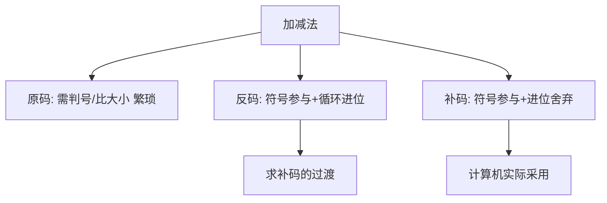

# 2.5 二进制算术运算（补码运算、反码运算）

## 一、是什么（概念与定位）

二进制的算术运算指加、减、乘、除，本章重点是**加减法**及其在机器数下的实现。由于原码运算繁琐，计算机实际采用**补码**统一加减法、以**反码**作过渡。

核心结论：
- `[X₁+X₂]补 = [X₁]补 + [X₂]补`（成立）
- `[X₁−X₂]补 = [X₁]补 + [−X₂]补`（减法转加法）
- `[X₁+X₂]反 = [X₁]反 + [X₂]反`（成立）
- `[X₁+X₂]原 ≠ [X₁]原 + [X₂]原`（**不成立**，原码不能直接加）

## 二、原理与特性

### 1. 原码运算（P46–P47）
- 异号相加：比较绝对值大小，执行"大数减小数"，结果符号由**绝对值较大者**决定。
- 减法 X₁ − X₂ = X₁ + (−X₂)，同号时绝对值相加，结果符号同原号。

### 2. 补码运算（P48–P50）
- **加法**：`[X₁+X₂]补 = [X₁]补 + [X₂]补`，符号位自然参与，无需单独处理。
- **减法**：`[X₁−X₂]补 = [X₁]补 + [−X₂]补`，减去一个数 = 加上其负补码。
- **进位处理**：符号位产生的进位**直接舍弃**。
- **结果还原**：符号位为 0 → 正数，补码即原码；符号位为 1 → 负数，需对结果**再求补**得原码。

### 3. 反码运算（P51–P54）
- 加法 / 减法：`[X₁±X₂]反 = [X₁]反 + [±X₂]反`，符号位参与运算。
- **循环进位**：若符号位产生进位，需将该进位 1 **加回结果最低位**（区别于补码的直接舍弃）。
- 结果符号位 0（正）→ 反码即原码；符号位 1（负）→ 对整个结果（含符号位）再求反得原码。

### 运算规则对比（Mermaid）

## 三、符号与图形（图文并茂，嵌入现成图）

**补码加法示例**（X₁=−0.1100, X₂=−0.0010，符号位参与、进位舍弃、结果求补还原）：

**反码运算的"循环进位"机制**（进位 1 加回最低位）：

## 四、典型例题/应用

**例 1（补码加法）**：X₁ = −0.1100，X₂ = −0.0010，求 [X₁+X₂]补 及真值。
> [X₁]补 = 1.0100，[X₂]补 = 1.1110
> 相加：1.0100 + 1.1110 = [1]1.0010（进位 1 舍弃）→ [X₁+X₂]补 = 1.0010
> 符号位 1 → 负数，对 1.0010 求补得 1.1110 → 真值 = −0.1110。
> 验证：(−0.1100)+(−0.0010) = −0.1110 ✓

**例 2（补码减法）**：同上，求 [X₁−X₂]补 及真值。
> [−X₂]补 = 0.0010（−0.0010 的补码）
> [X₁−X₂]补 = [X₁]补 + [−X₂]补 = 1.0100 + 0.0010 = 1.0110
> 符号位 1 → 求补：数值位取反 +1 → 1.1010 → 真值 = −0.1010（= −0.625）。

**例 3（反码减法 + 循环进位）**：X₁ = 0.1100，X₂ = 0.0010，求 [X₁−X₂]反。
> [X₁]反 = 0.1100，[−X₂]反 = 1.1101
> 相加：0.1100 + 1.1101 = [1]0.1001，产生符号位进位 1
> 循环进位修正：0.1001 + 1（末位）= 0.1010 → 符号位 0 → 正数，真值 = +0.1010。

## 五、易错点

1. **补码减法**：先求 [−X₂]补（对 [X₂]补 连同符号位一起取反 +1），再与 [X₁]补 相加。
2. **进位处理差异**：补码——进位**舍弃**；反码——进位**循环加回末位**。混用会算错。
3. **结果还原**：补码结果符号位为 1 时，必须"再求补"才得原码/真值，不能直接读数。
4. **原码不能直接加法**：必须判号、比绝对值，故计算机不用原码做算术。
5. **小数点的位置**：定点小数运算中，小数点隐含、不实际参与；结果位数超出字长时按模截断。

## 六、知识点总结

- 补码运算：`[X±Y]补 = [X]补 ± [Y]补`，符号位参与、进位舍弃、负结果需再求补。
- 反码运算：规则同补码，但进位需**循环加回末位**。
- 原码运算需判号比大小，计算机不采用。
- 补码将减法统一为加法，是硬件实现加减法的核心机制。
