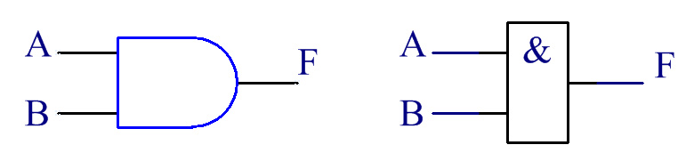
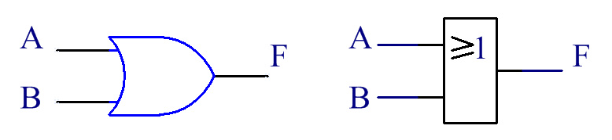
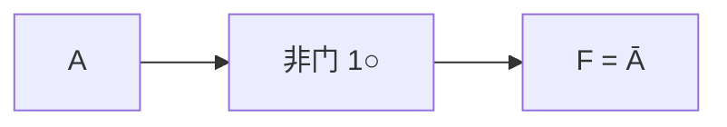

# 3.1 三种基本逻辑运算（Basic Logic Operations）

## 一、是什么（概念与定位）

逻辑代数（布尔代数）中的一切运算都建立在**三种基本运算**之上：**与（AND）、或（OR）、非（NOT）**。它们描述的是事物之间最基本的因果逻辑关系。

- **逻辑变量**：只有两个取值（0 和 1）的变量。0 和 1 **不代表数值大小**，只代表两种对立的逻辑状态（如真/假、开/关、高/低电平）。
- **逻辑函数**：若输入变量 A、B、C… 取值确定后，输出 Y 的值被唯一确定，则称 Y 是 A、B、C… 的逻辑函数，记作 Y = F(A, B, C…)。
- **原变量与反变量**：字母上无反号的称原变量（A），带反号的称反变量（Ā），代表相反的逻辑状态。

## 二、原理与特性

### 1. 与运算（AND）——"缺一不可"

只有当决定事件的所有条件**全部具备**时，事件才发生。运算规则："**全 1 出 1，有 0 出 0**"。

- 逻辑表达式：`F = A · B = AB`

| A | B | F = AB |
|---|---|--------|
| 0 | 0 | 0 |
| 0 | 1 | 0 |
| 1 | 0 | 0 |
| 1 | 1 | 1 |

**电路实例**：两个开关 A、B **串联**控制一盏灯，只有两个开关都闭合灯才亮——典型的与逻辑。

### 2. 或运算（OR）——"有一即可"

决定事件的条件中**有一个或几个具备**时，事件就发生。运算规则："**有 1 出 1，全 0 出 0**"。

- 逻辑表达式：`F = A + B`（"+" 代表或运算）

| A | B | F = A+B |
|---|---|---------|
| 0 | 0 | 0 |
| 0 | 1 | 1 |
| 1 | 0 | 1 |
| 1 | 1 | 1 |

**电路实例**：两个开关 A、B **并联**控制一盏灯，任一开关闭合灯即亮——典型的或逻辑。

### 3. 非运算（NOT）——"取反"

条件具备时事件不发生，条件不具备时事件发生。非逻辑是最基础的单变量运算，本质是对逻辑状态的**取反**。

- 逻辑表达式：`F = Ā`（A 上方的横线代表取反运算）

| A | F = Ā |
|---|-------|
| 0 | 1 |
| 1 | 0 |

## 三、符号与图形（图文并茂）

与门、或门各有两套标准画法：**IEEE 标准**（独特形状符号）与 **IEC 标准**（矩形框符号：与门标 `&`，或门标 `≥1`，非门标 `1` 加小圆圈）。

**与门（AND gate）符号：**

**或门（OR gate）符号：**

**非门（NOT gate）**可用 Mermaid 补充示意：

> 记忆技巧：IEC 矩形框中，`&` = 与、`≥1` = 或（输入中至少一个 1 输出即为 1）、`1` = 非（缓冲+取反）；输出端的小圆圈统一表示"取反"。

## 四、典型例题/应用

**例**：楼道里两处开关控制一盏灯（A、B 为两个单刀双掷开关），规定开关向上为 1。已知"开关状态相同时灯亮"。写出真值表并判断逻辑关系。

| A | B | F |
|---|---|---|
| 0 | 0 | 1 |
| 0 | 1 | 0 |
| 1 | 0 | 0 |
| 1 | 1 | 1 |

**思路**：逐行核对——只有 A、B 同为 0 或同为 1 时 F=1。这既不是与也不是或，而是第 3.2 节要学的"同或"运算。可见基本运算组合可以表达更复杂的逻辑关系。

## 五、易错点

1. **0 和 1 不是数**，是状态符号；不能按普通代数理解"1+1=2"，逻辑代数中 `1+1=1`。
2. **与/或真值表易背反**：与是"全 1 出 1"（仅一行 F=1），或是"有 1 出 1"（仅一行 F=0）。
3. 非运算只能作用于**一个**变量；`Ā·B̄` 与 `A·B̄` 完全不同，横线的覆盖范围要看清。
4. 符号书写：与运算的点号可省略（AB），但或运算的加号**不可省略**。

## 六、知识点总结

| 运算 | 表达式 | 口诀 | 记忆特征 |
|------|--------|------|----------|
| 与 | F = AB | 全 1 出 1，有 0 出 0 | 真值表只有一个 1 |
| 或 | F = A+B | 有 1 出 1，全 0 出 0 | 真值表只有一个 0 |
| 非 | F = Ā | 1 变 0，0 变 1 | 单变量取反 |

三种基本运算是一切复合运算（3.2）和逻辑代数公理体系（3.3）的基石。
