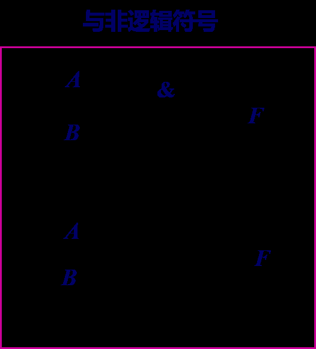
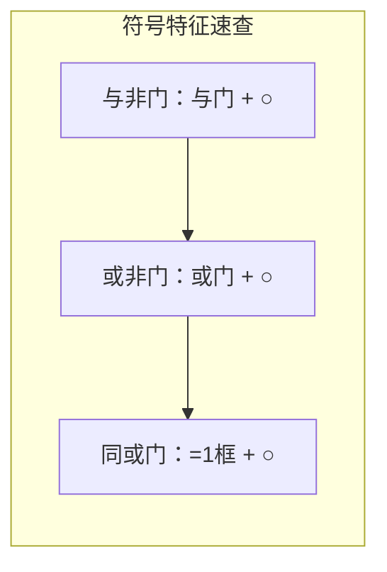

# 3.2 复合逻辑运算（Compound Logic Operations）

## 一、是什么（概念与定位）

复合逻辑运算是把与、或、非三种基本运算**组合**起来得到的运算，主要包括：**与非（NAND）、或非（NOR）、与或非（AND-OR-NOT）、异或（XOR）、同或（XNOR）**。它们在实际数字电路中使用频率极高——尤其是与非门，被称为数字系统的"通用逻辑单元"。

## 二、原理与特性

### 1. 与非运算（NAND）：先与后非

- 逻辑表达式：`F = (AB)‾`
- **运算口诀："全 1 出 0，有 0 出 1"**——仅当所有输入均为 1 时输出为 0；只要有一个输入为 0，输出即为 1。
- 逻辑意义：通过与非门的组合可以实现与、或、非**所有**基本逻辑运算，因此与非门是构建数字系统的通用逻辑单元。

| A | B | F = (AB)‾ |
|---|---|-----------|
| 0 | 0 | 1 |
| 0 | 1 | 1 |
| 1 | 0 | 1 |
| 1 | 1 | 0 |

### 2. 或非运算（NOR）：先或后非

- 逻辑表达式：`F = (A+B)‾`
- **运算口诀："全 0 出 1，有 1 出 0"**——只有所有输入均为 0 时输出才为 1。
- 应用：构成 NOR 门，是数字电路中实现逻辑控制、信号反转及组合逻辑设计的关键单元，广泛应用于 CPU、存储器等集成电路中。

| A | B | F = (A+B)‾ |
|---|---|------------|
| 0 | 0 | 1 |
| 0 | 1 | 0 |
| 1 | 0 | 0 |
| 1 | 1 | 0 |

### 3. 与或非运算（AND-OR-NOT）

- 逻辑表达式：`F = (AB + CD)‾`
- 逻辑关系：先把各组与项相或，再整体取反。对应与或非门（AOI 门），一个器件即可完成"与-或-非"三级运算。

### 4. 异或运算（XOR）："相异为 1"

- 逻辑表达式：`F = A ⊕ B = AB‾ + A‾B`
- **运算规则：输入相异输出 1，相同输出 0**。是数字电路中实现"比较"与"校验"功能的基础。
- 运算特性：满足**交换律与结合律**，即 A⊕B = B⊕A，(A⊕B)⊕C = A⊕(B⊕C)。

| A | B | F = A⊕B |
|---|---|---------|
| 0 | 0 | 0（相同为 0） |
| 0 | 1 | 1（相异为 1） |
| 1 | 0 | 1（相异为 1） |
| 1 | 1 | 0（相同为 0） |

异或符号为框内标注 `=1`（IEC 标准：恰好一个输入为 1 时输出为 1）。

### 5. 同或运算（XNOR）："相同为 1"

- 逻辑表达式：`F = A ⊙ B = AB + (AB)‾`（即异或的取反：`A ⊙ B = (A⊕B)‾`）
- **运算规则：输入相同输出 1，否则输出 0**。
- 性质：满足交换律与结合律，常用于**奇偶校验电路**设计与数值比较器。

| A | B | F = A⊙B |
|---|---|---------|
| 0 | 0 | 1 |
| 0 | 1 | 0 |
| 1 | 0 | 0 |
| 1 | 1 | 1 |

同或符号为框内标注 `=`（IEC 标准：输入全相同则输出 1）。

## 三、符号与图形（图文并茂）

**与非门逻辑符号**（IEEE 独特形状 = 与门加小圆圈；IEC 矩形 = `&` 加小圆圈）：

其余复合门可用 Mermaid 补充对照：

> 关键规律：**与非 = 与门输出加小圆圈，或非 = 或门输出加小圆圈，同或 = 异或输出加小圆圈**。凡在输出端加"○"（取反圈）即在原有运算结果上取反。

## 四、典型例题/应用

**例 1**：用与非门实现 `F = A + B`。

思路：两次取反 + 摩根定律：
`F = A + B = ((A+B)‾)‾ = (A‾·B‾)‾`
即：A、B 各经一个非门（与非门两输入短接可实现非），再经一个两输入与非门即可。

**例 2（应用）**：用异或门设计"奇偶校验"电路：判断 3 位输入 A、B、C 中 1 的个数是否为奇数。

思路：`F = A ⊕ B ⊕ C`。由结合律逐位异或即可：输入中 1 的个数为奇数时 F=1。同理 `A ⊙ B ⊙ C` 在 1 的个数为偶数（含 0）时输出 1。

## 五、易错点

1. **与非 vs 或非口诀勿混**：与非是"全 1 出 0"（针对输入全 1），或非是"全 0 出 1"（针对输入全 0）。
2. **异或与同或互为反函数**：`(A⊕B)‾ = A⊙B`，但注意 `(A⊕B)‾ ≠ A‾⊕B‾`（后两者实际相等，仍为异或）。牢记：同或 = 异或整体取反，不是把每个变量取反。
3. 多变量异或的判断标准是"**1 的个数为奇数**"，而不是"输入两两比较"。
4. 与或非运算中，取反号覆盖的是**整个与-或式**：`(AB+CD)‾`，展开时要用摩根定律，不能只给部分项加非号。

## 六、知识点总结

| 运算 | 表达式 | 口诀 | 互反关系 |
|------|--------|------|----------|
| 与非 | (AB)‾ | 全 1 出 0，有 0 出 1 | 与运算的取反 |
| 或非 | (A+B)‾ | 全 0 出 1，有 1 出 0 | 或运算的取反 |
| 与或非 | (AB+CD)‾ | 先与或，后取反 | — |
| 异或 | A⊕B | 相异为 1 | 与同或互为反 |
| 同或 | A⊙B | 相同为 1 | 与异或互为反 |
