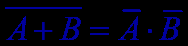
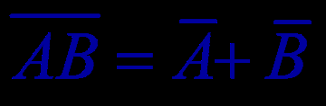
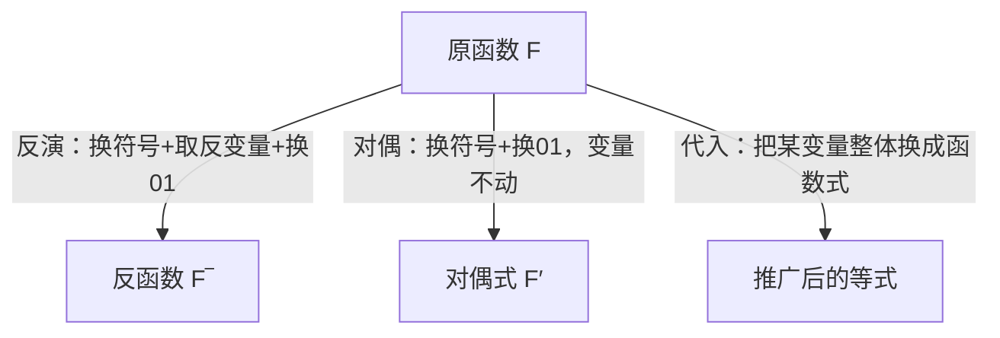

# 3.3 逻辑代数公理、基本定理与运算规则（Axioms, Theorems & Rules）

## 一、是什么（概念与定位）

逻辑代数的公理、定理与运算规则是**一切逻辑函数化简与变换的依据**。掌握本节内容是学好公式化简法（3.6）的前提，其中**摩根定律（反演律）**是全章最核心、应用最广泛的定理。

## 二、原理与特性

### 1. 公理系统（满足一致性、独立性、完备性）

公理系统的三大特性：
- **一致性**：公理之间无矛盾，推导结果唯一；
- **独立性**：无冗余公理，缺一不可；
- **完备性**：能推导出所有逻辑代数定理与公式。

**0、1 律：**

| 加法形式 | 乘法形式 |
|----------|----------|
| A + 0 = A | A · 1 = A |
| A + 1 = 1 | A · 0 = 0 |

**互补律：**

| 加法形式 | 乘法形式 |
|----------|----------|
| A + Ā = 1 | A · Ā = 0 |

由此可得常量关系：`0‾ = 1`，`1‾ = 0`。

### 2. 基本运算规律（定理 1~8）

| 定律 | 加法形式 | 乘法形式 |
|------|----------|----------|
| 交换律 | A + B = B + A | A·B = B·A |
| 结合律 | (A+B)+C = A+(B+C) | (A·B)·C = A·(B·C) |
| 分配律 | A·(B+C) = A·B + A·C | **A + BC = (A+B)(A+C)** |
| 重叠律 | A + A = A | A·A = A |
| 吸收律 | **A + AB = A** | **A(A+B) = A** |
| 定理4（消去律） | **A + ĀB = A + B** | **A(Ā+B) = A·B** |
| 还原律 | (A‾)‾ = A | — |
| 反演律（摩根定律） | (A+B)‾ = Ā·B̄ | (A·B)‾ = Ā + B̄ |

> 注意：`A + BC = (A+B)(A+C)` 是逻辑代数**特有**的分配律，普通代数中没有，是重要考点。

**典型证明示例（吸收律 A + AB = A）：**

```
A + AB = A·1 + A·B      （0-1律）
       = A·(1 + B)      （分配律）
       = A·1            （0-1律，1+B=1）
       = A              （0-1律）
```

**定理 4 证明（A + ĀB = A + B）：**

```
A + ĀB = (A + Ā)(A + B)   （分配律第二式）
       = 1 · (A + B)      （互补律）
       = A + B            （0-1律）
```

**定理 7（互补项合并）与定理 8（冗余项消去）：**

| 定理 | 公式 |
|------|------|
| 定理 7 互补项合并 | AB + ĀB‾→ AB + ĀB = A；AB + ĀB = A（互补项相或消去）|
| 定理 8 冗余项消去 | **AB + ĀC + BC = AB + ĀC**（冗余项 BC 可消去） |

定理 8 是化简中的高频公式：当一个与项含 A、另一与项含 Ā，且剩余因子组成的第三项出现时，第三项是冗余的。

### 3. 摩根定律（反演律）——核心定理

$$\overline{A+B} = \overline{A}\cdot\overline{B} \qquad \overline{A\cdot B} = \overline{A}+\overline{B}$$





**真值表证明法**（以 (A·B)‾ = Ā+B̄ 为例）：

| A | B | (A·B)‾ | Ā+B̄ |
|---|---|--------|------|
| 0 | 0 | 1 | 1 |
| 0 | 1 | 1 | 1 |
| 1 | 0 | 1 | 1 |
| 1 | 1 | 0 | 0 |

两列完全一致，等式得证。**任何逻辑恒等式都可用真值表法证明**——枚举输入所有取值组合，验证等式两边结果一致即可。

**代数证明思路**：令 X = Ā、Y = B̄，验证 X+Y 与 (AB)‾ 满足"和为 1 且积为 0"（互补律定义），则二者互为反函数。

### 4. 三大基本运算规则

#### （1）代入规则

在包含变量 A 的逻辑等式中，若用另一个**函数式**代入式中所有 A 的位置，则等式仍然成立。

**示例**：已知 B(A+C) = BA + BC，用 (A+D) 代替所有 A：
`B[(A+D)+C] = B(A+D) + BC = BA + BD + BC` ✓

> 意义：代入规则可将双变量公式推广到任意多变量，如摩根定律因此可推广为 (A+B+C)‾ = Ā·B̄·C̄。

#### （2）反演规则

对任意逻辑函数 F，将式中：
- 所有 `·` 换成 `+`，`+` 换成 `·`；
- 原变量换成反变量，反变量换成原变量；
- `1` 换成 `0`，`0` 换成 `1`；

所得结果即 F 的**反函数 F‾**。**注意：必须保持原运算优先级不变**（必要时加括号）。

**例**：求 F = A(B + CD)‾ + 0 的反函数。
按反演规则：F‾ = [A‾ + (B‾·(C‾ + D‾))]·1 = Ā + B̄(C̄ + D̄)

#### （3）对偶规则

对任意逻辑函数式 F，将式中所有 `·` 换 `+`、`+` 换 `·`；`1` 换 `0`、`0` 换 `1`（**变量不取反！**），所得新函数式即 F 的对偶式，记作 F′。

**规则**：若某个逻辑恒等式成立，则该恒等式**两侧的对偶式也相等**。利用对偶规则可从已知公式推出更多公式。

**例**：F = (A + B̄)(A + C)，其对偶式为：
F′ = (A·B̄) + (A·C) = AB̄ + AC

> 对偶与反演的区别就一条：**反演规则变量要取反，对偶规则变量保持不变**。

## 三、符号与图形（图文并茂）

用 Mermaid 梳理三大规则的关系：



## 四、典型例题/应用

**例 1**：求 F = A(B + C) 的反函数与对偶式。

- 反函数（反演规则，变量取反、注意加括号保优先级）：F‾ = Ā + (B̄·C̄)
- 对偶式（变量不动）：F′ = A + B·C

**例 2**：化简 Y = (A + B)(A + C)。

利用对偶的分配律 A + BC = (A+B)(A+C)：直接读出 Y = A + BC。可见对偶式在手，公式可"双向使用"。

## 五、易错点

1. **反演时括号顺序**：F = (A+B)·C 的反函数是 Ā·B̄ + C̄，**不能**写成 Ā + B̄·C̄——必须给与运算的各反变量加括号保持优先级。
2. **对偶 ≠ 反演**：对偶规则中变量**不取反**；混淆二者是最高频错误。
3. **分配律第二式** A + BC = (A+B)(A+C) 只在逻辑代数中成立，不要凭普通代数直觉否定它。
4. 吸收律 A + AB = A 中被吸收的是**含 A 的乘积项**；A + ĀB = A + B 消去的是**反变量因子**，两个公式用途不同，前者"整体吸收"，后者"消去互补因子"。
5. 冗余项消去 AB + ĀC + BC = AB + ĀC 中，冗余项 BC 的因子必须恰好来自前两项的**剩余因子**，否则不适用。

## 六、知识点总结

| 类别 | 必背内容 |
|------|----------|
| 公理 | 0-1 律、互补律（A+Ā=1，A·Ā=0） |
| 核心定律 | 摩根定律、吸收律、消去律、还原律、分配律两式 |
| 三大规则 | 代入规则（推广公式）、反演规则（求反函数）、对偶规则（求对偶式、推导新公式） |
| 化简利器 | A+AB=A；A+ĀB=A+B；AB+ĀC+BC=AB+ĀC |
