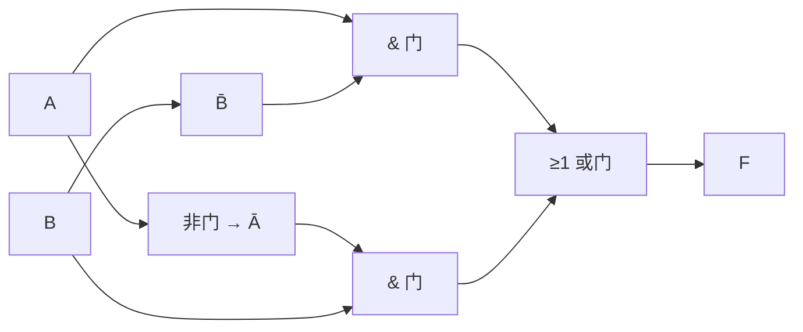
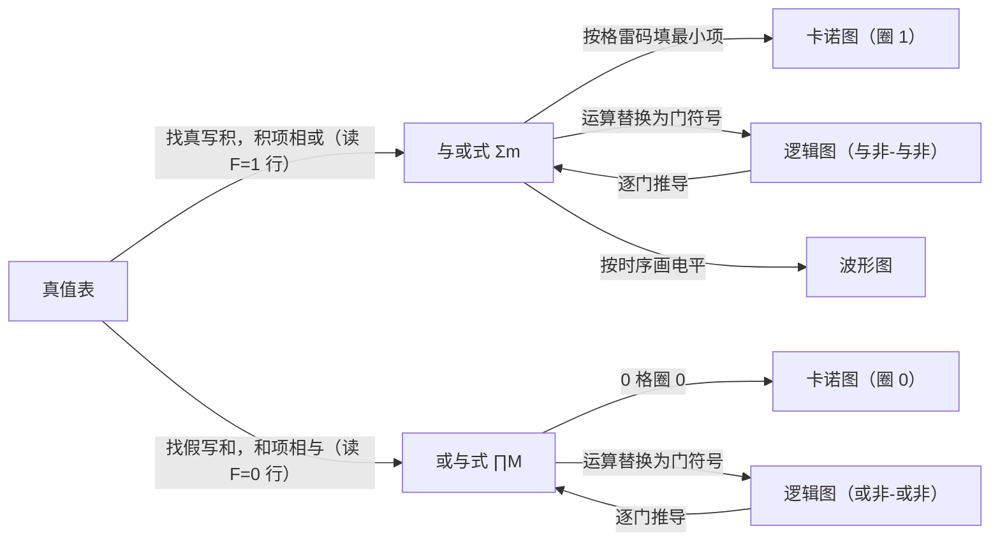

# 3.4 逻辑函数的表示方法（Representation of Logic Functions）

## 一、是什么（概念与定位）

同一个逻辑函数可以有**五种常用的表示方法**：**逻辑真值表、逻辑函数式、卡诺图、逻辑图、波形图**。它们各有侧重、可以互相转换——这是逻辑电路"分析"（图→式→表）与"设计"（表→式→图）两条主线的桥梁。

## 二、原理与特性

### 1. 逻辑真值表（Truth Table）

把输入变量的**所有取值组合**与其对应的输出函数值列成表格。是最直观、最完备的表示方法。

**建立步骤（逻辑抽象）**：
1. 确定输入变量与输出函数，并进行赋值定义（如开关"向上=1、向下=0"，灯"亮=1、灭=0"）；
2. 列出所有输入组合（n 个变量共 2ⁿ 行）；
3. 根据逻辑要求填出每组输入对应的输出值。

**实例（楼道双控开关灯）**：A、B 为楼上楼下两个开关，规定"开关状态相同时灯亮"。

| A | B | F |
|---|---|---|
| 0 | 0 | 1 |
| 0 | 1 | 0 |
| 1 | 0 | 0 |
| 1 | 1 | 1 |

### 2. 逻辑函数式（Logic Expression）

用与、或、非运算组合起来表示输出与输入关系的代数式。

**由真值表写逻辑式的通用方法——口诀："找真写积，积项相或"**：
1. 找出所有使 F=1 的行；
2. 每一行写成一个乘积项（输入为 1 写原变量，为 0 写反变量）；
3. 所有乘积项相或。

**例**：已知真值表，F=1 的行是 (0,0) 与 (1,1)：

| A | B | F |
|---|---|---|
| 0 | 0 | 1 |
| 0 | 1 | 0 |
| 1 | 0 | 0 |
| 1 | 1 | 1 |

写出：`F = A‾B̄ + AB`（即同或）。**这一步得到的正是标准与或式（最小项之和）**。

### 3. 由真值表写或与式——"找假写和，和项相与"（对偶的另一半）

上面第 2 条读的是 **F=1 的行**；同一张真值表**反过来读 F=0 的行**，得到的是**标准或与式（最大项之积）**。这两条路互为对偶，缺一条，遇到"只许用或非门实现""求最大项之积"这类要求就只能照搬与或式的做法。

**分型判据一句话**：看**哪种行少**——F=1 少就走"找真写积"，F=0 少就走"找假写和"；题目限定或非门时，一律走"找假写和"。

| 对比项 | 找真写积（与或式） | 找假写和（或与式） |
|---|---|---|
| 读哪些行 | F = 1 的行 | F = 0 的行 |
| 每行写什么 | 一个**乘积项（与项）** | 一个**和项（或项）** |
| 变量取值的写法 | 取 1 写原变量、取 0 写反变量 | **取 0 写原变量、取 1 写反变量**（恰相反） |
| 项与项之间 | 相**或** | 相**与** |
| 标准式名称 | Σm（最小项之和） | ∏M（最大项之积） |
| 卡诺图对应 | 圈 **1** | 圈 **0**（3.7） |
| 门电路对应 | 与非-与非 | 或非-或非（4.1、4.2） |

**例（与上例同一张真值表，反着读）**：F=0 的行是 000、010、011，逐行写和项：

- 000 → A=0、B=0、C=0 → 全取原变量 → $(A+B+C)=M_0$
- 010 → A=0、B=1、C=0 → 取 1 的 B 写反变量 → $(A+\bar B+C)=M_2$
- 011 → $(A+\bar B+\bar C)=M_3$

三个和项相**与**：$F=(A+B+C)(A+\bar B+C)(A+\bar B+\bar C)=\prod M(0,2,3)$。

**为什么补它是"等价"而不是另写一个函数**：可以从两个方向验。

1. **编号互补**：与或式用了 {1,4,5,6,7}，或与式用了 {0,2,3}，两者正好拼满 0~7，不重不漏；
2. **代数验**：把 $M_0M_2M_3$ 展开或直接代值——凡是让某一和项为 0 的取值（即 000、010、011），乘积必为 0；其余取值三个和项全为 1，乘积为 1，与真值表逐行一致。

根子是 3.5 的结论：**同一编号的最小项与最大项互为反函数**（$M_i=\bar m_i$）。

**为什么两条路都得会**：

1. 题目写"**仅用或非门实现**"时，或非-或非结构天然对应或与式，先有或与式就一步到位，硬从与或式转要做摩根 + 分配律，步骤翻倍还易错；
2. F=0 的行少时，或与式短得多（见例 3，一个和项搞定）；
3. 卡诺图 1 圈 / 0 圈、公式法 与或 / 或与，是同一件事的四种写法，考法可以任意组合。

### 4. 卡诺图（Karnaugh Map）

将 n 变量的全部 2ⁿ 个最小项填入按**格雷码**顺序排列的方格图，使逻辑相邻的最小项在几何位置上也相邻（详见 3.7）。卡诺图本质上是真值表的"图形化重排"。

### 5. 逻辑图（Logic Diagram）

将函数式中的与、或、非运算替换为对应**逻辑门符号**，并按运算优先级连接而成的电路图。它是**从逻辑设计到实际电路实现的关键媒介**。

**例**：已知 `F = A·B‾ + A‾·B`（异或），画逻辑图：

（注：此电路即"异或门"，输入相异时输出为 1。）

### 6. 波形图（Timing Diagram）

用随时间变化的各变量电平波形表示输入输出关系，能直观反映**信号随时间的动态关系**，是时序分析和仿真验证的主要工具（本章作了解，时序电路章节重点使用）。

## 三、符号与图形（图文并茂）

五种表示方法之间的转换关系（真值表走向逻辑式有**两条对称的路**）：

## 四、典型例题/应用

**例 1**：已知逻辑函数 `F = A + B‾C`，写出真值表。

| A | B | C | F = A + B‾C |
|---|---|---|-------------|
| 0 | 0 | 0 | 0 |
| 0 | 0 | 1 | 1 |
| 0 | 1 | 0 | 0 |
| 0 | 1 | 1 | 0 |
| 1 | 0 | 0 | 1 |
| 1 | 0 | 1 | 1 |
| 1 | 1 | 0 | 1 |
| 1 | 1 | 1 | 1 |

对应的函数标准与或式：`F = A‾B̄C + AB̄C̄ + AB̄C + ABC̄ + ABC = Σm(1, 4, 5, 6, 7)`。

**例 2**：由真值表直接写函数式：F=1 的行为 (0,0,1)、(1,0,0)、(1,1,0)，
则 `F = A‾B̄C + AB̄C̄ + ABC̄`。

**例 3（0 少的场合——用或与式一步到位）**：某三变量函数只在 A=1、B=1、C=0 这一行输出 0，其余 7 行全为 1。

- **找假写和**：只有一行 F=0，即 110 → 取 1 的 A、B 写反变量、取 0 的 C 写原变量 → 和项 $(\bar A+\bar B+C)$；
- 只有一个和项，直接得：$F=\bar A+\bar B+C$（1 项 3 个因子）；
- **若硬走找真写积**：7 个最小项相或，再靠卡诺图合并才能化简到同一式子，绕一大圈。

**验**：把 110 代进去，$\bar A+\bar B+C=0+0+0=0$ ✓；其余 7 行至少有 A=0 或 B=0 或 C=1，三项中必有一项为 1 ✓。

> 对照记法：**判 1 少还是 0 少先看真值表**；1 少圈 1 写积、0 少圈 0 写和。**F=0 只有一行时，或与式就是最简式，不必化简。**

## 五、易错点

1. **真值表必须列全 2ⁿ 行**，不能漏组合；变量赋值约定（哪个状态算 1）要先声明再列表。
2. **由真值表写式子时方向易反**：输入取值 1 写**原变量**、0 写**反变量**，顺序固定为 A、B、C…，切勿把行号当变量值。
3. **画逻辑图要按优先级连接**：先与后或、括号优先、非号紧贴变量；不能随意交换门的位置。
4. 五种表示方法**同一函数只能对应一个真值表、一个卡诺图、一个标准与或式、一个标准或与式**，但一般与或式、逻辑图可以有多种（化简程度不同）。
5. 逻辑图与函数式互推时，从输出端**倒推**（输出是什么运算→逐级往前）比顺推不易出错。
6. **两条写式路径的取值规则恰好相反**：与或式"取 1 写原变量"，或与式"取 0 写原变量"。同一个 010 行，积项写 $\bar A B\bar C$、和项写 $(A+\bar B+C)$——规则写反，整式全错。
7. **和项之间是"与"不是"或"**：写成 $(A+B+C)+(A+\bar B+C)$ 是把或与式错当与或式，函数值完全不同（前者只在 0 行取 0，后者几乎恒为 1）。

## 六、知识点总结

| 表示方法 | 特点 | 互转关键 |
|----------|------|----------|
| 真值表 | 最完备、直观，2ⁿ 行 | "找真写积，积项相或"得标准与或式 |
| 真值表（反着读） | 同上，读 F=0 的行 | "找假写和，和项相与"得标准或与式 |
| 逻辑函数式 | 简洁，可运算化简 | 配项/展开可得标准式；与或式与或与式互为对偶 |
| 卡诺图 | 几何相邻=逻辑相邻，化简利器 | 格雷码排列；1 少圈 1、0 少圈 0 |
| 逻辑图 | 对应实际电路 | 与运算优先级一致；与非-与非↔与或式、或非-或非↔或与式 |
| 波形图 | 反映时间动态关系 | 逐时刻对应 |

**两条写式路径一句话对照**：读 **F=1** 的行 → 积项相或 → Σm；读 **F=0** 的行 → 和项相与 → ∏M。变量取值规则相反、编号互补（见 3.5），卡诺图上分别对应圈 1 与圈 0（见 3.7）。
