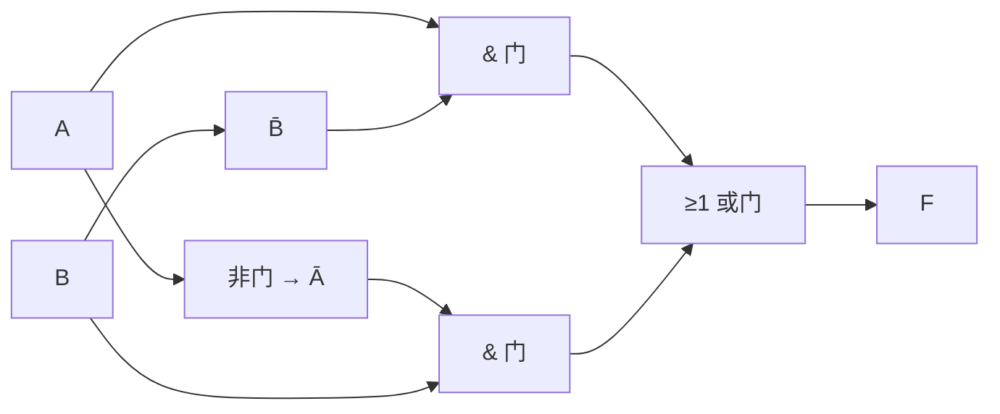
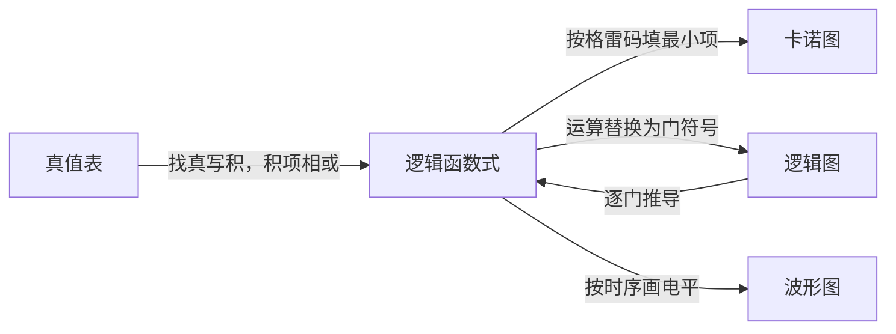

# 3.4 逻辑函数的表示方法（Representation of Logic Functions）

## 一、是什么（概念与定位）

同一个逻辑函数可以有**五种常用的表示方法**：**逻辑真值表、逻辑函数式、卡诺图、逻辑图、波形图**。它们各有侧重、可以互相转换——这是逻辑电路"分析"（图→式→表）与"设计"（表→式→图）两条主线的桥梁。

## 二、原理与特性

### 1. 逻辑真值表（Truth Table）

把输入变量的**所有取值组合**与其对应的输出函数值列成表格。是最直观、最完备的表示方法。

**建立步骤（逻辑抽象）**：
1. 确定输入变量与输出函数，并进行赋值定义（如开关"向上=1、向下=0"，灯"亮=1、灭=0"）；
2. 列出所有输入组合（n 个变量共 2ⁿ 行）；
3. 根据逻辑要求填出每组输入对应的输出值。

**实例（楼道双控开关灯）**：A、B 为楼上楼下两个开关，规定"开关状态相同时灯亮"。

| A | B | F |
|---|---|---|
| 0 | 0 | 1 |
| 0 | 1 | 0 |
| 1 | 0 | 0 |
| 1 | 1 | 1 |

### 2. 逻辑函数式（Logic Expression）

用与、或、非运算组合起来表示输出与输入关系的代数式。

**由真值表写逻辑式的通用方法——口诀："找真写积，积项相或"**：
1. 找出所有使 F=1 的行；
2. 每一行写成一个乘积项（输入为 1 写原变量，为 0 写反变量）；
3. 所有乘积项相或。

**例**：已知真值表，F=1 的行是 (0,0) 与 (1,1)：

| A | B | F |
|---|---|---|
| 0 | 0 | 1 |
| 0 | 1 | 0 |
| 1 | 0 | 0 |
| 1 | 1 | 1 |

写出：`F = A‾B̄ + AB`（即同或）。**这一步得到的正是标准与或式（最小项之和）**。

### 3. 卡诺图（Karnaugh Map）

将 n 变量的全部 2ⁿ 个最小项填入按**格雷码**顺序排列的方格图，使逻辑相邻的最小项在几何位置上也相邻（详见 3.7）。卡诺图本质上是真值表的"图形化重排"。

### 4. 逻辑图（Logic Diagram）

将函数式中的与、或、非运算替换为对应**逻辑门符号**，并按运算优先级连接而成的电路图。它是**从逻辑设计到实际电路实现的关键媒介**。

**例**：已知 `F = A·B‾ + A‾·B`（异或），画逻辑图：

（注：此电路即"异或门"，输入相异时输出为 1。）

### 5. 波形图（Timing Diagram）

用随时间变化的各变量电平波形表示输入输出关系，能直观反映**信号随时间的动态关系**，是时序分析和仿真验证的主要工具（本章作了解，时序电路章节重点使用）。

## 三、符号与图形（图文并茂）

五种表示方法之间的转换关系：

## 四、典型例题/应用

**例 1**：已知逻辑函数 `F = A + B‾C`，写出真值表。

| A | B | C | F = A + B‾C |
|---|---|---|-------------|
| 0 | 0 | 0 | 0 |
| 0 | 0 | 1 | 1 |
| 0 | 1 | 0 | 0 |
| 0 | 1 | 1 | 0 |
| 1 | 0 | 0 | 1 |
| 1 | 0 | 1 | 1 |
| 1 | 1 | 0 | 1 |
| 1 | 1 | 1 | 1 |

对应的函数标准与或式：`F = A‾B̄C + AB̄C̄ + AB̄C + ABC̄ + ABC = Σm(1, 4, 5, 6, 7)`。

**例 2**：由真值表直接写函数式：F=1 的行为 (0,0,1)、(1,0,0)、(1,1,0)，
则 `F = A‾B̄C + AB̄C̄ + ABC̄`。

## 五、易错点

1. **真值表必须列全 2ⁿ 行**，不能漏组合；变量赋值约定（哪个状态算 1）要先声明再列表。
2. **由真值表写式子时方向易反**：输入取值 1 写**原变量**、0 写**反变量**，顺序固定为 A、B、C…，切勿把行号当变量值。
3. **画逻辑图要按优先级连接**：先与后或、括号优先、非号紧贴变量；不能随意交换门的位置。
4. 五种表示方法**同一函数只能对应一个真值表、一个卡诺图、一个标准与或式**，但一般与或式、逻辑图可以有多种（化简程度不同）。
5. 逻辑图与函数式互推时，从输出端**倒推**（输出是什么运算→逐级往前）比顺推不易出错。

## 六、知识点总结

| 表示方法 | 特点 | 互转关键 |
|----------|------|----------|
| 真值表 | 最完备、直观，2ⁿ 行 | "找真写积，积项相或"得标准式 |
| 逻辑函数式 | 简洁，可运算化简 | 配项/展开可得标准式 |
| 卡诺图 | 几何相邻=逻辑相邻，化简利器 | 格雷码排列 |
| 逻辑图 | 对应实际电路 | 与运算优先级一致 |
| 波形图 | 反映时间动态关系 | 逐时刻对应 |
