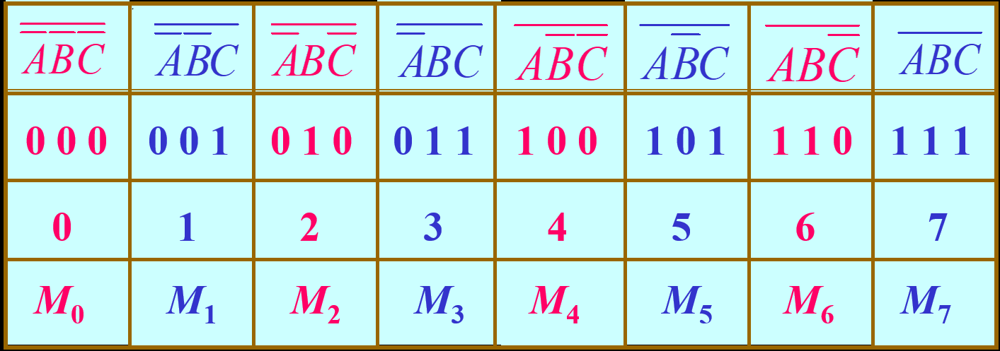
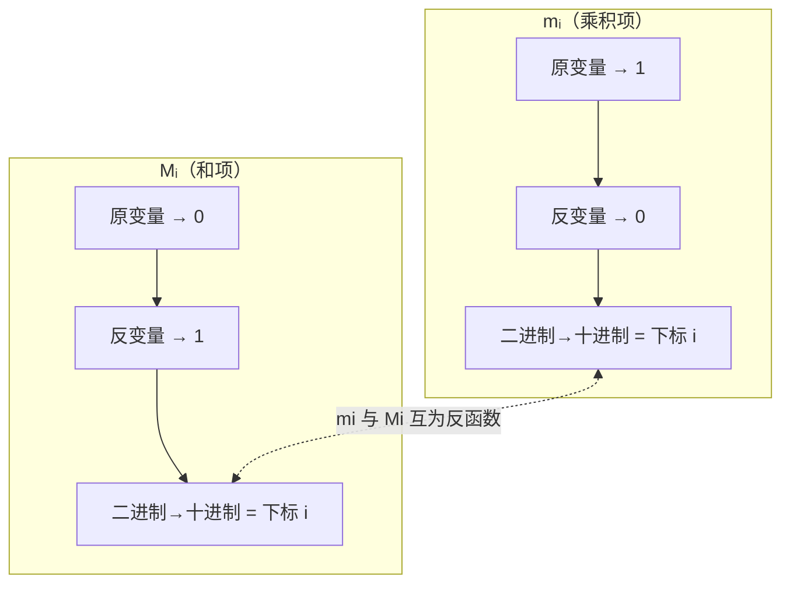

# 3.5 逻辑函数的两种标准形式（Minterms & Maxterms）

## 一、是什么（概念与定位）

任何逻辑函数都可以唯一地表示为两种标准形式之一：
1. **最小项之和**（标准与-或表达式，Σm 形式）；
2. **最大项之积**（标准或-与表达式，∏M 形式）。

最小项是逻辑函数标准化的"原子单元"，是掌握卡诺图化简（3.7）与电路设计的**前提**。

## 二、原理与特性

### 1. 最小项（Minterm）

**定义**：在 n 个变量的逻辑函数中，若 m 是包含**全部 n 个变量**的乘积项，且每个变量以原变量或反变量形式**出现且仅出现一次**，则 m 称为该组变量的最小项。

三要素：
- **完备性**：必须涵盖全部 n 个变量，不允许缺失任何变量因子；
- **唯一性**：每个变量仅出现一次（原变量或反变量二选一）；
- **互斥性**：任意两个不同最小项的乘积恒为 0。

**最小项数量**：n 个变量共有 **2ⁿ 个最小项**（2 变量 4 个、3 变量 8 个、4 变量 16 个），数量只取决于变量个数，与具体逻辑关系无关。

**最小项编号**：把最小项对应的变量取值（原变量=1，反变量=0）当作二进制数，其十进制值即编号 mᵢ。以三变量为例：

| A | B | C | 最小项 | 编号 |
|---|---|---|--------|------|
| 0 | 0 | 0 | A‾B̄C̄ | m₀ |
| 0 | 0 | 1 | A‾B̄C | m₁ |
| 0 | 1 | 0 | A‾BC̄ | m₂ |
| 0 | 1 | 1 | A‾BC | m₃ |
| 1 | 0 | 0 | AB̄C̄ | m₄ |
| 1 | 0 | 1 | AB̄C | m₅ |
| 1 | 1 | 0 | ABC̄ | m₆ |
| 1 | 1 | 1 | ABC | m₇ |

**最小项的四条性质**：
1. **唯一性**：任何一组输入取值下，必有一个且仅有一个最小项的值为 1；
2. **完备性**：全体最小项之和为 1，即 m₀+m₁+…+m₇ = 1；
3. **正交性**：任意两个不同最小项之积为 0，即 mᵢ·mⱼ = 0（i≠j）；
4. **可合并性**：逻辑相邻（只有一个变量互为反变量）的两个最小项之和可合并为一项，**消去那个取值互补的变量**。例如 m₁ + m₃ = A‾B̄C + A‾BC = A‾C。

### 2. 标准与或式（最小项之和）的转化方法——"补项配平"

任意与或式 → 标准与或式的四步法：
1. **补项配平**：利用互补律 A + Ā = 1 给缺变量的乘积项乘以"1"补全变量；
2. **乘开展开**：按分配律展开所有乘积项；
3. **合并去重**：相同最小项只保留一个；
4. **编号标注**：写成 Σm(…) 形式。

**例 6**：将 F = AB + C 化成最小项之和。

```
F = AB + C
  = AB(C‾+C) + (A‾+A)(B‾+B)C     （补项配平）
  = ABC‾ + ABC + A‾B‾C + A‾BC + AB‾C + ABC   （展开）
  = A‾B‾C + A‾BC + AB‾C + ABC‾ + ABC        （合并重复的 ABC）
  = m₁ + m₃ + m₅ + m₆ + m₇
  = Σm(1, 3, 5, 6, 7)
```

**例（含非号先化简）**：将 L(A,B,C) = ((AB + ĀB̄ + C̄)‾·AB)‾ 化为标准最小项之和。

- **去非号**（摩根定律逐层消去外层非号）：L = (AB + ĀB̄ + C̄)‾ + AB = (A‾+B‾)(A+B)C + AB = ĀC·… 化简合并后 L = AB；
- **配项成最小项**：L = AB(C‾+C) = ABC̄ + ABC = m₆ + m₇ = **Σm(6, 7)**。

### 3. 最大项（Maxterm）

**定义**：在 n 个变量的逻辑函数中，若 M 是包含全部 n 个变量的**和项**（或项），且每个变量以原变量或反变量形式出现且仅出现一次，则 M 称为该组变量的最大项，记作 Mᵢ。

**最大项编号规则（与最小项相反！）**：**原变量对应 0，反变量对应 1**。三变量最大项编号表：



> 图中上方为各最大项表达式（如 M₀ = A+B+C 对应取值 000），中间为变量取值组合的十进制编号，最下行标注 M₀~M₇。注意编号时 **0↔原变量、1↔反变量**，与最小项刚好相反。

**最大项的性质**（与最小项对偶）：
1. **唯一性**：任何取值组合下，必有且仅有一个最大项的值为 0；
2. **完备性**：全体 2ⁿ 个最大项之积恒为 0；
3. **互补性（正交性）**：任意两个不同最大项之和恒为 1，即 Mᵢ + Mⱼ = 1（i≠j）；
4. **可合并性**：只有一个变量不同的两个最大项相乘，结果等于各相同变量之和（消去互补变量）。

**重要关系：相同编号的最小项与最大项互为反函数**：

$$m_i = \overline{M_i} \qquad M_i = \overline{m_i}$$

例如 m₃ = A‾BC，M₃ = A+B̄+C̄，二者互为反。

### 4. 标准或与式（最大项之积）与两种形式的互换

**定理**：若 F = Σm(i)，则 F = ∏M(k)，其中 k 为**未出现在 Σ 中的编号**。

**例 8**：将 F = AB + C（即 F = Σm(0,2,4,6,7)）化成最大项之积。

编号 0,2,4,6,7 之外的是 1, 3, 5：
- 编号 1 → 001 → M₁ = A+B+C̄
- 编号 3 → 011 → M₃ = A+B̄+C̄
- 编号 5 → 101 → M₅ = A‾+B̄+C̄

所以 **F = M₁ · M₃ · M₅ = (A+B+C̄)(A+B̄+C̄)(A‾+B̄+C̄)**。

## 三、符号与图形（图文并茂）

最小项与最大项的编号规则对比：



## 四、典型例题/应用

**例**：将 Y = AB + BC + CA 化为标准与或式。

```
Y = AB(C‾+C) + (A‾+A)BC + A(B‾+B)C
  = ABC‾ + ABC + A‾BC + ABC + AB‾C + ABC
  = A‾BC + AB‾C + ABC‾ + ABC          （合并去重）
  = m₃ + m₅ + m₆ + m₇ = Σm(3, 5, 6, 7)
```

**结论**：无论用哪种方法转换，同一函数的最小项组合**固定不变**——标准与或式是唯一的，这为函数化简与电路实现提供了统一判定依据。

## 五、易错点

1. **最小项与最大项的编号规则相反**：最小项"原变量=1"，最大项"原变量=0"。混用必错。
2. **补项时只能乘"(X+X‾)"，不能凭空加项**：补的是缺失的变量，且每个缺变量的项要补"该变量的 1"（即 X‾+X）。
3. **重复最小项要合并**：展开后同一 mᵢ 出现多次只保留一个（A + A = A）。
4. Σm 与 ∏M 互补：∏M 用的是 Σ 中**没有的编号**，且 M 内部写的是**和项**不是乘积项。
5. n 变量最小项必须含**全部 n 个变量**——像 AB、B̄C 这种缺变量的项都不是最小项，必须配平后才可编号。

## 六、知识点总结

| 对比项 | 最小项 mᵢ | 最大项 Mᵢ |
|--------|-----------|-----------|
| 形式 | 乘积项（含全部变量） | 和项（含全部变量） |
| 编码 | 原变量=1，反变量=0 | 原变量=0，反变量=1 |
| 取 1/0 | 恰有一组取值使其为 1 | 恰有一组取值使其为 0 |
| 标准式 | 最小项之和 Σm（标准与或式，唯一） | 最大项之积 ∏M（标准或与式，唯一） |
| 互换 | F = Σm(i) ⟺ F = ∏M(补编号) | mi 与 Mi 互为反函数 |
