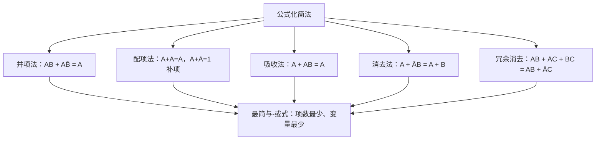

# 3.6 逻辑函数的公式化简法（Algebraic Simplification）

## 一、是什么（概念与定位）

**公式化简法（代数化简法）**：运用逻辑代数的基本定律、恒等式和基本规则，对逻辑表达式进行推演化简的方法。与之并列的是图形化简法（卡诺图法，见 3.7）。

**化简目标（最简与-或表达式）**：在与逻辑关系相同的若干与-或表达式中，**与项数最少，且每个与项中变量数最少**的那个。化简的目的是使电路结构更简单、门数更少、成本更低、可靠性更高。

同一函数可有多种表达式形式（与-或、或-与、与非-与非、或非-或非、与-或-非），例如：

```
L = AC + C̄D           （与-或）
  = ((AC + C̄D)‾)‾ = ((AC)‾·(C̄D)‾)‾   （与非-与非）
  = (A‾ + C‾)(C + D‾)  （或-与）
  = ((A‾+C‾)(C+D‾))‾ = …  （或非-或非 / 与-或-非）
```

## 二、原理与特性

公式法没有固定步骤，但常用以下**四种基本方法**，可单独或联合使用。

### 1. 并项法

**原理**：利用互补律 A + Ā = 1，将含有互补因子的项**分组提取公因子**后合并，消去互补变量。

**例 9**：化简 F = ABC + AB̄C + AB̄C̄ + ABC̄

```
F = ABC + ABC̄ + AB̄C + AB̄C̄        （交换律重排）
  = AB(C + C̄) + AB̄(C + C̄)        （提公因子）
  = AB + AB̄                        （互补律）
  = A(B + B̄) = A                   （再次并项）
```

### 2. 配项法

**原理**：利用重叠律 A + A = A 或互补律 A + Ā = 1，**人为添加辅助项**（重复项或互补项），构造可提取公因子的分组结构，再消去冗余变量。

**例 10**：化简 F = AB̄C + ABC + A‾BC

```
F = AB̄C + ABC + ABC + A‾BC        （重叠律补一项 ABC）
  = AC(B̄+B) + BC(A + A‾)          （重新分组）
  = AC + BC                        （互补律）
```

**例 11**：化简 F = AB̄ + B̄C̄ + BC̄ + ĀB

```
F = AB̄ + B̄C̄(A + Ā) + BC̄ + ĀB(A + Ā)     （配项：给两项分别乘 1）
  = AB̄ + AB̄C̄ + ĀB̄C̄ + ABC̄ + ĀBC̄ + ĀB
  = (AB̄ + AB̄C̄) + ĀB + (ĀB̄C̄ + ĀBC̄) + ABC̄…  （重组）
  = AB̄ + ĀB + C̄(B̄ + B) + …
  = AB̄ + ĀB + C̄
```

### 3. 吸收法

**原理**：利用吸收律 A + AB = A 消去多余项。当表达式中出现"单一变量（或整体）+ 含该变量的乘积项"时，可直接吸收。

**例 12**：化简 F = AB + AB(C + D)

```
F = AB + AB(C+D)                  （把 AB 看作整体 X）
  = X + X(C+D)                    （套用吸收律 X + X·Y = X）
  = AB
```

**乘法形式吸收**：A·(A+B) = A，同样支持整体代入：

```
F = AB·(AB + C + D) = AB
```

> 吸收法的关键是"**整体观**"：吸收律中的 A 不一定是单个变量，可以是任意函数式（代入规则）。当式中出现"某整体 + 含该整体的乘积项"时，直接吸收掉乘积项，一步到位。

### 4. 消去法

**原理**：利用公式 A + ĀB = A + B，消去多余的反变量因子。

**例 13**：化简 F = ĀB + AC + BC

```
F = ĀB + C(A + B)                 （提取公因子 C）
  = ĀB + C·(ĀB̄)‾                  （摩根定律：A+B = (ĀB̄)‾）
  = ĀB + C·(ĀB)‾                  （合并 ĀB̄ = Ā·B̄ = (A+B)‾，即 (ĀB)‾）
  = C + C‾·(ĀB)                   （交换次序，凑成 A + ĀB 形式，A:=C）
  = C + ĀB                         （消去法：A + ĀB = A + B）
```

**最简结果：F = ĀB + C**。本例综合运用了"提取公因子 + 摩根定律 + 消去法"三步。

### 5. 综合运用（分组凑项）

**例 14**：化简 F = ĀB + AB̅ + ĀB̅

```
F = ĀB + AB̅ + ĀB̅ + ĀB̅            （重叠律：补一项 ĀB̅）
  = (ĀB + ĀB̅) + (AB̅ + ĀB̅)        （重新分组）
  = Ā(B + B̅) + B̅(A + Ā)           （提公因子，互补律）
  = Ā + B̅
```

化简技巧：**通过"分组凑项"创造互补因子或常量因子是关键**。当直接化简无从下手时，先补项、再分组，往往一步打开局面。

### 6. 表达式形式变换（与非门 / 或非门实现）

已知最简式后，常要求**仅用某一种门**实现电路，方法是对偶/两次取反（课件例：L = AC + C̄D）：

| 目标形式 | 变换方法 | 结果 |
|----------|----------|------|
| 与非-与非 | 对与-或式两次取反，内层用摩根展开 | L = ((AC)‾·(C̄D)‾)‾ |
| 或-与 | 分配律 A+BC=(A+B)(A+C) 反向 | L = (A+C̄)(C+D) |
| 或非-或非 | 对或-与式两次取反，内层用摩根展开 | L = ((A+C̄)‾ + (C+D)‾)‾ |

> 规律：**与-或式两次取反 → 与非门实现；或-与式两次取反 → 或非门实现**。内层取反号保留，正好对应门输出端的取反圈。

## 三、符号与图形（图文并茂）

公式法常用"武器库"速查：



## 四、典型例题/应用

**例（消去法经典）**：化简 F = ĀB + AC + BC。

- 第一步：后两项提公因子 C：F = ĀB + C(A+B)
- 第二步：摩根变形 (A+B) = (ĀB̄)‾，令 X = ĀB，得 F = X + C·X‾
- 第三步：套用 X + X‾Y 中取 Y=C…（正用定理 4 的变形 X + C·X‾ = X + C）
- 结果：**F = ĀB + C**

验证：当 C=1 时 F=1（或项保证）；C=0 时 F=ĀB。与原式真值表完全一致。✓

## 五、易错点

1. **公式法没有唯一路径**：不同化简顺序可能得到形式不同但等价的结果，判定最简的标准是"与项最少 + 每项变量最少"。
2. **配项法补的项必须是"合法的 1"**：补 A‾+A 或重复项 A+A，补完后一定要"用得出去"（能配对消去），否则越配越繁。
3. **吸收的对象是"乘积项"，消去的对象是"因子"**：A+AB=A 吸收整项；A+ĀB=A+B 只消去反变量因子，别张冠李戴。
4. **与非门/或非门实现**：与或式两次取反 → 与非-与非结构；或与式两次取反 → 或非-或非结构，方向不能搞反。
5. 化简过程中**优先提公因子**，再看互补/吸收，比硬套公式更稳。

## 六、知识点总结

| 方法 | 核心公式 | 作用 |
|------|----------|------|
| 并项法 | AB + AB̄ = A | 合并互补项，消去一个变量 |
| 配项法 | A + A = A；A + Ā = 1 | 制造可合并结构 |
| 吸收法 | A + AB = A | 消去多余乘积项 |
| 消去法 | A + ĀB = A + B | 消去多余反变量因子 |
| 冗余消去 | AB + ĀC + BC = AB + ĀC | 消去冗余第三项 |

> 公式法普适性强（不受变量数限制），但依赖技巧与经验，结果不易验证——这正是引入卡诺图法（3.7）的原因。
