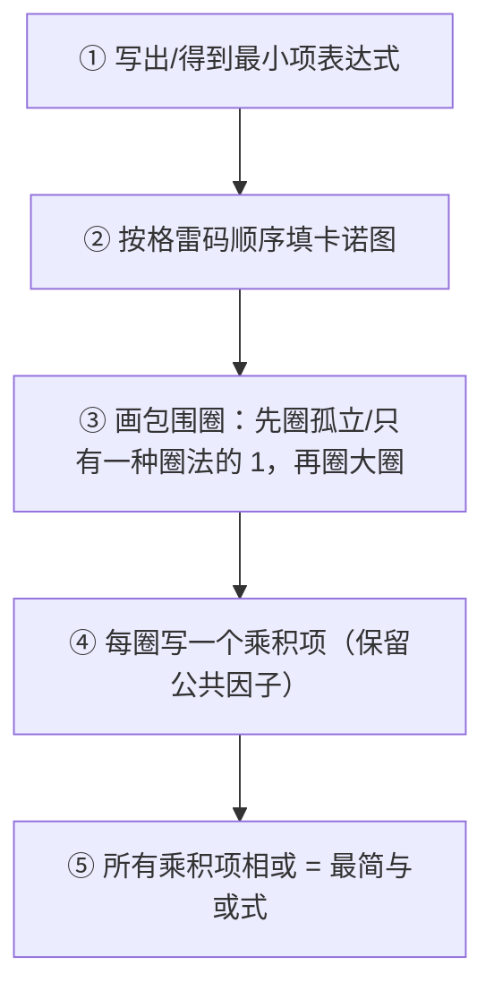
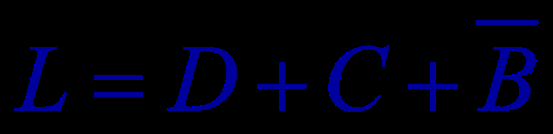
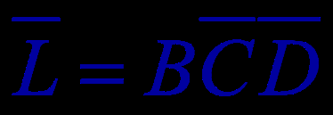
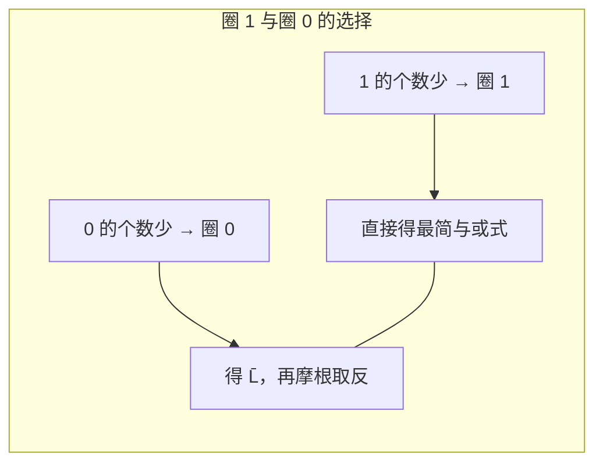

# 3.7 逻辑函数的卡诺图化简法（Karnaugh Map Simplification）

## 一、是什么（概念与定位）

**卡诺图（Karnaugh Map）**：将 n 变量的全部 2ⁿ 个最小项各用一个小方块表示，并使**逻辑相邻的最小项在几何位置上也相邻**排列所得到的图形。

**为什么需要它**：公式化简法规则易混、无固定步骤、结果难验证。卡诺图把化简变成"画圈"操作——直观简便、规律性强，是化简 **≤4 变量**逻辑函数的高效工具（5~6 变量勉强可用，6 个以上变量不适用图形法）。

**核心概念——逻辑相邻**：若两个最小项**只有一个变量互为反变量**（其余变量完全相同），则称二者逻辑相邻。例如 m₆ = ABC̄ 与 m₇ = ABC 逻辑相邻（仅 C 互反）。

## 二、原理与特性

### 1. 卡诺图的构造

- **变量划分**：变量分成两组，分别标注在图的上方与左方（如四变量图：行变量 AB、列变量 CD）；
- **格雷码排列**：行列取值均按 `00 → 01 → 11 → 10` 的顺序排列（相邻两组编码只有一位不同），保证几何相邻 ⟺ 逻辑相邻；
- **循环相邻**：不仅上下左右直接相邻，**同一行（列）的两端方格、四个角**也相邻——这是"对折重合"的特性。

n 变量卡诺图的方格数与最小项：2 变量 4 格、3 变量 8 格、4 变量 16 格、5 变量 32 格。

### 2. 用卡诺图表示逻辑函数

- 函数为**最小项表达式** Σm(…)：在对应方格填 1，其余填 0（或留空）；
- 函数为**一般与-或式**：可先化为最小项之和再填；也可将每个与项分别覆盖到卡诺图上（与项覆盖其所有可能取值的方格）；
- **任何逻辑函数都等于其卡诺图中为 1 的方格所对应的最小项之和**。

**例**：F(A,B,C,D) = Σm(0,1,2,3,4,8,10,11,14,15) 的卡诺图（行 AB，列 CD）：

| AB＼CD | 00 | 01 | 11 | 10 |
|--------|----|----|----|----|
| **00** | 1  | 1  | 1  | 1  |
| **01** | 1  | 0  | 0  | 0  |
| **11** | 0  | 0  | 1  | 1  |
| **10** | 1  | 0  | 1  | 1  |

**例**：F = AB + C 化为 Σm(0,2,4,6,7) 后填图（行 A，列 BC）：

| A＼BC | 00 | 01 | 11 | 10 |
|-------|----|----|----|----|
| **0** | 1  | 0  | 0  | 1  |
| **1** | 1  | 0  | 1  | 1  |

### 3. 合并最小项的规则（化简依据）

依据公式 A + Ā = 1、AB + AB̄ = A：

| 包围圈规模 | 消去变量数 | 举例 |
|-----------|-----------|------|
| 2 个相邻的 1（2¹） | 消去 1 个变量 | ABC̄ + ABC = AB（消 C）|
| 4 个相邻的 1（2²） | 消去 2 个变量 | AB̄CD + AB̄C̄D + ABCD + ABC̄D = AD |
| 8 个相邻的 1（2³） | 消去 3 个变量 | m₁,m₃,m₅,m₇,m₉,m₁₁,m₁₃,m₁₅ = D |

> 规律：2ᵏ 个相邻的 1 圈在一起，消去 k 个变量，保留圈内的公共因子。

### 4. 化简步骤

1. **写表达式**：将函数化为最小项表达式（或直接按与项填图）；
2. **填卡诺图**：包含的最小项填 1，其余填 0；
3. **画包围圈**：把相邻的 1 圈成矩形组，每组含 2ⁿ 个方格；
4. **加乘积项**：每个圈对应一个最简乘积项（保留公共因子），所有项相或即得最简与或式。

**画包围圈五大原则**：

| 原则 | 说明 |
|------|------|
| **数量** | 每圈方格数必为 2 的幂（1、2、4、8…），且形状必须是**矩形** |
| **相邻** | 循环相邻：上下左右、行/列两端、四个角均可圈在一起 |
| **重复** | 同一方格可被多个圈重复包围，但**每个新圈必须含至少一个未被覆盖的新 1** |
| **最优（大）** | 圈尽可能大，消去的变量更多 |
| **最优（少）** | 圈的数量尽可能少，与项才最少 |

## 三、符号与图形（图文并茂）

四变量卡诺图圈 1 流程示意（以 F = Σm(0,4,5,6,7,9,12,14,15) 为例）：

**例 18**：F(A,B,C,D) = Σm(0,4,5,6,7,9,12,14,15)，填图并圈 1：

| AB＼CD | 00 | 01 | 11 | 10 |
|--------|----|----|----|----|
| **00** | 1  | 0  | 0  | 0  |
| **01** | 1  | 1  | 1  | 1  |
| **11** | 1  | 0  | 1  | 1  |
| **10** | 0  | 1  | 0  | 0  |

**圈法（先找"必圈"格）**：
- m₉（AB=10，CD=01）四周（m₁、m₈、m₁₁、m₁₃）全是 0，为**孤立 1**，只能单独圈 → AB̄C̄D；
- m₀ 只有 m₄ 一个相邻的 1，圈 (m₀,m₄) → ĀC̄D̄；
- m₁₂ 可与 m₁₄ 圈（列 00 与 10 循环相邻）→ ABD̄（也可与 m₄ 圈成 BC̄D̄）；
- m₅ 促成了整行大圈 (m₄,m₅,m₆,m₇) → ĀB；(m₆,m₇,m₁₄,m₁₅) → BC。

圈 1 结果（课件例 18 的圈 1 答案为 **L = D + C + B̄** 形式之一，此处按上述圈法写出等价的覆盖结果）：

课件还演示了"圈 0"法：圈全部 0 格得 L̄，再整体取反用摩根展开：

**例 19**：L = Σm(0~3, 5~7, 8~11, 13~15)——0 只有 m₄、m₁₂ 两个（同列 CD=00、行 01 与 11 相邻），**圈 0 求反**更快：

$$\overline{L} = B\,\overline{C}\,\overline{D} \quad\Rightarrow\quad L = \overline{B} + C + D$$

与课件圈 0 结果一致（见上图 3_7_result_circle0.png：L̄ = BC̄D̄）。

## 四、典型例题/应用

**例 1**：用卡诺图化简 F(A,B,C,D) = Σm(0,4,5,6,7,9,12,14,15)。

- 填图见上（第三节）；
- 画圈：②组 (m₄,m₅,m₆,m₇) → B；③组 (m₅,m₇,m₁₃,m₁₅) → BD；④组 (m₆,m₇,m₁₄,m₁₅) → BC；⑤组 (m₁₂,m₁₄,m₈?…) 依课件：圈出 **B̄C̄D̄**（m₀,m₄ 循环相邻？m₀ 与 m₄ 同列相邻）、**AD̄**（m₀,m₈? …）等；
- 最简结果（课件答案）：**F = B + BC + BD + A̅?… = B + AD̄?** 按课件最终式：

$$F = B + BC + BD + \overline{B}\,\overline{C}\,\overline{D} \;→\; F = B + \overline{B}\,\overline{C}\,\overline{D} = B + \overline{C}\,\overline{D}$$

> 提示：以上为课件例 18 的圈法骨架；实际解题时按"先大后少"原则圈完所有 1，逐圈写公共因子即可，答案唯一性以覆盖全部 1 且圈数最少为准。

**例 2（圈 0 法）**：化简 L(A,B,C,D) = Σm(0~3, 5~7, 8~11, 13~15)。

卡诺图中仅有 2 个 0（m₄、m₁₂，相邻，同一列 CD=00），圈 0 得：

$$\overline{L} = B\,\overline{C}\,\overline{D} \quad\Rightarrow\quad L = \overline{B\,\overline{C}\,\overline{D}} = \overline{B} + C + D$$

当 0 的个数远少于 1 时，圈 0 法步骤更少。

## 五、易错点

1. **行列必须按格雷码 00,01,11,10 排列**，写成自然二进制 00,01,10,11 会使"几何相邻"失效，全盘皆错。
2. **包围圈只能是矩形且方格数为 2ⁿ**：L 形、十字形都是错的；6 个 1 不能圈成"2×3"圈（不是 2 的幂）。
3. **别忘了循环相邻**：最左列与最右列、最上行与最下行、四个角都相邻——漏用会多画圈。
4. **每个圈必须有新 1**：全是已被覆盖的 1 的圈是冗余项，必须去掉。
5. **圈 0 法取反别忘了摩根展开**：L̄ = BC̄D̄ ⟹ L = B̄ + C + D（变号、换运算符），直接写 L̄ = BC̄D̄ 的"非"成 L = B̄C̄D̄ 是典型错误。
6. 卡诺图法适用于**变量数 ≤6**，变量多时失去优势，需改用公式法或系统化简方法（如奎恩-麦克拉斯基法）。

## 六、知识点总结

| 要点 | 内容 |
|------|------|
| 本质 | 真值表的图形化：2ⁿ 个最小项按格雷码排列 |
| 相邻性 | 几何相邻（含循环相邻）⟺ 逻辑相邻（仅一个变量互反） |
| 合并 | 2ᵏ 个相邻 1 → 消去 k 个变量 |
| 步骤 | 化最小项式 → 填图 → 圈 1（矩形、2ⁿ、尽量大尽量少、每圈有新 1）→ 写公共因子相或 |
| 技巧 | 0 少时圈 0 求 L̄ 再取反；无关项（3.8）可灵活圈入 |
