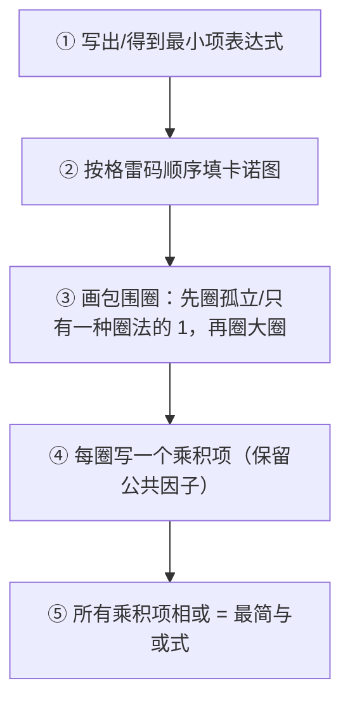
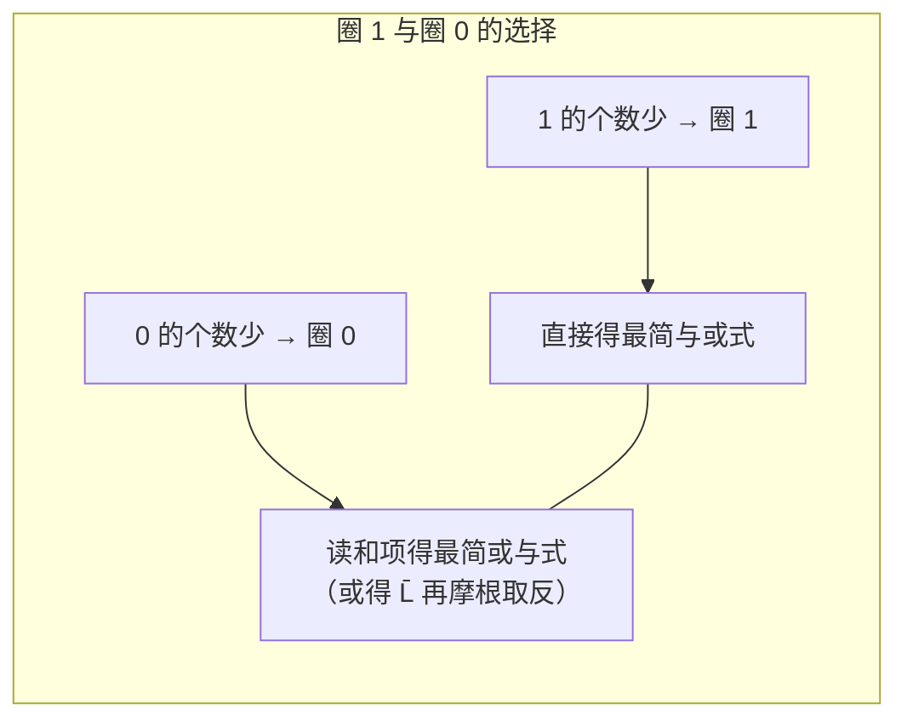

# 3.7 逻辑函数的卡诺图化简法（Karnaugh Map Simplification）

## 一、是什么（概念与定位）

**卡诺图（Karnaugh Map）**：将 n 变量的全部 2ⁿ 个最小项各用一个小方块表示，并使**逻辑相邻的最小项在几何位置上也相邻**排列所得到的图形。

**为什么需要它**：公式化简法规则易混、无固定步骤、结果难验证。卡诺图把化简变成"画圈"操作——直观简便、规律性强，是化简 **≤4 变量**逻辑函数的高效工具（5~6 变量勉强可用，6 个以上变量不适用图形法）。

**核心概念——逻辑相邻**：若两个最小项**只有一个变量互为反变量**（其余变量完全相同），则称二者逻辑相邻。例如 m₆ = ABC̄ 与 m₇ = ABC 逻辑相邻（仅 C 互反）。

## 二、原理与特性

### 1. 卡诺图的构造

- **变量划分**：变量分成两组，分别标注在图的上方与左方（如四变量图：行变量 AB、列变量 CD）；
- **格雷码排列**：行列取值均按 `00 → 01 → 11 → 10` 的顺序排列（相邻两组编码只有一位不同），保证几何相邻 ⟺ 逻辑相邻；
- **循环相邻**：不仅上下左右直接相邻，**同一行（列）的两端方格、四个角**也相邻——这是"对折重合"的特性。

n 变量卡诺图的方格数与最小项：2 变量 4 格、3 变量 8 格、4 变量 16 格、5 变量 32 格。

### 2. 用卡诺图表示逻辑函数

- 函数为**最小项表达式** Σm(…)：在对应方格填 1，其余填 0（或留空）；
- 函数为**一般与-或式**：可先化为最小项之和再填；也可将每个与项分别覆盖到卡诺图上（与项覆盖其所有可能取值的方格）；
- **任何逻辑函数都等于其卡诺图中为 1 的方格所对应的最小项之和**。

**例**：F(A,B,C,D) = Σm(0,1,2,3,4,8,10,11,14,15) 的卡诺图（行 AB，列 CD）：

| AB＼CD | 00 | 01 | 11 | 10 |
|--------|----|----|----|----|
| **00** | 1  | 1  | 1  | 1  |
| **01** | 1  | 0  | 0  | 0  |
| **11** | 0  | 0  | 1  | 1  |
| **10** | 1  | 0  | 1  | 1  |

**例**：F = AB + C̄ 化为 Σm(0,2,4,6,7) 后填图（行 A，列 BC）：

| A＼BC | 00 | 01 | 11 | 10 |
|-------|----|----|----|----|
| **0** | 1  | 0  | 0  | 1  |
| **1** | 1  | 0  | 1  | 1  |

### 3. 合并最小项的规则（化简依据）

依据公式 A + Ā = 1、AB + AB̄ = A：

| 包围圈规模 | 消去变量数 | 举例 |
|-----------|-----------|------|
| 2 个相邻的 1（2¹） | 消去 1 个变量 | ABC̄ + ABC = AB（消 C）|
| 4 个相邻的 1（2²） | 消去 2 个变量 | AB̄CD + AB̄C̄D + ABCD + ABC̄D = AD |
| 8 个相邻的 1（2³） | 消去 3 个变量 | m₁,m₃,m₅,m₇,m₉,m₁₁,m₁₃,m₁₅ = D |

> 规律：2ᵏ 个相邻的 1 圈在一起，消去 k 个变量，保留圈内的公共因子。

### 4. 化简步骤

1. **写表达式**：将函数化为最小项表达式（或直接按与项填图）；
2. **填卡诺图**：包含的最小项填 1，其余填 0；
3. **画包围圈**：把相邻的 1 圈成矩形组，每组含 2ⁿ 个方格；
4. **加乘积项**：每个圈对应一个最简乘积项（保留公共因子），所有项相或即得最简与或式。

**画包围圈五大原则**：

| 原则 | 说明 |
|------|------|
| **数量** | 每圈方格数必为 2 的幂（1、2、4、8…），且形状必须是**矩形** |
| **相邻** | 循环相邻：上下左右、行/列两端、四个角均可圈在一起 |
| **重复** | 同一方格可被多个圈重复包围，但**每个新圈必须含至少一个未被覆盖的新 1** |
| **最优（大）** | 圈尽可能大，消去的变量更多 |
| **最优（少）** | 圈的数量尽可能少，与项才最少 |

### 5. 圈 0 法（对偶方法）——直接读出最简或与式

上面第 3、4 条讲的都是**圈 1**，得到与或式。卡诺图还有**对称的另一半**：**圈 0**，得到或与式。

**判据一句话**：数一数 1 多还是 0 多——**1 少就圈 1**（与或式），**0 少就圈 0**（或与式）。

**为什么圈 0 能出或与式**（两条等价解释，讲清任意一条即可）：

1. **先取反、再摩根**：卡诺图上的 0 格，就是反函数 $\bar F$ 的 1 格。对 0 格按圈 1 的规矩圈，得到的是 $\bar F$ 的最简与或式；整体取反并用摩根展开，即得 $F$ 的最简或与式。
2. **直接读和项**（推荐，少一步）：每个 0 圈对应**一个和项**——圈内**恒为 0 的变量写原变量、恒为 1 的变量写反变量**（与圈 1 恰好相反），各和项相**与**。

| 对比项 | 圈 1 | 圈 0 |
|---|---|---|
| 什么时候用 | 1 比 0 少 | 0 比 1 少 |
| 圈哪些格 | 值为 **1** 的格 | 值为 **0** 的格 |
| 每圈读出一项 | **乘积项**：圈内恒为 1 写原变量、恒为 0 写反变量 | **和项**：圈内恒为 0 写原变量、恒为 1 写反变量 |
| 项与项之间 | 相**或** | 相**与** |
| 得到什么 | 最简**与或式**（Σ 型） | 最简**或与式**（∏ 型） |
| 消变量规律 | 2ᵏ 格消 k 个变量 | 2ᵏ 格消 k 个变量（**两者相同**） |
| 对应门电路 | 与非-与非 | 或非-或非 |
| 圈的最优原则 | 尽量大、尽量少、每圈有新 1 | 尽量大、尽量少、每圈有新 0 |

**例（0 只有两个）**：$L(A,B,C,D)=\sum m(0\sim3,\ 5\sim7,\ 8\sim11,\ 13\sim15)$，0 只在 $m_4$、$m_{12}$。

- $m_4(0100)$ 与 $m_{12}(1100)$ 同在 $CD=00$ 列、行 $AB=01$ 与 $11$ 相邻 → 圈成一个 **2 格圈**；
- 圈内 B 恒为 1、C 恒为 0、D 恒为 0，A 两格一 0 一 1（变化，消去）；
- 按"恒 0 写原变量、恒 1 写反变量"读和项：$(\bar B+C+D)$；
- 只有一个和项，$L=\bar B+C+D$。

**验一遍**：$\bar L=B\bar C\bar D\Rightarrow L=\overline{B\bar C\bar D}=\bar B+C+D$ ✓，两种读法同结果。

**对照圈 1**：本题 14 个 1，圈 1 需画 $B=0$、$C=1$、$D=1$ 三个 8 格大圈（3 圈）才覆盖完；圈 0 只画 1 圈。**0 越少，圈 0 越省。**

**对偶关系点明**：圈 1 与圈 0 互为对偶——圈 1 圈"1"、读积项、相或、得 Σ 型；圈 0 圈"0"、读和项、相与、得 ∏ 型；连变量取值规则都整个反过来（1↔0、原变量↔反变量、与↔或）。这正是 3.4"找真写积 / 找假写和"的图形版。

**什么时候不该用圈 0**：① 0 比 1 多时（圈 0 要画更多圈）；② 题目要求"写出最简**与或**式"或"仅用**与非**门实现"时，圈 0 得到的或与式还要再转一次，反而绕远。

## 三、符号与图形（图文并茂）

四变量卡诺图圈 1 流程示意（以 F = Σm(0,4,5,6,7,9,12,14,15) 为例）：

**例 18**：F(A,B,C,D) = Σm(0,4,5,6,7,9,12,14,15)，填图并圈 1：

| AB＼CD | 00 | 01 | 11 | 10 |
|--------|----|----|----|----|
| **00** | 1  | 0  | 0  | 0  |
| **01** | 1  | 1  | 1  | 1  |
| **11** | 1  | 0  | 1  | 1  |
| **10** | 0  | 1  | 0  | 0  |

**圈法（先找"必圈"格）**：
- m₉（AB=10，CD=01）四周（m₁、m₈、m₁₁、m₁₃）全是 0，为**孤立 1**，只能单独圈 → AB̄C̄D；
- m₀ 只有 m₄ 一个相邻的 1，圈 (m₀,m₄) → ĀC̄D̄；
- 四格圈 (m₄,m₆,m₁₂,m₁₄)（行 AB=01/11 × 列 CD=00/10 的 2×2 方块）→ BD̄（只留 2 个因子，比拆成两个二格圈省）；
- 整行大圈 (m₄,m₅,m₆,m₇) → ĀB；(m₆,m₇,m₁₄,m₁₅) → BC。

圈 1 结果（五圈逐圈写公共因子，五项相或）：

$$F=\bar A B + BC + B\bar D + \bar A\bar C\bar D + A\bar B\bar C\bar D$$

> **【已核对更正】** 本节原稿把结果转录为 $F=B+\bar C\bar D$、并配了 $L=D+C+\bar B$ 的截图。按本表所列最小项重圈，$B+\bar C\bar D$ 会把 $m_1,m_3$ 等本应为 0 的格置 1，与真值表不符；$m_{12}$ 与 $m_6,m_{14}$ 一起可凑成四格 $B\bar D$，比拆成 $AB\bar D$、$BC\bar D$ 都省因子。截图 $L=D+C+\bar B$ 实为**例 19** 的结果，图注已移到例 19。

**例 19**：L = Σm(0~3, 5~7, 8~11, 13~15)——0 只有 m₄、m₁₂ 两个（同列 CD=00、行 01 与 11 相邻），**圈 0 求反**更快：

$$\overline{L} = B\,\overline{C}\,\overline{D} \quad\Rightarrow\quad L = \overline{B} + C + D$$

圈 0 的两张课件结果图——先得 L̄，再摩根得 L：

> 两图对照：第一张是圈 0 的中间结果（$\bar L=B\bar C\bar D$），第二张是最终式（$L=D+C+\bar B$）。同一题若改圈 1，要画 $B=0$、$C=1$、$D=1$ 三个 8 格圈，3 圈才盖住 14 个 1——这正是"0 少圈 0"的收益。

## 四、典型例题/应用

**例 1（圈 1）**：用卡诺图化简 F(A,B,C,D) = Σm(0,4,5,6,7,9,12,14,15)。

- 填图见第三节例 18；
- **圈法**（先找只有一种圈法的"必圈"格，再圈大圈，最后查每个圈是否有新 1）：

| 圈 | 覆盖方格 | 圈内恒定的因子 | 读出 |
|---|---|---|---|
| ① | m₉（四面皆 0，孤立） | A=1、B=0、C=0、D=1 | $A\bar B\bar C\bar D$ |
| ② | m₀,m₄（同列相邻） | A=0、C=0、D=0 | $\bar A\bar C\bar D$ |
| ③ | m₄,m₅,m₆,m₇（整行） | A=0、B=1 | $\bar A B$ |
| ④ | m₆,m₇,m₁₄,m₁₅ | B=1、C=1 | $BC$ |
| ⑤ | m₄,m₆,m₁₂,m₁₄（行 01/11 × 列 00/10 的 2×2 方块） | B=1、D=0 | $B\bar D$ |

$$F=\bar A B+BC+B\bar D+\bar A\bar C\bar D+A\bar B\bar C\bar D$$

- **答案不唯一**：若不用四格 $B\bar D$，也可拆成 (m₄,m₁₂)→$BC\bar D$ 与 (m₁₂,m₁₄)→$AB\bar D$ 两个二格圈，覆盖同样的 1，但因子更多。判最优的标准始终是**覆盖全部 1 + 圈数少 + 因子少**——本例取四格圈，5 圈 13 个因子即到最简。

**例 2（圈 0 法）**：化简 L(A,B,C,D) = Σm(0~3, 5~7, 8~11, 13~15)。

卡诺图中仅有 2 个 0（m₄、m₁₂，同列 CD=00 相邻），圈 0 只画 1 圈：

$$\overline{L} = B\,\overline{C}\,\overline{D} \quad\Rightarrow\quad L = \overline{B\,\overline{C}\,\overline{D}} = \overline{B} + C + D$$

**两种圈法怎么选**（详见第二节第 5 条）：

| 情形 | 走哪条路 | 本例 |
|---|---|---|
| 1 少 0 多 | 圈 1，直接得与或式 | 例 1：9 个 1、7 个 0 → 圈 1 |
| 0 少 1 多 | 圈 0，得或与式（或取反再摩根） | 例 2：2 个 0、14 个 1 → 圈 0，1 圈搞定 |
| 题目限"与或式/与非门" | 一律圈 1 | —— |
| 题目限"或与式/或非门" | 一律圈 0 | —— |

## 五、易错点

1. **行列必须按格雷码 00,01,11,10 排列**，写成自然二进制 00,01,10,11 会使"几何相邻"失效，全盘皆错。
2. **包围圈只能是矩形且方格数为 2ⁿ**：L 形、十字形都是错的；6 个 1 不能圈成"2×3"圈（不是 2 的幂）。
3. **别忘了循环相邻**：最左列与最右列、最上行与最下行、四个角都相邻——漏用会多画圈。
4. **每个圈必须有新 1**：全是已被覆盖的 1 的圈是冗余项，必须去掉。
5. **圈 0 法取反别忘了摩根展开**：L̄ = BC̄D̄ ⟹ L = B̄ + C + D（变号、换运算符），直接写 L̄ = BC̄D̄ 的"非"成 L = B̄C̄D̄ 是典型错误。
6. 卡诺图法适用于**变量数 ≤6**，变量多时失去优势，需改用公式法或系统化简方法（如奎恩-麦克拉斯基法）。
7. **圈 0 读出的是和项、多圈相"与"**：圈 0 时每个圈对应一个"或"（如 $(\bar B+C+D)$），圈与圈之间相"与"；把圈 0 的圈当成乘积项再相或，等于把 $F$ 与 $\bar F$ 混算。另外圈 0 读和项时变量规则与圈 1 相反——**恒 0 写原变量、恒 1 写反变量**，忘了这点会得到与正确答案"逐项取反"的表达式。

## 六、知识点总结

| 要点 | 内容 |
|------|------|
| 本质 | 真值表的图形化：2ⁿ 个最小项按格雷码排列 |
| 相邻性 | 几何相邻（含循环相邻）⟺ 逻辑相邻（仅一个变量互反） |
| 合并 | 2ᵏ 个相邻 1 → 消去 k 个变量（圈 0 同样消 k 个） |
| 圈 1 步骤 | 化最小项式 → 填图 → 圈 1（矩形、2ⁿ、尽量大尽量少、每圈有新 1）→ 写公共因子相或 |
| 圈 0 步骤 | 同上，改圈 0 → 每圈读一个**和项**（恒 0 原变量、恒 1 反变量）→ 各和项相**与**，得最简**或与式** |
| 两种圈法的选择 | **1 少圈 1**（与或式，配与非门）、**0 少圈 0**（或与式，配或非门）；题目限定哪种式就圈哪种 |
| 对偶关系 | 圈 1↔圈 0、与↔或、原变量↔反变量、Σm↔∏M；"0 少时圈 0 求 $\bar L$ 再摩根取反"只是圈 0 的一种说法 |
| 技巧 | 无关项（3.8）在两种圈法里都可灵活圈入——**1 圈借 × 凑大圈，0 圈同样可借 × 凑大圈** |
