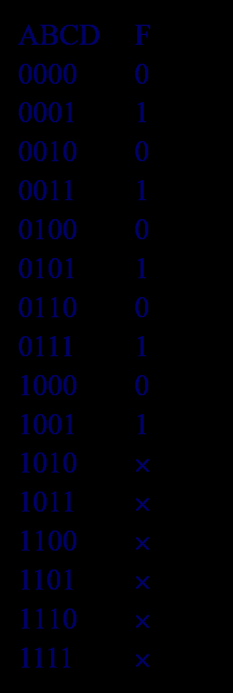

# 3.8 具有无关项的逻辑函数及其化简（Don't-Care Conditions）

## 一、是什么（概念与定位）

**无关项（Don't-Care Terms）**：在逻辑函数中，变量的某些取值组合**不会出现**（约束项），或函数在这些组合下**输出不确定**（任意项），这样的变量取值组合统称为无关项，也叫**任意项、约束项**。

无关项是化简的"自由资源"：它的值可以取 0 也可以取 1，**取什么值以使函数尽量简化而定**。合理利用无关项可以画出更大的包围圈、消去更多变量，显著减少逻辑门数量、降低电路成本。

## 二、原理与特性

### 1. 无关项的来源

**经典实例：电梯运行状态逻辑分析**。设 A=升、B=降、C=停：

- 三个命令互斥，不能同时发生，逻辑上只能取一种状态；
- **有效组合（合法）**：仅三种——001（停）、010（降）、100（升）；
- **无关项（无效）**：不可能出现的组合——000、011、101、110、111。这些违背物理逻辑，视为无关项。

### 2. 约束条件的两种表示方法

**方法一：真值表/卡诺图上用"×"表示**。无关项的位置既不填 1 也不填 0，画 ╳（或 d）。

**方法二：在逻辑表达式中用"等于 0 的条件等式"表示约束项**。如上例中不可能出现的取值组合为：

$$\sum d(0, 3, 5, 6, 7) = 0 \quad\Longleftrightarrow\quad A\overline{B}\,\overline{C} + \overline{A}BC + A\overline{B}C + AB\overline{C} + ABC = 0$$

含义：这些最小项对应的输入组合永远不出现，故可令约束等式恒为 0；化简时把无关项当作 1 与有效项合并，只要最终"约束条件仍成立（这些组合下输出随意）"即可。

### 3. 化简策略：灵活取值

在卡诺图上：
- 无关项按 **1** 处理可帮着"凑大圈"——当它能与相邻的 1 组成更大的 2ⁿ 矩形圈时，就当作 1 圈进去；
- 无关项按 **0** 处理——当它对扩大包围圈没有帮助时，就不圈它；
- 每个被圈的无关项"值取 1"，未圈的"值取 0"，**不影响函数在有效输入上的输出**。

### 4. 圈 0 里的无关项（对偶的一半）

上面第 3 条讲的是"× 当 **1**、凑进 **1 圈**"，得到与或式。卡诺图本身有两半（3.7），无关项也有两半：**× 同样可以当 0，凑进 0 圈**，得到或与式。

**判据一句话**：要最简**与或式**（配与非门）→ × 当 **1** 凑 **1 圈**；要最简**或与式**（配或非门）→ × 当 **0** 凑 **0 圈**。

| 对比项 | × 当 1（圈 1） | × 当 0（圈 0） |
|---|---|---|
| 服务于 | 最简与或式（Σ 型，与非-与非） | 最简或与式（∏ 型，或非-或非） |
| 干什么 | 补进 1 圈，把圈凑到 2ᵏ 格 | 补进 0 圈，把圈凑到 2ᵏ 格 |
| 不圈它时的默认值 | 当作 0 | 当作 1 |
| 每圈必须含 | 至少一个**有效的 1** | 至少一个**有效的 0** |
| 圈内读法 | 恒 1 写原变量、恒 0 写反变量 → 乘积项 | 恒 0 写原变量、恒 1 写反变量 → 和项 |
| 项间连接 | 相或 | 相与 |
| 不改变什么 | 有效输入上的输出 | 有效输入上的输出 |

**同一次化简里，每个 × 只取一个值**。取 1 得一组与或式、取 0 得一组或与式，二者在**有效输入**上完全一致，只在"不出现"的那些组合上取值不同——都合法，这也是无关项化简"答案不唯一"的根源之一。

## 三、符号与图形（图文并茂）

**例 20：一位十进制数奇偶判断电路**。输入为 8421 码 ABCD（表示 0~9），输出 F：奇数为 1，偶数为 0。输入组合 1010~1111（十进制 10~15）**不会出现**，是无关项。

真值表（1010~1111 标 ×）：

对应的卡诺图（行 AB，列 CD，× 表示无关项）：

| AB＼CD | 00 | 01 | 11 | 10 |
|--------|----|----|----|----|
| **00** | 0  | 1  | 1  | 0  |
| **01** | 0  | 1  | 1  | 0  |
| **11** | ×  | ×  | ×  | ×  |
| **10** | ×  | ×  | ×  | ×  |

化简：把下方两行 8 个"×/1"全部圈成一个 8 格大圈（即所有 D=1 的方格），消去 A、B、C 三个变量：

$$F = D$$

**结论**：电路只需检测最低位 D——D=1 时为奇数输出 1，D=0 时为偶数输出 0。利用无关项化简后，原本需要多级运算的判断电路被简化为**一根导线（一个缓冲器）**，充分体现了无关项的价值。

化简流程示意：

## 四、典型例题/应用

**例（一题两解：圈 1 得与或式，圈 0 得或与式）**：某函数 F(A,B,C) = Σm(1, 3, 6)，约束条件 Σd(0, 7) = 0（即 m₀、m₇ 不可能出现）。分别求最简与或式与最简或与式。

| A＼BC | 00 | 01 | 11 | 10 |
|-------|----|----|----|----|
| **0** | ×  | 1  | 1  | 0  |
| **1** | 0  | 0  | ×  | 1  |

**解 1（圈 1，× 当 1）**：

- m₁、m₃ 相邻 → 2 格圈 → $\bar A C$；
- m₆ 与 m₇ 的 × 相邻 → 圈 (m₆,m₇) → $AB$（借 m₇ 这个 × 才凑成 2 格）；
- m₀ 的 × 帮不上忙（其邻居 m₂ 是有效 0）→ 不圈；
- $F=\bar A C+AB$（2 项 4 个因子）。

**解 2（圈 0，× 当 0）**：

- m₂ 的 0 与 m₀ 的 × 相邻 → 圈 (m₀,m₂) → 恒 0 的 A、C 写原变量 → 和项 $(A+C)$；
- m₄、m₅ 相邻 → 2 格 0 圈 → 恒 1 的 A 写反变量、恒 0 的 B 写原变量 → 和项 $(\bar A+B)$；
- $F=(A+C)(\bar A+B)$（2 个和项 4 个因子）。

**验两解等价**：$(A+C)(\bar A+B)=A\bar A+AB+\bar AC+BC=AB+\bar AC+BC=AB+\bar AC$（BC 被前三项吸收）✓，与解 1 完全相同。

**两个 × 的分工**：解 1 借了 m₇，解 2 借了 m₀——同一份真值表的不同"取值方案"，各自得到一组最简式。

> 无关项化简的答案**本来就不唯一**（不同的 × 取值方案给出不同但都正确的式子），评判标准是"**圈最大、圈最少、有效项全覆盖**"。

## 五、易错点

1. **无关项 ≠ 恒 1**：只有被圈进去的无关项才当 1 用；全部圈入往往会画很多小圈反而更繁。原则是"**对化简有利才圈**"。
2. **不能把无关项单独圈成只有 × 的圈**——没有 1 的圈不对应任何有效输出，毫无意义。
3. **约束条件的书写**：Σd(…) = 0 表示这些最小项恒为 0（不出现）；在卡诺图上要统一用 × 标注，别把无关项当普通 0 全部排除（那样会错过化简机会）。
4. **化简结果必须覆盖所有有效的 1**，无关项只起"搭圈"作用；检查时只需验证有效输入组合的输出正确。
5. 利用无关项后，函数在这些组合上的输出是"约定值"（非原题要求），若后续电路可能输入这些组合，需重新确认约束是否仍成立。
6. **只想到"× 当 1 圈 1"、想不到"× 当 0 圈 0"**：题目要**或与式**或限定**或非门**时，必须把 × 当 0 往 0 圈里凑；只会圈 1 就只能交一个与或式，再硬转成或与式往往白丢分。
7. **× 在同一次化简里只能取一个值**：解 1 借 m₇ 当 1、解 2 借 m₀ 当 0，是**两套**答案；同一份答案里既让某个 × 当 1 又当 0，逻辑上自相矛盾。

## 六、知识点总结

| 要点 | 内容 |
|------|------|
| 无关项 | 不出现的组合（约束项）或输出任意的组合（任意项），记 × 或 Σd(…)=0 |
| 取值 | 0/1 皆可，以化简最简为准 |
| 卡诺图（圈 1） | 有利则当 **1** 圈入大圈，不利则不圈；得最简**与或式** |
| 卡诺图（圈 0） | 有利则当 **0** 圈入 0 圈，不利则不圈；得最简**或与式**（对偶的另一半） |
| 收益 | 消去更多变量、减少门数、降低成本（如奇偶判断 F=D 的极简设计） |
| 注意 | 每个圈仍须含有效的 1（或有效的 0）；× 在同一次化简里只取一个值；答案可能不唯一 |
