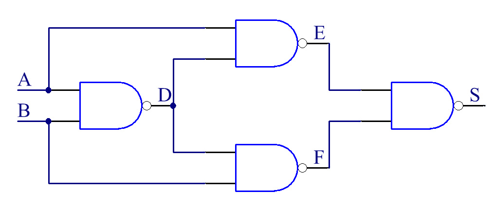
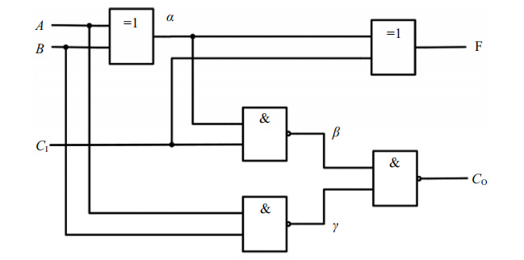

# 4.1 组合逻辑电路的分析方法

## 一、是什么（概念与定位）

**组合逻辑电路（Combinational Logic Circuit）**：任一时刻的输出仅取决于该时刻的输入信号组合，而与电路过去状态无关的逻辑电路。

两大结构/工作特征：
1. **无反馈、无记忆**：内部不存在反馈延迟通路，不含触发器、寄存器等存储单元，仅由与、或、非等基本逻辑门组合连接而成，信号单向传输；
2. **即时响应**：输出状态只与"同一时刻"的输入有关，这是组合电路区别于时序逻辑电路的本质特征。

一般框图与函数映射：

$$Z_i = f(X_1, X_2, \dots, X_n)\quad (i=1,2,\dots,m)$$

**分析（Analysis）**是数字电路研究的基础：根据**给定的逻辑电路图**，通过逻辑推导、化简与验证，明确输入与输出间的逻辑关系，最终**确定电路实现的逻辑功能**——即"由图求功能"。

## 二、原理与特性

### 分析的四个步骤（必背）

| 步骤 | 内容 | 要点 |
|---|---|---|
| ① 写出逻辑表达式 | 从**输入到输出逐级推导**，写出各输出端的逻辑函数式 | 从输出端向前逐门回推，或从输入向后逐门写 |
| ② 化简与变换逻辑式 | 用逻辑代数公式法或卡诺图化简为最简形式 | 便于分析，也可变换为与非-与非等形式 |
| ③ 列出真值表 | 穷举所有输入组合（n 个输入共 2ⁿ 行），逐一算出输出 | 把抽象的式子还原为直观的因果映射 |
| ④ 确定电路逻辑功能 | 根据真值表规律用一句话概括功能 | 如"异或""多数表决""全加运算"等 |

### 分析的主要目的
1. **验证功能合规性**：确认输出是否符合设计指标；
2. **优化电路结构**：变换为更高效形式（如与非-与非结构），降低硬件成本；
3. **适配器件实现**：得到标准表达式，便于用 MSI/LSI 标准器件实现；
4. **明确功能**：给出功能的文字结论。

### 逐级推导示例（P9 例题）
对上图（两级与非门电路）：
- $D=\overline{AB}$，$E=\overline{A\cdot D}=\overline{A\overline{AB}}$，$F=\overline{B\cdot D}=\overline{B\overline{AB}}$
- $S=\overline{EF}=\overline{\overline{A\overline{AB}}\cdot\overline{B\overline{AB}}}=A\overline{AB}+B\overline{AB}$
- 化简：$S=A\bar B+\bar A B=A\oplus B$

| A | B | S |
|---|---|---|
| 0 | 0 | 0 |
| 0 | 1 | 1 |
| 1 | 0 | 1 |
| 1 | 1 | 0 |

**结论**：该电路实现**异或逻辑**——输入相异输出为 1，相同输出为 0。它是半加器、奇偶校验、数据比较的基础单元。

### 另一分析示例（P12 全加功能判定）
某电路输出 $F=A\oplus B\oplus C_i$、$C_o=AB+(A\oplus B)C_i$，列出真值表后发现：两个一位二进制数 A、B 与低位进位 $C_i$ 相加得到本位和 F 与进位 $C_o$——电路实现**一位全加**功能。

## 三、符号与图形（图文并茂）

全加器分析电路（逐级推导实例，$F$ 为本位和、$C_o$ 为进位）：

组合电路的四种表示方法（相互等价、可互相转换）：

| 表示方法 | 特点与用途 |
|---|---|
| 真值表 | 穷举所有输入输出组合，直观反映逻辑因果关系 |
| 逻辑表达式 | 用与/或/非运算描述，便于代数推演与设计实现 |
| 卡诺图 | 图形化化简工具，利用几何相邻性化简 |
| 时间图（波形图） | 反映信号随时间变化，用于功能验证与时序分析 |

## 四、典型例题/应用

**例**：分析教材 P11 电路（输出 $F=\overline{\overline{AB}\cdot\overline{AC}}$）。

- （1）化简：$F=AB+AC=A(B+C)$
- （2）列真值表：

| A | B | C | F |
|---|---|---|---|
| 0 | × | × | 0 |
| 1 | 0 | 0 | 0 |
| 1 | 0 | 1 | 1 |
| 1 | 1 | 0 | 1 |
| 1 | 1 | 1 | 1 |

- （3）功能：**A 为使能控制端**——A=1 时 F 跟随 B、C 的或输出，A=0 时输出被封锁。

**应用场景**：读懂现成电路（维修、抄板）、把未知电路改造成标准器件实现、检验设计方案正确性。

## 五、易错点

1. **逐级推导顺序搞反**：应从输入端逐级向输出写，或从输出端回推，中间变量要设好符号（D、E、F…），不能跳步。
2. **化简不到位就下结论**：不化简直接列真值表虽然也能得出功能，但考试通常要求"最简表达式 + 真值表 + 功能说明"三件套齐全。
3. **真值表行数遗漏**：n 个输入必须列满 2ⁿ 行，3 输入 8 行，漏行即失分。
4. **功能描述含糊**：结论必须是一句明确的逻辑功能（如"实现 A⊕B"），不能只写"输出等于某式"。
5. 混淆"分析"与"设计"：分析是**图 → 功能**，设计是**功能 → 图**，方向相反。

## 六、知识点总结

- 组合逻辑电路：**无反馈、无记忆、即时响应**，$Z_i=f(X_1,\dots,X_n)$。
- 分析四步：**写表达式 → 化简 → 列真值表 → 定功能**。
- 核心技能是逐级推导 + 公式/卡诺图化简；结论落在"一句话功能"上。
- 分析的逆过程即设计（见 4.2）。
