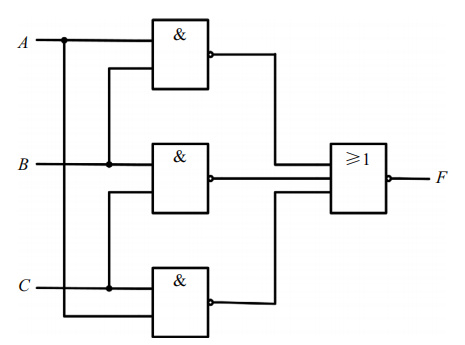
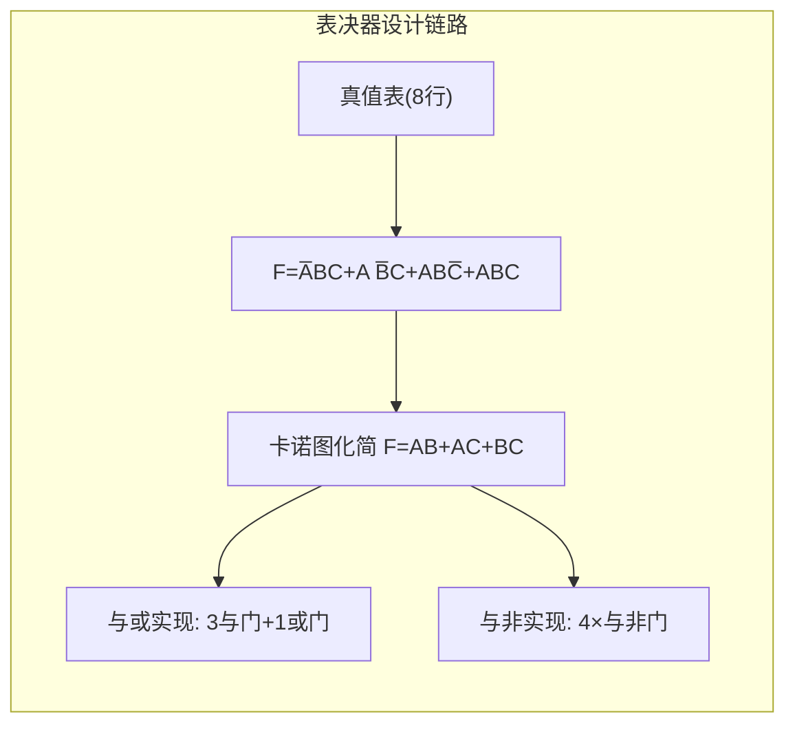

# 4.2 组合逻辑电路的设计方法

## 一、是什么（概念与定位）

**组合逻辑电路的设计**是分析的**逆过程**：根据实际问题的功能需求，通过逻辑抽象、化简与变换等步骤，求出能实现该功能且**结构最简单、成本最低**的逻辑电路——即"由功能求图"。

典型设计任务：三人表决器、码制转换电路（格雷码→二进制）、优先排队电路（列车进站指示）、报警电路等。

## 二、原理与特性

### 设计的五个步骤（必背）

| 步骤 | 内容 | 关键点 |
|---|---|---|
| ① 逻辑抽象 | 分析因果关系，**确定输入/输出变量**，定义 0、1 的含义 | 赋值定义要写明（如"赞成=1"） |
| ② 列真值表 | 穷举全部 2ⁿ 种输入组合，写出对应输出 | 完备、无误；有无关项用"×" |
| ③ 写逻辑表达式 | 由真值表写出**最小项表达式**（F=1 的各组合相或） | 取原变量/反变量的规则见下 |
| ④ 化简与变换 | 卡诺图或代数法化简；按所选器件变换（如与非-与非） | 用什么门实现，就化成什么形式 |
| ⑤ 画逻辑电路图 | 按信号流向（输入→输出）用标准符号连接 | 与最终表达式严格一致 |

### 由真值表写表达式的规则
对每一个使 **F=1** 的输入组合构造一个**乘积项（与项）**：
- 输入变量取 **1** → 取**原变量**（如 A）；
- 输入变量取 **0** → 取**反变量**（如 $\bar A$）。

所有乘积项之间**相或**，即得最小项之和表达式。

### 器件适配（化简后的变换）
- 用**与门+或门**实现：保持与或式 $F=AB+AC+BC$；
- 用**与非门**实现：两次取反 + 摩根定律，$F=\overline{\overline{AB}\cdot\overline{AC}\cdot\overline{BC}}$（与非-与非结构）；
- 用**译码器/数据选择器**实现：化为最小项表达式，见 4.4、4.5。

## 三、符号与图形（图文并茂）

经典案例：**三人表决器**（A、B、C 三人表决，多数赞成灯亮 F=1）：

1. 真值表（"1"的个数 ≥ 2 时 F=1）：

| A | B | C | F |
|---|---|---|---|
| 0 | 0 | 0 | 0 |
| 0 | 0 | 1 | 0 |
| 0 | 1 | 0 | 0 |
| 0 | 1 | 1 | 1 |
| 1 | 0 | 0 | 0 |
| 1 | 0 | 1 | 1 |
| 1 | 1 | 0 | 1 |
| 1 | 1 | 1 | 1 |

2. 最小项表达式：$F=\bar ABC+A\bar BC+AB\bar C+ABC$
3. 卡诺图/代数化简：$F=AB+AC+BC$

与非门实现（$F=\overline{\overline{AB}\cdot\overline{BC}\cdot\overline{AC}}$，3 个与非门 + 1 个与非门汇总）：

## 四、典型例题/应用

### 例1 火车站列车进站指示（优先级设计，P24-26）
特快、直快、慢车请求信号分别为 A、B、C（有请求=1），优先级特快>直快>慢车；对应指示灯 $F_A$、$F_B$、$F_C$。

- 真值表（× 为无关项——高优先级请求"屏蔽"低优先级）：

| A | B | C | $F_A$ | $F_B$ | $F_C$ |
|---|---|---|---|---|---|
| 0 | 0 | 0 | 0 | 0 | 0 |
| 0 | 0 | 1 | 0 | 0 | 1 |
| 0 | 1 | × | 0 | 1 | 0 |
| 1 | × | × | 1 | 0 | 0 |

- 表达式：$F_A=A$，$F_B=\bar A B$，$F_C=\bar A\bar B C$
- 与非形式：$F_A=\bar{\bar A}$，$F_B=\overline{\overline{\bar A B}}$，$F_C=\overline{\overline{\bar A\bar B C}}$，用反相器产生 $\bar A,\bar B,\bar C$，再级联两输入与非门实现。

**要点**：这是"3线-3线优先编码"思想的雏形——高优先级信号封锁低优先级输出。

### 例2 格雷码 → 二进制码转换电路（P27-31）
输入 4 位格雷码 $G_3G_2G_1G_0$，输出二进制码 $B_3B_2B_1B_0$。列 16 行真值表 → 画各输出卡诺图化简，得：

$$B_3=G_3,\quad B_2=G_3\oplus G_2,\quad B_1=G_3\oplus G_2\oplus G_1,\quad B_0=G_3\oplus G_2\oplus G_1\oplus G_0$$

即**每一位二进制码等于该位及更高位格雷码的依次异或累积**；电路呈线性流水状，仅需 3 个异或门。

### 例3 火灾报警电路（P32）
烟感、温感、光感三种探测器 A、B、C，**两种及以上**报警才输出 F=1（防误报）：
$F=AB+AC+BC$——与三人表决器同构（"多数统一"模型）。

## 五、易错点

1. **0/1 赋值定义不写**：逻辑抽象时必须明确"什么算 1、什么算 0"，否则真值表无从谈起。
2. **无关项处理错误**：优先级类问题中高优先级封锁低优先级产生的"×"，化简时既可圈 1 也可圈 0，但不能漏用。
3. **化简方向与器件不匹配**：题目要求"用与非门实现"就必须变换成与非-与非式，直接交与或式不得分。
4. **由真值表写式子取反错误**：组合取 0 的变量必须写成反变量，写成原变量是最常见笔误。
5. **画图与表达式不一致**：画完电路要回验一遍逻辑图与最简式等价。

## 六、知识点总结

- 设计 = 分析的逆过程，五步：**抽象 → 真值表 → 表达式 → 化简/变换 → 画图**。
- 写式规则：**F=1 的行构成与项，1 取原变量、0 取反变量，各项相或**。
- 同一真值表可有多种电路实现（与或式、与非式、译码器、数据选择器），按题目要求的器件类型变换表达式。
- 表决器、格雷码转换、优先排队是本章三大经典设计模型。
