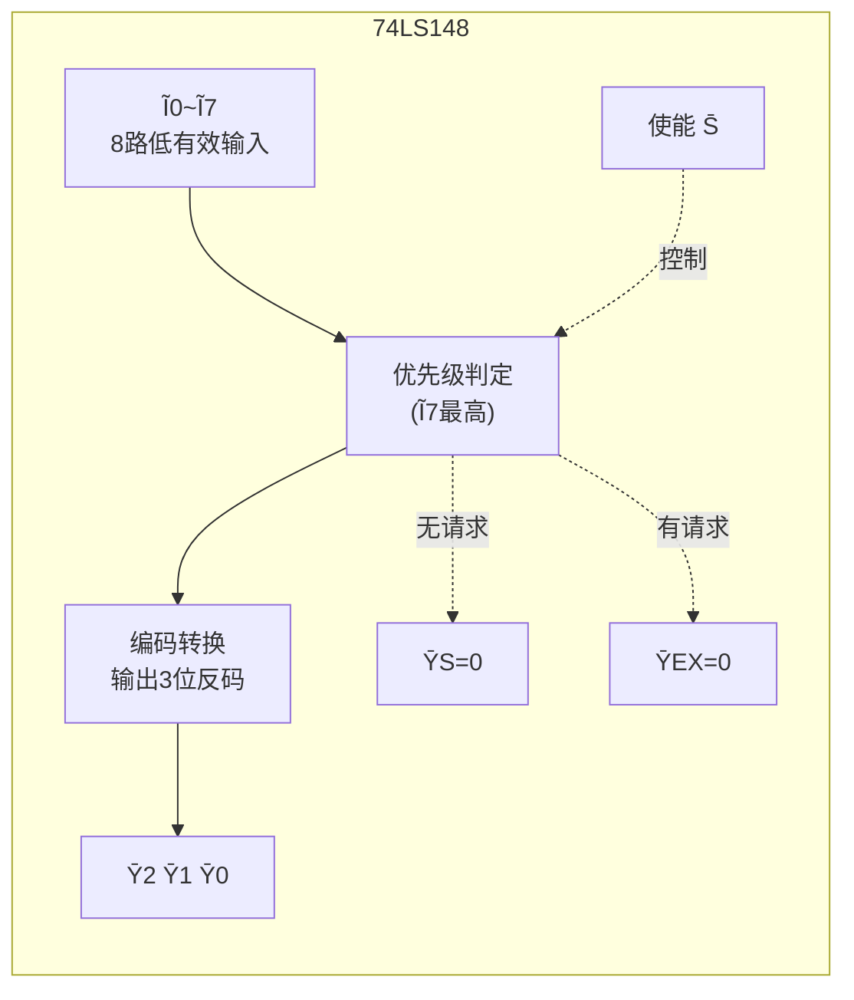
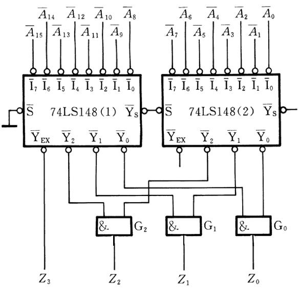
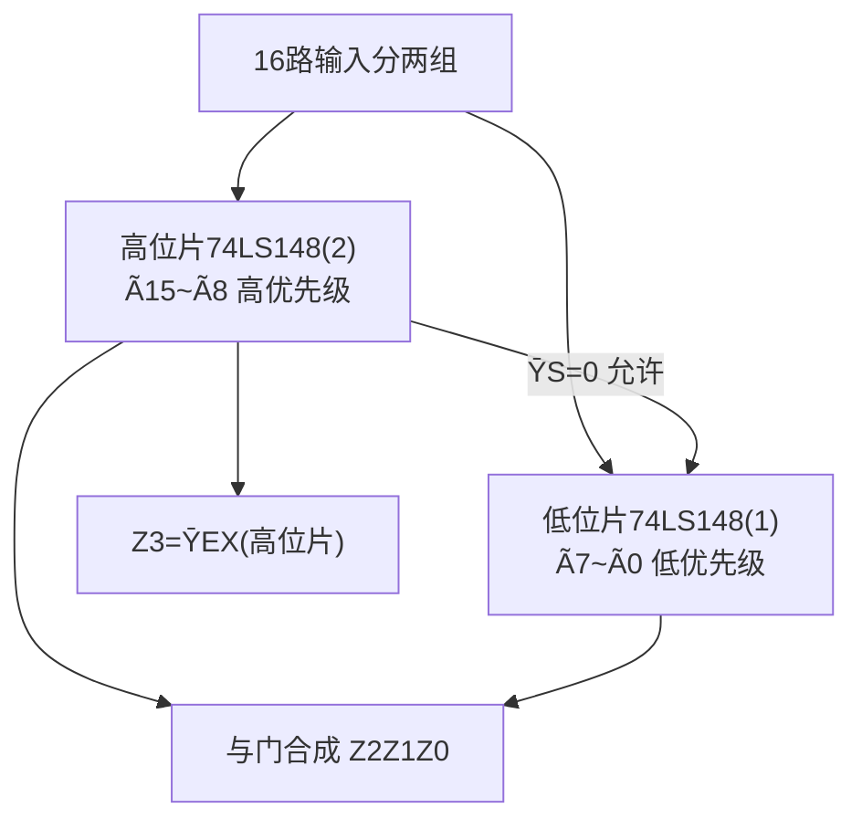

# 4.3 编码器（Encoder）

## 一、是什么（概念与定位）

**编码**：赋予二进制代码特定含义的过程（如 ASCII 码）。
**编码器**：实现编码功能的组合逻辑电路——把**多路输入信号**按特定规则转换为**少数几位二进制代码**输出，是信息的"压缩器"，广泛应用于键盘输入、指令编码、中断控制等场景。

按输入约束分为两类：
- **普通编码器**：任何时刻**只允许一个**输入有效（输入互斥），否则输出混乱；
- **优先编码器**：允许多路输入同时有效，只对**优先级最高**者编码，解决了信号冲突问题。

## 二、原理与特性

### 1. 普通二进制编码器（以 4线-2线为例）

结构：$2^n$ 路输入 $I_0\sim I_{2^n-1}$（高电平有效、互斥），n 位二进制码输出 $Y_0\sim Y_{n-1}$，把"有效输入的序号"翻译成二进制数。

4线-2线编码器真值表：

| $I_0$ | $I_1$ | $I_2$ | $I_3$ | $Y_1$ | $Y_0$ |
|---|---|---|---|---|---|
| 1 | 0 | 0 | 0 | 0 | 0 |
| 0 | 1 | 0 | 0 | 0 | 1 |
| 0 | 0 | 1 | 0 | 1 | 0 |
| 0 | 0 | 0 | 1 | 1 | 1 |

未化简（按最小项写出）：
$$Y_1=\bar I_0\bar I_1 I_2\bar I_3+\bar I_0\bar I_1\bar I_2 I_3,\qquad Y_0=\bar I_0 I_1\bar I_2\bar I_3+\bar I_0\bar I_1\bar I_2 I_3$$

**利用互斥约束化简**：任意时刻只有一个输入为 1，其余自动为 0，于是：
$$\boxed{Y_1=I_2+I_3,\qquad Y_0=I_1+I_3}$$

仅需**两个或门**即可实现。这是"利用约束条件化简"的经典范例。

### 2. 优先编码器（4线-2线设计实例）

输入 $I_3\sim I_0$ 优先级从高到低（设 $I_0$ 最高），允许同时有效，只编优先级最高者，"×"表示无关项：

| $I_0$ | $I_1$ | $I_2$ | $I_3$ | $Y_1$ | $Y_0$ |
|---|---|---|---|---|---|
| 1 | × | × | × | 1 | 1 |
| 0 | 1 | × | × | 1 | 0 |
| 0 | 0 | 1 | × | 0 | 1 |
| 0 | 0 | 0 | 1 | 0 | 0 |

$$Y_1=I_0+\bar I_1 I_2,\qquad Y_0=I_0+\bar I_1\bar I_2 I_3$$

### 3. 集成 8线-3线优先编码器 74LS148

- **输入**：$\bar I_0\sim\bar I_7$ 共 8 路，**低电平 0 有效**，$\bar I_7$ 优先级最高；
- **输出**：$\bar Y_2\bar Y_1\bar Y_0$，3 位二进制**反码**输出；
- **输入使能端 $\bar S$（选通输入）**：$\bar S=0$ 正常编码；$\bar S=1$ 禁止，所有输出为 1；
- **选通输出端 $\bar Y_S$**：$\bar Y_S=0$ 表示"芯片工作但无有效输入请求"（$\bar Y_S=\overline{\bar S\,\bar I_7\bar I_6\cdots\bar I_0}$），用于级联时允许低位片工作；
- **扩展输出端 $\bar Y_{EX}$**：$\bar Y_{EX}=0$ 表示"芯片工作且有有效输入"（$\bar Y_{EX}=\overline{\bar S\,(I_0+I_1+\cdots+I_7)}$ 的反逻辑），可作最终编码的最高位/级联封锁信号。

## 三、符号与图形（图文并茂）

两片 74LS148 级联扩展为 **16线-4线优先编码器**（高位片接 $\bar A_{15}\sim\bar A_8$，低位片接 $\bar A_7\sim\bar A_0$）：

级联工作原理（"高位优先"）：
- **高位片有请求**：高位片 $\bar Y_{EX}=0$ → 最终编码最高位 $Z_3=0$；同时其 $\bar Y_S=1$ 封锁低位片，低 3 位 $Z_2Z_1Z_0$ 由高位片决定；
- **高位片无请求**：高位片 $\bar Y_{EX}=1$ → $Z_3=1$；其 $\bar Y_S=0$ 允许低位片工作，低 3 位由低位片决定；
- 低 3 位输出：两片输出经**与门**合并得到 $Z_2Z_1Z_0$。

**应用场景**：
- 键盘输入编码：按键产生电平信号 → 编码器输出 ASCII；
- 计算机中断请求排队、电梯呼叫调度、炉温多路监测报警。

## 四、典型例题/应用

**例（P46）**：74LS148 使能 $\bar{EN}=0$，输入 $\bar I_7\bar I_6\bar I_5\bar I_4\bar I_3\bar I_2\bar I_1\bar I_0=11000110$，求输出 $\bar Y_2\bar Y_1\bar Y_0$。

- 有效输入（低电平 0）出现在 $\bar I_6,\bar I_2,\bar I_1$；优先级最高的是 $\bar I_6$；
- 按 6=110 编码，反码输出 → $\bar Y_2\bar Y_1\bar Y_0=001$。

**答案：B（001）**。

**例（P47）**：用两片 74LS148 实现 16线-4线编码器（见上图），要点：① 输入分高低两组；② 高位片 $\bar Y_S$ 接低位片 $\bar S$ 实现级联使能；③ 最高位取高位片 $\bar Y_{EX}$，低 3 位由两片输出相与合成。

## 五、易错点

1. **普通 vs 优先**：普通编码器输入必须互斥；若多输入同时有效，普通编码器输出错乱，只有优先编码器才能正确响应最高级。
2. **74LS148 的有效电平**：输入**低电平有效**、输出为**反码**，做题时先把"哪个输入为 0"找出来，再按其下标取反码，两处都容易弄反。
3. **$\bar Y_S$ 与 $\bar Y_{EX}$ 含义混淆**：$\bar Y_S$=0 → "空转"（无请求）；$\bar Y_{EX}$=0 → "有请求且已编码"。级联接法必须记住：高位片 $\bar Y_S$ → 低位片 $\bar S$。
4. **优先级方向**：74LS148 是 $\bar I_7$ 最高，不是 $\bar I_0$ 最高；自设计的 4-2 线优先编码器则按题设优先级写真值表。
5. **级联输出合成**：低 3 位是两片输出的**与**（低有效逻辑），漏掉与门会得到错误结果。

## 六、知识点总结

- 编码器：多→少（$2^n$ 入 n 出）的信息压缩电路；普通型要求输入互斥，优先型自带优先级判定。
- 4线-2线普通编码器最简式：$Y_1=I_2+I_3$，$Y_0=I_1+I_3$（利用互斥约束化简）。
- 74LS148：8线-3线、低有效、反码输出、$\bar I_7$ 优先级最高；$\bar S$ 使能、$\bar Y_S$ 级联选通、$\bar Y_{EX}$ 扩展/最高位。
- 两片级联 = 16线-4线：核心是 "$\bar Y_S\to\bar S$" 的优先权传递链。
