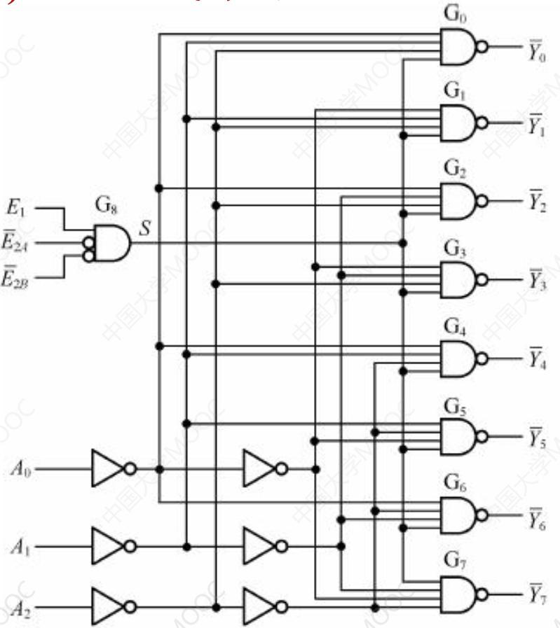
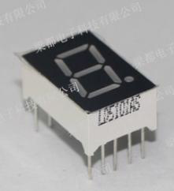
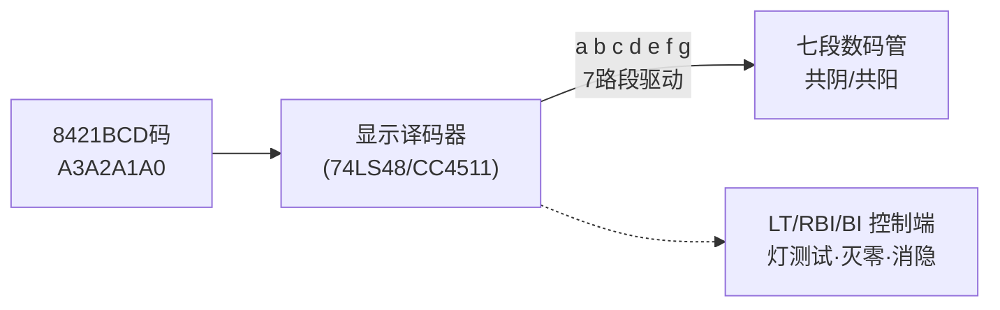

# 4.4 译码器（Decoder）

## 一、是什么（概念与定位）

**译码**是编码的**逆过程**：把二进制代码"翻译"成具有特定含义的输出信号（电路的某个状态）；实现该功能的电路即**译码器**，是数字系统中数据解析、**地址寻址**与状态控制的基础部件。

两大类：
1. **唯一地址译码器**：n 位输入 → $2^n$（m=2ⁿ）路输出，任意时刻**仅一路有效**，"一址一选"。含二进制译码器、二-十进制（BCD）译码器、显示译码器；
2. **代码变换器**：完成码制转换（BCD↔二进制、格雷码↔二进制等），不要求输出唯一。

常见规格：2线-4线（小规模片选）、**3线-8线（74LS138，应用最广）**、4线-16线（大规模寻址）。

## 二、原理与特性

### 1. 2线-4线译码器

由 1 个非门 + 4 个与非门组成；输入地址 $A_1A_0$、低电平有效使能端 $\bar E$；输出 $\bar Y_0\sim\bar Y_3$ **低电平有效**。

$$\bar Y_0=\overline{\bar E\,\bar A_1\bar A_0},\quad \bar Y_1=\overline{\bar E\,\bar A_1 A_0},\quad \bar Y_2=\overline{\bar E\,A_1\bar A_0},\quad \bar Y_3=\overline{\bar E\,A_1 A_0}$$

功能表：

| $\bar E$ | $A_1$ | $A_0$ | $\bar Y_0$ | $\bar Y_1$ | $\bar Y_2$ | $\bar Y_3$ |
|---|---|---|---|---|---|---|
| 1 | × | × | 1 | 1 | 1 | 1 |
| 0 | 0 | 0 | **0** | 1 | 1 | 1 |
| 0 | 0 | 1 | 1 | **0** | 1 | 1 |
| 0 | 1 | 0 | 1 | 1 | **0** | 1 |
| 0 | 1 | 1 | 1 | 1 | 1 | **0** |

**逻辑本质**：译码器是**"最小项发生器"**——使能有效时，每个输出 $\bar Y_i=\overline{m_i}$（对应最小项的**非**）。这是"用译码器实现任意逻辑函数"的理论基础。

### 2. 集成 3线-8线译码器 74LS138

- **地址输入**：$A_2A_1A_0$（$A_2$ 为高位）；
- **使能端**：$S_1$（高有效）+ $\bar S_2+\bar S_3$（低有效），三者**同时满足**（$S_1=1$ 且 $\bar S_2+\bar S_3=0$）才译码；用于多片级联/片选；
- **输出**：$\bar Y_0\sim\bar Y_7$ 低电平有效，$\bar Y_i=\overline{m_i}$（$m_i$ 为 $A_2A_1A_0$ 的第 i 个最小项）；
- 使能无效时 8 路输出全为 1。

**用 74LS138 实现任意三变量逻辑函数（核心方法）**：
任何函数 = 最小项之和，而译码器恰好输出全部最小项的**非**，故：
$$F=\sum m_i=\overline{\prod \bar Y_i}\quad(\text{最小项之和} \xrightarrow{\text{摩根}} \text{对应输出之与非})$$

步骤：① 变量接地址端（A→A2、B→A1、C→A0）→ ② 配好使能（S1=1，$\bar S_2=\bar S_3=0$）→ ③ 函数展开为最小项之和 → ④ 摩根变换成与非-与非式 → ⑤ 对应输出端接一个**与非门**即得 F。

### 3. 译码器扩展：两片 74LS138 → 4线-16线

- 低 3 位地址 $D_2D_1D_0$ 并联接两片地址端；
- 最高位 $D_3$ 作**片选**：$D_3=0$ 时低位片使能译出 $\bar Y_0\sim\bar Y_7$，$D_3=1$ 时高位片使能译出 $\bar Y_8\sim\bar Y_{15}$，分时选通、互不冲突。

### 4. 二-十进制译码器 74LS42（4线-10线）

8421BCD 码输入 $A_3A_2A_1A_0$ → 10 路低有效输出 $\bar Y_0\sim\bar Y_9$；输入 0000~1001 时唯一对应输出为 0；**伪码 1010~1111 自动屏蔽**（全部输出为 1），防误译。

### 5. 显示译码器（七段译码驱动）

组成链路：BCD 码 → **译码器** → **驱动器** → **七段显示器**（a~g 七段 LED 拼出 0~9）。

- **共阴极数码管**：公共端接地，段输入**高电平**点亮（拉电流），配**高有效**译码器 74LS48/CC4511；
- **共阳极数码管**：公共端接 +VCC，段输入**低电平**点亮（灌电流），配**低有效**译码器 74LS47；
- 74LS48 控制端：**$\overline{LT}$ 灯测试**（=0 全亮检段，优先级最高）、**$\overline{RBI}$ 动态灭零**（=0 且输入 0000 时熄灭无意义零）、**$\overline{BI}/\overline{RBO}$ 消隐/灭零输出**（双向端，多位级联灭零用）；
- CC4511：BCD-锁存/七段译码/驱动器，含 LT、$\overline{BI}$、LE 锁存端；对伪码 1010~1111 拒绝译码（全灭）。

### 6. 另一半用法：用 74LS138 实现最大项之积（输出接与门）

第 2 条走的是"化成**最小项之和** → 输出接**与非门**"。由于 $\bar Y_i=\overline{m_i}=M_i$（3.5：$M_i$ 与 $m_i$ 互为反函数），同一片 138 还有**对称的另一半用法**：把要用的几路 $\bar Y_i$ 接一个**与门**，直接得到**最大项之积**。

$$F=\sum m_i=\overline{\prod \bar Y_i}\ \text{（与非门）}\qquad F=\prod M_i=\prod \bar Y_i\ \text{（与门，因 }\bar Y_i=M_i\text{）}$$

**判据一句话**：函数写成**最小项之和**（1 少）→ 取**含**的编号、接**与非门**；写成**最大项之积**（0 少）→ 取**不含**的编号、接**与门**。

| 对比项 | 与非门接法 | 与门接法 |
|---|---|---|
| 依据式 | $F=\sum m_i=\overline{\prod\bar Y_i}$ | $F=\prod M_i=\prod\bar Y_i$ |
| 取哪几路 $\bar Y$ | 函数**含**的最小项编号 | 函数**不含**的编号（即 F=0 的行） |
| 得到 | 标准**与或式**（Σ 型） | 标准**或与式**（∏M 型） |
| 使能端 | $S_1=1,\ \bar S_2=\bar S_3=0$ | 完全相同 |
| 什么时候更省 | 1 少 | **0 少** |

**例**：某三变量函数只有 $m_0,m_2,m_3$ 三行为 0，其余 5 行为 1。用 74LS138 实现。

- 若按"1 少/0 少"判：0 只有 3 个 → 走**与门**接法；
- $F=\prod M(0,2,3)=\bar Y_0\cdot\bar Y_2\cdot\bar Y_3$——把这三路输出接一个**三输入与门**即得；
- 若硬走与非门接法，要实现 $\sum m(1,4,5,6,7)$，得用五输入与非门，接线与器件都更费。

**验**：代入 $m_0(000)$，$M_0=A+B+C=0$ → 乘积为 0 ✓；代入 $m_4(100)$，$M_0=M_2=M_3=1$ → 输出 1 ✓。

**对偶关系点明**：与非门 ↔ Σm（最小项之和）、与门 ↔ ∏M（最大项之积），两者互为对偶；连"取哪几路"都互补——一个取**含**的编号、一个取**不含**的编号。这正是 3.5"Σ 与 ∏ 编号互补"在器件层的体现。

## 三、符号与图形（图文并茂）

74LS138 内部逻辑图（G0~G7 八个与非门 + 输入缓冲与使能门 G8）：

七段半导体数码管（实物，字段 a~g + 小数点 DP）：

七段显示译码系统框图：

**用 74LS138 实现函数示例（P66）**：$Y(A,B,C)=\sum m(1,4,7)=\overline{\bar Y_1\cdot\bar Y_4\cdot\bar Y_7}$——把 $\bar Y_1,\bar Y_4,\bar Y_7$ 接一个三输入与非门即可。

## 四、典型例题/应用

**例1（P67）**：用 74LS138 + 与非门实现多数表决 $Y=AB+BC+AC$。
- 展开为最小项：$Y=m_3+m_5+m_6+m_7$；
- 与非-与非变换：$Y=\overline{\bar Y_3\cdot\bar Y_5\cdot\bar Y_6\cdot\bar Y_7}$；
- 连接：A、B、C 接 A2A1A0，$\bar Y_3,\bar Y_5,\bar Y_6,\bar Y_7$ 接四输入与非门。

**例2（P62-63）**：两片 74LS138 扩展 4线-16线译码器（见"原理"节），$D_3$ 反相后分别控制两片使能，实现"分时选通"。

**例3（P112-115）**：74LS138 作**数据分配器**：数据 D 接使能端（原码输出：$\bar S_2=\bar S_3=D$、$S_1=1$；反码输出：$S_1=D$），地址 CBA 决定数据从哪一路输出，如 CBA=001 时 $F_1=D$。

**例4（对称题：最大项之积）**：用 74LS138 + 一个与门实现 $Y=\prod M(0,2,4)$。

- 判型：$\prod M$ 只列了 3 个编号（0 少）→ 走**与门**接法；
- 连接：A、B、C 接 $A_2A_1A_0$，$\bar Y_0,\bar Y_2,\bar Y_4$ 接**三输入与门**，输出即 $Y$；
- 等价验证：$\prod M(0,2,4)$ 与 $\sum m(1,3,5,6,7)$ 编号互补，是同一函数的两种写法（3.5）；
- 对照：若用与非门接 $\bar Y_1\bar Y_3\bar Y_5\bar Y_6\bar Y_7$，需要五输入与非门，明显更费。

**应用**：存储器地址译码与片选、外设选通、点阵/数码显示驱动、任意组合逻辑函数的"查表式"实现。

## 五、易错点

1. **输出是低电平有效**：$\bar Y_i=\overline{m_i}$ 是最小项的**非**，实现函数时要先做摩根变换，直接把 $\bar Y_i$ 当 $m_i$ 相或是典型错误。
2. **74LS138 使能条件**：$S_1=1$ **且** $\bar S_2=\bar S_3=0$ 三者缺一不可；级联扩展时最高位地址经**非门**分配给两片的使能端，接错则两片同时/同时不工作。
3. **共阴/共阳与译码器电平匹配**：共阴管配高有效（74LS48），共阳管配低有效（74LS47），接反则整管不亮或全亮。
4. **控制端优先级**：74LS48 中 $\overline{BI}=0$ 消隐优先级最高，$\overline{LT}=0$ 灯测试次之，做功能判断题要注意次序。
5. **伪码处理**：74LS42/CC4511 对 1010~1111 输出"全 1/全 0 屏蔽"，简答题常考"无效输入时输出状态"。
6. **以为 138 只能配与非门**：输出端接**与门**同样是标准用法，得到的是**最大项之积**（或与式），适合 0 少的情形；两种接法的"取端"还互补——与非门取**含**的编号，与门取**不含**的编号，接错就得到 $\bar F$。
7. **把 138 的输出当最小项直接相或**：$\bar Y_i=m_i$ 只在**高有效输出**的译码器（如 74LS42 的部分用法）成立；74LS138 是**低有效**，非要相或必须换成 $\bar Y_i=\overline{m_i}$ 再摩根，否则整式取反。

## 六、知识点总结

- 译码器：n 入 2ⁿ 出的"最小项发生器"，$\bar Y_i=\overline{m_i}=M_i$，输出低电平有效。
- 74LS138：3 地址端 + 3 使能端（S1·$\overline{\bar S_2+\bar S_3}$）+ 8 低有效输出；一片 74LS138 + 一个**与非门**即可实现**任意三变量函数的最小项之和**。
- **对称用法**：同样一片 138 + 一个**与门**，把"不含"的编号对应的 $\bar Y_i$ 相与，得到**最大项之积**（或与式）——0 少时更省门。
- 扩展：最高位地址做片选，两片 138 → 4线-16线。
- 74LS42：BCD→十进制，伪码自动屏蔽；显示译码器 + 数码管（共阴高有效/共阳低有效）构成显示接口。
- 译码器还可兼作数据分配器（使能端作数据输入）。
