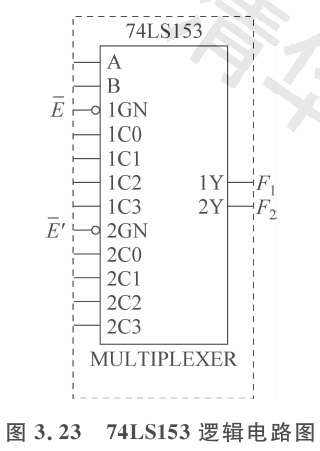
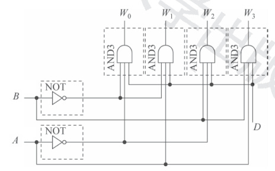
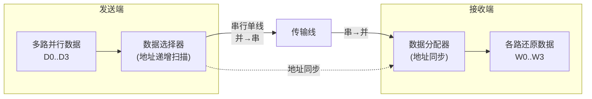

# 4.5 数据选择器与数据分配器

## 一、是什么（概念与定位）

- **数据选择器（MUX，Multiplexer）**：多路输入、单路输出的组合逻辑电路，根据**地址（选择控制）信号**从 N 路数据中"选一路"传到输出——多路数据的"选择开关"（多输出的单刀多掷开关）。
- **数据分配器（DEMUX，Demultiplexer）**：功能与选择器**互逆**——一路输入按地址"分发"到多路输出中的指定一路，单路数据的"多路分发器"。

两者配合实现数据传输格式转换：**并-串转换用选择器**（发送端逐位选通），**串-并转换用分配器**（接收端按序还原），解决了并行传输线多成本高、串行传输效率低的矛盾。典型芯片：74HC151（8选1）、CT74LS153（双4选1）。

## 二、原理与特性

### 1. 四选一数据选择器

端口：数据输入 $D_0\sim D_3$；地址 $A_1A_0$（00~11 选通对应路）；使能 $\bar S$（0 工作，1 禁止输出 0）；输出 F。

真值表（$\bar S=0$ 时）与逻辑表达式（最小项之和形式）：

| $A_1$ | $A_0$ | F |
|---|---|---|
| 0 | 0 | $D_0$ |
| 0 | 1 | $D_1$ |
| 1 | 0 | $D_2$ |
| 1 | 1 | $D_3$ |

$$F=\bar A_1\bar A_0 D_0+\bar A_1 A_0 D_1+A_1\bar A_0 D_2+A_1 A_0 D_3=\sum_{i=0}^{3}m_i D_i$$

**核心结论**：MUX 的输出 = 地址最小项 × 对应数据的乘积之和 → **改变 $D_i$ 的接法就能产生任意逻辑函数**（逻辑函数发生器）。

### 2. 集成双4选1 CT74LS153

- 内含**两个独立**的 4选1 选择器，地址端 A1A0 **公用**，使能端 $\bar S$ 各自独立；
- $\bar S=1$：与门被封锁，F=0，芯片禁止；$\bar S=0$：按 $A_1A_0$ 选通 $C_0\sim C_3$ 之一。

### 3. 8选1 74HC/74LS151

- 8 路数据 $D_0\sim D_7$，3 个地址端 $A_2A_1A_0$，1 个使能端 $\bar E$，**两个互补输出** F 与 $\bar F$；
- $\bar E=0$ 使能：$F=\sum_{i=0}^{7}m_i D_i$；$\bar E=1$：F=0、$\bar F=1$。

### 4. 数据分配器（1路-4路）

数据 D、地址 B A、输出 $W_0\sim W_3$：

| B | A | 输出 |
|---|---|---|
| 0 | 0 | $W_0=D\bar B\bar A$ |
| 0 | 1 | $W_1=D\bar B A$ |
| 1 | 0 | $W_2=DB\bar A$ |
| 1 | 1 | $W_3=DBA$ |

**用 74LS138 实现数据分配器（最常用技巧）**：数据 D 接使能端（$\bar S_2=\bar S_3=D$，$S_1=1$），地址 $A_2A_1A_0$ 接通道选择码，被选中的输出端 $F_i=D$（原码输出）；若改接 $S_1=D$、$\bar S_2=\bar S_3=0$ 则得到**反码输出** $F_i=\bar D$。

## 三、符号与图形（图文并茂）

CT74LS153 逻辑电路图（双 4选1，公用地址 A、B）：

1路-4路数据分配器逻辑图（4 个 AND3 门 + 反相器）：

MUX 与 DEMUX 的分工与配合：

**16选1 扩展**：两片 74LS151，高位地址 $S_3$ 反相控制两片使能（$\bar S_1=0$ 第一片工作，$\bar S_1=1$ 第二片工作），两输出经或门合并。

## 四、典型例题/应用

### 例1 用 74LS151 实现逻辑函数（P101、P103 例6）
$F(A,B,C)=\sum m(1,4,7)$：
- （1）使能：$\bar E=0$；
- （2）变量接地址：A→$S_2$、B→$S_1$、C→$S_0$；
- （3）有最小项的 $D_i$ 接 1，其余接 0：$D_1=D_4=D_7=1$，$D_0=D_2=D_3=D_5=D_6=0$；

**一般步骤总结（必背）**：a. 函数化为最小项表达式；b. 器件置于使能状态；c. 地址端作输入变量；d. 表达式中含 $m_i$ 则 $D_i=1$，其余 $D_i=0$。

（变量数 > 地址数时，如 4 变量函数用 8选1：多余变量 $X$ 接 $D_i$ 或 $\bar D_i$——$D_i\in\{0,1,X,\bar X\}$。）

### 例2 用 MUX 产生序列信号（P105）
产生 **01101001** 序列：把序列 8 位依次接 $D_0\sim D_7$（$D_0=0,D_1=1,D_2=1,D_3=0,D_4=1,D_5=0,D_6=0,D_7=1$），地址端接三位二进制计数器 A、B、C，随计数递增逐位输出。

### 例3 数据的分时传输（P106-107）
用 4 个 4选1 选择器分别对应 8421BCD 码的 D、C、B、A 四位，地址端 $A_1A_0$ 并联统一时序控制，分时选通千/百/十/个位 BCD 码，经七段译码器驱动数码管显示——单通道复用传输 4 位十进制数。当 $A_1A_0=00$ 时选通个位，若该位 BCD=1001，数码管显示"9"。

### 例4 74LS138 实现原码/反码 1-8 路数据分配器（P112-115）
原码输出：$D$ 接 $\bar S_2\bar S_3$、$S_1=1$；反码输出：$D$ 接 $S_1$、$\bar S_2=\bar S_3=0$。

**应用**：多路模拟量采集与 A/D 转换多路开关、数据路由、并行-串行转换、逻辑函数发生器、序列发生器、总线分时复用。

## 五、易错点

1. **地址端与数据的对应关系**：$A_1A_0=10$ 选通的是 $D_2$（按二进制值定），不是 $D_1$；8选1 中 $A_2$ 是最高位。
2. **使能端极性**：153/151 的使能均为**低电平有效**，$\bar S=1$ 时输出恒 0（不是高阻），做功能表题勿写错。
3. **实现函数时多余变量**：n 变量函数用 $2^{n-1}$ 选 1 选择器时，多余变量只能接到对应 $D_i$ 或 $\bar D_i$ 上，不能悬空；地址变量与函数变量的对应顺序（哪位是高位）必须一致。
4. **分配器用 138 实现时使能端接法**：原码、反码输出的接法不同（数据接低有效使能 vs 接高有效使能），接反输出相位颠倒。
5. **MUX 与 DEMUX 方向**：MUX 是多入单出，DEMUX 是单入多出，注意"选择开关"vs"分发器"的方向不要画反。

## 六、知识点总结

- MUX：$F=\sum m_iD_i$——**地址最小项加权选通**，是"逻辑函数发生器"的本质。
- 4选1、双4选1（153）、8选1（151，互补输出）功能表要熟记；使能均为低有效。
- 用 MUX 实现函数四步：最小项展开 → 使能 → 变量接地址 → $D_i$ 赋 0/1/变量。
- DEMUX：MUX 的逆过程；用 74LS138 使能端作数据输入即可实现（区分原码/反码接法）。
- MUX+DEMUX 配对实现并-串、串-并转换与分时复用传输。
