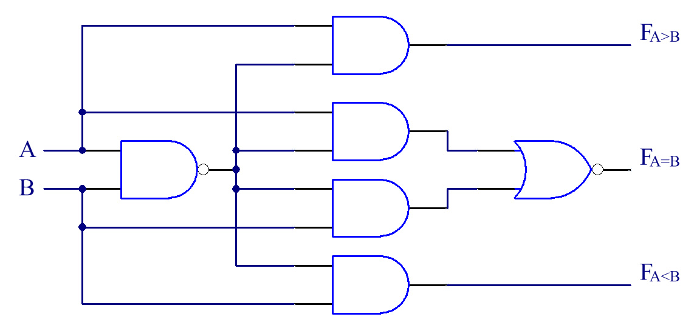
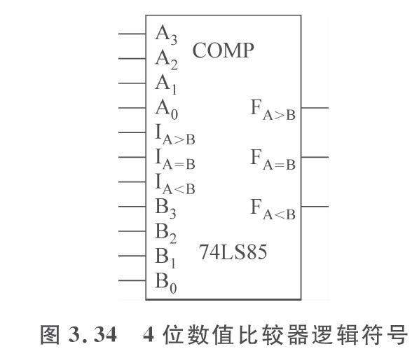
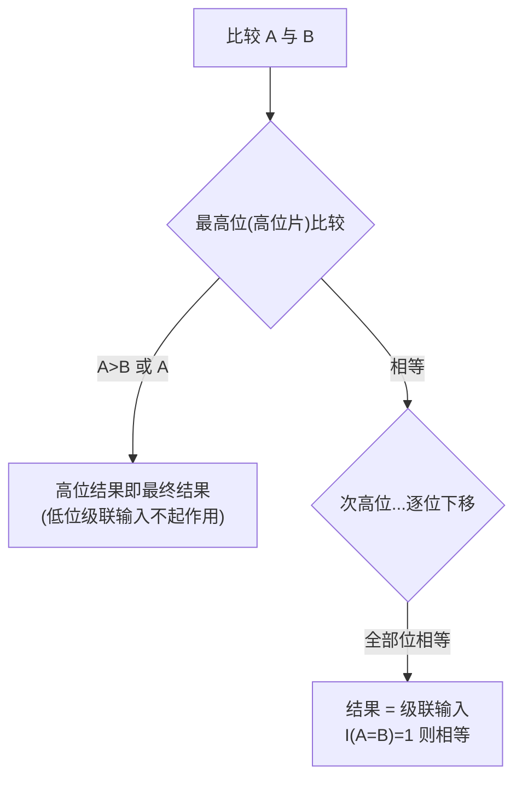

# 4.6 数值比较器（Digital Comparator）

## 一、是什么（概念与定位）

**数值比较器**：对两个二进制数 A、B 进行比较、判断其**大小关系**的组合逻辑电路。

三个输出（互斥，任意时刻仅一个为 1）：
- $F_{A>B}=1$：A 大于 B；
- $F_{A<B}=1$：A 小于 B；
- $F_{A=B}=1$：A 等于 B。

典型集成芯片：**74LS85（4 位数值比较器）**。

## 二、原理与特性

### 1. 一位数值比较器

输入 A、B，真值表与表达式：

| A | B | $F_{A>B}$ | $F_{A=B}$ | $F_{A<B}$ |
|---|---|---|---|---|
| 0 | 0 | 0 | 1 | 0 |
| 0 | 1 | 0 | 0 | 1 |
| 1 | 0 | 1 | 0 | 0 |
| 1 | 1 | 0 | 1 | 0 |

$$F_{A>B}=A\bar B,\qquad F_{A=B}=A\odot B=\overline{A\oplus B}=A\bar B+\bar A B\text{ 的非}=\overline{A\oplus B},\qquad F_{A<B}=\bar A B$$

（即 $F_{A=B}=\overline{A\oplus B}$，同或；三个输出恰好覆盖全部输入组合，天然互斥且完备。）

### 2. 两位数值比较器（多位比较的原则）

比较 A=A₁A₀ 与 B=B₁B₀，**从高位到低位逐位比较**：
- **高位不等**（$A_1\ne B_1$）：高位结果就是两数的比较结果，无须再看低位；
- **高位相等**（$A_1=B_1$）：结果由低位比较结果决定。

$$F_{A>B}=(A_1>B_1)+(A_1=B_1)(A_0>B_0)$$
$$F_{A=B}=(A_1=B_1)(A_0=B_0)$$
$$F_{A<B}=(A_1<B_1)+(A_1=B_1)(A_0<B_0)$$

### 3. 集成 4 位数值比较器 74LS85

- 输入：$A_3A_2A_1A_0$、$B_3B_2B_1B_0$ 两组 4 位数；
- **级联输入**：$I_{A>B}$、$I_{A=B}$、$I_{A<B}$——接收低位片的比较结果，用于**位数扩展**；
- 输出：$F_{A>B}$、$F_{A=B}$、$F_{A<B}$；
- 工作原理与两位比较器相同：从最高位向低位逐位比较，各位全等时结果由级联输入决定。

**级联使用注意**：单独使用（最低位片）时三个级联输入必须接**固定约定电平**：$I_{A=B}=1$，$I_{A>B}=I_{A<B}=0$——否则"全等"判断失效，这是最常考的细节。

### 4. 位数扩展

- **串联扩展**：低 4 位接一片，高 4 位接另一片；低位片的输出 $F_{A>B},F_{A=B},F_{A<B}$ 分别接高位片的级联输入 $I_{A>B},I_{A=B},I_{A<B}$；**最终结果取高位片输出**。两片 → 8 位，四片 → 16 位；
- 串联方式结构简单，但延迟逐级累积；位数很大时可用并联/树形扩展提高速度。

## 三、符号与图形（图文并茂）

一位数值比较器逻辑图（与非门 + 或非门实现三个输出）：

74LS85（4 位数值比较器）逻辑符号（COMP）：

两位/多位比较的判决逻辑：

## 四、典型例题/应用

**例1（设计）**：用一位比较器构成两位比较器。
- 两个一位比较器分别比较 $A_1B_1$、$A_0B_0$；
- 按上式用与门、或门合成三个输出（对应 P119 逻辑图：G1~G3 门电路）。

**例2（扩展）**：两片 74LS85 组成 8 位比较器（串联方式）。
- 低位片：输入 $A_3\sim A_0,B_3\sim B_0$，级联输入接"基准电平"（$I_{A=B}=1$，其余 0）；
- 高位片：输入 $A_7\sim A_4,B_7\sim B_4$，级联输入接低位片输出；
- 输出取**高位片**的 $F_{A>B},F_{A=B},F_{A<B}$。

**例3（判断）**：若 74LS85 的级联输入误接成 $I_{A=B}=0$，当两组 4 位数完全相等时输出如何？
- 答：$F_{A=B}=0$，且因 $I_{A>B}=I_{A<B}=0$，三个输出可能全为 0（取决于内部逻辑），比较结果错误——说明级联输入必须正确设置。

**应用**：CPU 的条件判断（大于/小于/等于分支）、地址比较与片选、排序与搜索电路、门限报警（数值超限检测）。

## 五、易错点

1. **多位比较顺序**：必须**从最高位开始**比较；先比低位是概念性错误。
2. **级联输入的基准电平**：最低位片（或单片独立使用）必须接 $I_{A=B}=1$、$I_{A>B}=I_{A<B}=0$；漏接或接错是考试最常设的坑。
3. **扩展时结果取哪片**：串联扩展的最终输出取**高位片**，不是低位片。
4. **三个输出互斥性**：一位比较器三式之和恒为 1（$A\bar B+\bar AB+\overline{A\oplus B}=1$），若化简时破坏了互斥/完备结构，真值表就对不上。
5. **$F_{A=B}$ 用同或**：相等输出是同或（$\overline{A\oplus B}$），不要误写成异或。

## 六、知识点总结

- 一位比较器三式：$F_{A>B}=A\bar B$，$F_{A<B}=\bar AB$，$F_{A=B}=\overline{A\oplus B}$。
- 多位比较原则：**高位优先，高位相等看低位，全等看级联输入**。
- 74LS85：4 位比较器，带 $I_{A>B}/I_{A=B}/I_{A<B}$ 级联端；串联扩展 8 位/16 位，输出取最高位片。
- 级联输入基准电平：最低片 $I_{A=B}=1$、其余置 0。
