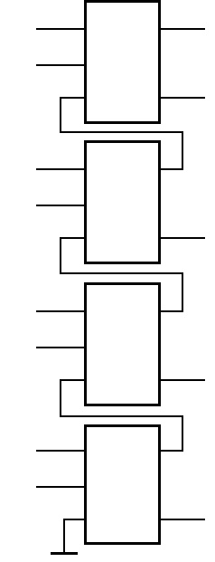
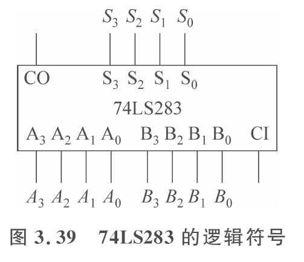

# 4.7 加法器（Adder）

## 一、是什么（概念与定位）

**加法器**：实现二进制加法运算的组合逻辑电路，是计算机 **ALU（算术逻辑单元）**的核心。按层次分为：
- **半加器（Half Adder）**：两个 1 位数相加，**不考虑低位进位**；
- **全加器（Full Adder）**：两个 1 位数相加，**考虑低位进位** $C_{i-1}$；
- **多位加法器**：① **串行（逐位）进位加法器**——全加器级联，结构简单但速度慢；② **超前进位加法器**——进位并行产生，速度快（74LS283）。

减法通常"加补码"实现：$A-B=A+B_补-2^n=A+\bar B+1-2^n$。

## 二、原理与特性

### 1. 半加器

输入 $A_i,B_i$；输出本位和 $S_i$、进位 $C_i$。

| $A_i$ | $B_i$ | $S_i$ | $C_i$ |
|---|---|---|---|
| 0 | 0 | 0 | 0 |
| 0 | 1 | 1 | 0 |
| 1 | 0 | 1 | 0 |
| 1 | 1 | 0 | 1 |

$$\boxed{S_i=A_i\oplus B_i,\qquad C_i=A_iB_i}$$

结构：**1 个异或门（求和）+ 1 个与门（求进位）**。

### 2. 全加器

输入 $A_i,B_i,C_{i-1}$；输出本位和 $S_i$、向高位进位 $C_i$。标准与或式：

$$S_i=\bar A_i\bar B_iC_{i-1}+\bar A_iB_i\bar C_{i-1}+A_i\bar B_i\bar C_{i-1}+A_iB_iC_{i-1}$$
$$C_i=\bar A_iB_iC_{i-1}+A_i\bar B_iC_{i-1}+A_iB_i\bar C_{i-1}+A_iB_iC_{i-1}$$

卡诺图化简（$C_i$ 圈"1"得最简与或式）：

$$S_i=A_i\oplus B_i\oplus C_{i-1},\qquad C_i=A_iB_i+(A_i\oplus B_i)C_{i-1}$$

**双半加器架构**（模块化构建）：半加器 I 算 $A_i\oplus B_i=S'$ 与 $C_1=A_iB_i$；半加器 II 算 $S'\oplus C_{i-1}=S_i$ 与 $C_2=S'C_{i-1}$；或门合并进位 $C_i=C_1+C_2$。

### 3. 串行（逐位）进位加法器

4 个全加器级联：低位 $CO$ 依次接高位 $CI$，最低位 $CI=0$（接地）；和为 $C_3S_3S_2S_1S_0$。
- 优点：**结构简单、易于扩展**；
- 缺点：高位必须等低位进位，进位"波浪式"逐位传递，延迟累积 $=4t_{pd}$（n 位为 $n\cdot t_{pd}$，$t_{pd}$ 为一位全加器平均传输延迟），**速度慢**。

### 4. 超前进位加法器（Carry Look-ahead）

定义中间变量（仅由本位输入决定，不依赖低位）：
- 进位**生成**项：$G_i=A_iB_i$（本位必然产生进位）；
- 进位**传递**项：$P_i=A_i\oplus B_i$（允许低位进位穿过本位）。

代入全加器进位式得递推式 $C_i=G_i+P_iC_{i-1}$，**逐级代入展开**（4 位）：

$$C_0=G_0+P_0C_{-1}$$
$$C_1=G_1+P_1G_0+P_1P_0C_{-1}$$
$$C_2=G_2+P_2G_1+P_2P_1G_0+P_2P_1P_0C_{-1}$$
$$C_3=G_3+P_3G_2+P_3P_2G_1+P_3P_2P_1G_0+P_3P_2P_1P_0C_{-1}$$

各位进位**只由 G、P 与初始进位直接算出**，并行产生、无需等待 → 各位同时运算，速度大幅提升，是现代 CPU 加法器的核心架构。和：$S_i=P_i\oplus C_{i-1}$。

### 5. 集成超前进位加法器 74LS283（74HC283）

4 位超前进位加法器：输入 $A_3\sim A_0$、$B_3\sim B_0$、$CI$；输出 $S_3\sim S_0$、$CO$。
**两片级联成 8 位加法器**：低片 $CO$ 接高片 $CI$——**片内超前进位、片间串行进位**。

**用 74LS283 实现减法（加补码）**：$\bar B$ 由 4 个异或门/反相器产生，$CI=1$ 实现"+1"；进位 $CO=1$ 表示差为正（原码），$CO=0$ 表示差为负（绝对值的补码，需再求补还原原码）。

## 三、符号与图形（图文并茂）

4 位串行进位加法器（4 个全加器 ∑ 级联，CI 逐位传递）：



74LS283 逻辑符号：



```mermaid
flowchart LR
    subgraph 串行进位(慢, 4·t_pd)
    A0["FA0<br>A0B0CI=0"] -->|C1| A1["FA1"] -->|C2| A2["FA2"] -->|C3| A3["FA3"]
    end
```

```mermaid
flowchart LR
    subgraph 超前进位(快, 并行产生进位)
    CLA["进位产生电路<br>Ci=Gi+PiCi-1 展开式"] --> F0["FA0"] & F1["FA1"] & F2["FA2"] & F3["FA3"]
    end
```

## 四、典型例题/应用

**例1（P9-10 分析）**：分析由异或门与与门构成的电路：$S=A\oplus B$、$C=AB$，真值表表明 A=B=1 时进位、相异时和为 1——**该电路是半加器**。

**例2（P128-129 设计）**：用 3线-8线译码器 74LS138 实现一位全加器。
- $S_i=\sum m(1,2,4,7)=\overline{\bar Y_1\bar Y_2\bar Y_4\bar Y_7}$，$C_i=\sum m(3,5,6,7)=\overline{\bar Y_3\bar Y_5\bar Y_6\bar Y_7}$；
- $A_iB_iC_{i-1}$ 接地址端 $A_2A_1A_0$，$\bar Y_1\bar Y_2\bar Y_4\bar Y_7$ 接一个四输入与非门输出 $S_i$，$\bar Y_3\bar Y_5\bar Y_6\bar Y_7$ 接另一个与非门输出 $C_i$。

**例3（P138）**：两片 74LS283 构成 8 位加法器：低片加 $A_3\sim A_0,B_3\sim B_0$、$CI=0$，其 $CO$ 接高片 $CI$；高片加 $A_7\sim A_4,B_7\sim B_4$；8 位和为 $S_7\sim S_0$，最高进位为高片 $CO$。

**例4（P140-141）**：输出为原码的 4 位减法器：第一片 283 做 $A+\bar B+1$；第二片在 $CO=0$（差为负）时对结果再求补（异或门取反 + 加 1），并以 $CO$ 控制符号。

**应用**：ALU 算术运算、地址计算、BCD 加法修正、乘法器部分积累加、数字信号处理。

## 五、易错点

1. **半加器 vs 全加器**：区别仅在"是否考虑低位进位"；半加器只有 2 入 2 出，全加器 3 入 2 出。写全加器真值表时 8 行必须列全。
2. **全加器进位式**：$C_i=A_iB_i+(A_i\oplus B_i)C_{i-1}$ 中第二项是"半加和 × 低位进位"，写成 $A_iB_iC_{i-1}$ 属于与或展开错误。
3. **串行进位延迟**：n 位串行加法器延迟 ≈ n·t_pd（4 位为 4t_pd），答"与位数无关"或"一位门延迟"均错；其优化方向就是超前进位。
4. **超前进位变量含义**：$G_i=A_iB_i$ 是"生成"，$P_i=A_i\oplus B_i$ 是"传递"，两者都**只由本位输入决定**；$C_i$ 展开式漏写末项 $P_3P_2P_1P_0C_{-1}$ 是常见失分点。
5. **减法的补码细节**：$+1$ 通过 $CI=1$ 实现；差为负时 $CO=0$、结果是补码而非原码——判读结果时别忘了再求补。
6. **级联概念**：两片 283 级联是"片内并行、片间串行"，不能说成 8 位超前进位加法器。

## 六、知识点总结

- 半加器：$S=A\oplus B$，$C=AB$（异或+与门）。
- 全加器：$S_i=A_i\oplus B_i\oplus C_{i-1}$，$C_i=A_iB_i+(A_i\oplus B_i)C_{i-1}$；可由两个半加器 + 一个或门构成。
- 串行进位：级联简单但延迟 $nt_{pd}$；超前进位：$G_i/P_i$ + 展开式并行产生进位，74LS283 是典型 4 位超前进位加法器。
- 减法 = 加补码（取反 + 1）；译码器/选择器亦可实现全加器（最小项法）。
