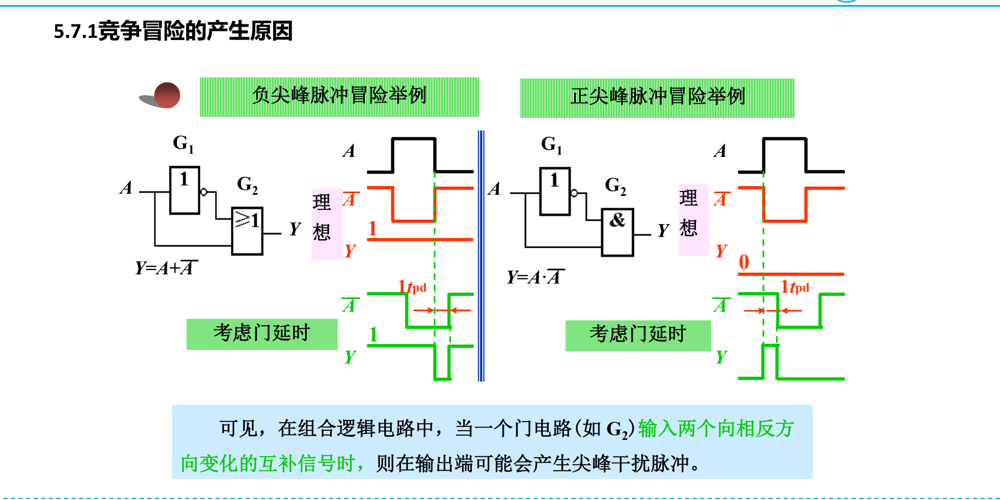
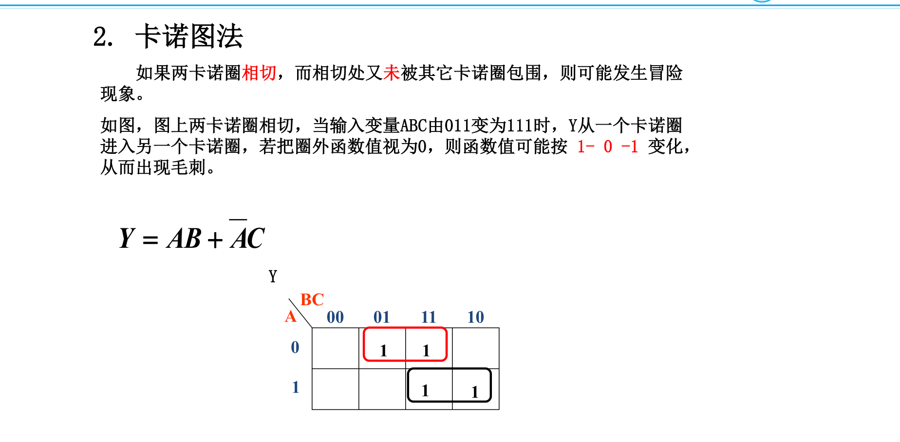
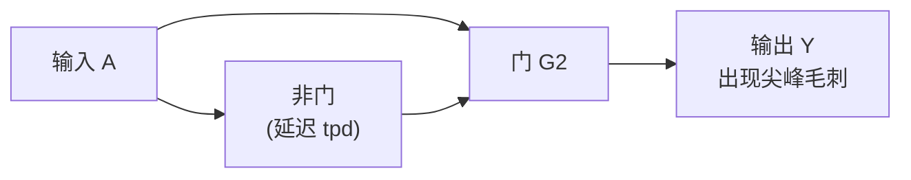
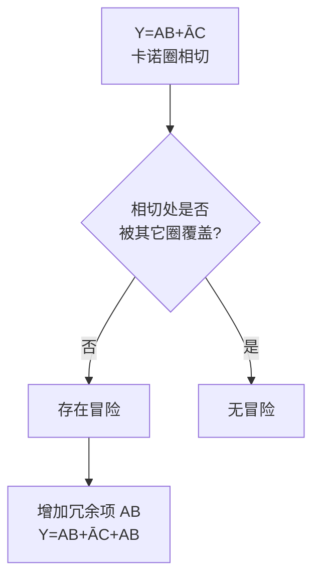

# 4.8 竞争与冒险（Competition & Hazard）

## 一、是什么（概念与定位）

组合逻辑电路的输出本应只由**当前输入**决定，与历史无关。但在实际电路中，信号经过导线和门电路都会产生**时间延迟**（$t_{pd}$）。

- **竞争（Competition）**：同一个门的一组输入信号，因此前经过的门数目不同、导线长度不同，**到达门输入端的时间有先有后**，这种现象称为竞争。
- **冒险（Hazard）**：逻辑门因输入端竞争，导致输出产生**不应有的尖峰干扰脉冲（毛刺）**的现象，称为冒险。

冒险是一种**瞬态**的、本不该出现的窄脉冲。若后级电路对它敏感（如触发时钟、计数器），就可能导致**错误动作**，必须识别并消除。

## 二、原理与特性

### 1. 冒险的产生原因

当某个门（如 $G_2$）的输入端同时加入**两个向相反方向变化的互补信号**（如 $A$ 与 $\bar A$）时，由于反相器带来的延迟，两个信号不会"同时"翻转，输出端就可能出现尖峰脉冲。

| 逻辑式 | 理想输出 | 考虑门延时 | 尖峰类型 |
|---|---|---|---|
| $Y=A+\bar A$ | 恒为 1 | 出现短暂 0 | **负尖峰**脉冲，"0"型冒险 |
| $Y=A\cdot\bar A$ | 恒为 0 | 出现短暂 1 | **正尖峰**脉冲，"1"型冒险 |

负/正尖峰脉冲冒险举例（左：$Y=A+\bar A$；右：$Y=A\cdot\bar A$）：

互补信号电路（$Y=A+\bar A$）：

### 2. 判断方法

**① 代数法**：若某变量以**原变量和反变量同时出现**在逻辑函数 $Y$ 中，该变量即**具有竞争条件**。消去其他变量（令其为 0 或 1），只留下竞争变量：

- 若化简后出现 $Y=A+\bar A$ → **"0"型冒险**（负尖峰）；
- 若化简后出现 $Y=A\cdot\bar A$ → **"1"型冒险**（正尖峰）。

**例**：$Y=AB+\bar AC$。令 $B=C=1$（消去 B、C），得 $Y=A+\bar A$ → 变量 $A$ 存在"0"型冒险。

**② 卡诺图法**：若**两个卡诺圈相切**，而相切处**又未被其它卡诺圈包围**，则可能发生冒险。

例如 $Y=AB+\bar AC$，输入 $ABC$ 由 $011\to 111$ 时，$Y$ 从一个卡诺圈进入另一个卡诺圈，函数值可能按 $1\to 0\to 1$ 变化，从而出现毛刺：

### 3. 消除方法

| 方法 | 做法 | 说明 |
|---|---|---|
| **① 发现并消除互补变量** | 用公式变换把 $A\bar A$ 消去 | 从表达式入手，最彻底 |
| **② 增加冗余（乘积）项** | 在相切的卡诺圈之间**多加一个圈** | 本质是加冗余项 $AB$，使相切处被覆盖 |
| **③ 滤波法** | 输出端并接小电容 | 使边沿变缓，滤掉窄脉冲；仅适合低速电路 |
| **④ 选通法** | 输出门加选通脉冲 | 在输入变化瞬间关闭输出门，稳定后再开启 |

**增加冗余项示例**：$F=AC+B\bar C$，当 $A=B=1$ 时 $F=C+\bar C$ 存在冒险。加入冗余项 $AB$ 得

$$F=AC+B\bar C+AB$$

当 $A=B=1$ 时 $F=C+\bar C+1=1$，冒险被消除（$AB$ 为冗余项，逻辑上不改变函数值）。

## 三、符号与图形（图文并茂）

组合电路中的竞争冒险可用时序示意描述：理想输出与考虑门延时后的实际输出：

消除冒险的"加冗余项"思路：

## 四、典型例题/应用

**例（代数法判断冒险）**：判断 $Y=AB+\bar AC$ 是否存在冒险，指出冒险变量与类型。

- **解**：变量 $A$ 以 $A$ 与 $\bar A$ 形式同时出现，为竞争变量。令 $B=C=1$ 消去其它变量，得 $Y=A+\bar A$，属 **"0"型冒险**（负尖峰）。
- **消除**：增加冗余项，$Y=AB+\bar AC+BC$，此时 $B=C=1$ 时 $Y=A+\bar A+1=1$，冒险消除。

**应用**：竞争冒险在**异步时序电路、计数器的时钟/复位端**尤其危险——一个毛刺就可能让计数器多计一个数。因此工程上常通过加冗余项、加滤波电容或选通脉冲来保证电路可靠。

## 五、易错点

1. **竞争 ≠ 冒险**：竞争是"信号到达时间有先有后"的**原因**；冒险是"输出出现尖峰"的**结果**。有竞争不一定有冒险（若两个信号最终值不变，则看具体电路）。
2. **判断时"消去其他变量"**：代数法要令其它变量取 0 或 1，看剩余式是否为 $A+\bar A$（0型）或 $A\bar A$（1型），不能直接看原式。
3. **卡诺图法要看"相切且未被覆盖"**：仅相切还不足以判定冒险，必须相切处**没有被其它圈重叠覆盖**才可能冒险。
4. **冗余项不改变逻辑值**：$F=AC+B\bar C$ 与 $F=AC+B\bar C+AB$ 真值完全相同，加 $AB$ 只为消除冒险，别误以为改了函数。
5. **滤波法有代价**：并接电容会使输出**边沿变缓**，只适用于低速电路；高速电路应用加冗余项或选通法。

## 六、知识点总结

- **竞争**：信号到达门输入端有先有后；**冒险**：竞争引起输出尖峰毛刺。
- 产生原因：门输入端出现**向相反方向变化的互补信号**（$A$ 与 $\bar A$）。
- **判断**：① 代数法——$Y=A+\bar A$ 为"0"型冒险，$Y=A\bar A$ 为"1"型冒险；② 卡诺图法——两圈**相切且未被覆盖**。
- **消除**：① 消除互补变量；② **加冗余（乘积）项**（最常用）；③ 滤波法（并电容）；④ 选通法（加选通脉冲）。
