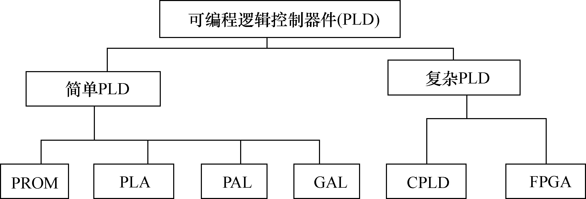
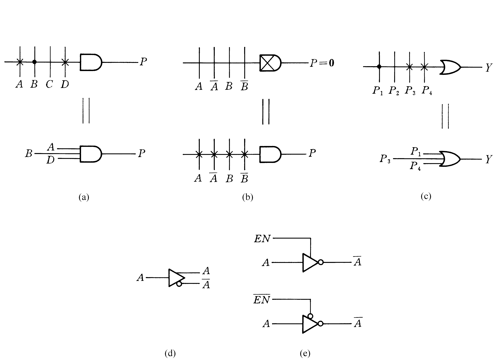
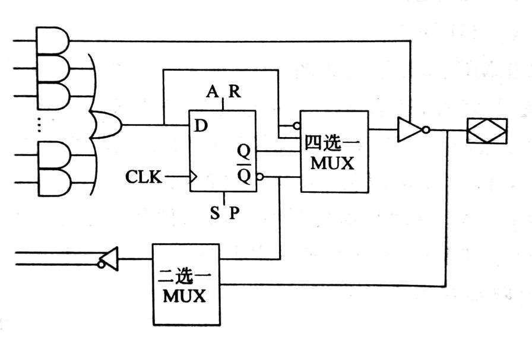
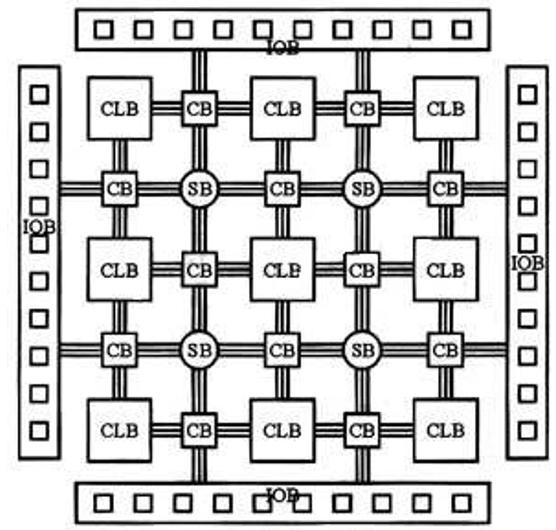
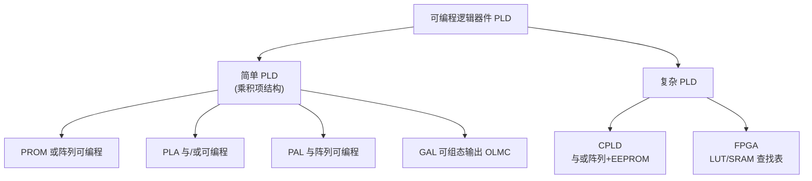

# 4.9 可编程逻辑器件 PLD（Programmable Logic Device）

## 一、是什么（概念与定位）

用**固定功能**的标准逻辑器件（74 系列等）设计数字系统时，需要把系统拆成若干模块再用导线连接，存在**体积功耗大、器件多、连线多、速度低、可靠性差、方案难修改、可构建规模小、易被复制**等缺点。

**可编程逻辑器件 PLD**：由**用户编程**（而非厂家固定）来定义内部连接、进而实现所需逻辑功能的集成电路。它把"设计"从"连线"转移到"配置"，彻底改变了上述不利局面，是现代数字系统（尤其 FPGA/CPLD）的基础。

## 二、原理与特性

### 1. 基本结构

PLD 的基本结构 = **输入缓冲电路 + 与阵列 + 或阵列 + 输出电路**。其中：

- **与阵列**：产生**乘积项**（与项）；
- **或阵列**：产生**乘积项之和**（或项），即"与或表达式"；
- 输入缓冲电路产生输入变量的**原变量与反变量**；
- 输出结构可以是组合输出、时序输出或可编程输出，输出信号还可**反馈**回输入端。

任何逻辑函数都能写成"与或式"，而 PLD 的与/或阵列天然实现"与或式"，这正是 PLD 能实现任意组合逻辑的根本原因。

### 2. 分类

按与阵列/或阵列是否可编程，可分为：

| 器件 | 与阵列 | 或阵列 | 输出电路 | 特点 |
|---|---|---|---|---|
| **PROM** 可编程只读存储器 | 固定 | 可编程 | 固定 | 用作存储器，与阵列全译码 |
| **PLA** 可编程逻辑阵列 | 可编程 | 可编程 | 固定 | 灵活，但慢且贵 |
| **PAL** 可编程阵列逻辑 | 可编程 | 固定 | 固定 | 一度成为主流 |
| **GAL** 通用阵列逻辑 | 可编程 | 固定 | **可组态** | PAL 第二代，可擦写 |
| **CPLD** 复杂可编程逻辑器件 | — | — | — | 基于乘积项结构，集成度高 |
| **FPGA** 现场可编程门阵列 | — | — | — | 基于查找表结构，集成度最高 |

PLD 分类树：

其它分类角度：
- **按集成度**：简单 PLD（PROM/PLA/PAL/GAL）与复杂 PLD（CPLD/FPGA）；
- **按内部结构**：**乘积项结构**器件 与 **查表（LUT）结构**器件；
- **按编程工艺**：熔丝型（不可改）、EPROM（紫外擦除）、EEPROM（电擦除）、SRAM 型（掉电丢失）。

### 3. PLD 的画法（连接约定）

PLD 阵列图中用不同符号表示交叉点的连接状态：

- **固定连接**：实心点（"•"）；
- **可编程"接通"单元**：编程后接通（"×"）；
- **可编程"断开"单元（被编程擦除单元）**：编程后断开；
- **不连接**：无符号。

各种连接与门符号的画法：

### 4. 各类器件要点

- **PROM**：与阵列固定（全译码）、或阵列可编程，通常**用作存储器**（输入为地址、输出为单元内容）。与阵列规模随输入按 $2^n$ 增长，输入多时功耗大、速度慢；但价格低、易编程、无布局布线问题、性能可预测。不可擦除的缺点由 EPROM 解决。
- **PLA**：与、或阵列**均可编程**，芯片利用率高，适合含复杂随机逻辑置换的场合；但慢、贵。
- **PAL**：或阵列固定、与阵列可编程，**每个输出是固定数目乘积项之和**，结构与大多数逻辑函数的与或式吻合，性能速度高，曾为主流。
- **GAL**：PAL 第二代，采用**浮栅 + CMOS 静态 RAM**的 E²PROM 工艺，**可电擦写、可重复编程、可加密**。每个输出端集成一个**可编程输出逻辑宏单元 OLMC（Output Logic Macro Cell）**，内部有四选一 MUX（选输出方式/极性）和二选一 MUX（选反馈），通过编程可配置成多种输出结构，因而能取代数十种 PAL。用 GAL16V8 可驱动数码管。缺点是规模较小。

OLMC 内部结构（含或阵列、D 触发器、两个 MUX）：

## 三、复杂可编程逻辑器件与 FPGA

### 1. CPLD（复杂可编程逻辑器件）

CPLD 基本结构与 PAL/GAL **相仿**，基于**与或阵列的乘积项结构**，只是集成度高得多。多用 **E²PROM/Flash** 工艺，**可反复编程、上电即工作**（无需外部配置芯片）。

CPLD 至少包含 3 种结构：**可编程逻辑功能块（FB）、可编程 I/O 单元、可编程内部连线**。以 Altera **MAX7000** 系列为例：由**逻辑阵列块（LAB）**、**宏单元**（= 逻辑阵列 + 乘积项选择矩阵 + 可编程触发器）、扩展乘积项、可编程连线阵（PIA）等组成。可用下载电缆进行**在系统编程（ISP, In System Programming）**。

### 2. FPGA（现场可编程门阵列）

FPGA 由若干**独立的可编程逻辑模块**组成，属高密度 PLD。采用**逻辑单元阵列 LCA（Logic Cell Array）**概念，内部含：

- **可配置逻辑模块 CLB（Configurable Logic Block）**
- **输入/输出模块 IOB（Input/Output Block）**
- **可编程内部连线 PI（Programmable Interconnect）**

FPGA 结构（CLB / IOB / PI）：

**常见 FPGA 结构有 3 种**：查找表（LUT）结构、多路开关结构、多级与非门结构。其中 **LUT 型**最主流：

- **查找表 LUT（Look Up Table）** 是最小可编程逻辑单元，物理结构是**静态存储器 SRAM**；
- $M$ 个输入的逻辑函数可由一个 $2^M$ 位 SRAM 实现：输入变量作为**地址**，SRAM 输出即**函数值**；
- 输入每增 1 个，SRAM 容量翻倍，故实际 LUT 输入项一般**不超过 5 个**，多于 5 输入的函数用多个 LUT **组合或级联**。

以 Altera **Cyclone** 为例：可编程资源来自 **LAB**，每个 LAB 由多个 **LE（Logic Element，逻辑宏单元）**构成；每个 LE = **4 输入 LUT + 进位链 + 可编程寄存器**（可配成 D/T/JK/RS 触发器）。由于基于 SRAM，**掉电后配置数据丢失**，每次上电需由 **Flash 配置芯片**自动加载。

## 四、典型例题/应用

**例1**：FPGA 与 CPLD 在结构、编程工艺、掉电特性上有何区别？

- **解**：CPLD 基于**与或阵列乘积项结构**，用 E²PROM/Flash 工艺，**掉电信息不丢失、上电即工作**；FPGA 基于**查找表（LUT）/SRAM 结构**，集成度更高，但 **SRAM 掉电丢失配置数据**，每次上电需由外部配置芯片重新加载。

**例2**：为什么查找表型 FPGA 的 LUT 输入项一般不超过 5 个？

- **解**：$M$ 输入函数的 LUT 需要 $2^M$ 位 SRAM；每增加一个输入，容量翻倍。当输入超过 5 个时 SRAM 容量迅速膨胀（如 16 输入需 64 KB 位），代价过高，故多用多级 LUT 级联实现。

**应用**：CPLD/FPGA 广泛用于数字系统原型验证、通信、图像处理、嵌入式控制等——用硬件描述语言编程后"烧写"进芯片即可获得所需逻辑，改设计只需重新编程。

## 五、易错点

1. **与阵列/或阵列的"可编程"归属**：PROM（与固定、或可编程）、PLA（都可编程）、PAL（与可编程、或固定）——极易记混，用"**PROM 做存储器、PAL 固定或阵列**"来辅助记忆。
2. **"乘积项结构" vs "查表结构"**：CPLD 属**乘积项（与或阵列）结构**，FPGA 属**查找表（LUT/SRAM）结构**，是两者的本质区别。
3. **FPGA 掉电**：基于 SRAM 的 FPGA **掉电数据丢失**，必须配 Flash 配置芯片；CPLD 基于 E²PROM/Flash 则**掉电不丢**。
4. **GAL 的 OLMC**：GAL 的灵活性来自**输出逻辑宏单元 OLMC**（含两个 MUX），不是靠改变与/或阵列规模。
5. **LUT 容量关系**：$M$ 输入 → $2^M$ 位，别把指数关系记反。

## 六、知识点总结

- PLD 基本结构：**输入缓冲 + 与阵列 + 或阵列 + 输出电路**；与阵列产生乘积项，或阵列求和成与或式。
- 分类（与/或阵列可编程性）：**PROM**（或可编程）→ **PLA**（都可编程）→ **PAL**（与可编程、或固定）→ **GAL**（与可编程 + 可组态输出 OLMC）。
- **CPLD**：与或乘积项结构 + E²PROM/Flash，掉电不丢，含 FB/I/O/内部连线，可 ISP 在系统编程。
- **FPGA**：LCA = **CLB + IOB + PI**；主流为 **LUT（SRAM）结构**，$M$ 输入需 $2^M$ 位 SRAM，LUT 输入一般 ≤5；基于 SRAM 需**掉电重配**。
- 核心价值：**用编程代替连线**，灵活、可改、可保护知识产权，是数字系统设计的主流载体。
