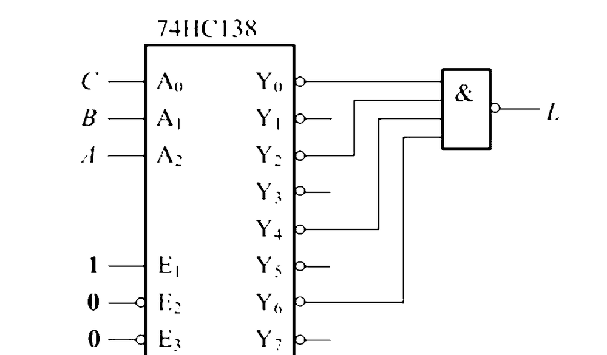
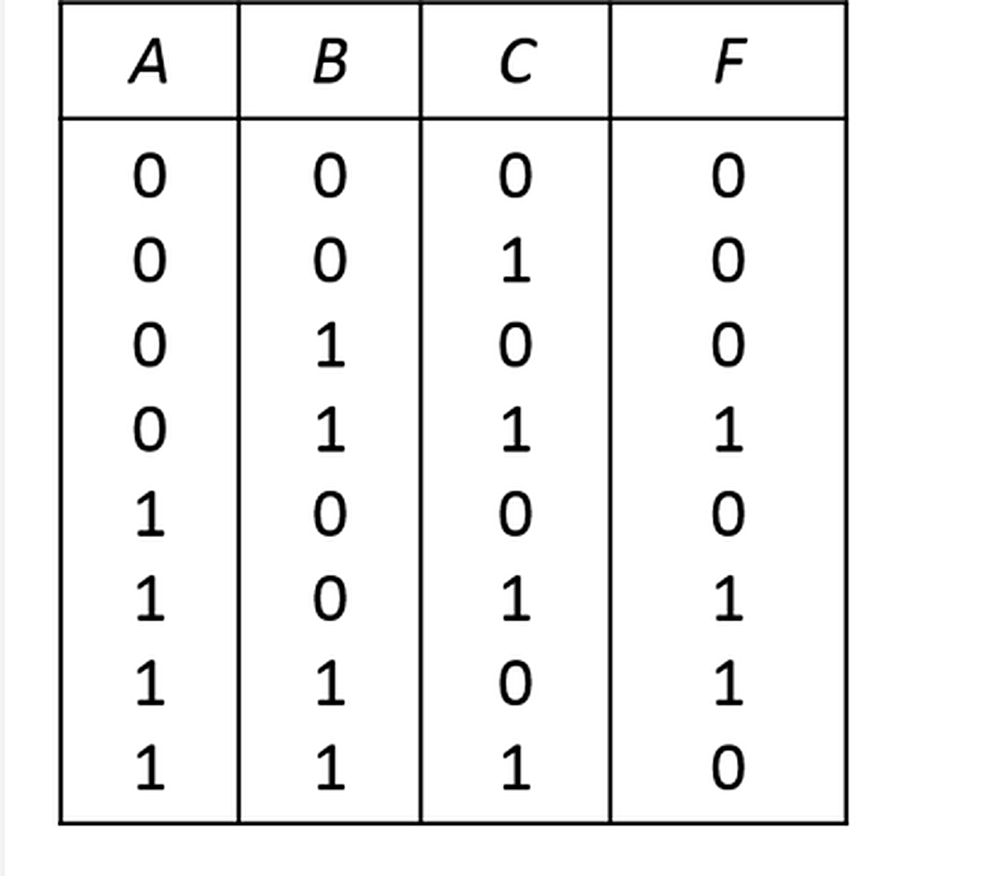
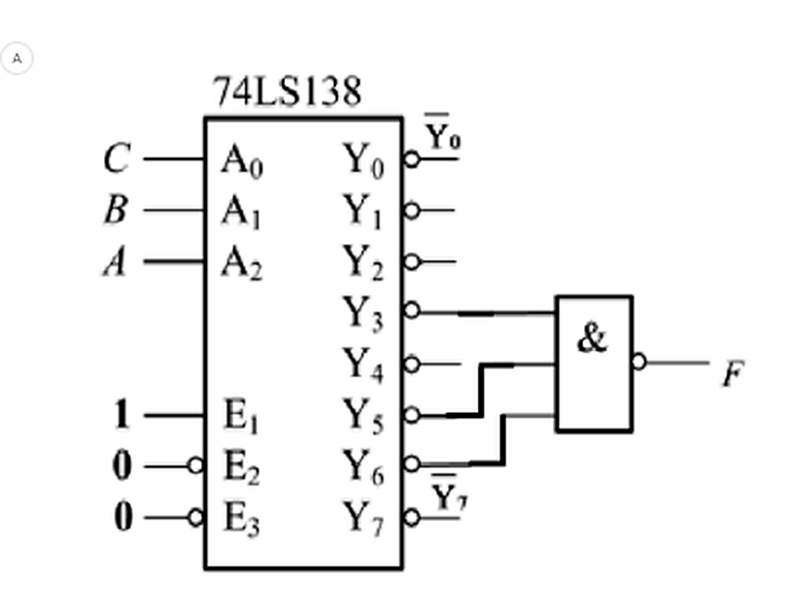
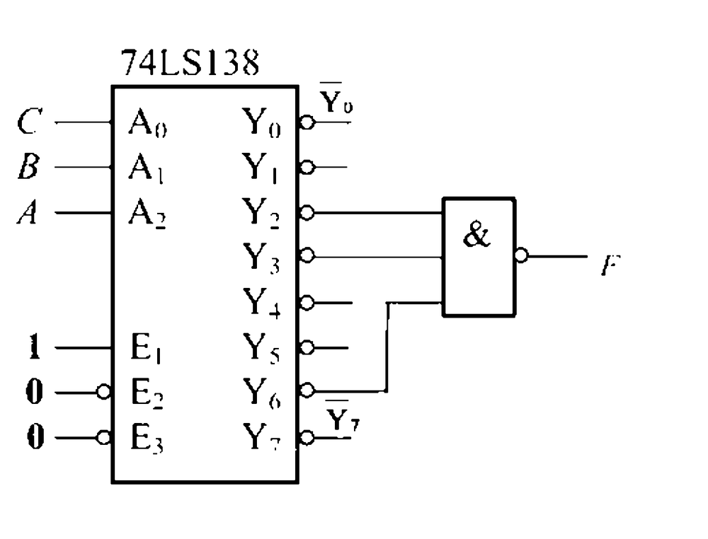
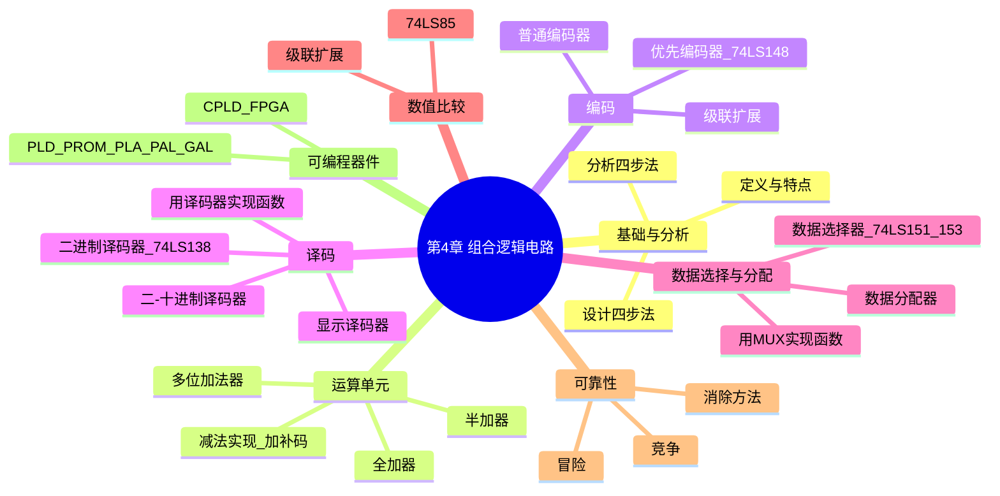
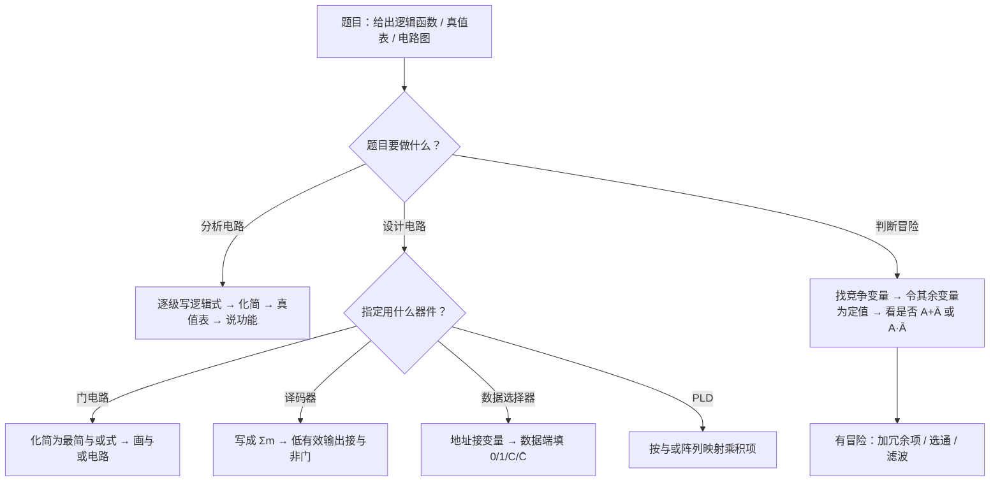

# 第4章 组合逻辑电路 · 例题与考法解析

## 一、考情概览

组合逻辑电路是数字电路的核心章节之一，期末与考研中分值占比高（通常 15%–25%）。高频题型：

- **分析型**：给出电路图 → 写逻辑式 → 化简 → 列真值表 → 说明功能；
- **设计型**：给功能要求 → 列真值表 → 化简 → 用**门电路 / 译码器 / 数据选择器**实现；
- **器件应用**：74LS138 译码器、74LS148 编码器、74LS153/151 数据选择器、74LS283 加法器、74LS85 比较器的功能与扩展；
- **竞争冒险**：判断（代数法 / 卡诺图法）与消除。

关键得分点：**分析要按"逐级写式→化简→真值表→功能"四步**；**设计要落到"与或式→器件实现"**。

## 二、典型例题

### 例题 1（题型：组合电路分析）

**题干**：某电路输入 $A,B,C$，输出 $Y=AB\bar C+A\bar BC+ABC$，判断其功能。

**思路**：先化简，再列真值表，最后归纳功能。

**解答**：卡诺图化简 $Y=AB\bar C+A\bar BC+ABC$，圈相邻最小项 $m_6,m_7$ 与 $m_5,m_7$：

$$
Y=AB+AC=A(B+C)
$$

即 $A=1$ 且（$B=1$ 或 $C=1$）时 $Y=1$，其余为 0。功能为"**选通一致电路**"：A 为选通端，B、C 任一有效即输出 1。

**易错**：直接写三个乘积项而不化简，导致功能描述不清；漏圈 $m_5,m_7$。

### 例题 2（题型：用译码器实现逻辑函数）

**题干**：用 3 线—8 线译码器 74LS138（输出低有效）及与非门实现 $F(A,B,C)=\sum m(1,3,5,7)$。

**思路**：译码器每个输出 $\bar Y_i=\overline{m_i}$（最小项的**非**，也即同编号的最大项 $M_i$），故 $F=\sum m_i=\overline{\prod \bar Y_i}=\overline{\bar Y_1\bar Y_3\bar Y_5\bar Y_7}$。

**解答**：将 $A,B,C$ 接地址端 $A_2A_1A_0$，取低有效输出 $\bar Y_1,\bar Y_3,\bar Y_5,\bar Y_7$ 接一个**四输入与非门**，输出即 $F$。

**易错**：译码器输出是**低有效**，实现"最小项之和"应当用**与非门**（不是或门）；注意 74LS138 的使能端 $G_1$、$\bar G_{2A}$、$\bar G_{2B}$ 必须正确置位才能工作。

### 例题 3（题型：用数据选择器实现逻辑函数）

**题干**：用 4 选 1 数据选择器 74LS153 实现 $F(A,B,C)=\sum m(0,1,3,6,7)$。

**思路**：数据选择器输出 $Y=\sum D_i\,m_i$。选两个变量（如 $A,B$）接地址端，把第三个变量 $C$ 通过 $D_i$ 端口用 **0 / 1 / C / $\bar C$** 表示。

**解答**：令地址 $A_1A_0=AB$，每个地址覆盖两个最小项（$C=0$ 与 $C=1$ 各一个）：

| 地址 AB | 覆盖的最小项 | 数据端 |
|---|---|---|
| 00 | $m_0,m_1$（两个都在 Σ 内） | $D_0=1$ |
| 01 | $m_2,m_3$（只有 $m_3$ 在 Σ 内） | $D_1=C$ |
| 10 | $m_4,m_5$（都不在 Σ 内） | $D_2=0$ |
| 11 | $m_6,m_7$（两个都在 Σ 内） | $D_3=1$ |

故 $D_0=D_3=1$，$D_1=C$，$D_2=0$，接好即得 $F$。

**易错**：地址端的变量选择会影响 $D_i$ 表达式；注意数据选择器的**使能端**与**输出极性**。

### 例题 4（题型：加法器 / 减法器）

**题干**：用两片 4 位超前进位加法器 74LS283 构成 8 位二进制加法器，并说明如何实现减法。

**思路**：低片 $CO$ 接高片 $CI$ 完成级联；减法用"加补码"。

**解答**：低片算 $A_3\!\sim\!A_0+B_3\!\sim\!B_0$、$CI=0$，其 $CO$ 接高片 $CI$；高片算 $A_7\!\sim\!A_4+B_7\!\sim\!B_4$；8 位和为 $S_7\!\sim\!S_0$。**减法** $A-B$：将 $B$ 各位取反（异或门/反相器）后送入，并令 $CI=1$ 实现"+1"，即 $A+\bar B+1$。$CO=1$ 表示差为正（原码），$CO=0$ 表示差为负（结果为补码，需再求补还原）。

**易错**：两片级联是"**片内并行、片间串行**"，不能说成 8 位超前进位；减法结果判读别忘 $CO$ 作符号。

### 例题 5（题型：竞争冒险判断与消除）

**题干**：判断 $Y=AB+\bar AC$ 是否存在冒险，若有，给出消除方法。

**思路**：代数法找竞争变量。

**解答**：变量 $A$ 以 $A$ 与 $\bar A$ 同时出现，为竞争变量。令 $B=C=1$，得 $Y=A+\bar A$，属 **"0"型冒险**（负尖峰）。消除：增加冗余项 $BC$，得

$$
Y=AB+\bar AC+BC
$$

当 $B=C=1$ 时 $Y=A+\bar A+1=1$，冒险消除（$BC$ 为冗余项，不改变函数逻辑值）。

**易错**：判"1"型还是"0"型要看消去其它变量后的剩余式是 $A\bar A$（1型）还是 $A+\bar A$（0型）；卡诺图法要判"两圈相切**且未被覆盖**"。

### 例题 6（题型：用译码器实现最大项之积 —— 与例题 2 对称）

**题干**：用 74LS138 及**与门**实现 $F(A,B,C)=\prod M(0,2,3)$。

**思路**：$\bar Y_i=\overline{m_i}=M_i$，所以 $\prod M_i=\prod\bar Y_i$；**0 少时取"不含 1 的编号"接与门**，得到或与式。

**解答**：$A,B,C$ 接 $A_2A_1A_0$，使能 $S_1=1$、$\bar S_2=\bar S_3=0$，把 $\bar Y_0,\bar Y_2,\bar Y_3$ 接一个**三输入与门**，输出即 $F$。

**对照例题 2**：

| 对比项 | 例题 2（与非门） | 例题 6（与门） |
|---|---|---|
| 实现目标 | $\sum m(1,3,5,7)$ | $\prod M(0,2,3)$ |
| 取哪几路 $\bar Y$ | 函数**含**的编号 | 函数**不含**的编号（F=0 的行） |
| 汇总门 | 四输入与非门 | 三输入与门 |
| 得到形式 | 与或式 | 或与式 |
| 适用场合 | 1 少 | **0 少** |

**等价性验**：$\prod M(0,2,3)$ 与 $\sum m(1,4,5,6,7)$ 编号互补，是同一函数的两种标准式（3.5）；代 $m_4(100)$ 进 $\prod M$：$M_0=1$、$M_2=1$、$M_3=1$（$1+\bar0+\bar0$）→ 输出 1 ✓；代 $m_2(010)$：$M_2=0+\bar1+0=0$ → 输出 0 ✓。

**易错**：① 与门接法要取**不含**的编号，取成"含 1 的编号"得到的是 $\bar F$；② 别把"最小项之和用与门"记反——**与非门配 Σm、与门配 ∏M**。

## 三、真题考法归纳

- **考法 1｜给图分析**：按"逐级写逻辑式 → 化简 → 真值表 → 归纳功能"四步作答，功能描述要落到**实际电路名**（如半加器、比较器、选通电路）。
- **考法 2｜器件实现**：译码器实现"最小项之和"用**与非门**（输出低有效）、实现"最大项之积"用**与门**（取不含的编号）；数据选择器实现函数时，地址端选变量、数据端用 0/1/单变量表示，0 少时可取互补输出端。
- **考法 3｜器件扩展**：74LS138 用使能端扩展成 4-16 线；74LS283 级联成多位；比较器级联成多位比较。
- **考法 4｜竞争冒险**：给表达式/卡诺图，判断冒险类型并写消除方案（加冗余项最常考——注意**与或式补乘积项、或与式补和项**，别只背乘积项）。
- **考法 5｜编码器优先级**：优先编码器只需考虑**输入中最高优先级**的有效信号这一行。

## 四、本章必背清单

- **分析四步**：写式 → 化简 → 真值表 → 功能；**设计四步**：功能→真值表→化简→电路。
- **半加器** $S=A\oplus B,\ C=AB$；**全加器** $S_i=A_i\oplus B_i\oplus C_{i-1},\ C_i=A_iB_i+(A_i\oplus B_i)C_{i-1}$。
- **编码器**：$2^n$ 输入 → $n$ 输出；**优先编码器**按优先级编码，高位屏蔽低位。
- **译码器**：$n$ 输入 → $2^n$ 输出；74LS138 输出**低有效**（$\bar Y_i=\overline{m_i}=M_i$），用**与非门**实现最小项之和、用**与门**实现最大项之积——前者取"含的编号"，后者取"不含的编号"。
- **数据选择器**：$Y=\sum D_i m_i$；地址选变量，数据端填 0/1/变量。
- **竞争冒险**：$A+\bar A$→0型负尖峰（与或式的或门），$A\bar A$→1型正尖峰（或与式的与门）；消除——**加冗余项**（与或式补乘积项、或与式补和项）、消互补变量、滤波法、选通法。
- **PLD 分类**：PROM（或可编程）/PLA（都可编程）/PAL（与可编程、或固定）/GAL（+OLMC）；CPLD 乘积项+E²PROM，FPGA 查找表+SRAM。

---

# 五、在线测验真题精解（19 题 · 按知识点归类 · 已用官方答案核对）

> 来源：第 4 章在线测验截图（2026-10-17 / 10-19）+ 官方答案截图（2026-10-19）。19 道题全部属于**第 4 章 组合逻辑电路**，按知识点分为 6 组：译码器、编码器、数据选择/分配、加法器、组合电路基本概念、竞争冒险。每题标注 **【考查知识点】**，并给出完整推导（不只给答案）。
>
> 说明：涉及电路图的题目，配图为从原始截图裁切放大而来；**Q12 官方答案截图中未包含**，文中标注为按真值表推导所得，其余 18 题均与官方答案逐一核对一致。

## 答案核对表（本文 ↔ 官方答案）

| 原题号 | 知识点 | 题目要点 | 官方答案 | 本文答案 | 核对 |
| --- | --- | --- | --- | --- | --- |
| 1 | 译码器 | 100 个输出端 → 输入至少几位 | B（7） | B（7） | ✅ |
| 2 | 数据选择器 | 8 选 1， | C（） | C（） | ✅ |
| 3 | 编码器 | 50 个编码对象 → 代码位数 | B（6） | B（6） | ✅ 补充 |
| 4 | 译码器 | 4 位输入 → 输出位数 | B（16） | B（16） | ✅ 补充 |
| —（未标号） | 编码器 | 8 线—3 线优先编码器的端口 | B | B | ✅ |
| 6 | 译码器 | 3 线—8 线译码器的名称 | C | C | ✅ |
| 7 | 组合概念 | 不是组合逻辑电路的是 | A | A | ✅ |
| 8 | 加法器 | 计入低位进位的器件 | D | D | ✅ |
| 9 | 译码器 | 的实现电路 | C | C | ✅ |
| 11 | 译码器 | 74HC138 + 与非门求 | C | C | ✅ |
| 12 | 译码器 | 真值表 → 译码器设计 | 截图未给 | A（推导） | ⚠ 待确认 |
| 13 | 编码器 | 任何时刻只能对一个输入编码 | 错 | 错 | ✅ |
| 14 | 编码器 | 优先编码器输入相互排斥 | 错 | 错 | ✅ |
| 15 | 加法器 | 串行进位加法器速度快 | 错 | 错 | ✅ |
| 16 | 译码器 | 每个输出就是最小项 | 错 | 错 | ✅ |
| 17 | 竞争冒险 | 竞争冒险的定义 | 错 | 错 | ✅ |
| 18 | 数据选择器 | 十六路选择器地址四根 | 对 | 对 | ✅ |
| 19 | 数据选择器 | 选择器 / 分配器 | 错 | 错 | ✅ |
| 20 | 组合概念 | 组合逻辑电路的特点 | 对 | 对 | ✅ |

> 原题 **5、10** 本次未提供截图，暂缺；Q12 仍缺官方答案，其余 18 题**全部一致，无一处错误**。

## 5.1 译码器（74LS138 / 74HC138）

### 测验题 1（原 Q6）3 线—8 线译码器的名称

**题目**：3 线—8 线译码电路是（　）译码器。

A. 三-八进制　B. 八进制　C. 三位二进制　D. 三进制

**答案：C**

**解析**：译码器的命名按「输入线数—输出线数」：3 根输入线接收 **3 位二进制代码**，8 根输出线对应 $2^3=8$ 个代码状态，故称 3 线—8 线译码器，也叫**三位二进制译码器**。它不是"三-八进制"——八进制只是 3 位二进制的一种书写形式，译码器本身并不做进制转换。

**【考查知识点】** 译码器的定义与 $n\to 2^n$ 输入输出关系。

---

### 测验题 2（原 Q11）74HC138 + 与非门求逻辑函数

**题目**：写出下图所示电路的逻辑函数，并化简为最简与-或表达式（　）。

A. $L=\overline{A}BC+B\overline{C}$　B. $L=A+C$　C. $L=\overline{C}$　D. $L=\overline{A}C+B\overline{C}$

**答案：C（$L=\overline{C}$）**

**解析**：

1. **接线关系**：$C\to A_0$、$B\to A_1$、$A\to A_2$，故地址码 $A_2A_1A_0=ABC$，最小项编号 $i=4A+2B+C$。使能端 $E_1=1$、$\overline{E_2}=\overline{E_3}=0$，芯片处于**使能**状态。
2. **输出极性**：74HC138 输出**低电平有效**，即 $\overline{Y_i}=\overline{m_i}$。
3. **与非门输入**：图中只有 $\overline{Y_0},\overline{Y_2},\overline{Y_4},\overline{Y_6}$ 接入与非门（$\overline{Y_1},\overline{Y_3},\overline{Y_5},\overline{Y_7}$ 为空脚）。
4. **化简**：

$$
L=\overline{\overline{Y_0}\cdot\overline{Y_2}\cdot\overline{Y_4}\cdot\overline{Y_6}}=m_0+m_2+m_4+m_6
$$

其中 $m_0=000,\ m_2=010,\ m_4=100,\ m_6=110$——**共同特征是 $C=0$**，$A,B$ 四种组合全取，故

$$
L=\overline{C}
$$

**易错**：① 误把输出当高有效，得 $L=\overline{m_0+m_2+m_4+m_6}=C$；② 地址端接反（$A\to A_0$）会得到别的函数；③ 与非门只接 2 个输入时结果不同。

**【考查知识点】** 译码器输出低有效 $\overline{Y_i}=\overline{m_i}$；用「与非门 + 译码器」实现最小项之和；由最小项集合反读变量关系。

---

### 测验题 3（原 Q12）真值表 → 译码器 + 门电路设计

**题目**：已知某组合逻辑电路的逻辑真值表如下表所示，试用译码器和门电路设计该逻辑电路为（　）。

**答案：A**

**解析**：

1. **由真值表写最小项之和**：$F=1$ 的行是 $011,101,110$，故

$$
F=m_3+m_5+m_6=\sum m(3,5,6)
$$

2. **译码器输出低有效**：74LS138 的 $\overline{Y_i}=\overline{m_i}$，因此

$$
F=m_3+m_5+m_6=\overline{\overline{m_3}\cdot\overline{m_5}\cdot\overline{m_6}}=\overline{\overline{Y_3}\cdot\overline{Y_5}\cdot\overline{Y_6}}
$$

3. **器件实现**：把 $\overline{Y_3},\overline{Y_5},\overline{Y_6}$ 接入一个**三输入与非门**，输出即 $F$。选项中只有 **A** 的与非门接 $\overline{Y_3},\overline{Y_5},\overline{Y_6}$。

**其余选项为何错**（按图中连线读出）：

| 选项 | 与非门输入 | 实际实现 |
| --- | --- | --- |
| A |   | ✓ |
| B |   | ✗ |
| C |   | ✗ |
| D |   | ✗ |

**易错**：把「最小项之和」错接成**或门**（低有效输出须用与非门）；或把使能端接错导致芯片不工作。本题原截图未显示标准答案，**结论由真值表与连线推导得出**。

**【考查知识点】** 真值表 → 最小项之和；译码器 + 与非门实现组合函数；读图能力（识别接入的门输入）。

---

### 测验题 4（原 Q9）给出函数，选择实现电路

**题目**：下列电路图中，能实现函数 $F=\overline{A}B+B\overline{C}$ 的电路为（　）。

**答案：C**

**解析**：

1. **化为最小项之和**：

$$
\overline{A}B=\overline{A}B(C+\overline{C})=\overline{A}B\overline{C}+\overline{A}BC=m_2+m_3
$$

$$
B\overline{C}=B\overline{C}(A+\overline{A})=AB\overline{C}+\overline{A}B\overline{C}=m_6+m_2
$$

合并得

$$
F=m_2+m_3+m_6=\sum m(2,3,6)
$$

2. **译码器实现**：74LS138 输出低有效，故

$$
F=\overline{\overline{Y_2}\cdot\overline{Y_3}\cdot\overline{Y_6}}
$$

即把 $\overline{Y_2},\overline{Y_3},\overline{Y_6}$ 接**三输入与非门**。选项 C 的 74LS138（$C\to A_0,B\to A_1,A\to A_2$，$E_1=1,\overline{E_2}=\overline{E_3}=0$）正是这种接法。

3. **干扰项 B 的实际函数**（可读图验证）：$B$ 经非门得 $\overline{B}$，两个或非门分别输出 $\overline{A+\overline{B}}$、$\overline{\overline{B}+C}$，再经或非门：

$$
F_B=\overline{\overline{A+\overline{B}}+\overline{\overline{B}+C}}=(A+\overline{B})(\overline{B}+C)=\overline{B}+AC
$$

与目标 $F=\overline{A}B+B\overline{C}$ 不符。

**易错**：化简时漏掉"补变量"这一步，导致最小项编号缺失；忘记译码器输出是**反变量**。

**【考查知识点】** 代数式 → 最小项；译码器 + 与非门实现；或非门电路的逐级写式。

---

### 测验题 5（原题）译码器输出端数 → 输入端数

**题目**：一个译码器若有 100 个译码输出端，则译码输入端至少有（　）个。

A. 6　B. 7　C. 5　D. 8

**答案：B（7 个）**

**解析**：$n$ 根输入最多产生 $2^n$ 个输出状态。要求 $2^n\ge 100$：

$$
2^6=64<100\le 128=2^7
$$

故至少需要 $n=7$ 根输入线（此时可译出 128 个状态，其中 100 个被使用）。

**【考查知识点】** 译码器 $n\to 2^n$ 关系；向上取整（$\lceil \log_2 N\rceil$）。

---

### 补充题 Q4｜4 位输入二进制译码器的输出位数

**题目**：4 位输入的二进制译码器，其输出应有（　）位。

A. 1　B. 16　C. 4　D. 8

**答案：B（16）**　✅ 与官方答案一致

**解析**：4 位输入共可给出 $2^4=16$ 种不同的输入代码，每一种代码使对应的一个输出端有效，故输出应为 **16 位**，即 4 线—16 线译码器（如两片 74LS138 扩展实现）。

本题与**测验题 5** 正好互逆：

| 题 | 已知 | 求 | 公式 |
| --- | --- | --- | --- |
| 测验题 5 | 输出端数 100 | 输入位数 |   |
| 补充题 Q4 | 输入位数 4 | 输出端数 |   |

**【考查知识点】** 译码器 $n\to 2^n$；由输入位数直接求输出端数（与"由输出数反求输入位数"成对掌握）。

---

### 测验题 6（原判断 16）译码器输出与最小项的关系

**题目**：二进制译码器的每一个输出信号就是输入变量的一个最小项。（　）

A. 对　B. 错

**答案：B（错）**

**解析**：$n$ 线—$2^n$ 线译码器的每个输出**对应**一个最小项，但输出信号的**极性**决定了它是最小项本身还是最小项的非：

- 输出**高有效**时：$Y_i=m_i$，此时"输出就是最小项"成立；
- 输出**低有效**时（74LS138、74HC138 等常用器件）：$\overline{Y_i}=\overline{m_i}$，输出是**最小项的非**。

题干笼统地说"就是最小项"，忽略了输出极性，故判错。

**【考查知识点】** 译码器输出极性；最小项与最小项的非；低有效器件写式。

---

## 5.2 编码器（普通编码器 / 优先编码器）

### 测验题 7（原题）8 线—3 线优先编码器的端口

**题目**：对于 8 线—3 线优先编码器，下面说法正确的是（　）。

A. 有 3 根输入线，3 根输出线 B. 有 8 根输入线，3 根输出线 C. 有 3 根输入线，8 根输出线 D. 有 8 根输入线，8 根输出线

**答案：B**

**解析**：编码是译码的逆过程：$2^n$ 个输入状态 → $n$ 位二进制代码。8 线—3 线即 **8 个输入**（$I_0\sim I_7$）、**3 个输出**（$Y_2Y_1Y_0$，编码 000\~111）。优先编码器允许多个输入同时有效，输出**优先级最高**那一路的编码。

**【考查知识点】** 编码器 $2^n\to n$；优先编码的"高位屏蔽低位"。

---

### 补充题 Q3｜编码器编码对象数与输出代码位数

**题目**：若在编码器中有 50 个编码对象，则输出二进制代码位数至少需要（　）位。

A. 10　B. 6　C. 5　D. 50

**答案：B（6 位）**　✅ 与官方答案一致

**解析**：$n$ 位二进制代码最多可区分 $2^n$ 个对象，要求

$$
2^n\ge 50
$$

逐一代入：$2^5=32<50$，而 $2^6=64\ge 50$，故至少需要 **6 位**代码（可编码 64 个对象，其中 50 个被使用，其余为冗余码）。

**注意**：不是 5 位（只能编 32 个，不够），也不是 50 位（把"对象数"当成了"位数"）。本题与**测验题 5** 同为 $\lceil \log_2 N\rceil$ 型计算，只是一个出现在编码器、一个出现在译码器。

**【考查知识点】** 编码器 $2^n\to n$；$\lceil \log_2 N\rceil$ 向上取整；编码与译码的互逆关系。

---

### 测验题 8（原判断 13）编码器能否同时编码多个输入

**题目**：编码器在任何时刻只能对一个输入信号进行编码。（　）

A. 对　B. 错

**答案：B（错）**

**解析**：要区分两类编码器：

- **普通编码器**：要求同一时刻**只有一个**输入有效，否则输出混乱——这是题干所描述的情形；
- **优先编码器**：**允许多个输入同时有效**，内部按优先级排队，只对优先级最高的输入编码（如 74LS148）。

题干用"任何时刻只能对一个"以偏概全，故错。

**【考查知识点】** 普通编码器与优先编码器的区别；优先级的含义。

---

### 测验题 9（原判断 14）优先编码器的输入是否互斥

**题目**：优先编码器的输入信号是相互排斥的，不容许多个编码信号同时有效。（　）

A. 对　B. 错

**答案：B（错）**

**解析**："输入相互排斥、不许多个同时有效"是**普通编码器**的约束。**优先编码器**恰恰是为解决"多个输入同时有效"而设计的：它给各输入规定优先级，多个同时有效时只输出最高优先级的编码，其余被屏蔽。故题干把普通编码器的特性安到优先编码器上，错误。

**【考查知识点】** 优先编码器的工作条件；与普通编码器的对比。

---

## 5.3 数据选择器 / 数据分配器

### 测验题 10（原题）8 选 1 数据选择器的输出

**题目**：一个 8 选 1 的数据选择器，当选择控制端 $S_2S_1S_0$ 的值为 101 时，输出端输出（　）的值。

A. $D_4$　B. 0　C. $D_5$　D. 1

**答案：C（$D_5$）**

**解析**：数据选择器的输出由地址码决定：$Y=D_i$，其中 $i=(S_2S_1S_0)_2$。此处

$$
(101)_2=1\times2^2+0\times2^1+1\times2^0=5
$$

故 $Y=D_5$。注意地址是**二进制权**展开，不是十进制直读"101"。

**【考查知识点】** 数据选择器的地址译码；$Y=\sum D_i m_i$；二进制权展开。

---

### 测验题 11（原判断 18）十六路数据选择器的地址位数

**题目**：十六路数据选择器的地址输入端有四根。（　）

A. 对　B. 错

**答案：A（对）**

**解析**："十六路"指 **16 个数据输入端**，要从 16 路中选 1 路，地址码需满足 $2^n=16$，即 $n=4$ 根地址线（$S_3S_2S_1S_0$，编码 0000\~1111）。

**【考查知识点】** 数据选择器路数与地址位数的关系 $2^n=N$。

---

### <mark>测验题 12（原判断 19）数据选择器与数据分配器的区别</mark>

**<mark>题目</mark>**<mark>：能将一个数据根据需要传送到多个输出端的任何一个输出端的电路，称为数据选择器。</mark>（　）

A. 对　B. 错

**答案：B（错）**

**解析**：题干描述的是**数据分配器**（Demultiplexer，DMUX）——**1 个输入 → N 个输出中选 1 个**。而**数据选择器**（Multiplexer，MUX）方向相反：**N 个输入 → 选 1 个送到唯一输出**。两者是互逆器件：

| 器件 | 数据流向 | 端口关系 |
| --- | --- | --- |
| 数据选择器 MUX | 多 → 一 | 路输入、1 路输出、 位地址 |
| 数据分配器 DMUX | 一 → 多 | 1 路输入、 路输出、 位地址 |

**【考查知识点】** MUX 与 DMUX 的功能与方向；地址端作用。

---

## 5.4 加法器

### 测验题 13（原 Q8）实现"带低位进位"的加法器件

**题目**：能完成两个一位二进制数相加，并考虑到低位进位的器件为（　）。

A. 编码器　B. 数值比较器　C. 半加器　D. 全加器

**答案：D（全加器）**

**解析**：

- **半加器**：只把两个一位数 $A_i,B_i$ 相加，**不考虑**低位进位，输出 $S=A\oplus B$、$C=AB$；
- **全加器**：把 $A_i,B_i$ 与**低位进位** $C_{i-1}$ 三者相加，输出

$$
S_i=A_i\oplus B_i\oplus C_{i-1},\qquad C_i=A_iB_i+(A_i\oplus B_i)C_{i-1}
$$

题干强调"考虑到低位进位"，正是全加器的定义。

**【考查知识点】** 半加器与全加器的区别；全加器求和/进位表达式。

---

### 测验题 14（原判断 15）串行进位加法器的速度

**题目**：串行进位加法器的优点是电路简单、连接方便，而且运算速度快。（　）

A. 对　B. 错

**答案：B（错）**

**解析**：串行（逐位）进位加法器确实**电路简单、连线方便**，但进位必须从最低位逐级向高位传递，**进位延迟逐级累加**，位数越多速度越慢。速度快的是**超前进位（并行进位）加法器**，如 74LS283——它用附加逻辑同时算出各级进位，代价是电路更复杂。题干前半句对、后半句错，故整句判错。

**【考查知识点】** 串行进位 vs 超前进位；速度与结构的权衡。

---

## 5.5 组合逻辑电路基本概念

### 测验题 15（原 Q7）判断是否组合逻辑电路

**题目**：在下列逻辑电路中，不是组合逻辑电路的有（　）。

A. 寄存器　B. 编码器　C. 全加器　D. 译码器

**答案：A（寄存器）**

**解析**：组合逻辑电路的输出**仅取决于当前输入**，与电路原状态无关。编码器、全加器、译码器都只做当前输入的组合运算，属于组合电路。**寄存器由触发器构成，具有记忆功能**，其输出还与**历史状态**有关，属于**时序逻辑电路**。

**【考查知识点】** 组合电路与时序电路的本质区别（是否含存储/反馈）。

---

### 测验题 16（原判断 20）组合逻辑电路的特点

**题目**：组合逻辑电路的特点是：任何时刻电路的稳定输出，仅仅取决于该时刻各个输入变量的取值，与电路原来的状态无关。（　）

A. 对　B. 错

**答案：A（对）**

**解析**：这是组合逻辑电路的标准定义：输出是当前输入的**单值函数** $Y=F(X)$，不含记忆元件、不存在反馈，因而与"原来的状态"无关。注意题干限定"**稳定输出**"——实际电路中因门延迟会存在短暂过渡过程，但稳态值仍只由当前输入决定。

**【考查知识点】** 组合电路的定义；与"竞争冒险"中暂态尖峰的区别。

---

## 5.6 竞争冒险

### 测验题 17（原判断 17 / 独立判断题）竞争冒险的定义

**题目**：竞争冒险是指组合电路中，当输入信号改变时，输出端可能出现的虚假信号。（　）

A. 对　B. 错

**答案：B（错）**

**解析**：完整的定义包含两个要件：

1. **成因**：输入信号变化时，同一变量经**不同路径**到达输出端，各路径**传输延迟不同**；
2. **结果**：输出端出现**违背稳态逻辑关系**的窄脉冲（尖峰／毛刺）。

题干只说"输入信号改变时输出端可能出现的虚假信号"，既**未指出延迟差这一成因**，也未说明尖峰"违背稳态逻辑关系"的性质，表述不严密。更关键的是要区分两个概念：

- **竞争**：多个输入信号同时变化（或同一变量以原、反形式经不同路径到达）的现象；
- **冒险**：竞争导致输出出现尖峰的结果。

**竞争 ≠ 冒险**，竞争不一定产生冒险（取决于延迟差与逻辑结构）。题干把"竞争冒险"直接等同于"输出端虚假信号"，混淆了二者，故判错。

**【考查知识点】** 竞争与冒险的定义及区别；冒险的成因（路径延迟）；冒险类型与消除（加冗余项、选通、滤波）。

---

# 六、知识点拓展与分层结构

## 6.1 全章知识结构总览

## 6.2 三级知识分层表

| 一级（模块） | 二级（知识点） | 三级（要点 / 公式） |
| --- | --- | --- |
| 一、基础与分析 | 定义与特点 | 输出仅由当前输入决定，；无记忆、无反馈 |
|   | 分析四步 | 逐级写式 → 化简 → 真值表 → 归纳功能 |
|   | 设计四步 | 逻辑抽象 → 真值表 → 化简 → 画电路 |
| 二、运算单元 | 半加器 | ， |
|   | 全加器 | ， |
|   | 多位加法器 | 串行进位（慢、简单）/ 超前进位（快、复杂，74LS283） |
|   | 减法 | （加补码）， 判符号 |
| 三、编码 | 普通编码器 | ；同一时刻只允许 1 个输入有效 |
|   | 优先编码器 | 允许多个输入同时有效，输出最高优先级编码（74LS148） |
|   | 级联扩展 | 用使能/优先输出端扩展位数 |
| 四、译码 | 二进制译码器 | ；74LS138 输出低有效 |
|   | 二-十进制译码器 | 4 输入 → 10 输出，拒绝伪码 |
|   | 显示译码器 | 七段译码，配共阴/共阳数码管 |
|   | 用译码器实现函数 | ，用与非门 |
| 五、数据选择/分配 | 数据选择器 MUX | ；地址选变量，数据端填 0/1/变量 |
|   | 数据分配器 DMUX | 1 → N，方向与 MUX 相反 |
|   | 用 MUX 实现函数 | 地址接  个变量， 用剩余变量表示 |
| 六、数值比较 | 74LS85 | 比较 、、，可级联 |
| 七、竞争冒险 | 竞争 | 输入同时变化 / 同一变量多路径到达 |
|   | 冒险 | 输出出现违背稳态逻辑的尖峰（0 型负尖峰、1 型正尖峰） |
|   | 消除 | 加冗余项、消互补变量、选通法、滤波电容 |
| 八、可编程器件 | PLD 分类 | PROM（或可编程）/ PLA（全可编程）/ PAL（与可编程）/ GAL（+OLMC） |
|   | CPLD / FPGA | CPLD：乘积项 + E²PROM；FPGA：查找表 + SRAM |

## 6.3 易混概念对比（本套题集中暴露的 7 组）

| 对比项 | 区别要点 | 本套题对应 |
| --- | --- | --- |
| 组合电路 vs 时序电路 | 是否含存储（触发器）/反馈；输出是否与历史状态有关 | 测验题 15、16 |
| 普通编码器 vs 优先编码器 | 是否允许多个输入同时有效 | 测验题 8、9 |
| 编码器 vs 译码器 | 与 ，互为逆过程 | 测验题 1、7、补充题 Q3、Q4 |
| 数据选择器 vs 数据分配器 | 多→一 与 一→多，方向相反 | 测验题 12 |
| 半加器 vs 全加器 | 是否计入低位进位 | 测验题 13 |
| 竞争 vs 冒险 | 竞争是现象/原因，冒险是结果；竞争不一定产生冒险 | 测验题 17 |
| 译码器高有效 vs 低有效 | 高有效 ；低有效 ，实现"最小项之和"用与非门 | 测验题 2、3、4、6 |

## 6.4 解题决策树（拿到题先问什么）

## 6.5 由本套题反推的复习优先级

1. **最高频**：译码器（本套 **7 题**：Q1、Q4、Q6、Q9、Q11、Q12、判断 16）。核心口诀——**"低有效输出，最小项求和用与非门"**；同时要能双向换算 $n\leftrightarrow 2^n$。
2. **次高频**：编码器（**4 题**：Q3、8-3 线、判断 13、判断 14）与 MUX/DMUX 方向区分（**3 题**：Q2、判断 18、判断 19）。
3. **概念题**：组合 vs 时序、竞争 vs 冒险（**3 题**：Q7、判断 17、判断 20），属于"送分题"，但必须**逐字抠定义**。
4. **计算题**：$n\leftrightarrow 2^n$ 的换算（输入端数、输出端数、地址位数，**4 题**：Q1、Q3、Q4、判断 18），注意**向上取整**与**二进制权展开**。