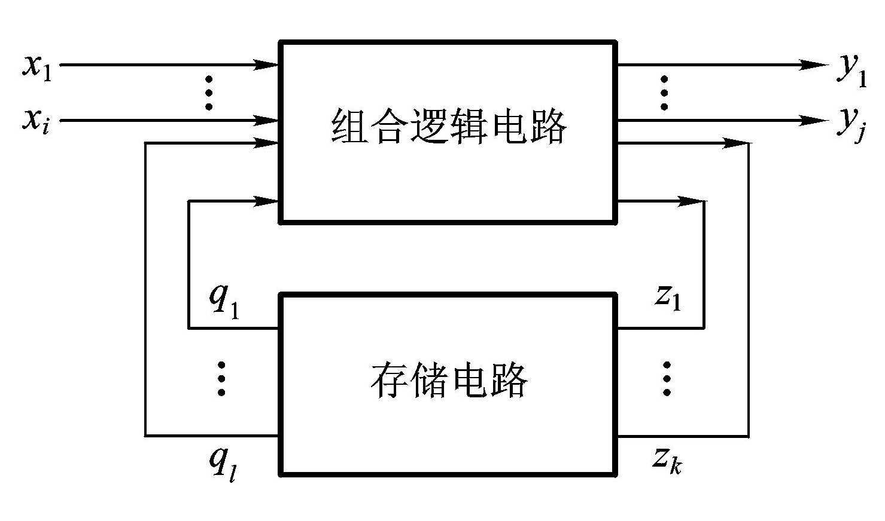
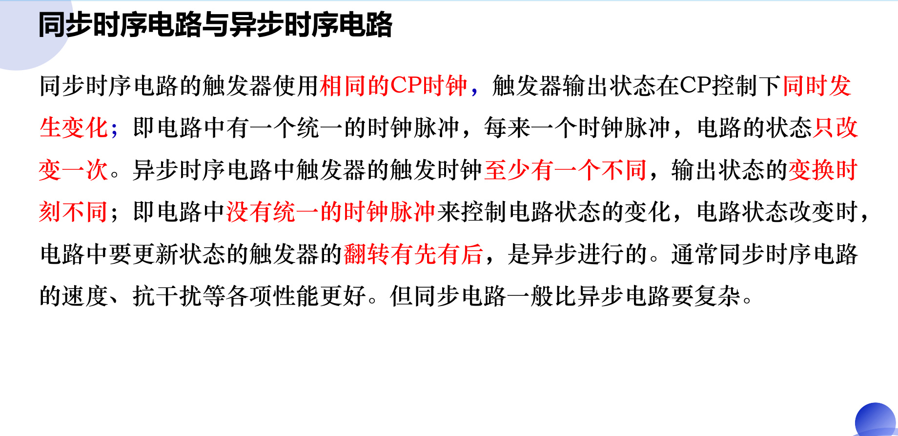
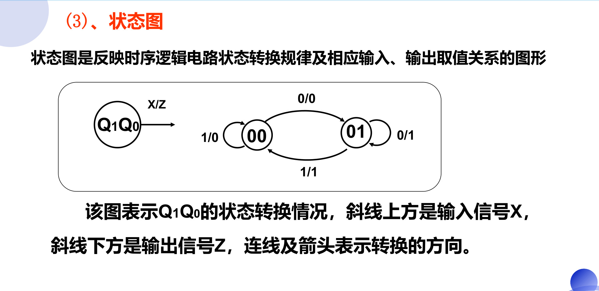
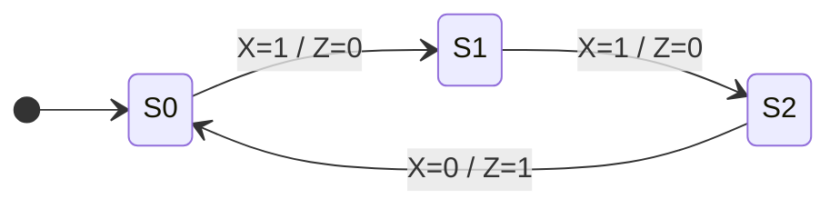
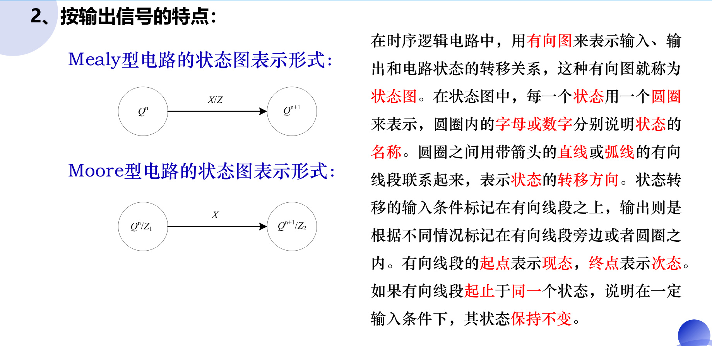

# 5.1 时序逻辑电路的结构、特点与分类（Overview）

## 一、是什么（概念与定位）

时序逻辑电路（Sequential Logic Circuit）是数字系统中与“时间”和“历史状态”相关的电路。

- **组合逻辑电路**：任意时刻的输出仅取决于该时刻的输入，与电路过去状态无关。
- **时序逻辑电路**：任意时刻的输出不仅取决于该时刻的输入，还与电路**原来的状态**有关。

因此，时序电路必须包含能够“记忆”过去输入信息的存储单元，通常由**触发器**构成。

## 二、原理与特性

### 1. 基本结构

时序逻辑电路由两部分组成：

1. **组合逻辑电路**：产生外部输出和内部激励信号。
2. **存储电路（触发器）**：保存电路的当前状态。

电路中至少存在一条**反馈回路**，将存储电路的输出送回组合逻辑电路的输入端，这是形成“时序”特性的关键。

> 上图为课件原图：组合逻辑 + 触发器存储电路的反馈结构框图。

### 同步 / 异步分类（课件原图）

> 左：同步时序电路——所有触发器共用同一个 CP，状态在 CP 控制下**同时**变化；右：异步时序电路——各触发器 CP 不同源，状态变化有先有后。

### 2. 信号定义

| 符号 | 含义 |
|------|------|
| X | 外部输入信号 |
| Z | 外部输出信号 |
| D | 触发器激励（驱动）输入 |
| Q | 触发器状态输出 |

### 3. 三组核心方程

| 方程 | 表达式 | 说明 |
|------|--------|------|
| 输出方程 | Z = F(X, Qⁿ) | 输出由输入和现态共同决定（Mealy 型）或仅由现态决定（Moore 型） |
| 驱动方程 | D = F(X, Qⁿ) | 组合逻辑产生的触发器输入 |
| 状态方程 | Qⁿ⁺¹ = F(D, Qⁿ) | 将驱动方程代入触发器特性方程得到 |

其中：
- **现态 Qⁿ**：某一时刻触发器的状态。
- **次态 Qⁿ⁺¹**：在外部信号作用下，触发器将要到达的新状态。

### 4. 逻辑功能表示方法

1. **逻辑方程式**：输出方程、驱动方程、状态方程。
2. **状态转换表**：列出输入 X、现态 Qⁿ、次态 Qⁿ⁺¹、输出 Z 的对应关系。
3. **状态转换图**：用圆圈表示状态，有向线段表示状态转移，标注输入/输出。
4. **时序图（波形图）**：直观描述 CP、输入、输出、状态在时间上对应关系。

### 状态图 / 状态表 / 时序图示例（课件原图）

> 课件原图展示：状态图用圆圈表示状态、有向线段表示转移并标注 `输入/输出`；状态表列出现态、次态/输出的对应关系；时序图反映 CP、状态、输出随时间的变化。三种表示方法本质一致，可相互转换。

## 三、符号与图形

### Mealy 型与 Moore 型状态图对比

上图为 Mealy 型示意：转移箭头上标注 `X/Z`，输出标在箭头旁。

Moore 型输出仅与状态有关，通常将输出写在状态圆圈内，例如 `S0/0`。

### Mealy 型 与 Moore 型 状态表 / 状态图对比（课件原图）

> 课件原图：上排为 Mealy 型（输出标在转移箭头 `X/Z` 上），下排为 Moore 型（输出写在状态圈内 `S/Z`）。注意同一条功能下，Moore 型的状态数通常比 Mealy 型**多一个**。

## 四、典型例题/应用

**例题**：判断下列描述属于组合电路还是时序电路。

- 译码器：组合电路（输出仅由当前输入决定）。
- 计数器：时序电路（计数值依赖历史状态）。
- 触发器：时序电路（具有记忆功能）。

## 五、易错点

1. **认为输出一定与输入有关**：Moore 型电路的输出仅取决于存储电路状态，与当前输入无关。
2. **忽略反馈回路**：没有反馈回路的电路不是时序电路。
3. **混淆现态与次态**：Qⁿ 是当前状态，Qⁿ⁺¹ 是下一个 CP 作用后的状态。
4. **同步/异步只看 CP 是否同源**：所有触发器共用一个 CP 为同步；至少一个触发器使用不同 CP 为异步。

## 六、知识点总结

| 分类依据 | 类型 | 关键特征 |
|----------|------|----------|
| 触发器动作特点 | 同步时序电路 | 所有触发器共用同一 CP，状态同时变化 |
| 触发器动作特点 | 异步时序电路 | 触发器 CP 不同源，状态变化有先有后 |
| 输出信号特点 | Mealy 型 | Z = F(X, Qⁿ)，输出与输入和状态都有关 |
| 输出信号特点 | Moore 型 | Z = F(Qⁿ)，输出仅与状态有关 |

时序电路的核心特征是**含有存储电路（触发器）和反馈回路**，这是与组合电路最本质的区别。
