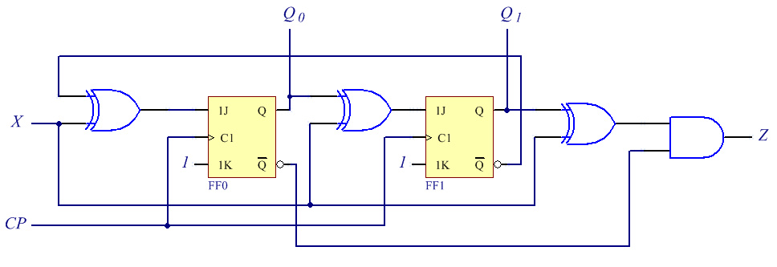
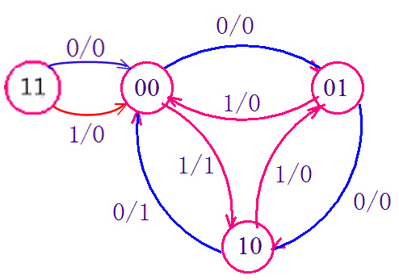
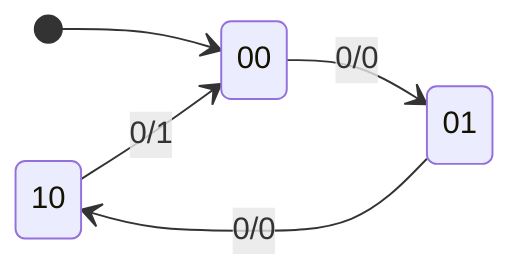
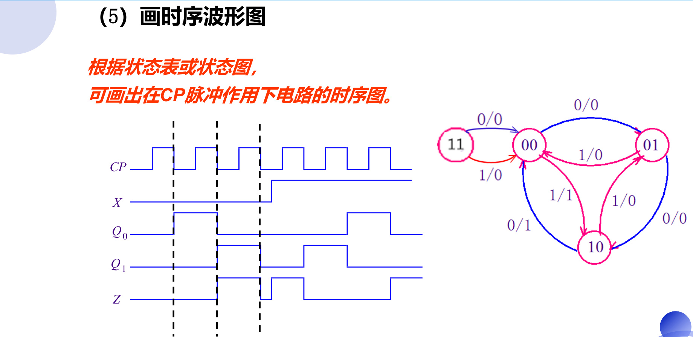

# 5.2 时序逻辑电路的分析方法（Analysis）

## 一、是什么（概念与定位）

时序逻辑电路分析，是指**根据给定的时序电路逻辑图，推导出它的逻辑功能**。分析过程通常得到时钟方程、输出方程、驱动方程、状态方程、状态表、状态图和时序图，最后用文字说明电路完成的功能。

与设计的方向相反：设计是从功能到电路，分析是从电路到功能。

## 二、原理与特性

### 1. 同步时序电路分析一般步骤

```
逻辑图
  ↓
时钟方程（异步电路必须写；同步电路可省略）
  ↓
输出方程 + 驱动方程
  ↓
状态方程（将驱动方程代入触发器特性方程）
  ↓
状态转换表
  ↓
状态图 / 时序图
  ↓
逻辑功能说明
```

课件原图：分析步骤总览（从逻辑图 → 写方程 → 状态表 → 状态图 → 功能说明）。


### 2. 关键方程

| 方程 | 来源 | 用途 |
|------|------|------|
| 输出方程 | 由输出端的门电路写出 | 计算当前输出 Z |
| 驱动方程 | 由各触发器输入端的门电路写出 | 求状态方程的桥梁 |
| 状态方程 | 驱动方程代入触发器特性方程 | 计算次态 Qⁿ⁺¹ |

常用触发器特性方程：

- JK 触发器：Qⁿ⁺¹ = J·Q̄ⁿ + K̄·Qⁿ
- D 触发器：Qⁿ⁺¹ = D
- T 触发器：Qⁿ⁺¹ = T ⊕ Qⁿ

### 3. 状态转换表的两种画法

**画法一**：以输入 X 和现态 Qⁿ 为行，列出次态 Qⁿ⁺¹ 和输出 Z。

**画法二**：以现态为行，不同输入下列出 `次态/输出`。

| 现态 Q₁ⁿQ₀ⁿ | X=0 | X=1 |
|-------------|-----|-----|
| 00 | 01/0 | 10/0 |
| 01 | 10/0 | 00/0 |
| 10 | 00/1 | 00/0 |
| 11 | 00/0 | 00/0 |

**状态转换表的定义（课件原图）**：


> 课件原图：将任意一组输入与现态代入状态方程、输出方程，即可算出次态与输出，逐行列出即得到状态转换表。

## 三、符号与图形

### 例 1 逻辑图（Mealy 型同步时序电路）



该电路由两个 JK 触发器组成，所有触发器共用同一 CP，属于**同步时序电路**；输出 Z 同时与输入 X 和触发器状态有关，属于**Mealy 型**。

### 状态转换图



状态图中：
- 圆圈内的数字表示状态 Q₁Q₀。
- 箭头上的标注格式为 `X/Z`。
- 状态 11 为无效状态，最终会回到有效循环。

用 Mermaid 表示核心循环（X=0 时）：



## 四、典型例题/应用

### 例题：分析上图所示同步时序电路

**步骤 1：写输出方程与驱动方程**

- 输出方程：Z = f(X, Q₁ⁿ, Q₀ⁿ)
- 驱动方程：根据各 JK 触发器输入端连线写出 J₀、K₀、J₁、K₁。

**步骤 2：求状态方程**

将驱动方程代入 JK 触发器特性方程：

```
Q₀ⁿ⁺¹ = J₀·Q̄₀ⁿ + K̄₀·Q₀ⁿ
Q₁ⁿ⁺¹ = J₁·Q̄₁ⁿ + K̄₁·Q₁ⁿ
```

**步骤 3：列状态转换表并画状态图**

将 X、Q₁ⁿ、Q₀ⁿ 的所有取值组合代入状态方程和输出方程，得到完整状态表。

**步骤 4：说明功能**

由状态图可知：
- 当 X=0 时，状态按 00→01→10→00 循环，转换到 10 时输出 Z=1，是**可控加 1 计数**。
- 当 X=1 时，状态按 10→01→00→10 循环，转换到 00 时输出 Z=1，是**可控减 1 计数**。

因此该电路是一个**可控的 3 进制计数器**。

### 时序波形图（课件原图）



> 课件原图：在 CP 脉冲作用下，X、Q₀、Q₁、Z 的时序波形。由状态表/状态图画波形图时，注意**有效循环**与**无效状态**的走向，波形图是分析结果与功能说明的直观验证。

## 五、易错点

1. **异步电路忘记写时钟方程**：异步分析必须先判断每个触发器是否有时钟有效沿。
2. **驱动方程写错**：注意 JK 触发器有 J、K 两个输入，不要把输入端搞反。
3. **状态方程代入错误**：记住特性方程形式，特别是 JK 触发器中 K 上面有无非号。
4. **状态图箭头方向画反**：箭头起点是现态，终点是次态。
5. **忽略无效状态**：要检查电路能否自启动，即从无效状态能否回到有效循环。

## 六、知识点总结

| 步骤 | 内容 | 备注 |
|------|------|------|
| 1 | 写时钟方程（异步） | 同步电路可省略 |
| 2 | 写输出方程 | Mealy 型含输入，Moore 型只含状态 |
| 3 | 写驱动方程 | 描述组合逻辑到触发器的输入 |
| 4 | 求状态方程 | 驱动方程代入触发器特性方程 |
| 5 | 列状态表、画状态图 | 检查所有状态，包括无效状态 |
| 6 | 说明逻辑功能 | 如计数器、序列检测器、寄存器等 |

时序电路分析的核心是**状态转换**，只要按步骤写出三组方程并列出状态表，就能系统、无遗漏地得到电路功能。
