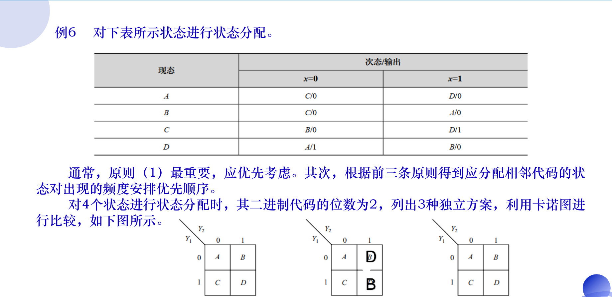
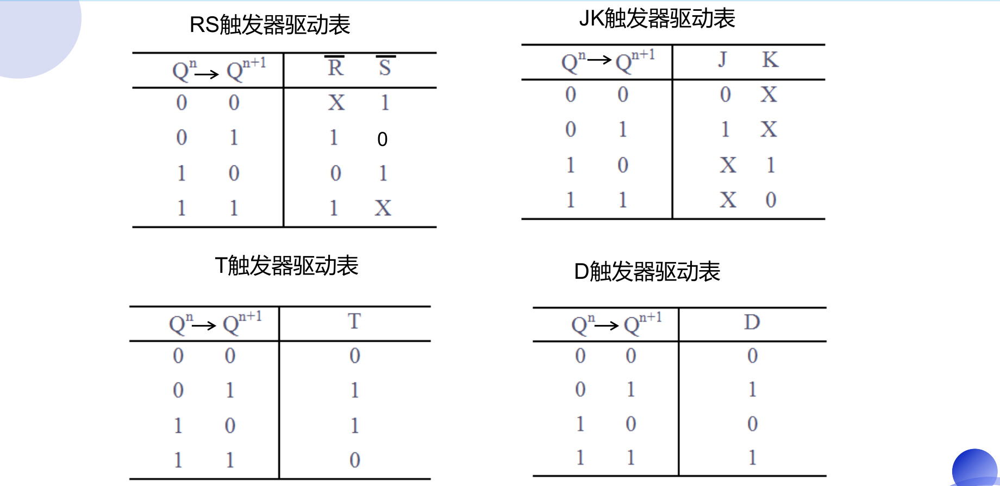
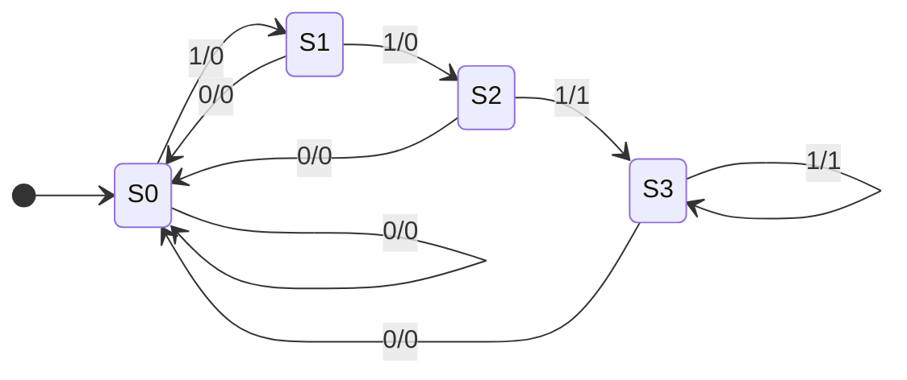
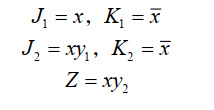
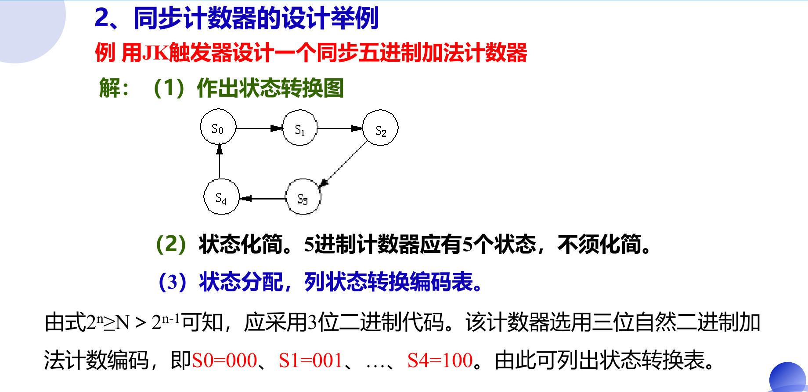

# 5.3 同步时序逻辑电路的设计（Design）

## 一、是什么（概念与定位）

同步时序逻辑电路设计，是指根据给定的逻辑功能要求，选择合适的触发器和门电路，画出满足要求的时序电路。

设计是分析的逆过程：

```
设计要求 → 原始状态图/表 → 状态化简 → 状态编码 → 选触发器 →
求激励函数 → 画逻辑图 → 检查自启动
```

## 二、原理与特性

### 1. 设计一般步骤

| 步骤 | 内容 | 说明 |
|------|------|------|
| 1 | 逻辑抽象 | 确定输入、输出变量，定义状态含义 |
| 2 | 建立原始状态图/表 | 从初始状态出发，逐步补全转移 |
| 3 | 状态化简 | 合并等效状态，得到最简状态表 |
| 4 | 状态编码 | 给每个状态分配二进制代码 |
| 5 | 确定触发器类型 | 常用 JK、D 触发器 |
| 6 | 求激励函数与输出函数 | 用卡诺图化简 |
| 7 | 画逻辑电路图 | 先画触发器，再画组合逻辑 |
| 8 | 检查自启动 | 确保无效状态能回到有效循环 |

### 2. 状态化简：等效状态

两个状态 Sᵢ 和 Sⱼ 等效，当且仅当在所有输入组合下：

1. 输出相同；
2. 次态相同、交错、循环或等效。

例如：

| 现态 | X=0 次态/输出 | X=1 次态/输出 |
|------|---------------|---------------|
| A | A/0 | C/0 |
| B | A/0 | C/0 |

A 与 B 输出相同、次态相同，因此 A 和 B 等效，可合并为 A。

**隐含表法（化简复杂状态表）**：当状态较多、用观察法困难时，采用**隐含表（Implication Table）**系统化简。

1. 作一个三角格隐含表，逐个比较所有状态对 (Sᵢ, Sⱼ)。
2. 若输出不同 → **不等效**，格内打 ×；若输出相同但对次态进行「等效判定」：
   - 次态相同/交错/循环 → 等效；
   - 次态涉及未知状态对 → 将待判定关系记入格内（如 `(A,C)`），称为隐含。
3. 顺次解开隐含关系，最终把所有打 × 之外的状态对合并为**最大等效类**。
4. 每类取一个状态，得到最小化状态表。

> 课件原图（P60–65）给出等效关系的三条性质（自反、对称、**传递性**：(S₁,S₂)、(S₂,S₃) ⇒ (S₁,S₃)）以及用观察法化简原始状态表的完整例（合并出等效类后，状态数大幅减少）。等效类之间用字母或数字统一命名即可。

### 3. 状态编码原则

1. **同一现态在不同输入下的次态**尽可能分配相邻代码。
2. **同一输入下具有相同次态的现态**尽可能分配相邻代码。
3. **输出相同的状态**尽可能分配相邻代码。
4. **出现次数最多的状态**分配逻辑 0。

触发器个数 n 与状态数 N 的关系：

```
2ⁿ⁻¹ < N ≤ 2ⁿ
```

### 状态分配方案（课件原图）



> 课件原图（P68–69）：对 4 个状态 A、B、C、D 给出 3 种独立二进制编码方案，用卡诺图比较各方案满足「状态分配原则」的程度。（a）方案能满足的原则最多，因此选 A=00、B=10、C=01、D=11。状态分配原则依次为：① 同一现态不同输入下次态相同/组合相同的状态对优先相邻；② 同一输入下具有相同次态的状态对相邻；③ 输出相同的状态对相邻；④ 出现频度高的状态分配 0。

### 4. 触发器选择

| 触发器 | 特性方程 | 设计特点 |
|--------|----------|----------|
| D | Qⁿ⁺¹ = D | 次态即输入，激励卡诺图与次态卡诺图相同 |
| JK | Qⁿ⁺¹ = J·Q̄ⁿ + K̄·Qⁿ | 功能灵活，需分别求 J、K |
| T | Qⁿ⁺¹ = T ⊕ Qⁿ | 适用于翻转/保持场景 |

### 触发器驱动表（课件原图）



> 课件原图（P76）：RS、JK、T 三种触发器的**驱动表**（激励表）。设计时在「次态卡诺图」上，依据所选触发器驱动表把次态需求转换为 J/K、S/R、T 的输入值，再分别画激励卡诺图化简，得到激励函数。这是「状态表 → 激励方程」的关键查表环节。

## 三、符号与图形

### 例：连续三个“1”序列检测器

**功能**：输入串行序列 X，当连续输入三个或三个以上 1 时，输出 Z=1。

**原始状态图**：



**状态化简**：S3 与 S2 在 X=0 时都回到 S0，X=1 时 S2→S3、S3→S3，可合并为 C。

**状态编码**：A=00，B=01，C=11（10 为无效状态）。

**设计结果示例**（用 JK 触发器）：



## 四、典型例题/应用

### 例题：用 JK 触发器设计同步五进制加法计数器

**步骤 1：状态转换图**

```
S0(000) → S1(001) → S2(010) → S3(011) → S4(100) → S0(000)
```

**步骤 2：状态化简**

5 个状态已最简，无需化简。

**步骤 3：状态编码**

自然二进制编码：S0=000，S1=001，S2=010，S3=011，S4=100。

**步骤 4：选触发器**

选用 3 个 JK 触发器。

**步骤 5：求驱动方程与输出方程**

通过次态卡诺图和 JK 触发器驱动表，分别求出 J₂、K₂、J₁、K₁、J₀、K₀ 和进位输出 Y。

**步骤 6：画逻辑图**

按驱动方程和输出方程连接门电路与触发器。

**步骤 7：检查自启动**

将无效状态 101、110、111 代入状态方程，验证能否回到有效循环。若能，则电路可自启动。

### 同步五进制加法计数器设计例状态图（课件原图）



> 课件原图（P77）：上图为该设计例的「状态转换图」（000→001→010→011→100→000）。后续按次态卡诺图 + JK 驱动表求得 J₂K₂J₁K₁J₀K₀ 与进位 Y，再画逻辑图；无效状态 101/110/111 在 CP 作用下分别进入 010/010/000，故**可自启动**。

## 五、易错点

1. **原始状态图遗漏转移**：每个状态下，所有输入取值都要考虑。
2. **状态化简条件判断错误**：次态“交错”或“循环”也算等效，不要只盯着完全相同。
3. **状态编码导致卡诺图复杂**：尽量让相邻状态在卡诺图上相邻，减少门电路。
4. **自启动检查时漏掉无效状态**：所有 2ⁿ 个状态都要检查，不能只验证有效循环。
5. **输出函数任意项处理不当**：为避免错误输出，化简时一般不将无关项画进包围圈。

## 六、知识点总结

| 要点 | 核心内容 |
|------|----------|
| 设计起点 | 逻辑抽象，明确输入、输出、状态 |
| 状态化简 | 找最大等效类，合并等效状态 |
| 状态编码 | 相邻优先，减少激励函数复杂度 |
| 触发器选择 | D 触发器最直观，JK 触发器最灵活 |
| 最后一步 | 必须检查自启动，确保可靠性 |

同步时序电路设计的本质是**用触发器保存状态，用组合逻辑实现状态转移和输出**。
