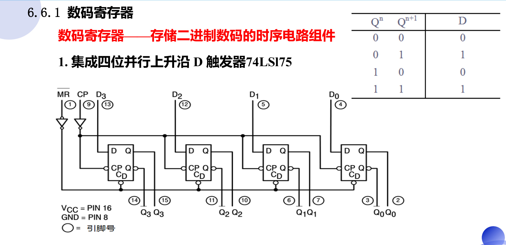
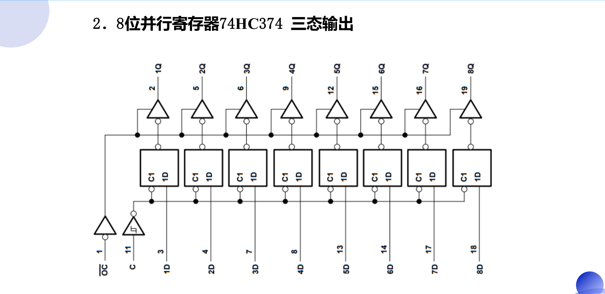
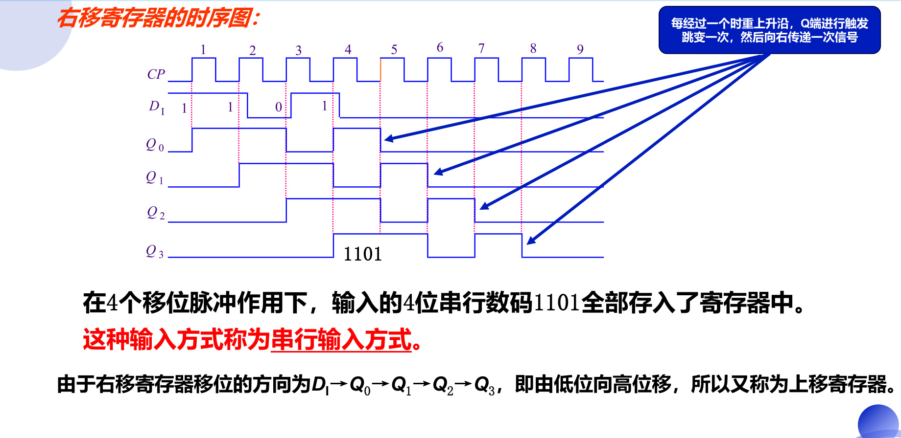
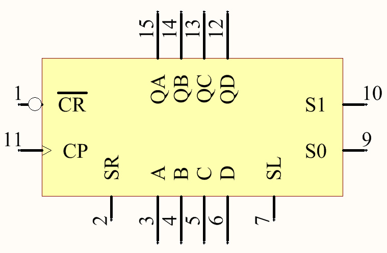
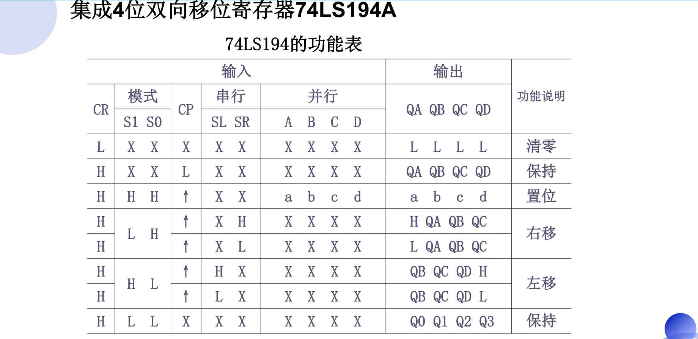
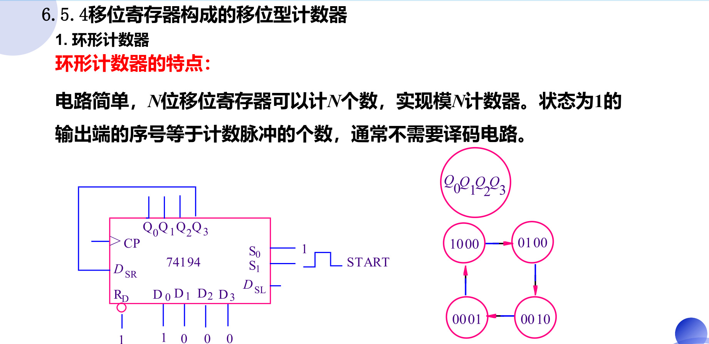
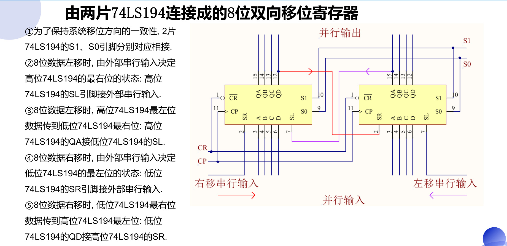
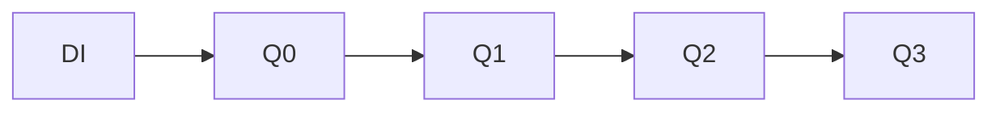
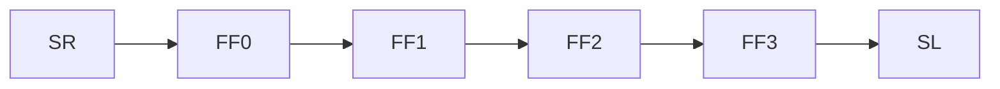

# 5.6 数码寄存器与移位寄存器（Registers）

## 一、是什么（概念与定位）

寄存器（Register）是用于暂时存放二进制数码的时序逻辑器件，广泛应用于数字系统、计算机和通信设备中。

| 类型 | 功能 |
|------|------|
| 数码寄存器 | 仅存储数码 |
| 移位寄存器 | 既能存储数码，又能在移位脉冲作用下依次左移或右移 |

## 二、原理与特性

### 1. 数码寄存器

由 D 触发器构成，来一个 CP 脉冲就将输入数码存入触发器。

典型芯片：
- **74LS175**：4 位并行 D 触发器，具有异步清零和并行输出。
- **74HC374**：8 位并行寄存器，具有三态输出。

74LS175 工作模式：

| MR | CP | D₃D₂D₁D₀ | 功能 |
|----|----|----------|------|
| 0 | × | ×××× | 异步清零 |
| 1 | ↑ | abcd | 数码寄存 |
| 1 | 1/0 | ×××× | 保持 |

### 74LS175 / 74HC374 引脚与功能（课件原图）



> 课件原图（P132）：集成 4 位并行上升沿 D 触发器 74LS175，含 `MR`(异步清零，低有效)、`D₀~D₃`(并行输入)、`CP`(时钟)、`Q₀~Q₃`(并行输出)。



> 课件原图（P135）：8 位并行寄存器 74HC374，三态输出，含输出控制、`CP`、输入 `Dₓ` 等，适合作为总线数据暂存。

### 2. 移位寄存器

**右移寄存器**：左边触发器输出接右邻触发器输入，数据移动方向为 `D_I → Q₀ → Q₁ → Q₂ → Q₃`。

**左移寄存器**：右边触发器输出接左邻触发器输入，数据移动方向相反。

**双向移位寄存器**：引入方向控制端 S，选择左移或右移。

### 右移寄存器时序图（课件原图）



> 课件原图（P139）：4 位移位寄存器在 4 个移位脉冲下，串行数码 1101 自 DI 端依次移入，移位方向 DI→Q₀→Q₁→Q₂→Q₃。因由低位向高位移，也称**上移寄存器**。每个 CP 作用一次，数据整体右移一位。

### 3. 集成 4 位双向移位寄存器 74LS194



| 引脚 | 功能 |
|------|------|
| CR | 异步清零，低电平有效 |
| S1、S0 | 工作模式选择 |
| CP | 时钟脉冲 |
| SR | 右移串行输入 |
| SL | 左移串行输入 |
| A、B、C、D | 并行数据输入 |
| QA、QB、QC、QD | 并行输出 |

**74LS194 功能表**：

| CR | S1 S0 | CP | 功能 |
|----|-------|----|------|
| 0 | ×× | × | 清零 |
| 1 | 00 | × | 保持 |
| 1 | 11 | ↑ | 并行置数 |
| 1 | 01 | ↑ | 右移 |
| 1 | 10 | ↑ | 左移 |

### 74LS194 功能表与引脚（课件原图）



> 课件原图（P143）：74LS194 完整功能表与引脚定义。重点记 `CR`(异步清零，低有效)、`S₁S₀` 模式选择（00 保持 / 01 右移 / 10 左移 / 11 并行置数）、`SR`/`SL` 串行输入、`A~D` 并行输入、`Q_A~Q_D` 并行输出。

### 4. 移位型计数器

| 类型 | 接法 | 模数 | 特点 |
|------|------|------|------|
| 环形计数器 | Q_D → SR | N | N 个有效状态，无需译码 |
| 扭环形计数器 | Q̄_D → SR | 2N | 状态数翻倍，译码简单 |

### 环形计数器 / 扭环形计数器（课件原图）



> 课件原图（P144–145）：环形计数器将 `Q_D → SR`（右移接回），N 位形成模 N、每个状态仅一个 1，可直接作节拍脉冲、无需译码；扭环形计数器将 `Q̄_D → SR`，N 位可组成模 2N，且译码逻辑更简单。注意初态必须预设（如 1000），避免 0000/1111 死循环。

### 多片 74LS194 构成 8 位双向移位寄存器（课件原图）



> 课件原图（P146）：两片 74LS194 级联。要点：① 两片的 `S₁`、`S₀` 分别对应相接以保持移位方向一致；② 低位片的 `Q_D` 接高位片的 `SR`，高位片的 `Q_D` 接低位片的 `SL`，实现 8 位右/左双向移位。

## 三、符号与图形

### 4 位右移寄存器数据流向



每个箭头代表一次 CP 作用后的数据移动。

### 74LS194 双向移位示意



- S=1 时：数据从 SR 向右移，Q_A→Q_B→Q_C→Q_D。
- S=0 时：数据从 SL 向左移，Q_D→Q_C→Q_B→Q_A。

## 四、典型例题/应用

### 例题 1：用右移寄存器串行输入 1101

设初始状态为 0000，串行输入从高位到低位依次进入。

| CP | 串行输入 | Q₃ Q₂ Q₁ Q₀ |
|----|----------|-------------|
| 0 | — | 0 0 0 0 |
| 1 | 1 | 0 0 0 1 |
| 2 | 1 | 0 0 1 1 |
| 3 | 0 | 0 1 1 0 |
| 4 | 1 | 1 1 0 1 |

经过 4 个 CP，4 位数码 1101 全部移入寄存器。

### 例题 2：用 74LS194 构成环形计数器

将 Q_D 接回 SR，置初态 1000，工作模式设为右移。

状态循环：

```
1000 → 0100 → 0010 → 0001 → 1000
```

4 位环形计数器模为 4，每个状态中只有一个 1，可直接作为节拍信号。

## 五、易错点

1. **左移/右移方向混淆**：右移是向高位下标方向移动（Q₀→Q₃），左移相反。
2. **串行输入顺序搞反**：题目若说“高位先入”，第一个 CP 进入的是最高位。
3. **74LS194 模式控制 S1S0 记混**：11 置数、01 右移、10 左移、00 保持。
4. **环形计数器初态必须预设**：如果初态为 0000 或 1111，会进入死循环。
5. **扭环形计数器模数算错**：N 位扭环形计数器模为 2N，不是 N。

## 六、知识点总结

| 器件 | 核心功能 | 关键引脚/信号 |
|------|----------|---------------|
| 74LS175 | 4 位数码寄存 | MR、CP、D、Q |
| 74HC374 | 8 位三态寄存 | 输出使能、CP |
| 74LS194 | 4 位双向移位寄存 | CR、S1S0、SR、SL、CP |
| 环形计数器 | 模 N 计数 | Q_N-1 → D₀ |
| 扭环形计数器 | 模 2N 计数 | Q̄_N-1 → D₀ |

寄存器本质上是**由触发器组成的“存储+移动”单元**，理解移位方向和控制端含义是用好移位寄存器的关键。
