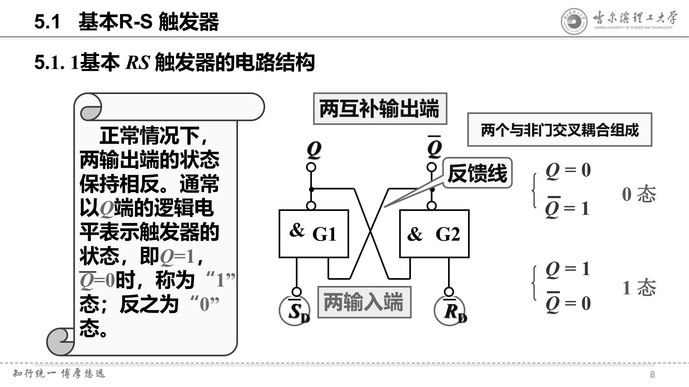
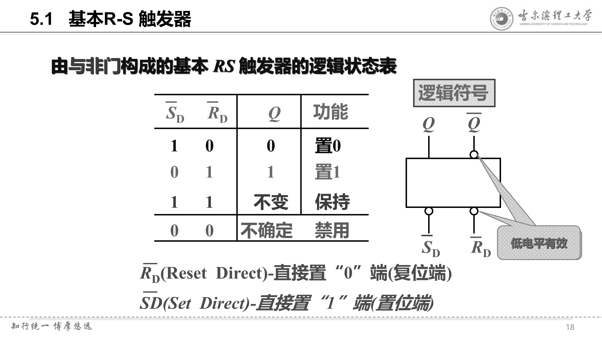
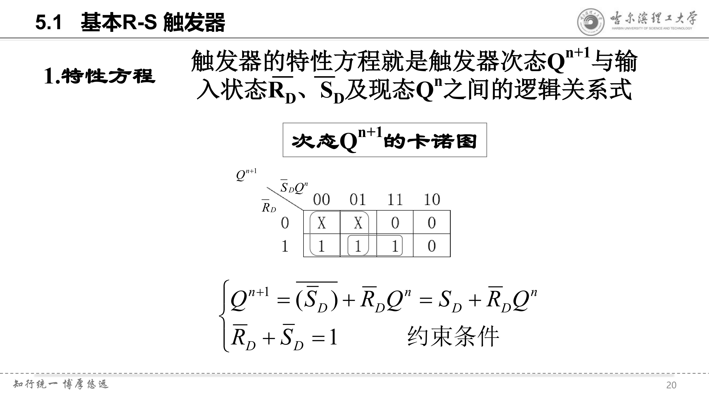
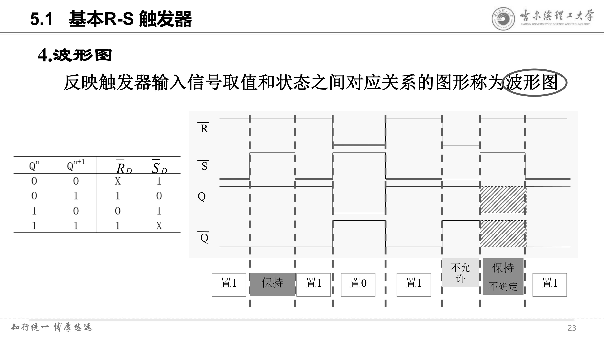

# 5.1 基本 RS 触发器

> 本节对应课件《05.触发器（6学时）》第 6~25 页。触发器是**时序逻辑电路的基本单元**，就像门电路是组合逻辑电路的基本单元一样——这是理解整章时序电路的入口。

## 一、是什么（概念与定位）

**触发器（Flip-Flop，FF）** 是**具有记忆功能的双稳态电路**：它能长期稳定地停在"0"或"1"两个状态之一，并且在外加信号作用下可以从一个稳态**翻转**到另一个稳态。

三个必备性质（课件第 7 页）：

1. 有**两个稳定状态**（0 态、1 态），用来表示存储内容；
2. 能**接收、保存、输出**信号——记忆功能的体现；
3. 部分触发器具有**翻转功能**：在新信号作用下从一个稳态反转到另一个稳态。

两个关键概念（贯穿全章，务必分清）：

| 名称 | 符号 | 含义 |
| --- | --- | --- |
| **现态** | $Q^n$ | 触发器接收输入信号**之前**的状态，即原来的稳态 |
| **次态** | $Q^{n+1}$ | 触发器接收输入信号**之后**所处的新稳态 |

> **触发器 vs 门电路的本质区别**
> 门电路（组合逻辑）的输出只由当前输入决定，输入一变输出立刻跟着变，**没有记忆**；
> 触发器的输出不仅取决于当前输入，还取决于**原来是什么状态**，电路内部存在**反馈线**（把输出引回输入），这才形成了"记住"的能力。

**分类**（课件第 7 页）：

| 分类依据 | 类别 |
| --- | --- |
| 按**电路结构和工作特点** | 基本触发器、同步触发器、主从触发器、边沿触发器 |
| 按**逻辑功能** | RS 触发器、JK 触发器、D 触发器、T（T′）触发器 |
| 按**器件工艺** | TTL 型、CMOS 型；分立元件型、集成型 |

本节先讲最基本的一种：**基本 RS 触发器**（又叫直接复位—置位触发器）。

## 二、原理与特性

### 1. 电路结构（课件第 8 页）

基本 RS 触发器由**两个与非门交叉耦合**组成：G1 的输出 $\overline{Q}$ 接到 G2 的一个输入端，G2 的输出 $Q$ 接到 G1 的一个输入端——这两根线就是**反馈线**，是记忆功能的物理来源。

- 两个输入端：$S_D$（Set Direct，**直接置位端**，置"1"）、$R_D$（Reset Direct，**直接复位端**，置"0"）；
- 两个互补输出端：$Q$ 与 $\overline{Q}$。



**状态的表示方法**：正常情况下两个输出端状态**必然相反**。规定以 $Q$ 端的电平表示触发器的状态：

- $Q=1$、$\overline{Q}=0$ → 称为"**1 态**"（置位状态）；
- $Q=0$、$\overline{Q}=1$ → 称为"**0 态**"（复位状态）。

> 注意：$S_D$、$R_D$ 上方的横线或逻辑符号上的小圆圈表示**低电平有效**——即 $S_D=0$ 才是"要置位"，$S_D=1$ 表示"不置位"。这是初学者最容易搞反的地方。

### 2. 工作原理（四种输入组合逐一分析，课件第 9~17 页）

分析套路固定为三步：**①看哪个输入为 0（与非门"有 0 必出 1"，该 0 起支配作用）→ ②沿反馈链推出另一端 → ③验证状态自洽稳定**。

先记清门的对应关系：**受 $S_D$ 控制的是 G1，它的输出是 $Q$；受 $R_D$ 控制的是 G2，它的输出是 $\overline{Q}$**。

**（1）$S_D=1$，$R_D=0$（置 0 / 复位）**

$R_D=0$ → G2 因"有 0 必出 1"而输出 $\overline{Q}=1$；$\overline{Q}=1$ 送回 G1，与 $S_D=1$ 一起取非得 $Q=\overline{1\cdot1}=0$；$Q=0$ 再送回 G2，与 $R_D=0$ 一起仍使 $\overline{Q}=1$——**状态自洽稳定**。

**结论**：不论原态是 0 还是 1，结果都是 $Q=0$、$\overline{Q}=1$ → **置"0"，称为复位（Reset）**。

**（2）$S_D=0$，$R_D=1$（置 1 / 置位）**

$S_D=0$ → G1 输出 $Q=1$；$Q=1$ 送回 G2，与 $R_D=1$ 一起取非得 $\overline{Q}=0$；$\overline{Q}=0$ 再送回 G1，与 $S_D=0$ 一起仍使 $Q=1$——**状态自洽稳定**。

**结论**：不论原态如何，$S_D=0$、$R_D=1$ 时触发器被**置"1"，称为置位（Set）**，即 $Q=1$、$\overline{Q}=0$。

**（3）$S_D=1$，$R_D=1$（保持）**

两输入端都不为 0，两个与非门都处于"开门"状态，各自把对方送来的信号取反后送回，形成闭环自锁。原态为 0 就稳定在 0，原态为 1 就稳定在 1。

**结论**：$S_D=R_D=1$ 时触发器**保持原状态不变**——这就是**记忆功能**。

**（4）$S_D=0$，$R_D=0$（不允许 / 禁用）**

两个与非门都因输入有 0 而输出 1，于是 $Q=\overline{Q}=1$——**破坏了 $Q$ 与 $\overline{Q}$ 必须相反的逻辑要求**。

更严重的是：当 $S_D$、$R_D$ 由 00 **同时**回到 11 时，两个与非门都要翻转，但实际门的传输延迟不可能完全相同：

- 若 G1 先翻转 → $\overline{Q}$ 先变 0 → $Q$ 变 1 → 触发器停在"1"态；
- 若 G2 先翻转 → $Q$ 先变 0 → $\overline{Q}$ 变 1 → 触发器停在"0"态。

**结论**：$S_D=R_D=0$ 时次态**无法根据输入确定**，故称"**不允许**"或"**禁用**"状态。同时它还引出**约束条件**：

$$S_D+R_D=1\quad(\text{即 }S_D \text{ 与 } R_D \text{ 不能同时为 }0)$$

> **与非门型 vs 或非门型**
> 上面是**与非门**构成的基本 RS 触发器，输入**低电平有效**，约束条件是 $S_D+R_D=1$（不能同时为 0）。
> 若用**或非门**构成，输入变为**高电平有效**，约束条件变成 $S_DR_D=0$（不能同时为 1）。做题时先看符号：**输入端有小圆圈 = 低电平有效**。

### 3. 逻辑符号与功能表（课件第 18 页）



| $S_D$ | $R_D$ | $Q^{n+1}$ | 功能 |
| --- | --- | --- | --- |
| 1 | 0 | 0 | **置 0**（复位） |
| 0 | 1 | 1 | **置 1**（置位） |
| 1 | 1 | $Q^n$ | **保持**（记忆） |
| 0 | 0 | 不确定（$d$） | **禁用** |

符号要点：方框内写 $S_D$、$R_D$ 且带小圆圈（低电平有效）；输出端 $Q$ 与 $\overline{Q}$ 上方的横线表示"取反关系"，不是"非有效"。

### 4. 特性表（真值表，课件第 19 页）

特性表把**现态**也作为一个变量列进来，共 $2^3=8$ 行——这是与"功能表"的区别：功能表 4 行只讲"干什么"，特性表 8 行讲"从哪个状态到哪个状态"。

| $S_D$ | $R_D$ | $Q^n$ | $Q^{n+1}$ | 功能 |
| --- | --- | --- | --- | --- |
| 0 | 0 | 0 | — | 不允许 |
| 0 | 0 | 1 | — | 不允许 |
| 0 | 1 | 0 | 1 | 置 1 |
| 0 | 1 | 1 | 1 | 置 1 |
| 1 | 0 | 0 | 0 | 置 0 |
| 1 | 0 | 1 | 0 | 置 0 |
| 1 | 1 | 0 | 0 | 保持 |
| 1 | 1 | 1 | 1 | 保持 |

### 5. 特性方程（课件第 20 页）

由特性表画次态 $Q^{n+1}$ 的卡诺图化简得：

$$\begin{cases}Q^{n+1}=S_D+\overline{R_D}\,Q^n\\[4pt] S_D+R_D=1\ \ (\text{约束条件})\end{cases}$$



> **特性方程**：描述次态 $Q^{n+1}$ 与输入 $S_D$、$R_D$ 及现态 $Q^n$ 之间逻辑关系的表达式，是触发器"逻辑功能"的数学化描述，后面所有触发器都要会写。

### 6. 状态转换图（课件第 21 页）

状态图三要素：**有标号的圈 = 独立状态**、**箭头 = 转移方向（现态→次态）**、**箭头旁标注 = 转移条件（输入组合）**。

```
        R_D S_D = 01 / 11
      ┌───────────────────┐
      │                   ↓
   ┌─────┐             ┌─────┐
   │  0  │             │  1  │
   └─────┘             └─────┘
      ↑                   │
      └───────────────────┘
        R_D S_D = 10 / 11
```

- 处于 0 态（$Q^n=0$）时：输入 01 或 11 仍为 0 态；输入 10 则翻转为 1 态；
- 处于 1 态（$Q^n=1$）时：输入 10 或 11 仍为 1 态；输入 01 则翻转为 0 态。

（注：课件图中输入按 $R_DS_D$ 顺序标注，读图时务必先确认标注顺序，这是最常见的丢分点。）

### 7. 驱动表（课件第 22 页）

驱动表回答的问题与特性表相反：**"我想让状态这样变，输入端该给什么？"**——设计时序电路时用它。

| $Q^n$ | $Q^{n+1}$ | $S_D$ | $R_D$ |
| --- | --- | --- | --- |
| 0 | 0 | 0 | ×（任意） |
| 0 | 1 | 1 | × |
| 1 | 0 | × | 1 |
| 1 | 1 | × | 0 |

"×"表示可取任意值，因为另一种输入已被另一条约束锁死。

### 8. 波形图（课件第 23 页）

画波形图的步骤：①找到有效电平出现的时刻；②按功能表确定状态；③保持段画平线；④00 段画阴影或虚线并标"不确定"。



### 9. 基本 RS 触发器的四个特点（课件第 24 页）

1. 次态**不仅与输入有关，还与现态有关**——这是所有触发器的共性；
2. 有两个稳定状态，无触发信号时保持原状态；
3. 有触发信号有效时能翻转，实现置 0 或置 1；
4. 稳定状态下两输出端**必须互补**，故有**约束条件**。

> 推广定义：数字电路中，凡根据输入 $R$、$S$ 的不同情况，具有置 0、置 1 和保持功能的电路，都称为 **RS 触发器**。

### 10. 集成基本 RS 触发器（课件第 25 页）

| 型号 | 特点 |
| --- | --- |
| **74LS279** | 内含 4 个基本 RS 触发器；其中 3 个是双输入（$S$ 端为 $S_A$、$S_B$，两者是**与**关系），1 个是单输入 |
| **CC4044** | CMOS 4 路 RS 触发器，带**使能端 EN**：EN=1 时工作，EN=0 时禁止（输出高阻） |

## 三、符号与图形（图文并茂）

1. **交叉耦合的画法**：两个与非门（或或非门）首尾相接，$Q$ 引回上门的输入、$\overline{Q}$ 引回下门的输入，两根反馈线一定要画出来，否则不构成触发器。
2. **输入端小圆圈**：有圆圈 = 低电平有效（与非门型）；无圆圈 = 高电平有效（或非门型）。判断约束条件全靠这个。
3. **输出端标注**：$Q$ 与 $\overline{Q}$ 上的横线表示逻辑取反，与"低电平有效"无关。
4. **状态赋值**：一律以 $Q$ 端电平代表触发器状态，$Q=1$ 为 1 态、$Q=0$ 为 0 态。
5. **状态图输入标注顺序**：不同教材有 $R_DS_D$ 与 $S_DR_D$ 两种习惯，读题先看图上标注，写答案时也标清顺序。

## 四、典型例题/应用

**例 1**　与非门构成的基本 RS 触发器，初始 $Q=0$。$S_D$、$R_D$ 波形为：先出现 $S_D=0$ 的窄脉冲，恢复 11 后出现 $R_D=0$ 的窄脉冲，最后同时出现 00 脉冲。画出 $Q$ 波形。

**解答**：
1. 初始 $Q=0$；
2. $S_D=0$、$R_D=1$ → 置 1，$Q$ 变 1；
3. 回到 11 → 保持，$Q=1$ 不变；
4. $R_D=0$、$S_D=1$ → 置 0，$Q$ 变 0；
5. 00 同时出现 → $Q=\overline{Q}=1$，恢复 11 后**不确定**（画斜线阴影）。

**例 2**　判断：基本 RS 触发器的约束条件是 $S_DR_D=0$。这句话对吗？

**解答**：**不对，需要区分门型**。
- 由**与非门**构成：输入低电平有效，约束条件是 $S_D+R_D=1$（不能同时为 0）；
- 由**或非门**构成：输入高电平有效，约束条件才是 $S_DR_D=0$（不能同时为 1）。
题目若不指明门型，"$S_DR_D=0$"这个说法只对或非门型成立。

**例 3**　基本 RS 触发器的 $S_D$、$R_D$ 端能否像同步触发器那样接时钟？为什么？

**解答**：不能直接当同步触发器用。基本 RS 触发器的 $S_D$、$R_D$ 是**直接**置位/复位端，只要有效电平出现立即生效，**不受时钟控制**（电平触发）。若在 $CP=1$ 期间 $S_D$、$R_D$ 多次变化，触发器会多次翻转，无法实现"每来一个时钟翻转一次"的同步计数功能。这也正是它必须被同步触发器、主从触发器、边沿触发器逐步改进的原因。

## 五、易错点

1. **把"低电平有效"记反**。与非门型基本 RS 触发器是 $S_D=0$ 置 1、$R_D=0$ 置 0，与"1 表示有效"的直觉相反。
2. **约束条件写错门型**。与非门型是 $S_D+R_D=1$；或非门型是 $S_DR_D=0$。
3. **00 之后直接写"保持"**。$S_D=R_D=0$ 时输出不互补，且回到 11 后次态**不确定**，波形图必须体现"不确定"。
4. **状态图转移条件顺序看错**。图注常按 $R_DS_D$ 排列，若当成 $S_DR_D$ 读，整套转移全错。
5. **功能表与特性表混用**。功能表 4 行（不看现态）；特性表 8 行（含现态）。写特性方程必须用特性表。
6. **误认为基本 RS 触发器有"空翻"问题**。空翻是**同步**触发器才有的概念（$CP=1$ 期间多次翻转），基本 RS 触发器没有时钟，属于电平直接触发。

## 六、知识点总结

1. 触发器 = **双稳态 + 记忆 + 可翻转**，是时序电路的基本单元；现态 $Q^n$、次态 $Q^{n+1}$ 是描述它的两个核心变量。
2. 基本 RS 触发器由**两个与非门交叉耦合**构成，两根反馈线是记忆的来源，输入**低电平有效**。
3. 四种输入组合：**10 置 0、01 置 1、11 保持、00 禁用**（与非门型）。
4. 特性方程 $Q^{n+1}=S_D+\overline{R_D}Q^n$，约束条件 $S_D+R_D=1$；或非门型则为 $Q^{n+1}=S+R'Q$ 形式但约束为 $SR=0$。
5. 描述触发器逻辑功能有五件套：**特性表、特性方程、驱动表、状态转换图、波形图**——后面每一种触发器都要按这五件套掌握。
6. 基本 RS 触发器的 $S_D$、$R_D$ 是**直接端**，不受时钟控制；在集成触发器（74LS74、74LS112 等）中，$R_D$、$S_D$ 仍保留作为**最高优先级**的预置/清零端。
