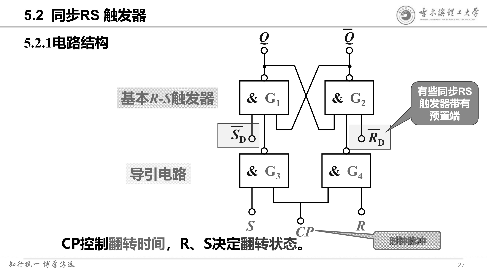
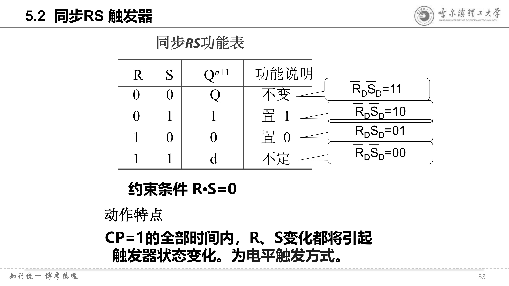
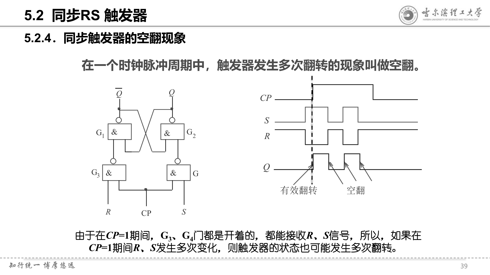

# 5.2 同步 RS 触发器

> 本节对应课件《05.触发器（6学时）》第 26~39 页。核心进步：给基本 RS 触发器**加了一个时钟 CP**，让"什么时候翻"由时钟决定、"翻成什么"由 R/S 决定。同时也暴露了它的致命缺陷——**空翻**，这就逼出了后面的主从触发器与边沿触发器。

## 一、是什么（概念与定位）

**同步触发器**：触发器的工作状态不仅受输入端（$R$、$S$）控制，**还受时钟脉冲 CP 的控制**。

**CP（Clock Pulse）**：等周期、等幅的脉冲串，是整个数字系统的"节拍"。

对比一下两种触发器的控制方式：

| 触发器 | 输入端名称 | 受不受 CP 控制 | 触发方式 |
| --- | --- | --- | --- |
| 基本 RS 触发器 | $S_D$ 直接置位端、$R_D$ 直接复位端 | **不受** | 电平直接触发 |
| 同步触发器 | $S$、$R$（数据端） | **受** | 电平触发（$CP=1$ 期间有效） |

同步触发器有两大类型：

- **同步 RS 触发器**：$R$、$S$ 两个数据端；
- **同步 D 触发器**：只有一个数据端 $D$（把 $R$、$S$ 强制成互补，从根上消掉 $RS=0$ 的约束）。

> **为什么要引入时钟？**
> 数字系统里成百上千个触发器必须**步调一致**地翻转，否则数据在电路里"跑"到一半就被下一级取走，系统必然出错。CP 就是统一的发令枪：只有 CP 有效时大家才看数据、才允许翻转。

## 二、原理与特性

### 1. 电路结构（课件第 27 页）

同步 RS 触发器 = **基本 RS 触发器 + 导引电路（控制门 G3、G4）**。

- G3、G4 各有一个输入端接 **CP**，只有 $CP=1$ 时它们才"开门"，才把 $R$、$S$ 反相后送到基本触发器的 $R_D$、$S_D$ 端；
- $S$ 经 G3 反相后送到 $S_D$（所以 $S=1$ 时 $S_D=0$，正好"置 1"）；
- $R$ 经 G4 反相后送到 $R_D$（$R=1$ 时 $R_D=0$，正好"置 0"）。



**分工**：**CP 控制翻转的时刻，R、S 决定翻转的方向（翻成什么状态）**。

有些同步 RS 触发器还带**预置端** $S_D$、$R_D$（直接置位/复位），用于开机时把触发器置成指定初态；正常工作过程中它们应保持高电平，对电路无影响。

### 2. 工作原理（课件第 28~32 页）

**（1）$CP=0$ 时**

G3、G4 被 CP 封锁（输出恒为 1），$R$、$S$ 的状态**传不进去**；基本触发器两输入为 11，处于**保持**状态。**此时无论 R、S 怎么变，触发器都不动。**

**（2）$CP=1$ 时**

G3、G4 打开，触发器状态由 $R$、$S$ 决定：

| $S$ | $R$ | 送到基本触发器的 $(S_D,R_D)$ | 触发器动作 |
| --- | --- | --- | --- |
| 0 | 0 | (1,1) | 保持原态 |
| 0 | 1 | (1,0) | 置 0 |
| 1 | 0 | (0,1) | 置 1 |
| 1 | 1 | (0,0) | **状态不定**（禁用） |

**关键结论**：触发器的**翻转时刻受 CP 控制（CP 高电平期间翻转）**，而**翻转成什么状态由 R、S 决定**。

### 3. 功能表与逻辑符号（课件第 33~34 页）



| $R$ | $S$ | $Q^{n+1}$ | 功能说明 |
| --- | --- | --- | --- |
| 0 | 0 | $Q^n$ | 不变（保持） |
| 0 | 1 | 1 | 置 1 |
| 1 | 0 | 0 | 置 0 |
| 1 | 1 | $d$（不定） | 禁用 |

**约束条件**：

$$R\cdot S=0$$

即 $R$、$S$ 不能同时为 1——这是同步 RS 触发器与基本 RS 触发器共同的"先天缺陷"。

逻辑符号特点：方框内标 $S$、$R$，**时钟输入端 C 处不加小圆圈**（表示高电平有效、电平触发）；带预置端时另画 $S_D$、$R_D$ 并加小圆圈。

### 4. 特性方程（课件第 35 页）

由功能表画次态 $Q^{n+1}$ 的卡诺图化简：

$$\begin{cases}Q^{n+1}=S+\overline{R}\,Q^n\\[4pt] RS=0\ \ (\text{约束条件})\end{cases}$$

> 和基本 RS 触发器的特性方程**形式完全相同**（都是 $S+\overline{R}Q^n$），区别只在约束条件的写法：与非门型基本 RS 是 $S_D+R_D=1$，同步 RS 是 $RS=0$。这是因为同步 RS 内部已经把 $R$、$S$ 反相后送到 $S_D$、$R_D$，有效电平变高，约束自然变成"不能同时为 1"。

### 5. 状态转换图与驱动表（课件第 36~37 页）

**状态转换图**（转移条件按 $R\,S$ 顺序）：

```
        R S = 00 / 01
      ┌───────────────┐
      │               ↓
   ┌─────┐         ┌─────┐
   │  0  │         │  1  │
   └─────┘         └─────┘
      ↑               │
      └───────────────┘
        R S = 10 / 00
```

**驱动表**（设计时用："要这样变，R、S 该给什么"）：

| $Q^n$ | $Q^{n+1}$ | $R$ | $S$ |
| --- | --- | --- | --- |
| 0 | 0 | × | 0 |
| 0 | 1 | 0 | 1 |
| 1 | 0 | 1 | 0 |
| 1 | 1 | 0 | × |

### 6. 波形图（课件第 38 页）

画波形图要点：

1. **只画 $CP=1$ 的区段**——$CP=0$ 期间状态一律保持；
2. $CP=1$ 期间按功能表逐段判断；
3. 若 $CP=1$ 期间 $R$、$S$ 出现 11，则 $CP$ 撤去后状态**不定**，用阴影或"×"标注。

### 7. 致命缺陷：空翻（课件第 39 页）

**空翻的定义**：在**一个时钟脉冲周期内，触发器发生多次翻转**的现象。

**产生原因**：$CP=1$ 期间 G3、G4 一直"开着"，随时都能接收 $R$、$S$ 信号。如果 $CP=1$ 期间 $R$、$S$ 发生**多次变化**，触发器状态就会跟着**多次翻转**——本来一个 CP 只该翻一次，结果翻了多次，计数器就会多计、寄存器就会写错。



**空翻的本质**：同步触发器是**电平触发**（$CP=1$ 整个期间都有效），而不是**边沿触发**（只在跳变瞬间有效）。所以只要输入在 $CP=1$ 期间抖动，输出就跟着抖动。

**解决思路（三种，对应后面三节）**：

| 方案 | 做法 | 对应电路 |
| --- | --- | --- |
| 主从结构 | $CP=1$ 时主触发器接收、从触发器封锁；$CP$ 下降沿时从触发器才动作 | 主从 RS/JK 触发器（5.3） |
| 维持—阻塞结构 | 引入反馈线，翻转后立即封锁输入通道 | 维持—阻塞边沿 D 触发器（5.4） |
| 利用传输延迟 | 让输入门的延迟大于反馈门的延迟 | 延迟型边沿触发器（5.4） |

### 8. 同步 D 触发器（课件第 57~58 页）

**动机**：同步 RS 触发器在 $R=S=1$ 时状态不定。解决办法很巧妙——**在 $R$、$S$ 前面加一个反相器**，使两个数据端永远互补，就再也不可能同时为 1 了。这样只剩**一个数据输入端**，就是 $D$ 触发器。

**电路**：$D$ 信号一路直接送 $S$（经 G3），另一路经反相器送 $R$（经 G4）。故恒有 $(R,S)=(\overline{D},D)$。

**工作过程**：

- $CP=0$：G3、G4 封锁，保持；
- $CP=1$、$D=0$：$S=0$、$R=1$ → 置 0；
- $CP=1$、$D=1$：$S=1$、$R=0$ → 置 1；
- $CP=1$ 期间若 $D$ 变化，输出跟着变（**仍有空翻**）。

**特性方程**：

$$Q^{n+1}=D$$

这个式子极简，却是后面所有寄存器、移位寄存器的基础。

## 三、符号与图形（图文并茂）

1. **CP 端符号约定**：时钟端**无小圆圈** = 高电平有效（$CP=1$ 期间接收，电平触发）；**有小圆圈** = 低电平有效；**加小三角"▷"** = 边沿触发（上升沿），加小圆圈 + 三角形 = 下降沿触发。这三者是判断"什么时候翻"的唯一依据。
2. **导引电路的画法**：G3、G4 的 CP 端并联接到 CP 线上，画图时要把这根线明显画出来，它标志"这是同步触发器"。
3. **预置端**：$S_D$、$R_D$ 画在方框上下（或上下侧），带小圆圈，与数据端 $S$、$R$ 严格区分——预置端**不受 CP 控制、优先级最高**。
4. **D 触发器的反相器**：同步 D 触发器电路图中那个反相器就是"$R$、$S$ 强制互补"的实现，缺了它就不是 D 触发器。
5. **波形图的时间轴**：CP 的每个高电平区段是一个"决策窗口"，画图时先把窗口标出来，再逐窗口填状态，最不容易错。

## 四、典型例题/应用

**例 1**　同步 RS 触发器，$CP$、$R$、$S$ 波形已知，初始 $Q=0$。$CP$ 第一个高电平期间 $S$ 出现一个正脉冲（$R=0$）；第二个高电平期间 $R$ 出现一个正脉冲（$S=0$）；第三个高电平期间 $R$、$S$ 同时为正脉冲。画出 $Q$。

**解答**：
1. 第一个 $CP=1$：$S=1$、$R=0$ → 置 1，$Q$ 变 1；$CP=0$ 期间保持 1；
2. 第二个 $CP=1$：$R=1$、$S=0$ → 置 0，$Q$ 变 0；$CP=0$ 期间保持 0；
3. 第三个 $CP=1$：$R=S=1$ → 状态不定，$CP$ 下降沿后 $Q$ 标"×"（不确定）。

**例 2**　判断：同步 RS 触发器只要 $CP=1$，输出就一定翻转。对吗？

**解答**：**不对**。$CP=1$ 只是"允许翻转"（开门），是否真翻取决于 $R$、$S$：$R=S=0$ 时保持不动。正确说法是"$CP=1$ 期间，触发器状态由 $R$、$S$ 决定"。

**例 3**　某同步 RS 触发器用作计数器的一位，$CP$ 频率 1 kHz。若在 $CP=1$ 期间 $S$ 端受到干扰产生两个毛刺，输出会怎样？

**解答**：会产生**空翻**——输出在同一个 CP 周期内翻转两次，计数结果多计（或少计），功能错误。工程上必须改用**边沿触发器**（只在 CP 跳变瞬间采样），因为边沿触发器对 $CP$ 稳定期间的输入干扰不敏感。

**例 4**　把同步 RS 触发器改造成同步 D 触发器，需要增加什么元件？

**解答**：增加**一个反相器**（非门）。把 $D$ 直接接 $S$，经反相器接 $R$。这样 $(R,S)$ 只能是 $(0,1)$ 或 $(1,0)$，永远不出现 $(1,1)$ 禁用态，约束条件自动满足，特性方程简化为 $Q^{n+1}=D$。

## 五、易错点

1. **约束条件写成 $S_D+R_D=1$**。同步 RS 的约束是 $RS=0$（不能同时为 1），与与非门型基本 RS 的"不能同时为 0"正好相反。
2. **$CP=0$ 期间还在判状态**。$CP=0$ 一律保持，不要在这一段做任何判断。
3. **忘记空翻**。$CP=1$ 期间 $R$、$S$ 变化会多次翻转，这是同步触发器特有的毛病，画波形时必须逐段看，不能只取一个时刻。
4. **把"电平触发"当"边沿触发"**。同步触发器是电平触发；符号上**没有小三角**就说明不是边沿触发。
5. **预置端与数据端混淆**。$S_D$、$R_D$ 是不受 CP 控制的直接端，优先级最高；$S$、$R$ 才是受 CP 控制的数据端。
6. **D 触发器漏掉反相器**。少了反相器就退化成同步 RS，仍会出现 $R=S=1$ 的不定态。

## 六、知识点总结

1. 同步触发器 = **基本触发器 + 导引电路**，由 CP 决定"何时翻"、由 $R/S$ 决定"翻成什么"。
2. 工作规则：**$CP=0$ 保持；$CP=1$ 按功能表动作**（00 保持、01 置 1、10 置 0、11 不定）。
3. 特性方程 $Q^{n+1}=S+\overline{R}Q^n$，约束条件 $RS=0$。
4. **空翻**是同步触发器的本质缺陷：电平触发使 $CP=1$ 整个期间都"开门"，输入多次变化就多次翻转。解决方案是主从结构、维持—阻塞结构、传输延迟结构。
5. 同步 D 触发器用**一个反相器**强制 $R$、$S$ 互补，消掉约束，特性方程简化为 $Q^{n+1}=D$；它仍属电平触发，仍有空翻。
