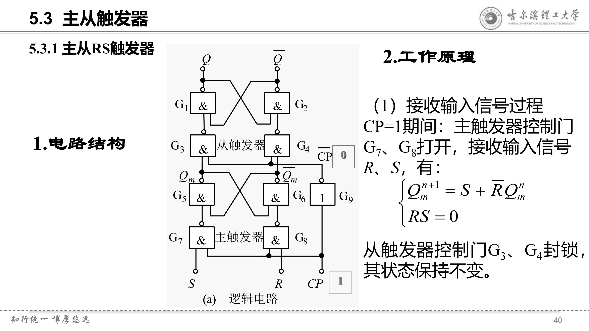
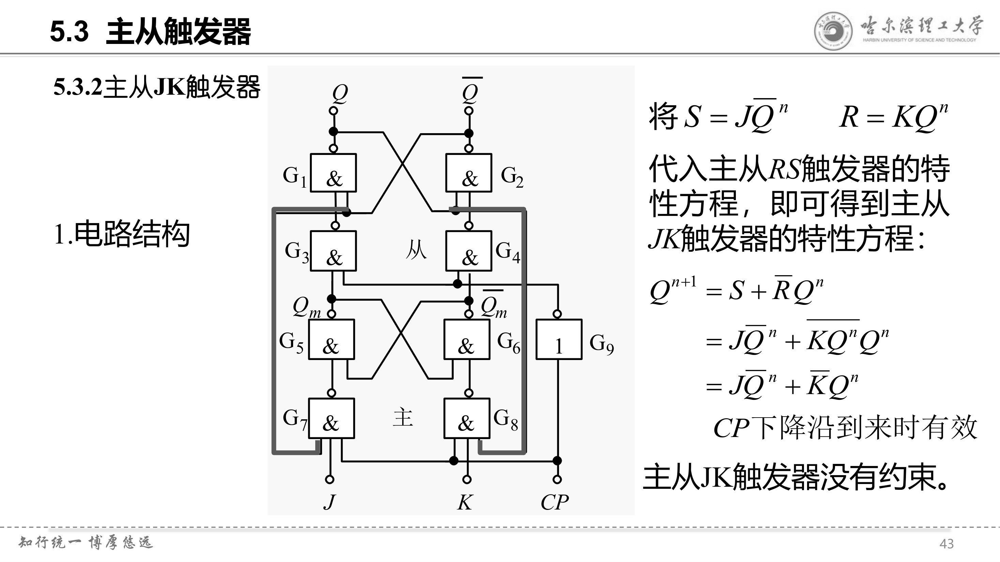
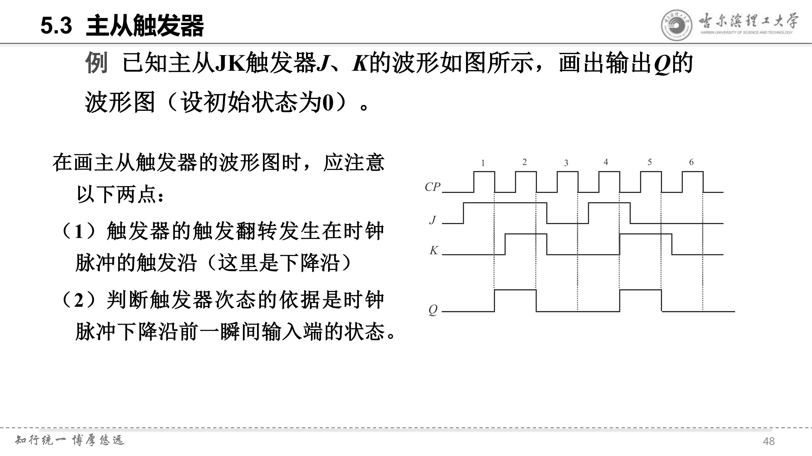
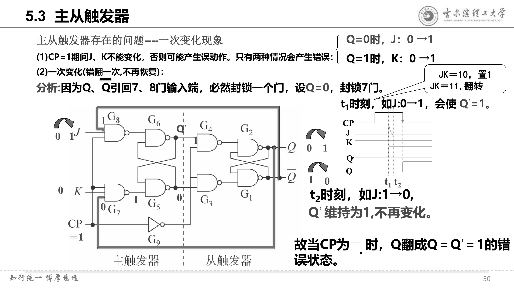

# 5.3 主从触发器（RS / JK / T / T′）

> 本节对应课件《05.触发器（6学时）》第 40~55 页。主从结构的目的是**解决同步触发器的空翻**：把触发器拆成"主"和"从"两级，让它们在时间上错开工作——$CP=1$ 时主级接收、从级封锁；$CP$ 下降沿时主级封锁、从级接收。同时用 $S=J\overline{Q^n}$、$R=KQ^n$ 的接法把 RS 的约束彻底消掉，得到功能最全的 **JK 触发器**。

## 一、是什么（概念与定位）

**主从触发器**：由**主触发器**和**从触发器**两级串联构成，两级用**互补的时钟**控制（主级用 CP，从级用 $\overline{CP}$），因此任何时刻只有一级在工作，另一级被封锁。

**它的价值**：

| 对比项 | 同步触发器 | 主从触发器 |
| --- | --- | --- |
| 接收与翻转 | 同时发生（$CP=1$ 期间随时可能翻） | **分开**：$CP=1$ 接收，$CP$ 下降沿翻转 |
| 一个 CP 内翻转次数 | 可能多次（空翻） | **一次**（只在下降沿） |
| 触发方式 | 电平触发 | **脉冲触发（下降沿有效）** |

**三个层次（本节逐层展开）**：

1. **主从 RS 触发器**：结构上解决了空翻，但**仍有 $RS=0$ 的约束**；
2. **主从 JK 触发器**：把输出反馈到输入端（$S=J\overline{Q^n}$、$R=KQ^n$），**约束消失**，功能最全（保持/置 0/置 1/翻转四功能齐全）；
3. **T 与 T′ 触发器**：把 J、K 连在一起（$J=K=T$），专做"翻转"这一件事。

## 二、原理与特性

### 1. 主从 RS 触发器的电路结构（课件第 40 页）

由两个**同步 RS 触发器**串接而成：

- **主触发器**（G5、G6 与 G7、G8）：控制门 G7、G8 的时钟端直接接 **CP**；
- **从触发器**（G1、G2 与 G3、G4）：控制门 G3、G4 的时钟端接 **$\overline{CP}$**（经 G9 反相）。

**关键点**：主、从两级的时钟**反相**，所以"一个开、另一个必关"。



### 2. 主从 RS 触发器的工作原理（课件第 40~41 页）

**（1）$CP=1$ 期间——接收输入信号**

- 主触发器控制门 G7、G8 **打开**，接收 $R$、$S$，主触发器状态按同步 RS 规则变化：$Q_m^{n+1}=S+\overline{R}Q_m^n$（约束 $RS=0$）；
- 从触发器控制门 G3、G4 因 $\overline{CP}=0$ 而**封锁**，从触发器状态**保持不变**。

所以此时输出 $Q$ **不会**跟着 $R$、$S$ 变——这就是空翻被压住的原因。

**（2）$CP$ 下降沿到来时——输出翻转**

- $CP$ 由 1 变 0，G7、G8 **封锁**，主触发器把 $CP=1$ 期间"接收到的内容"**存储**下来；
- 同时 $\overline{CP}$ 由 0 变 1，G3、G4 **打开**，主触发器的状态被送入从触发器，输出 $Q$ 随之改变。

**（3）$CP=0$ 期间**

主触发器保持不变，从触发器受其控制也不会变。

**结论**：主从 RS 触发器具有"**$CP=1$ 期间接收输入、$CP$ 下降沿触发翻转**"的特点，特性方程为

$$\begin{cases}Q^{n+1}=S+\overline{R}Q^n\\[4pt] RS=0\ (\text{约束仍存在})\end{cases}$$

**遗留问题**：结构上治好了空翻，但**约束问题没解决**——$CP=1$ 期间 $R$、$S$ 仍不能同时为 1。于是有了主从 JK。

### 3. 主从 JK 触发器（课件第 43~49 页）

**（1）结构：把输出反馈回输入端**

把 $Q$、$\overline{Q}$ 引回主触发器的输入控制门，令

$$S=J\,\overline{Q^n},\qquad R=K\,Q^n$$

**（2）特性方程的推导**

把上式代入主从 RS 的特性方程 $Q^{n+1}=S+\overline{R}Q^n$：

$$Q^{n+1}=J\overline{Q^n}+\overline{KQ^n}\cdot Q^n=J\overline{Q^n}+(\overline{K}+\overline{Q^n})Q^n=J\overline{Q^n}+\overline{K}Q^n$$

$$\boxed{Q^{n+1}=J\overline{Q^n}+\overline{K}Q^n}$$

**（3）约束为什么消失了？**

检验 $J=K=1$ 的危险情况：$S=J\overline{Q^n}=\overline{Q^n}$，$R=KQ^n=Q^n$。由于 $Q^n$ 与 $\overline{Q^n}$ **必然互补**，$S$ 与 $R$ 也就**必然互补**，永远不会同时为 1 → 约束条件自动满足，**主从 JK 触发器没有约束**。



**（4）功能表（课件第 44 页）**

| $J$ | $K$ | $Q^{n+1}$ | 功能 |
| --- | --- | --- | --- |
| 0 | 0 | $Q^n$ | **保持** |
| 0 | 1 | 0 | **置 0** |
| 1 | 0 | 1 | **置 1** |
| 1 | 1 | $\overline{Q^n}$ | **翻转** |

一句口诀：**"00 保持、01 置 0（跟 K 走）、10 置 1（跟 J 走）、11 翻转"**。JK 触发器是功能最全的触发器——**它能实现 RS、D、T 的全部功能**。

**（5）状态转换图（课件第 46 页）**

```
        J K = 0× / 1×          （J=1 就翻到 1）
      ┌────────────────┐
      │                ↓
   ┌─────┐          ┌─────┐
   │  0  │          │  1  │
   └─────┘          └─────┘
      ↑                │
      └────────────────┘
        J K = ×1 / ×0        （K=1 就翻回 0）
```

**（6）驱动表（课件第 47 页）**

| $Q^n$ | $Q^{n+1}$ | $J$ | $K$ |
| --- | --- | --- | --- |
| 0 | 0 | 0 | × |
| 0 | 1 | 1 | × |
| 1 | 0 | × | 1 |
| 1 | 1 | × | 0 |

> 记忆法：**要看变化，只盯"谁在新状态里是 1"**——0→1 必给 $J=1$，1→0 必给 $K=1$，不变则对应的那个端给 0、另一个随意。

**（7）波形图画法（课件第 48 页的例题）**



画主从触发器波形图，只需记住两条：

1. **翻转只发生在 CP 的触发沿**（主从 JK 是**下降沿**），其余时间 $Q$ 一律画平线；
2. **判断次态的依据是"触发沿前一瞬间"输入端的状态**，不是沿之后的状态。

> 这就是"脉冲触发"与"边沿触发"的共同点：都只看**某一瞬间**的输入。区别在于主从型在 $CP$ 高电平期间还在"偷偷"接收（所以有一次变化问题），而边沿型完全不接收。

### 4. 主从触发器的一次变化现象（课件第 50 页）

**现象**：$CP=1$ 期间若 $J$、$K$ 发生变化，可能使主触发器**错误翻转一次**，且**翻转后不再恢复**——即使输入又变回原值，主触发器也回不去了。等到 CP 下降沿，这个错误状态就被送到输出端。

**只有两种情况会出错**：

- $Q=0$ 时，$J$ 由 $0\to1$（此时 $\overline{Q}=1$ 把 $K$ 通道封锁，只有 $J$ 通道有效）；
- $Q=1$ 时，$K$ 由 $0\to1$（此时 $Q=1$ 把 $J$ 通道封锁，只有 $K$ 通道有效）。

**为什么"翻一次就不再恢复"**：$CP=1$ 期间 $Q$、$\overline{Q}$ 反馈回 G7、G8，**必然封锁其中一路**。设 $Q=0$，则 $\overline{Q}=1$ 使 $J$ 通道（G7）可通，$K$ 通道（G8）被封锁。若 $t_1$ 时刻 $J$ 由 $0\to1$，主触发器被置成 $Q'=1$；到 $t_2$ 时刻 $J$ 又由 $1\to0$，看起来应该"撤销"，但主触发器与从触发器之间的反馈已经锁定，$Q'$ **维持为 1 不再改变**。于是当 CP 下降沿到来时，$Q$ 被错误地翻成 1。



**工程结论**：主从触发器要求 **$CP=1$ 期间输入信号必须稳定**，否则可能误动作。这就是它最终被**边沿触发器**取代的原因。

### 5. 带清零端和预置端的主从 JK 触发器（课件第 51~52 页）

在主从 JK 触发器上增加 $R_D$（清零/复位）和 $S_D$（预置/置位）两个直接端：

- $R_D=0$ → 强制 $Q=0$、$\overline{Q}=1$；
- $S_D=0$ → 强制 $Q=1$、$\overline{Q}=0$；
- 两者**不受 CP 和 $J$、$K$ 的影响，具有最高的优先级**（低电平有效，平时应置 1）。

### 6. T 触发器与 T′ 触发器（课件第 53~55 页）

**（1）T 触发器**

把 JK 触发器的两个输入端**连在一起**，用 $T$ 表示，即 $J=K=T$，就得到 T 触发器。

功能：$T=0$ 时保持；$T=1$ 时翻转。

| $T$ | $Q^{n+1}$ | 功能 |
| --- | --- | --- |
| 0 | $Q^n$ | 保持 |
| 1 | $\overline{Q^n}$ | 翻转 |

**特性方程**（把 $J=K=T$ 代入 JK 特性方程）：

$$Q^{n+1}=T\overline{Q^n}+\overline{T}Q^n=T\oplus Q^n$$

**（2）T′ 触发器**

把 T 触发器的控制端**恒接高电平**（$T\equiv1$），就得到 T′ 触发器。

功能：**每来一个时钟脉冲，状态就翻转一次**，只具有翻转功能。

$$Q^{n+1}=\overline{Q^n}$$

**（3）用途**

T′ 触发器就是**二进制计数器的最基本单元**：每输入一个 CP，输出翻转一次，输出频率是输入频率的 $1/2$——这就是**二分频**。把 $n$ 个 T′ 触发器级联，就得到 $n$ 位二进制计数器（详见第 6 章）。

> **注意**：T 触发器、T′ 触发器**没有现成的集成电路产品**（课件第 63 页明确指出），实际都用 JK 或 D 触发器转换得到。

## 三、符号与图形（图文并茂）

1. **主从触发器的符号**：方框内标 $J$、$K$，**时钟端画一个小三角"▷"加一个小圆圈**（或只画三角形并在旁边标"↓"），表示**下降沿触发**。有些教材在主从型符号上画"延迟"符号（一个直角台阶），表示"脉冲触发"。
2. **两级结构的画法**：主触发器在上、从触发器在下，主级的 CP 与从级的 $\overline{CP}$ 用一根经反相器的线连起来，这根反相器是"主从"的标志。
3. **反馈线的画法**：主从 JK 中 $Q$、$\overline{Q}$ 分别引回 G7、G8 的输入端（$S=J\overline{Q}$、$R=KQ$），这两根线一定交叉，画图时不要漏。
4. **直接端的画法**：$R_D$、$S_D$ 画在方框上下两侧，带小圆圈，与 $J$、$K$ 分开，表示"不受 CP 控制"。
5. **T、T′ 的符号**：T 触发器方框内标 $T$；T′ 触发器不画输入端（或画一个常接 1 的端），只留 CP 端。

## 四、典型例题/应用

**例 1**　主从 JK 触发器，初始 $Q=0$。$CP$ 连续三个脉冲，$J$、$K$ 在各 $CP$ 高电平期间保持稳定，取值依次为 $(J,K)=(1,0)$、$(1,1)$、$(0,0)$。求每个 $CP$ 下降沿后的 $Q$。

**解答**：
1. 第一个下降沿：$J=1,K=0$ → 置 1，$Q=1$；
2. 第二个下降沿：$J=K=1$ → 翻转，$Q=0$；
3. 第三个下降沿：$J=K=0$ → 保持，$Q=0$。

**例 2**　上题中若第二个 $CP$ 高电平期间，$J$ 先由 $1\to0$、$K$ 由 $0\to1$（即输入在 $CP=1$ 期间变化），会有什么后果？

**解答**：由于 $CP=1$ 期间输入变化，主触发器可能发生**一次变化**：此时 $Q=1$，只有 $K$ 通道有效，$K$ 由 $0\to1$ 会使主触发器被置 0，且**不再恢复**。CP 下降沿到来时输出 $Q$ 变为 0——与"按下降沿前一瞬间 $J=0,K=1$ 也应置 0"的结论恰好一致，本例是巧合；若输入变化方向相反（$Q=1$ 时 $J$ 由 $0\to1$），就会得到错误结果。**结论：主从触发器要求 $CP=1$ 期间输入稳定。**

**例 3**　用 JK 触发器构成 T′ 触发器（二分频器），画出接法。

**解答**：把 $J$、$K$ 两端**连在一起并接高电平**（$J=K=1$）即可。此时每个 CP 下降沿都满足"$J=K=1$ → 翻转"，输出 $Q$ 的频率为 CP 频率的一半。若把第一级的 $Q$ 接到第二级的 CP 端，两级级联即得四分频（两位二进制计数器）。

**例 4**　主从 RS 触发器与主从 JK 触发器，哪一个还存在约束？为什么？

**解答**：**主从 RS 触发器仍有约束 $RS=0$**；主从 JK 没有约束。原因是 JK 把 $S=J\overline{Q^n}$、$R=KQ^n$ 接入，$Q^n$ 与 $\overline{Q^n}$ 恒互补，从而 $S$、$R$ 恒互补，任何 $J$、$K$ 组合都不会让 $S=R=1$。

## 五、易错点

1. **触发沿判断错**。主从 JK 是 **CP 下降沿**触发；符号上没有小三角就不是边沿触发，有小三角 + 小圆圈才是下降沿。
2. **把"下降沿前一瞬间"当成"沿之后"**。判次态必须用**触发沿到来前**的 $J$、$K$ 值。
3. **以为主从结构已彻底解决所有问题**。空翻解决了，但**约束（RS 型）**和**一次变化**两个问题还在，必须靠边沿触发器。
4. **一次变化的条件记反**。会出错的只有两种：$Q=0$ 时 $J$ 由 $0\to1$、$Q=1$ 时 $K$ 由 $0\to1$——都是"往封锁的那一路之外的方向变化"。
5. **T′ 与 T 混淆**。T 有控制端（$T=0$ 保持、$T=1$ 翻转）；T′ 没有控制端，恒翻转。
6. **$S=J\overline{Q^n}$、$R=KQ^n$ 中的 $Q^n$ 取错**。这里的 $Q^n$ 是**主触发器**在 $CP=1$ 期间的现态，不是输出端 $Q$ 的最终值；分析主从 JK 时要把主、从两级分开看。

## 六、知识点总结

1. 主从结构 = **主触发器 + 从触发器 + 互补时钟**：$CP=1$ 主级接收、从级封锁；$CP$ 下降沿主级封锁、从级接收 → **一个 CP 只翻一次，空翻被消除**。
2. 主从 RS 触发器特性方程 $Q^{n+1}=S+\overline{R}Q^n$，**约束 $RS=0$ 仍存在**。
3. 主从 JK 触发器令 $S=J\overline{Q^n}$、$R=KQ^n$，得 $Q^{n+1}=J\overline{Q^n}+\overline{K}Q^n$，**无约束**，功能最全（保持/置 0/置 1/翻转）。
4. JK 功能口诀：**00 保持、01 置 0、10 置 1、11 翻转**；驱动表：0→1 给 $J=1$，1→0 给 $K=1$。
5. **一次变化**：$CP=1$ 期间输入变化会使主触发器错翻一次且不恢复，故要求 $CP=1$ 期间输入稳定——这是主从型的固有缺陷。
6. T 触发器 $J=K=T$，$Q^{n+1}=T\oplus Q^n$；T′ 触发器 $T\equiv1$，$Q^{n+1}=\overline{Q^n}$，是**二分频/计数器**的基本单元，二者均无单独集成产品。
