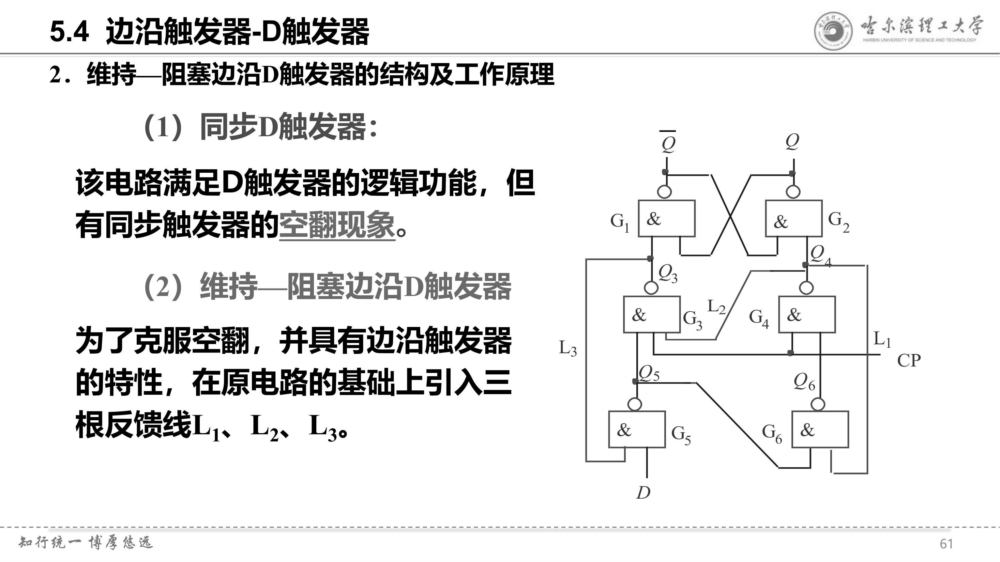

# 5.4 边沿触发器与 D 触发器

> 本节对应课件《05.触发器（6学时）》第 56~66 页。这是触发器结构演进的**终点**：只在 CP 跳变的**那一瞬间**采样输入，其余时间完全"闭眼不看"。从此空翻和一次变化都被彻底根除。本节同时把 **D 触发器**讲透（它是最常用的触发器），并给出**五种触发器互相转换**的通用方法。

## 一、是什么（概念与定位）

**边沿触发器**：触发器的次态**仅取决于 CP 信号上升沿（↑）或下降沿（↓）到达时刻输入信号的状态**，与 CP 稳定期间输入如何变化毫无关系。

三种触发方式的最终对比（这是本章最重要的一张表）：

| 触发方式 | 代表电路 | 何时接收输入 | 何时翻转 | 主要缺陷 |
| --- | --- | --- | --- | --- |
| **电平触发** | 基本 RS、同步 RS/D | $CP=1$ 整个期间 | $CP=1$ 期间随时 | **空翻** |
| **脉冲触发** | 主从 RS/JK | $CP=1$ 整个期间 | $CP$ 下降沿 | **一次变化** |
| **边沿触发** | 维持—阻塞 D、边沿 JK | 仅 CP 跳变瞬间 | 同一瞬间 | 无（最优） |

**边沿触发器的四种实现方式**（课件第 56 页）：

1. **维持—阻塞边沿触发器**（TTL 中最典型，本节重点讲）；
2. 利用各门电路**传输延迟时间不同**构成的边沿触发器；
3. 利用 **CMOS 传输门**构成的边沿触发器；
4. 利用**二极管**进行电平配置的边沿触发器。

**D 触发器**：只有一个数据输入端 $D$ 的触发器，特性方程为 $Q^{n+1}=D$。它逻辑最简单、使用最广，是寄存器、移位寄存器、分频器的核心。

## 二、原理与特性

### 1. D 触发器的逻辑功能（课件第 57~60 页）

**（1）由来：从同步 RS 到 D**

同步 RS 触发器在 $R=S=1$ 时状态不定。解决办法是**让 $R$、$S$ 永远互补**——在 $D$ 端后面加一个反相器，一路送 $S$、一路反相后送 $R$。于是 $R$、$S$ 只能是 01 或 10，不可能出现 11，**只剩一个输入端 D**。

**（2）功能表**

| $D$ | $Q^{n+1}$ | 功能 |
| --- | --- | --- |
| 0 | 0 | 置 0 |
| 1 | 1 | 置 1 |

**（3）状态表（含现态）**

| $Q^n$ | $D$ | $Q^{n+1}$ |
| --- | --- | --- |
| 0 | 0 | 0 |
| 0 | 1 | 1 |
| 1 | 0 | 0 |
| 1 | 1 | 1 |

看出规律：$Q^{n+1}$ 一列与 $D$ 一列**完全一样**，与 $Q^n$ 无关。

**（4）特性方程**

$$\boxed{Q^{n+1}=D}$$

**（5）状态转换图**

```
        D=1              D=1
   ┌─────────┐       ┌─────────┐
   ↓         │       ↓         │
 ┌─────┐     │     ┌─────┐     │
 │  0  │─────┘     │  1  │─────┘
 └─────┘  D=0      └─────┘  D=0
    ↑                 │
    └─────────────────┘
```

（0 态时 $D=1$ 转 1 态、$D=0$ 保持 0 态；1 态时 $D=0$ 转 0 态、$D=1$ 保持 1 态。）

**（6）驱动表**

| $Q^n$ | $Q^{n+1}$ | $D$ |
| --- | --- | --- |
| 0 | 0 | 0 |
| 0 | 1 | 1 |
| 1 | 0 | 0 |
| 1 | 1 | 1 |

极简结论：**$D=Q^{n+1}$**——设计时想让次态是什么，$D$ 端就接什么。这正是 D 触发器在设计中最讨人喜欢的地方。

**（7）触发时刻的准确表述**

- CP **上升沿前**接收信号，**上升沿时**触发器翻转；
- 翻转后 $Q$ 的状态与 $D$ 一致，但总比 $D$ **晚一步**（$Q^{n+1}=D^n$）；
- **上升沿之后**输入 $D$ 不再起作用，触发器保持。

> **"晚一步"怎么理解？**
> $D$ 在 $t$ 时刻的值，要到**下一个时钟沿**才反映到 $Q$ 上。这就是"**延迟一拍**"特性，它使 D 触发器天然适合做**数据暂存**与**移位**——数据沿着一串 D 触发器逐拍往右传。

### 2. 维持—阻塞边沿 D 触发器（课件第 61 页）

**（1）出发点**

同步 D 触发器满足 $Q^{n+1}=D$ 的逻辑功能，但**有电平触发的空翻现象**。为了既保留逻辑功能、又消除空翻，在原电路上**引入三根反馈线 $L_1$、$L_2$、$L_3$**。



**（2）两根线的功能分工**

| 反馈线 | 名称 | 作用 |
| --- | --- | --- |
| $L_1$、$L_2$ | **维持线** | 触发器一旦翻转，立刻把已建立的状态**维持住**，不让输入再改动它 |
| $L_3$ | **阻塞线** | 把输入通道**堵死**，使 $D$ 端后续的变化传不进来 |

**（3）工作过程（$CP$ 上升沿触发）**

- $CP=0$ 时：输入门被封锁，$D$ 的变化传不进去，触发器保持；
- $CP$ 由 0 变 1（**上升沿**）瞬间：输入门打开，$D$ 被采样送入，触发器翻转；
- **翻转完成的瞬间**：$L_1$、$L_2$ 立即把状态维持住，$L_3$ 立即把输入门堵死；
- 此后无论 $D$ 怎么变，都传不进去了 → **一次 CP 只翻一次，绝无空翻**。

**（4）名称的由来**

"**维持**"指维持住已翻转的状态，"**阻塞**"指阻塞住输入通道。这两个动作都在**纳秒级**内完成，靠的是门电路本身的传输延迟——所以这类电路对器件速度有要求，属于 TTL 工艺的经典设计。

### 3. 触发器的直接置 0 和置 1 端（课件第 62 页）

- $R_D$：直接置 0 端（复位），**低电平有效**；
- $S_D$：直接置 1 端（置位），**低电平有效**；
- **$R_D$、$S_D$ 不受 CP 和 D 信号的影响，具有最高的优先级**。

这意味着：无论时钟在做什么、$D$ 是什么，只要 $R_D=0$ 就立即清零，只要 $S_D=0$ 就立即置 1。工程上用它做**开机初始化**和**手动复位**。

> **使用纪律**：正常工作时 $R_D$、$S_D$ 必须接高电平（或悬空——TTL 悬空视为高电平）。若两者同时为 0，则 $Q=\overline{Q}=1$，且释放后状态不定，与基本 RS 的禁用态同理。

### 4. 触发器的功能转换（课件第 63~66 页）

**为什么要转换**：触发器按逻辑功能分为 RS、JK、D、T、T′ 五类，各有特性方程。但**实际能买到的集成产品只有 JK 和 D 两类**（74LS112、74LS74 等），T 和 T′ 没有现成芯片，必须用 JK 或 D 转换得到。

**通用方法（三步）**：

1. 写出**已有触发器**的特性方程；
2. 写出**待求触发器**的特性方程；
3. 把待求方程**变形**成已有方程的形式，**对比系数**确定各输入端的接法，画出电路。

**（1）JK → D**

已有：$Q^{n+1}=J\overline{Q^n}+\overline{K}Q^n$；待求：$Q^{n+1}=D$。

把 $D$ 改写成 $D=D(\overline{Q^n}+Q^n)=D\overline{Q^n}+DQ^n$，与 JK 方程对比：

$$J=D,\qquad \overline{K}=D\ \Rightarrow\ K=\overline{D}$$

即 **$J=D$、$K=\overline{D}$**（$K$ 端经一个反相器接 $D$）。

**（2）JK → T**

已有：$Q^{n+1}=J\overline{Q^n}+\overline{K}Q^n$；待求：$Q^{n+1}=T\overline{Q^n}+\overline{T}Q^n$。

直接对比得：**$J=K=T$**，即把 J、K 两端连在一起作为 T 端。

**（3）JK → T′**

在（2）基础上令 $T\equiv1$，即 **J、K 连在一起接高电平**，得 $Q^{n+1}=\overline{Q^n}$。

**（4）D → JK**

已有：$Q^{n+1}=D$；待求：$Q^{n+1}=J\overline{Q^n}+\overline{K}Q^n$。

直接令 **$D=J\overline{Q^n}+\overline{K}Q^n$**，用一个与或逻辑（两个与门 + 一个或门）产生 $D$ 即可。

**（5）D → T / T′**

令 **$D=T\oplus Q^n$**（一个异或门）→ T 触发器；
令 **$D=\overline{Q^n}$**（把 $\overline{Q}$ 接回 $D$）→ T′ 触发器（二分频）。

**转换关系一览表**：

| 目标 | 用 JK 实现 | 用 D 实现 |
| --- | --- | --- |
| D 触发器 | $J=D$，$K=\overline{D}$ | — |
| T 触发器 | $J=K=T$ | $D=T\oplus Q^n$ |
| T′ 触发器 | $J=K=1$ | $D=\overline{Q^n}$ |
| JK 触发器 | — | $D=J\overline{Q^n}+\overline{K}Q^n$ |

> **转换的本质**：不是换器件，而是**用组合逻辑"喂"出正确的输入信号**。所以触发器转换题 = 组合逻辑设计题 + 特性方程对比，两步都熟就不会错。

## 三、符号与图形（图文并茂）

1. **边沿触发的符号标志**：时钟端画**小三角"▷"**。三角形 + **无圆圈** = 上升沿触发；三角形 + **小圆圈** = 下降沿触发。这是判断触发沿的唯一依据，比文字说明更可靠。
2. **电平/脉冲触发的符号**：时钟端**光秃秃**（无三角形）就是电平触发（如同步 RS）；主从型常画"延迟台阶"符号表示脉冲触发。
3. **维持—阻塞电路的画法**：$L_1$、$L_2$、$L_3$ 三根反馈线要画出交叉关系，$L_3$ 从输出侧引回输入门——**画错方向就不成立**。
4. **D 触发器符号**：方框内标 $D$，CP 端带三角形，$R_D$、$S_D$ 画在上下带小圆圈。
5. **转换电路的画法**：$J$、$K$ 端上的反相器、异或门等要画在触发器**外面**，输入端标注清楚，不要画进触发器方框内。

## 四、典型例题/应用

**例 1**　上升沿触发的 D 触发器，初始 $Q=0$。$D$ 端在 $CP$ 第一个上升沿前为 1，第二个上升沿前为 0，第三个上升沿前为 1。求每次上升沿后的 $Q$。

**解答**：按 $Q^{n+1}=D$ 逐拍代入：
1. 第一个上升沿：$D=1$ → $Q=1$；
2. 第二个上升沿：$D=0$ → $Q=0$；
3. 第三个上升沿：$D=1$ → $Q=1$。

**要点**：只看**上升沿那一瞬间**的 $D$ 值，上升沿之间 $D$ 的波动全部忽略。

**例 2**　把边沿 D 触发器接成 T′ 触发器（二分频），如何接线？若 $CP=1000\ \mathrm{Hz}$，输出频率是多少？

**解答**：把 $\overline{Q}$ 端接回 $D$ 端（$D=\overline{Q^n}$）。这样每个 CP 上升沿都使 $Q$ 翻转一次，输出频率 $=1000/2=500\ \mathrm{Hz}$。

**例 3**　用 JK 触发器实现 D 触发器功能，画出接线。

**解答**：$J=D$，$K=\overline{D}$。即 $D$ 直接接 $J$，$D$ 经一个反相器接 $K$。验证：$D=0$ 时 $J=0,K=1$ → 置 0；$D=1$ 时 $J=1,K=0$ → 置 1，正是 $Q^{n+1}=D$。

**例 4**　某边沿 D 触发器的 $R_D$ 端在 $CP$ 高电平期间被拉低，此后 $D$ 端持续为 1。问 $Q$ 会怎样？说明理由。

**解答**：$Q$ 立即被清 0，且**在 $R_D$ 恢复高电平之前一直保持 0**，即使 $D=1$ 也不理。原因：$R_D$、$S_D$ 是**直接端，不受 CP 和 D 影响，优先级最高**。待 $R_D$ 恢复高电平后，下一个 CP 上升沿才按 $D=1$ 置 1。

## 五、易错点

1. **触发沿看错**。三角形 + 小圆圈 = 下降沿；三角形无圆圈 = 上升沿。D 触发器（74LS74、74HC74）常见为**上升沿**，JK 触发器（74LS73、74LS112）常见为**下降沿**。
2. **在 CP 稳定期间判状态**。边沿触发器只在跳变瞬间采样，$CP$ 稳定期间 $D$ 的任何变化都不影响 $Q$。
3. **把 $Q^{n+1}=D$ 写成 $Q^{n+1}=D^{n+1}$**。正确关系是"次态 = **当前**输入"，即输出永远比输入**晚一拍**。
4. **忽略 $R_D$、$S_D$ 的最高优先级**。含直接端的题必须先判 $R_D$、$S_D$，再判 CP 与 D。
5. **转换时忘了反相器**。JK→D 的 $K=\overline{D}$ 需要反相器，漏掉就变成 $J=K=D$（T 触发器），功能全错。
6. **转换方法用错方向**。要"用 D 实现 JK"，就不能去改 JK 的方程，而应把 **JK 的特性方程直接赋给 D**。方向搞反是这类题的头号错误。

## 六、知识点总结

1. 触发方式三代演进：**电平触发（有空翻）→ 脉冲触发（有一次变化）→ 边沿触发（无缺陷）**。边沿触发器只看 CP 跳变瞬间的输入。
2. D 触发器：**单输入、无约束、$Q^{n+1}=D$、驱动表 $D=Q^{n+1}$**，输出比输入晚一拍，是寄存器与移位寄存器的核心。
3. 维持—阻塞边沿 D 触发器靠 **$L_1$、$L_2$ 维持线 + $L_3$ 阻塞线**在翻转后立即封锁输入通道，从而消除空翻。
4. **$R_D$、$S_D$ 是直接端，低电平有效，优先级最高**，不受 CP 与 D 影响。
5. 功能转换的通法：**写两个特性方程 → 变形对比 → 定输入接法**。核心结论：JK→D 用 $J=D,K=\overline{D}$；JK→T 用 $J=K=T$；D→JK 用 $D=J\overline{Q^n}+\overline{K}Q^n$；D→T′ 用 $D=\overline{Q^n}$。
6. T、T′ 无集成产品，一律由 JK 或 D 转换而来；T′ 就是二分频器，是计数器的基本单元。
