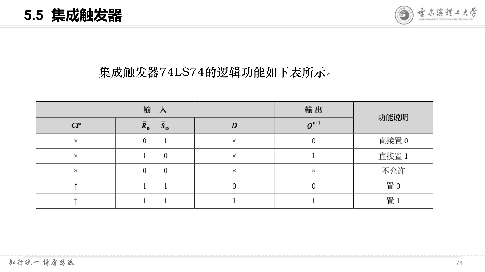

# 5.5 集成触发器

> 本节对应课件《05.触发器（6学时）》第 67~74 页。前面几节是"原理"，这一节是"实物"——考试中常以**读真值表、看引脚图、判初始状态**的形式出现。核心考点只有一个：**拿到一片芯片，能读懂它的触发沿、异步端与真值表**。

## 一、是什么（概念与定位）

**集成触发器**：把整个触发器电路（含输入缓冲、导引、维持阻塞、输出驱动）做在一块芯片上的标准化器件。实际工程中**只用集成触发器，不搭分立电路**。

本节涉及五款常用芯片：

| 型号 | 工艺 | 内含 | 逻辑功能 | 触发沿 | 异步端 |
| --- | --- | --- | --- | --- | --- |
| **74LS73** | TTL | 2 个独立 JK | JK | **下降沿** | 只有清零 $CLR$ |
| **74LS112** | TTL | 2 个独立 JK | JK | **下降沿** | $R_D$ 清零 + $S_D$ 预置 |
| **74LS74** | TTL | 2 个独立 D | D | **上升沿** | $R_D$ + $S_D$ |
| **74HC74** | CMOS | 2 个独立 D | D | **上升沿** | $R_D$ + $S_D$ |
| **74HC273** | CMOS | 8 个 D（公共时钟） | D | **上升沿** | 公共主复位 $MR$ |

> **命名规律**：`74` 表示商用温度系列；`LS` 是低功耗肖特基 TTL，`HC` 是高速 CMOS；末尾数字是器件序号；`273`、`374` 这类"8 路"芯片是**公共时钟**结构，专门用来做 8 位数据锁存/寄存。

## 二、原理与特性

### 1. 边沿 JK 触发器 74LS73（课件第 67 页）

**三个特点**：

1. 内含 **2 个完全独立的 JK 触发器**（一片顶两片用）；
2. 带**直接置 0 端 $CLR$，低电平有效**（注意：74LS73 **没有**置 1 端）；
3. **时钟 $CK$ 下降沿触发**。

**真值表**：

| $CLR$ | $CK$ | $J$ | $K$ | $Q^{n+1}$ | 说明 |
| --- | --- | --- | --- | --- | --- |
| 0 | × | × | × | 0 | **异步清零**（最高优先级） |
| 1 | ↓ | 0 | 0 | $Q^n$ | 保持 |
| 1 | ↓ | 0 | 1 | 0 | 置 0 |
| 1 | ↓ | 1 | 0 | 1 | 置 1 |
| 1 | ↓ | 1 | 1 | $\overline{Q^n}$ | 翻转 |
| 1 | 非↓ | × | × | $Q^n$ | 无时钟沿则保持 |

> 读表要点：第一行 $CLR=0$ 时 $CK$、$J$、$K$ 全是"×"——**异步端的 × 意味着"完全不管"**，包括不管时钟。

### 2. 高速 CMOS 边沿 D 触发器 74HC74（课件第 68 页）

**三个特点**：

1. **单输入端的双 D 触发器**（一片两个 D 触发器）；
2. 都带**直接置 0 端 $R_D$ 和直接置 1 端 $S_D$，低电平有效**；
3. 属**边沿触发器，CP 上升沿触发**。

**真值表**：

| $R_D$ | $S_D$ | $CP$ | $D$ | $Q^{n+1}$ | 说明 |
| --- | --- | --- | --- | --- | --- |
| 0 | 1 | × | × | 0 | **异步清零** |
| 1 | 0 | × | × | 1 | **异步置 1** |
| 1 | 1 | ↑ | 0 | 0 | 同步置 0 |
| 1 | 1 | ↑ | 1 | 1 | 同步置 1 |
| 1 | 1 | 非↑ | × | $Q^n$ | 保持 |

> **判题顺序**：先看 $R_D$、$S_D$（异步，最高优先级）→ 再看有无上升沿 → 最后看 $D$。三步走，不会错。

### 3. 8 路触发器 74HC273（课件第 69~70 页）

**特点**：

- 内含 **8 个边沿触发的 D 触发器**，各有独立的 $D$ 输入和 $Q$ 输出；
- **公共时钟 $CP$** 与**公共主复位 $MR$**（低电平有效）可同时读取或复位全部 8 个触发器；
- 每个 $D$ 输入的状态在**时钟上升沿之前的一段就绪时间**内被传输到对应输出 $Q_n$。

**真值表**：

| $MR$ | $CP$ | $D_X$ | $Q_X$ | 说明 |
| --- | --- | --- | --- | --- |
| 0 | × | × | 0 | 全部清零（8 路同时） |
| 1 | ↑ | 1 | 1 | 存入 1 |
| 1 | ↑ | 0 | 0 | 存入 0 |
| 1 | 非↑ | × | $Q^n$ | 保持 |

**典型用途**：**8 位数据锁存器/寄存器**——微处理器输出端口、LED 数码管段码锁存、并行数据缓冲。公共时钟保证 8 位数据**同时**被打入，避免"半新半旧"的中间态。

### 4. 边沿 JK 触发器 74LS112（课件第 71~72 页）

**特点**：带**预置端 $S_D$ 和清除端 $R_D$** 的**下降沿**触发双 JK 触发器。

**引脚（16 脚）**：1CP、1K、1J、1$S_D$、1Q、1$\overline{Q}$、2$\overline{Q}$、2K、2J、2$S_D$、2Q、2CP、2$R_D$、1$R_D$、GND(8)、VCC(16)。

**功能要点**：

- $J$、$K$ 是数据输入端，是状态翻转的依据；
- 若一片内有**两个或两个以上 J 端（或 K 端）**，它们之间是"**与**"的关系——必须全为 1 才起作用；
- $Q$ 与 $\overline{Q}$ 为两个互补输出；$Q=0$、$\overline{Q}=1$ 定义为"0 态"，$Q=1$、$\overline{Q}=0$ 定义为"1 态"。

> 74LS73 与 74LS112 的区别：**74LS73 只有清零端（无预置），74LS112 清零与预置都有**。这是常考的一道辨析题。

### 5. 双上升沿 D 触发器 74LS74（课件第 73~74 页）

**特点**：双列直插封装，带**预置端 $S_D$ 和清除端 $R_D$** 的**上升沿**触发双 D 触发器。



**引脚（14 脚）**：

```
        ┌──∪──┐
 1RD ─1─┤     ├─14─ VCC
  1D ─2─┤     ├─13─ 2RD
 1CP ─3─┤     ├─12─ 2D
 1SD ─4─┤74LS74├─11─ 2CP
  1Q ─5─┤     ├─10─ 2SD
 1Q ─6─┤     ├─9── 2Q
 GND ─7─┤     ├─8── 2Q
        └─────┘
```

**功能表**：

| $R_D$ | $S_D$ | $CP$ | $D$ | $Q$ | $\overline{Q}$ |
| --- | --- | --- | --- | --- | --- |
| 0 | 1 | × | × | 0 | 1 |
| 1 | 0 | × | × | 1 | 0 |
| 1 | 1 | ↑ | 0 | 0 | 1 |
| 1 | 1 | ↑ | 1 | 1 | 0 |
| 1 | 1 | 非↑ | × | $Q^n$ | $\overline{Q^n}$ |

> **注意时序参数**：$R_D$、$S_D$ 必须在时钟沿之前**提前撤销**（有一段恢复时间要求），否则可能出现"异步端与时钟沿竞争"的不确定状态。这是实验中最常见的故障原因之一。

## 三、符号与图形（图文并茂）

1. **引脚图的读法**：从**缺口/圆点标记**起，逆时针数 1、2、3……，左下角为 GND、右上角为 VCC（14 脚或 16 脚封装）。
2. **逻辑符号与引脚图的对应**：$1Q$、$1\overline{Q}$ 是第 1 个触发器的互补输出；下标 1、2 区分同一芯片内的两个独立触发器。
3. **触发沿标记**：74LS73、74LS112 的 CP 端画**三角形 + 小圆圈**（下降沿）；74LS74、74HC74、74HC273 的 CP 端画**三角形无圆圈**（上升沿）。
4. **异步端标记**：$R_D$、$S_D$、$CLR$、$MR$ 一律带小圆圈，画在方框上下，表示低电平有效、与时钟无关。
5. **"与"关系的多输入**：74LS112 的多个 J 端在符号上画成一个方框内并排的多输入，表示"与"关系，不是"或"。

## 四、典型例题/应用

**例 1**　74LS74 的 $R_D=1$、$S_D=1$、$D=1$，$CP$ 端先无跳变、后出现一个上升沿。求 $Q$。

**解答**：
1. 无上升沿时：$R_D=S_D=1$ 不作用，无时钟沿 → **保持**；
2. 出现上升沿：按 $D=1$ → **置 1**，$Q=1$。

**例 2**　74LS73 中 $CLR=1$、$J=1$、$K=1$，$CK$ 为连续方波。求 $Q$ 的变化规律及 $Q$ 的频率。

**解答**：$J=K=1$ → **翻转**功能，且为**下降沿**触发。故 $CK$ 每来一个下降沿 $Q$ 就翻转一次——每两个 $CK$ 周期 $Q$ 完成一个完整周期，**$Q$ 的频率 = $CK$ 频率的 $1/2$**，即二分频。

**例 3**　74LS74 的 $R_D$ 在 $CP$ 高电平期间被拉低 100 ns 后恢复，此时 $D=1$。分析 $Q$ 的变化。

**解答**：$R_D$ 拉低期间 → **异步清零**，$Q=0$ 且 $\overline{Q}=1$，与 $CP$、$D$ 全无关；$R_D$ 恢复高电平后，$Q$ 保持 0；直到出现**下一个 CP 上升沿**才按 $D=1$ 置 1。这体现了"**异步端优先级最高**"。

**例 4**　要用两片 74HC273 扩展成 16 位数据寄存器，应该如何连接？

**解答**：两片共用同一个 $CP$ 与同一个 $MR$（保证 16 位**同时**写入、同时清零），$D_0\sim D_7$ 接第一片、$D_8\sim D_{15}$ 接第二片，$Q$ 端各自引出即得 16 位输出。

## 五、易错点

1. **触发沿记混**：JK 型（74LS73、74LS112）为**下降沿**；D 型（74LS74、74HC74、74HC273）为**上升沿**。
2. **74LS73 与 74LS112 的异步端混淆**：73 只有 $CLR$（无预置），112 有 $R_D$ 与 $S_D$。
3. **判题顺序错**：必须先判异步端 $R_D$、$S_D$，再看时钟沿，最后看数据端。
4. **真值表里"×"的理解**：异步端的 × 表示"时钟、数据全不管"；时钟端的"非↑"表示"保持"，两者含义不同。
5. **多输入 J/K 当成"或"**：同一触发器若有多个 J 端，它们之间是与关系。
6. **忽略时序参数**：$R_D$、$S_D$ 撤销时刻离时钟沿太近会导致亚稳态，实际电路必须满足建立/保持时间要求。

## 六、知识点总结

1. 集成触发器只有**两种逻辑功能**主流产品：**JK**（74LS73、74LS112）与 **D**（74LS74、74HC74、74HC273）；T 与 T′ 需自行转换。
2. **触发沿**：JK 类多为下降沿，D 类多为上升沿，判别看符号上三角形有无小圆圈。
3. **异步端**（$R_D$、$S_D$、$CLR$、$MR$）低电平有效、**优先级最高**、不受 CP 与数据端影响，用于开机初始化与手动复位。
4. **74HC273** 是 8 路公共时钟 D 触发器，用于并行数据锁存，公共 $CP$ 保证同时写入。
5. 读真值表的三步法：**异步端 → 时钟沿 → 数据端**，任何含异步端的题目都按此顺序判。
6. 一片双触发器（74LS74、74LS73、74LS112）中两个触发器完全独立，可分别使用；多输入 J/K 之间为"与"关系。
