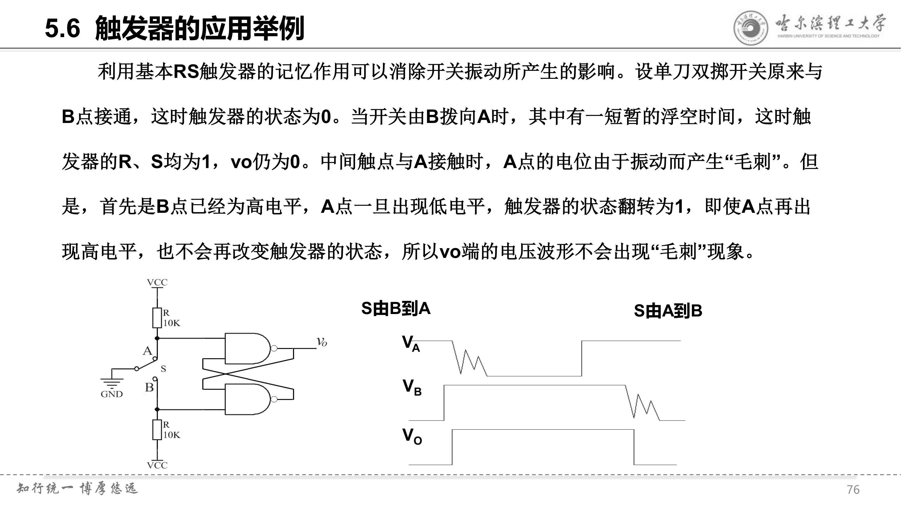
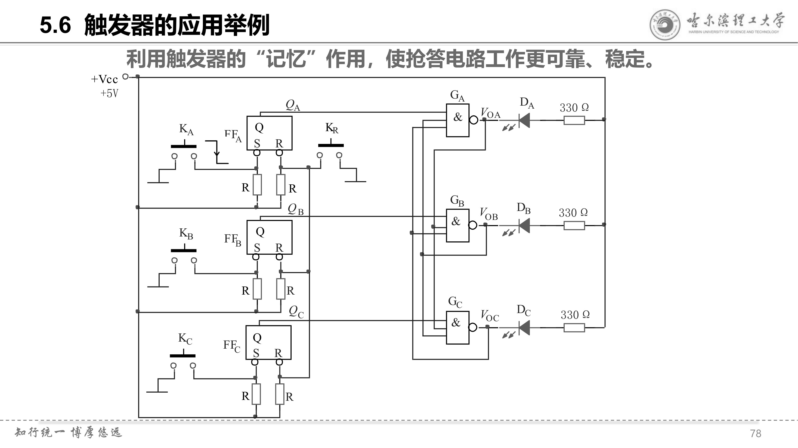

# 5.6 触发器的应用举例

> 本节对应课件《05.触发器（6学时）》第 75~79 页。两个经典案例都围绕**同一个核心能力——"记忆"**展开：用记忆消除抖动，用记忆锁定抢答。这也是本章所有知识的落地检验。

## 一、是什么（概念与定位）

触发器在实际电路中扮演的角色，概括起来是三件事：

| 角色 | 原理 | 典型电路 |
| --- | --- | --- |
| **消抖** | 用记忆"记住第一次有效状态"，忽略后续抖动 | 机械开关去抖电路 |
| **锁定/互锁** | 一旦置位就用反馈封锁其他通道 | 抢答器、优先编码 |
| **存储/计数** | 逐拍接收、逐拍翻转 | 寄存器、计数器（第 6 章） |

本节两个案例分别对应前两个角色，都只用了**基本 RS 触发器**——最古老的触发器，却解决着最实际的问题。

## 二、原理与特性

### 1. 用基本 RS 触发器消除机械开关的抖动（课件第 75~76 页）

**（1）抖动是怎么来的**

按键用的都是**机械弹性开关**。当机械触点断开、闭合时，由于触点的**弹性作用**，开关在闭合和断开的瞬间会产生**一连串的抖动**——触点会在通/断之间快速弹跳若干次（典型持续 5~20 ms），每弹一次就在电路上产生一个"毛刺"脉冲。

**危害**：如果直接把按键信号接到计数器或中断输入端，**按一次会被计成好几次**，系统彻底失控。

**（2）电路构成**

用一只**单刀双掷开关**（$S$ 在 A、B 两点间切换）加一只**基本 RS 触发器**：

- 开关的 A 端接 $S_D$（置位端），B 端接 $R_D$（复位端）；
- 两端各经上拉电阻接 $+V_{CC}$：按键不按时，$V_O$ 输出高电平；
- 触发器输出 $V_O$ 即消抖后的干净信号。



**（3）工作过程（设开关原来接 B 点，触发器为 0 态）**

1. **开关由 B 拨向 A 的过渡期**：中间有一短暂时间**两端都悬空**，此时 $R_D=S_D=1$（上拉为高）→ 触发器**保持** 0 态，$V_O$ 仍为 0；
2. **触点刚碰到 A 但发生抖动**：A 点电位因抖动出现"毛刺"，**第一次**出现低电平时 $S_D=0$，触发器立即**翻转为 1 态**；
3. **后续抖动全部无效**：此时 $\overline{Q}=0$ 已把 $R_D$ 侧锁住，A 点再出现高电平也不会改变状态——**记忆功能把抖动"吞掉"了**；
4. 因此 $V_O$ 只在**第一次接触**时跳变一次，波形上**不出现毛刺**。

**（4）为什么能消抖——一句话总结**

抖动的本质是"**同一事件被重复报告**"，而 RS 触发器"**只认第一次**"：一旦置位，后续重复的置位信号对它毫无影响。这就是**记忆 = 滤波**的物理直觉。

> **对比软件消抖**：单片机常用"延时 10 ms 再读一次"的软件消抖，本质是**避开**抖动期；硬件 RS 消抖是**吃掉**抖动期，响应更快、不占 CPU，可靠性更高。

### 2. 三人抢答电路（课件第 77~78 页）

**（1）设计要求**

三人 A、B、C 各控制一个按键开关 $K_A$、$K_B$、$K_C$ 和一个发光二极管 $D_A$、$D_B$、$D_C$。**谁先按下开关，谁的发光二极管亮，同时使其他人的抢答信号无效**（先到先得、后来无效）。

**（2）第一版方案：纯门电路（存在问题）**

用三个与非门 $G_A$、$G_B$、$G_C$ 交叉互锁：每个门的输出都接到另外两个门的输入。



- 按键不按时，下拉电阻使 A、B、C 输出低电平；
- 某人按下 → 对应与非门输出变高 → 该高电平送到另外两个门，把它们**封锁**，其他人再按也无效。

**缺陷**：靠门的**电平**互锁，按键抖动会传递到输出；且一旦按下者松手，互锁就**解除**了，后来者又能抢——不符合"锁定到复位为止"的要求。

**（3）改进版方案：RS 触发器锁定（课件第 78 页）**

给每一路加一只**基本 RS 触发器** $FF_A$、$FF_B$、$FF_C$，并让三个触发器的**复位端连在一起**由公共复位控制：

- 每人按键接对应触发器的 $S$ 端（置位）；
- 任一触发器被置位后，其 $Q=1$ 送到另外两路的**封锁端**（接到它们的 $R$ 或门电路），使另外两路**无法被置位**；
- 灯 $D_A$、$D_B$、$D_C$ 由各触发器的 $Q$ 驱动（经 330 Ω 限流电阻）；
- 主持人按**复位键**，三只触发器同时清零，进入下一轮。

**为什么可靠**：

1. **触发器有记忆**——按一次后状态**锁死**，松手也不会丢，直到复位；
2. **RS 结构天然消抖**——抖动的重复信号被"只认第一次"的特性吃掉；
3. **互锁由硬连线完成**——不依赖软件轮询，响应在纳秒级，绝无"两人同时亮"的可能。

**（4）设计套路的提炼**

```
输入（按键 + 消抖）→ 触发器（记忆/锁定）→ 互锁逻辑（封锁他人）→ 输出（灯/显示）
                         ↑
                    公共复位
```

这个套路可以扩展到任意路抢答、任意"先到先得"的优先请求电路（总线仲裁、中断优先级排队都用同一思路）。

### 3. 本章小结（课件第 79 页）

**（1）触发器的两个基本性质**

- 在一定条件下，可维持在**两种稳定状态（0 或 1）之一保持不变**；
- 在一定的外加信号作用下，可**从一个稳定状态转变到另一个稳定状态**。

**（2）描述触发器逻辑功能的五种方法**

特性表、特性方程、驱动表、状态转换图、波形图（时序图）。

**（3）按结构分类（关注"什么时候翻"）**

| 结构 | 触发方式 |
| --- | --- |
| 基本 RS 触发器 | 电平触发 |
| 同步触发器 | 脉冲（电平）触发 |
| 主从触发器 | 脉冲触发（CP 下降沿） |
| 边沿触发器 | **边沿触发** |

**（4）按逻辑功能分类（关注"翻成什么"）**

RS 触发器、JK 触发器、T 触发器、D 触发器。

**（5）常用集成触发器**

74HC74、74HC273、74LS74、74LS112。

## 三、符号与图形（图文并茂）

1. **消抖电路的画法**：单刀双掷开关的**中间触点接地**、两个定触点分别接 $S_D$、$R_D$ 并各经上拉电阻接 $+V_{CC}$——这是最常见的画法，注意开关"拨过去"是把某一端**接地**（拉低），而不是接高。
2. **抢答电路的画法**：三路完全对称，画图时先画一路、再复制，最后统一连公共复位线，最省事也最不容易漏线。
3. **封锁线的方向**：从"已置位"的 $Q$ 出发，指向"其他路"的封锁端——箭头方向不要画反。
4. **LED 限流电阻**：330 Ω 是 5 V 供电下的典型值（约 10 mA），画图时不要漏。
5. **上拉 / 下拉电阻的区别**：消抖电路用**上拉**（不按时为高，按下拉低有效）；纯门电路抢答用**下拉**（不按时为低）。看电阻接 $+V_{CC}$ 还是接地即可判断。

## 四、典型例题/应用

**例 1**　某按键直接接计数器 CP 端，按一次计数 5 次。分析原因并给出两种解决方案。

**解答**：原因是**机械触点抖动**——一次按下产生多个脉冲，计数器把每个脉冲都计了一次。
方案一（硬件）：加**基本 RS 触发器消抖电路**，用记忆吃掉重复脉冲；
方案二（软件）：单片机中检测到按键后**延时 10~20 ms 再采样**，避开抖动期。

**例 2**　三人抢答器中，若把 RS 触发器的 $S$ 端与 $R$ 端接反，会出现什么现象？

**解答**：按键按下时送的是"复位"而不是"置位"，触发器不会被置 1，**灯不亮**；同时松手后触发器反而可能一直被清零。功能完全失效。

**例 3**　三人抢答器中，三只触发器的公共复位端为何不能省？

**解答**：因为触发器有**记忆**——一旦某人抢到，状态会**永久锁死**，若不复位，下一轮抢答时三路都处于封锁状态，谁也抢不到。公共复位的作用是**把系统恢复到初始的"全员可抢"状态**。

**例 4**　用基本 RS 触发器设计一个"双路优先请求"电路：A、B 同时请求时，规定 A 优先。

**解答**：A 的请求信号接 $FF_A$ 的 $S$ 端；B 的请求信号**先与 $\overline{Q_A}$ 相与**再送 $FF_B$ 的 $S$ 端。这样一旦 A 已置位（$Q_A=1$、$\overline{Q_A}=0$），B 的置位通道被封锁，实现"同时请求时 A 优先"。这就是**优先级的硬连线实现**。

## 五、易错点

1. **误以为 RS 触发器能消除"所有"干扰**。它只能消除**重复的、同向的**脉冲（如抖动），对**持续的、反向的**干扰无效。
2. **消抖电路的开关接法画错**。开关中间触点接地、两个定触点各经上拉电阻接电源，拨动时把某一端拉低——不是把某一端接高。
3. **抢答器忘记公共复位**。触发器记忆锁死，不复位就无法进行下一轮。
4. **互锁线方向画反**。应是"已抢到者的 $Q$ → 其他人的封锁端"，不要反向。
5. **上拉 / 下拉混用**。同一电路里既有上拉又有下拉时，务必看清每个电阻接的是电源还是地。
6. **忽略 LED 限流电阻**。直接接 5 V 会烧毁发光二极管。

## 六、知识点总结

1. 触发器的三大应用角色：**消抖（记忆滤除抖动）、锁定（先到先得互锁）、存储（逐拍接收）**。
2. 机械开关抖动持续 5~20 ms，会一次按键产生多个脉冲；**基本 RS 触发器"只认第一次"**，从而消除抖动。
3. 消抖电路 = **单刀双掷开关 + 上拉电阻 + 基本 RS 触发器**；过渡期两端皆高 → 保持，第一次接触 → 翻转并锁死。
4. 三人抢答器 = **按键 + RS 触发器（记忆）+ 交叉互锁（封锁他人）+ 公共复位 + LED**，可靠性来自硬连线互锁。
5. 本章总纲：触发器有**两个稳态**、**五种描述方法**（特性表/特性方程/驱动表/状态图/波形图）、**四种结构**（基本/同步/主从/边沿）、**四种功能**（RS/JK/T/D）；常用集成芯片为 74HC74、74HC273、74LS74、74LS112。
