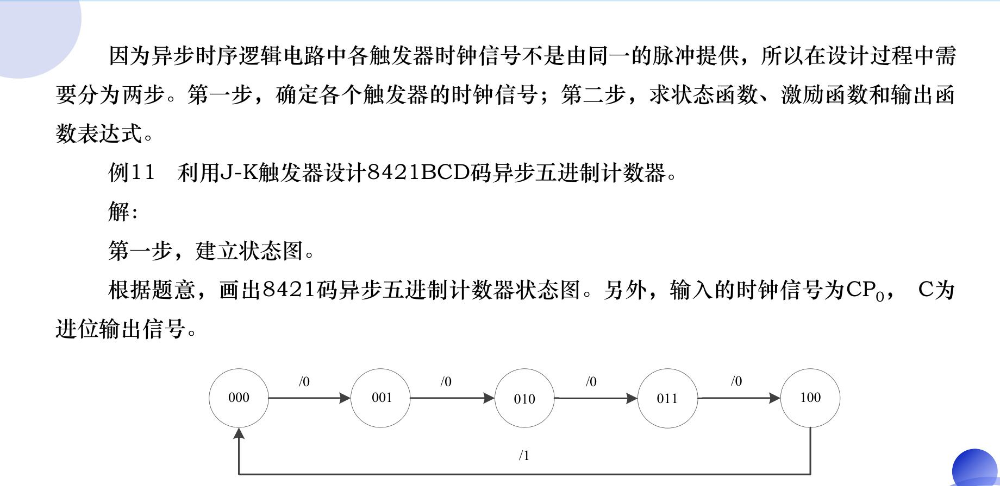
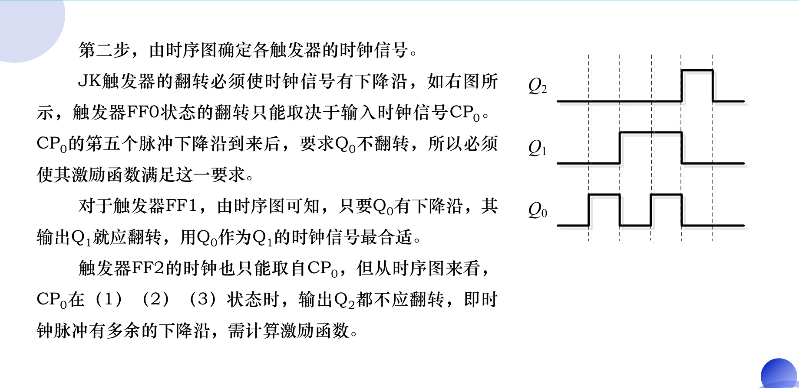
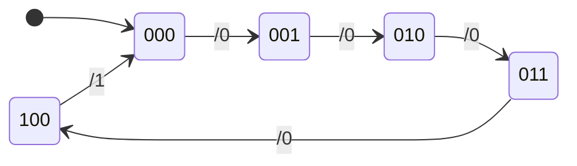
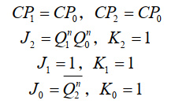

# 6.4 异步时序逻辑电路的设计（Asynchronous Design）

## 一、是什么（概念与定位）

异步时序逻辑电路中，各触发器**没有统一的时钟脉冲**，触发器的翻转时刻不完全相同。设计异步时序电路比同步电路复杂，因为除了确定激励函数和输出函数外，还必须先确定每个触发器的时钟信号。

## 二、原理与特性

### 1. 异步设计的两步法

| 步骤 | 内容 |
|------|------|
| 第一步 | 确定各触发器的时钟信号 |
| 第二步 | 求状态函数、激励函数和输出函数 |

### 异步设计两步法（课件原图）



> 课件原图（P99）：异步时序电路各触发器时钟不是由同一脉冲提供，因此设计必须**先确定每个触发器的时钟信号**，再求状态/激励/输出函数。第一步由状态图（或时序图）判断每个触发器何时需要翻转，从而选定其 CP 来源；第二步才做激励函数卡诺图化简。

### 2. 时钟信号选择原则

- 触发器需要翻转时，必须给它提供有效时钟沿（上升沿或下降沿）。
- 触发器不需要翻转时，即使有时钟沿到来，也要通过激励函数使其保持原态。
- 通常优先用相邻低位触发器的输出作为高位触发器的时钟，形成逐级触发。

### 由时序图确定各触发器时钟（课件原图）



> 课件原图（P100）：JK 触发器翻转必须出现**下降沿**。以 8421BCD 异步五进制计数器为例：FF0 每来一个 CP 就翻转 → `CP₀ = CP`；只要 Q₀ 有下降沿 Q₁ 就翻转 → `CP₁ = Q₀`（下降沿）；FF2 时钟取自 `CP₀`，但需通过激励函数约束多余下降沿。选取相邻低位输出作高位时钟，是异步计数器最典型的时钟方案。

### 3. 状态表写法

异步电路的状态表中，需要增加**时钟信号列**，标明每个状态下各触发器是否接收到有效时钟沿：

| 现态 Q₂Q₁Q₀ | 次态 | CP₂ CP₁ CP₀ | 说明 |
|-------------|------|-------------|------|
| 000 | 001 | ↑ 0 ↑ | FF0、FF2 有 CP，FF1 无 |
| 001 | 010 | ↑ ↑ ↑ | 三个 FF 都有 CP |

没有有效时钟时，触发器状态不变，激励项可作为无关项处理。

## 三、符号与图形

### 例：8421 BCD 码异步五进制计数器

**状态转换图**：



有效状态为 000→001→010→011→100，进位输出 C 在 100→000 时产生。

**时钟与激励方程示例**：



由图可知：
- CP₁ 取自 Q₀ 的下降沿，因为 FF1 需要 Q₀ 翻转时产生借位/进位。
- CP₀ 与 CP₂ 取自外部计数脉冲 CP。
- 各 JK 触发器根据状态转移需求确定 J、K 值。

## 四、典型例题/应用

### 例题：用 JK 触发器设计 8421 BCD 码异步五进制计数器

**步骤 1：建立状态图**

状态转换顺序：

```
000 → 001 → 010 → 011 → 100 → 000
```

**步骤 2：确定各触发器时钟**

根据状态变化画出时序图：

- Q₀ 每个 CP 都翻转 → CP₀ = CP
- Q₁ 在 Q₀ 产生下降沿时翻转 → CP₁ = Q₀（下降沿）
- Q₂ 只在特定 CP 沿翻转 → CP₂ = CP

**步骤 3：列状态表**

将 CP₂、CP₁、CP₀ 列入状态表，根据每个触发器是否需要翻转填写 J、K。

**步骤 4：求激励函数和输出函数**

对 J、K 和进位输出 C 分别画卡诺图并化简。

**步骤 5：画逻辑图**

按求得的时钟方程、驱动方程和输出方程连接电路。

**步骤 6：检查自恢复**

无效状态为 101、110、111。将这些状态代入状态方程，验证在 CP 作用下能否回到有效循环。若能回到有效状态，则电路具有自恢复功能。

## 五、易错点

1. **遗漏时钟方程**：异步电路必须分析每个触发器的时钟来源。
2. **时钟沿判断错误**：JK 触发器用下降沿时，应接 Q₀；用上升沿时，应接 Q̄₀。
3. **无效时钟沿导致状态不变**：状态表中要标明某触发器是否有时钟有效沿，无有效沿时次态等于现态。
4. **把同步设计方法直接套用到异步电路**：异步设计要先确定 CP，不能默认所有触发器同时翻转。
5. **自恢复检查不完整**：异步电路的无效状态转移也要逐状态验证。

## 六、知识点总结

| 要点 | 核心内容 |
|------|----------|
| 核心难点 | 各触发器时钟不同源 |
| 设计顺序 | 先定 CP，再求激励/输出 |
| 状态表 | 必须包含 CP 列 |
| 常见结构 | 低位输出作为高位时钟 |
| 可靠性检查 | 验证无效状态能否回到有效循环 |

异步时序电路速度比同步电路慢，但电路结构可能更简单。设计时最关键的是**正确选择各级触发器的时钟信号**。
