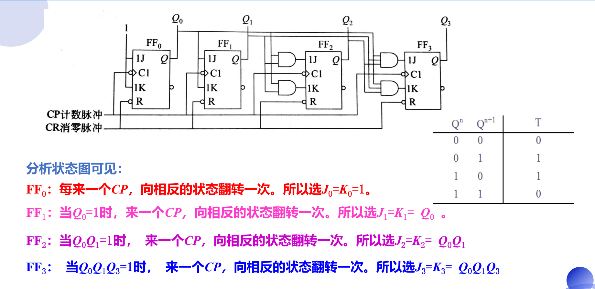
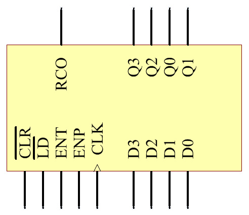
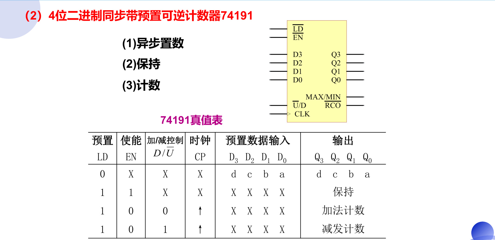
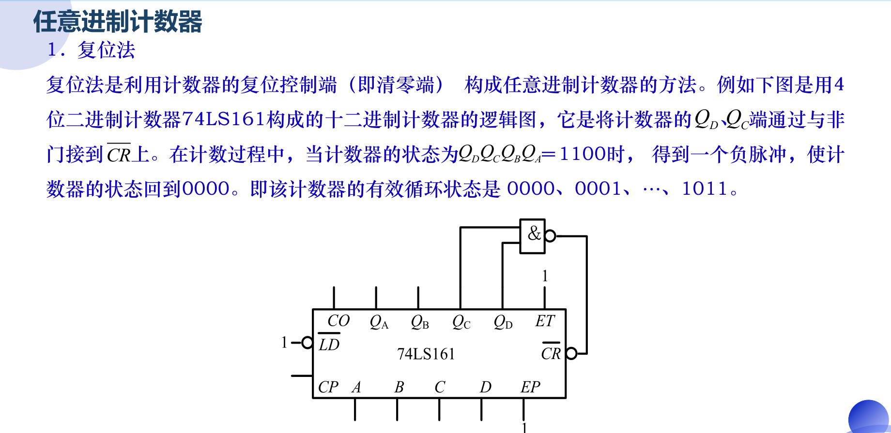
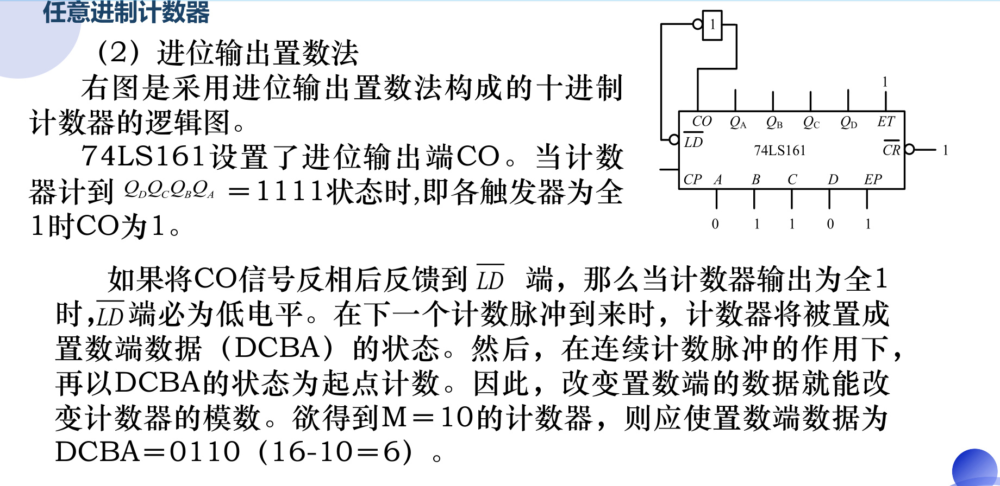
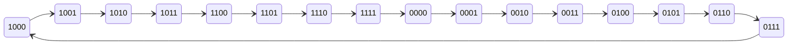

# 6.5 计数器（Counters）

## 一、是什么（概念与定位）

计数器（Counter）是用来统计输入时钟脉冲 CP 个数的时序逻辑电路，是数字系统中最常用的时序器件之一。

主要应用：
- **分频**：N 进制计数器可将 CP 频率除以 N。
- **定时**：结合已知频率产生定时信号。
- **节拍脉冲/序列脉冲**：用于控制程序执行步骤。
- **数字运算**：如频率测量、地址生成等。

## 二、原理与特性

### 1. 计数器分类

| 分类依据 | 类型 |
|----------|------|
| 计数进制 | 二进制计数器、非二进制计数器（如十进制） |
| 增减趋势 | 加法计数器、减法计数器、可逆计数器 |
| 时钟方式 | 同步计数器、异步计数器 |

### 2. 二进制异步计数器

由多个 JK 触发器接成 T' 触发器（J=K=1）构成，下降沿触发。

**进位规则**：

```
CP₀ = CP
CP₁ = Q₀
CP₂ = Q₁
CP₃ = Q₂
```

每当低位触发器从 1 变为 0 时，产生一个下降沿，使相邻高位触发器翻转一次。

**特点**：结构简单、速度较慢；高位翻转必须等待低位进位信号传递。

### 3. 二进制同步计数器

所有触发器共用同一 CP，状态同时变化。

| 触发器 | JK 端接法（加法） |
|--------|-------------------|
| FF0 | J₀ = K₀ = 1 |
| FF1 | J₁ = K₁ = Q₀ |
| FF2 | J₂ = K₂ = Q₀·Q₁ |
| FF3 | J₃ = K₃ = Q₀·Q₁·Q₂ |

**减法计数器**：将上述 Q 换成 Q̄。

**可逆计数器**：引入加减控制信号 X，X=1 做加法，X=0 做减法。

### 同步二进制计数器驱动方程（课件原图）



> 课件原图（P112）：由 4 位同步二进制加法计数器的状态图直接读驱动方程：FF0 每来一个 CP 翻转 → `J₀=K₀=1`；FF1 当 Q₀=1 时翻转 → `J₁=K₁=Q₀`；FF2 当 Q₀Q₁=1 时翻转 → `J₂=K₂=Q₀Q₁`；FF3 → `J₃=K₃=Q₀Q₁Q₂`。减法计数器把各 Q 换成 Q̄；可逆计数器由 X 控制各 J、K 与低位 Q 或 Q̄ 相连。

### 4. 集成二进制计数器 74161



| 引脚 | 功能 |
|------|------|
| CLR | 异步清零，低电平有效 |
| LD | 同步预置数控制，低电平有效 |
| ENP、ENT | 计数使能 |
| CLK | 时钟输入 |
| D₃~D₀ | 预置数据输入 |
| Q₃~Q₀ | 计数输出 |
| RCO | 进位输出 |

**74161 功能表**：

| CLR | LD | ENP | ENT | CLK | 功能 |
|-----|----|-----|-----|-----|------|
| 0 | × | × | × | × | 异步清零 |
| 1 | 0 | × | × | ↑ | 同步置数 |
| 1 | 1 | 0 | × | × | 保持 |
| 1 | 1 | × | 0 | × | 保持 |
| 1 | 1 | 1 | 1 | ↑ | 计数 |

### 4-2. 集成二进制同步可逆计数器 74191（课件原图）



74191 为 4 位二进制**同步可逆**计数器，主要引脚/功能：

- **异步置数**（`LD` 低电平有效，与 CP 无关立即置数）；**保持**（使能 `EN=1` 时保持）。
- 具有 **MAX/MIN** 最大/最小控制端与 **RCO** 进位/借位输出端：加法计到最大值 1111 时 MAX/MIN=1、若 CLK=0 则 RCO 发进位；减法计到最小值 0000 时发借位。
- 方向控制：决定加/减计数，配合级联可构成多位可逆计数器（见例题级联）。

### 5. 用集成计数器构成任意进制计数器（清零法 / 预置数法）

集成计数器（74161/74160/74163/74191）本身为固定进制，通过**反馈置零/置数**可截出任意 M 进制。

**① 复位法（异步清零）**（课件原图，P126）：



> 利用计数器的清零端（异步）构成任意进制。例：4 位计数器在计到某一状态（如 1100）时，经门电路使 `CLR=0`，立即清零回到 0000，从而截出所需进制。**异步清零一到状态立即清零**，故译码状态取 M。

**② 预置数法**（课件原图，P129）：



> 利用同步/异步预置端，在计到某状态时把预置数据置入。状态译码置数法对 `M-1`（同步置数，预置 0000）或 `N+M-1`（预置初值 N）译码；进位输出置数法用 RCO 触发置数。注意：**同步预置要在下一 CP 沿才完成置入**，故译码状态比异步清零少 1（取 M-1 而非 M）。

## 三、符号与图形

### 4 位二进制同步加法计数器状态转移



## 四、典型例题/应用

### 例题 1：用 74161 构成十二进制计数器（复位法）

当计数器状态到达 1100 时，用与非门检测该状态，产生清零脉冲使 CLR=0，计数器回到 0000。

有效循环：0000 → 0001 → … → 1011 → 0000，共 12 个状态。

### 例题 2：用 74161 构成 M 进制计数器（同步预置数法）

利用同步置数端 LD，当计数到某个状态时，下一个 CP 将预置数据 D₃D₂D₁D₀ 置入。

若预置数 N=0，要构成 M 进制计数器，译码门应对 **M-1** 对应的状态译码。

若预置数 N≠0，译码门应对 **N+M-1** 对应的状态译码。

### 例题 3：计数器级联

两片 74161 同步级联可构成 8 位二进制计数器，模为 16×16=256。低位片的 RCO 接高位片的 ENT，实现进位扩展。

## 五、易错点

1. **异步清零与同步清零混淆**：异步清零一到状态立即清零；同步清零要等下一个 CP 沿才清零。
2. **预置数法译码状态算错**：同步预置应对 M-1（或 N+M-1）状态译码，而不是 M。
3. **74161 的 ENP、ENT 同时置 1 才计数**：只置一个会保持。
4. **分频比与计数模数关系搞反**：N 进制计数器实现 N 分频，输出频率 f_out = f_CP / N。
5. **异步计数器速度受限**：高位翻转依赖低位进位传递，存在累积延迟。

## 六、知识点总结

| 类型 | 特点 | 适用场景 |
|------|------|----------|
| 异步二进制计数器 | 结构简单、速度慢 | 低速、简单计数 |
| 同步二进制计数器 | 速度快、结构稍复杂 | 高速计数 |
| 集成计数器 74161 | 异步清零、同步预置 | 构成任意进制计数器 |
| 集成计数器 74191 | 可逆计数 | 加减计数 |

计数器 = 时序电路 + 计数规则。掌握**清零法、预置数法、级联法**是用好集成计数器的关键。
