# 6.1 放大器与集成运放基础（Operational Amplifier Basics）

> 对应课件《07.集成运算放大器和脉冲波形的产生与变换》7.1 节，本资料按章节顺序编号为 6.1。

## 一、是什么（概念与定位）

**集成运算放大器**（简称集成运放、运放）是用集成工艺把整个多级直接耦合放大电路做在一块硅片上、再封装在管壳内的通用模拟器件。它的本质是一个**开环电压增益极高**的差分放大器。

本章是全书从"数字"转向"模拟—数字交界"的一章：运放本身是模拟器件，但它构成的**比较器、多谐振荡器、施密特触发器、单稳态触发器**是数字系统获取与整形脉冲信号的基础单元，所以放在数字电路课的末尾讲授。

三种基本输入方式：
- **反相输入**：同相端接地，信号从反相端与地之间输入，输出与输入反相。
- **同相输入**：反相端接地，信号从同相端与地之间输入，输出与输入同相。
- **差分输入**：信号从两输入端之间输入，或两输入端都有信号。

## 二、原理与特性

### 1. 集成运放的内部组成

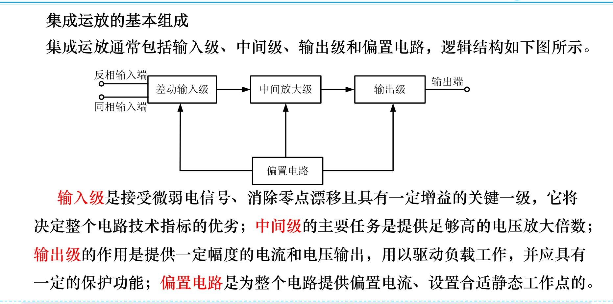

> 课件原图（P7）：集成运放由**输入级、中间级、输出级、偏置电路**四部分构成。输入级是差动放大电路，负责接受微弱电信号、消除零点漂移并提供一定增益，**决定整个电路技术指标的优劣**；中间级提供足够高的电压放大倍数；输出级提供一定幅度的电流和电压以驱动负载，并带保护功能；偏置电路为各级提供偏置电流、设置合适的静态工作点。

### 2. 图形符号与引脚含义

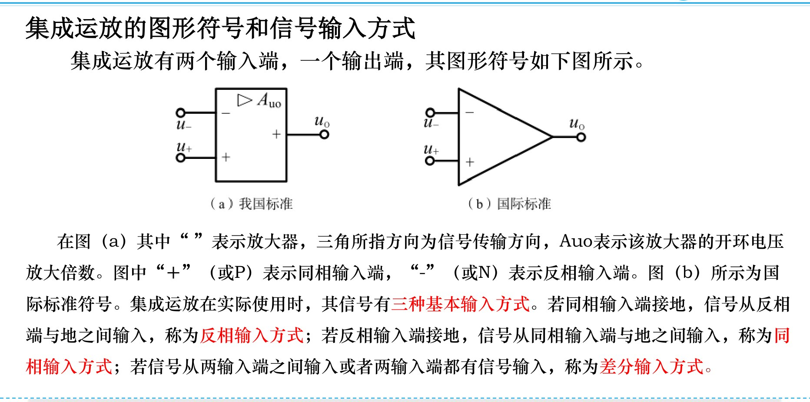

> 课件原图（P8）：三角形表示放大器，尖端指向信号传输方向，`Auo` 为开环电压放大倍数。"＋"（或 P）为**同相输入端**，"−"（或 N）为**反相输入端**。图（b）为国际标准符号。信号从反相端与地之间输入叫反相输入，从同相端与地之间输入叫同相输入，从两输入端之间输入叫差分输入。

### 3. 差分放大电路：共模与差模

基本差分放大电路由两只完全对称的晶体管 V1、V2 和两个集电极电阻 Rc1、Rc2 构成，发射极共用电阻 Re 接负电源。

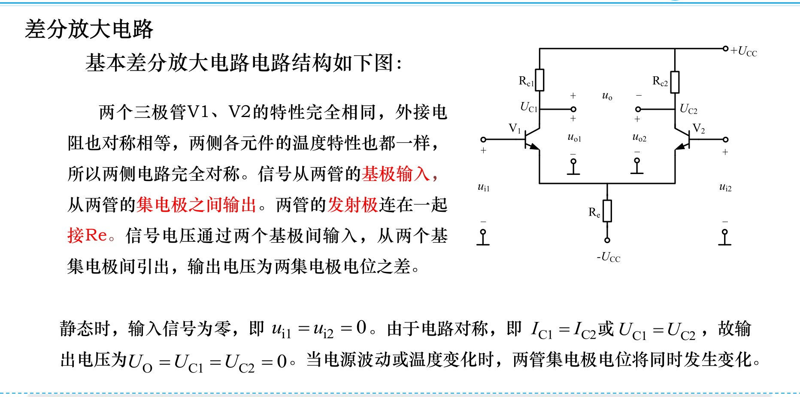

> 课件原图（P12）：基本差分放大电路结构。电路完全对称时，两管集电极静态电位相等，静态输出电压 uo = 0，这是它抑制零点漂移的根本原因。

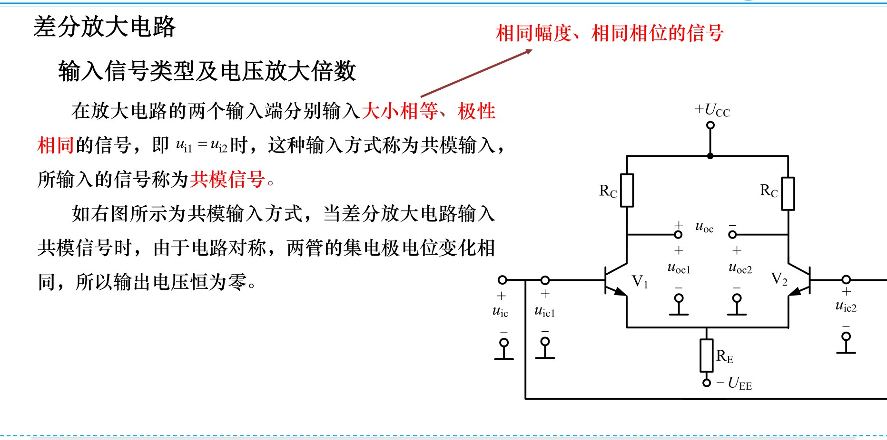

> 课件原图（P13）：**共模输入**——两输入端输入大小相等、极性相同的信号（ui1 = ui2）。由于电路对称，两管集电极电位变化相同，**输出电压恒为零**，即共模电压放大倍数 Ac = 0。温度漂移、工频干扰都属于共模信号，这正是差分电路要抑制的对象。

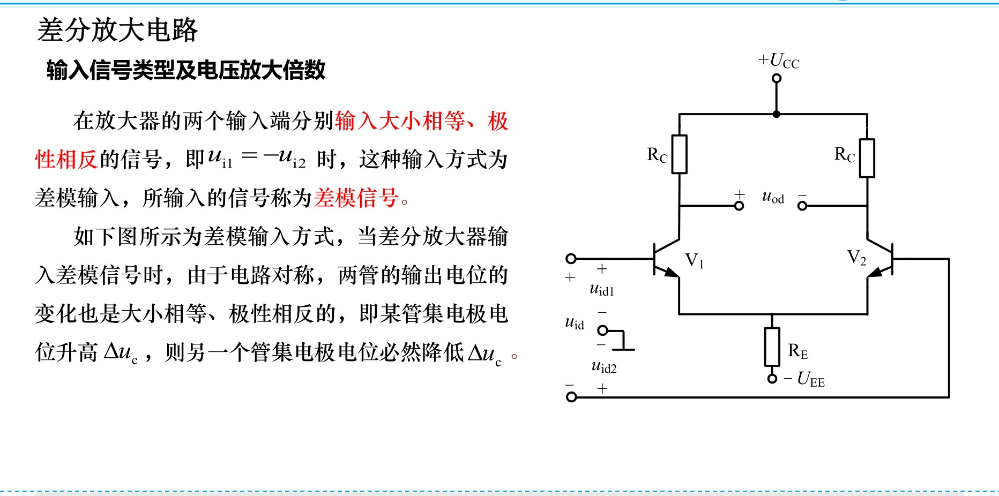

> 课件原图（P14）：**差模输入**——两输入端输入大小相等、极性相反的信号（ui1 = −ui2）。由于电路对称，两管输出电位变化大小相等、极性相反：一管集电极电位升高 Δ，另一管必然降低 Δ，于是输出端得到 2Δ 的电压，即单端输出的两倍。

设每管电压放大倍数为 A，则：

```
uo1 = A·uid1 ,  uo2 = A·uid2

双端输出：uo = uo1 − uo2 = A(uid1 − uid2) = A·uid  →  Ad = uo/uid = A
```

**结论：差分放大电路的差模电压放大倍数等于组成它的半边电路的放大倍数。**

输入电阻 rid = 2rbe（信号回路经过两个发射结）；输出电阻 rod = 2Rc（双端输出时经过两个 Rc）。

当两个输入信号既非纯共模又非纯差模时，先分解：

```
差模信号  uid = ui1 − ui2
共模信号  uic = (ui1 + ui2) / 2
```

### 4. 共模抑制比 KCMR

为全面衡量"放大差模、抑制共模"的能力，定义

```
KCMR = |Ad / Ac|          （倍数形式）
KCMR = 20 lg |Ad / Ac|    （dB 形式）
```

KCMR 越大，放大有用信号、抑制无用信号的能力越强，性能越好。理想运放 KCMR → ∞。

### 5. 长尾式差分电路的改进：恒流源

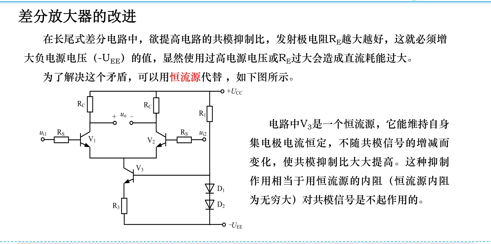

> 课件原图（P19）：要提高共模抑制比，发射极电阻 RE 越大越好，但这必须增大负电源 −UEE，直流耗能过大。解决办法是用**恒流源 V3 代替 RE**：恒流源维持自身集电极电流恒定，不随共模信号增减而变化，共模抑制比大大提高，同时不必用很高的电源电压。

### 6. 主要参数

| 参数 | 含义 |
|------|------|
| 开环差模电压放大倍数 Auo | 无反馈时 uo 与差模输入 (u+ − u−) 之比 |
| 输入失调电压 UIO | 输入为零时输出不为零，该输出折合到输入端的值 |
| 输入失调电流 IIO | 输入为零时，输入级两差动管静态基极电流之差 |
| 输入偏置电流 IIB | 输入为零时，两差动管静态基极电流的平均值 |
| 最大差模输入电压 UIND | 两输入端之间允许加载的最大差模电压 |
| 最大共模输入电压 UICM | 保证正常工作的共模输入电压 |
| 差模输入电阻 rid | 加差模信号时的交流输入电阻 |
| 差模输出电阻 rod | 开环下输出电压变化量与输出电流变化量之比 |
| 最大输出电压 Uopp | 放大状态下能输出的最大电压幅度 |

### 7. 理想运放与两条金律

理想化条件：

```
Auo → ∞       rid → ∞       ro → 0       KCMR → ∞       无失调
```

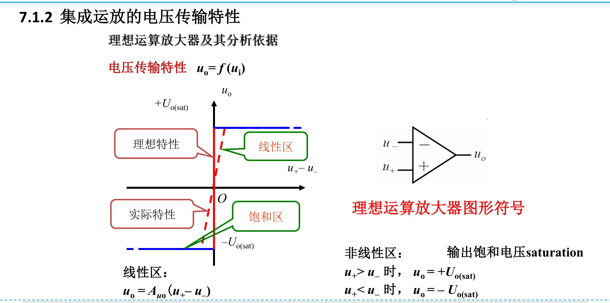

> 课件原图（P25）：电压传输特性 uo = f(ui)。**线性区**很窄，uo = Auo(u+ − u−)，斜率为 Auo（理想时是一条竖直线）；超出 ±Uo(sat) 后进入**饱和区**，输出只有 +Uo(sat) 和 −Uo(sat) 两种状态。
> - 线性区：u+ = u− 时 uo = 0；u+ > u− 时 uo > 0
> - 非线性区：u+ > u− 时 uo = +Uo(sat)；u+ < u− 时 uo = −Uo(sat)

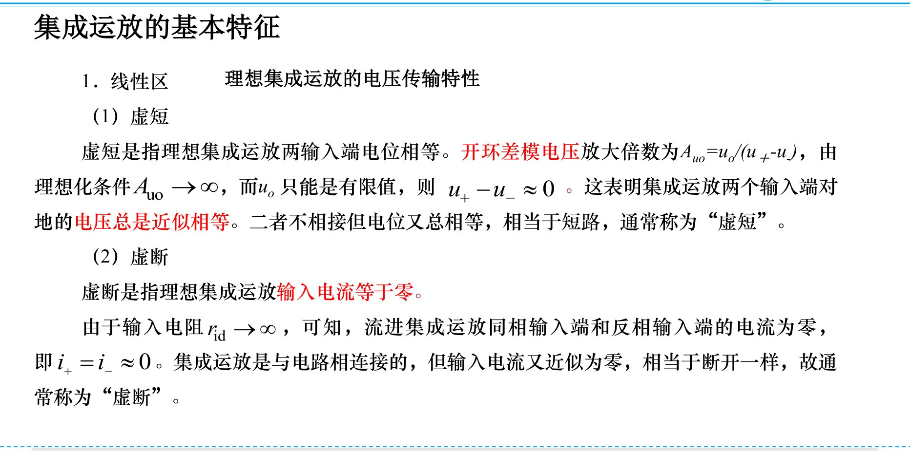

> 课件原图（P26）：线性区的两条分析依据。
> - **虚短**：Auo → ∞ 而 uo 是有限值，故 u+ − u− = uo/Auo → 0，即 **u+ ≈ u−**。两端并未短接，电位却总相等，故称"虚短"。
> - **虚断**：rid → ∞，故流入两输入端的电流 **i+ = i− ≈ 0**。输入端与电路相连，电流却近似为零，相当于断开，故称"虚断"。

非线性区（开环或接正反馈）：
- **虚短不再成立**——输出只有 ±Uo(sat) 两态，u+ 与 u− 不再相等；
- **虚断仍然成立**——rid → ∞，输入电流依旧为零。

### 8. 反馈的基本概念与类型判断

反馈：把放大电路输出信号（电压或电流）的一部分或全部送回输入端，与输入信号相合成的过程。

| 分类 | 判据 |
|------|------|
| 正反馈 / 负反馈 | 反馈信号使净输入**增强**为正反馈，**减弱**为负反馈 |
| 直流 / 交流反馈 | 按反馈量是直流量还是交流量区分 |
| 电压 / 电流反馈 | 反馈信号取自输出电压还是输出电流 |

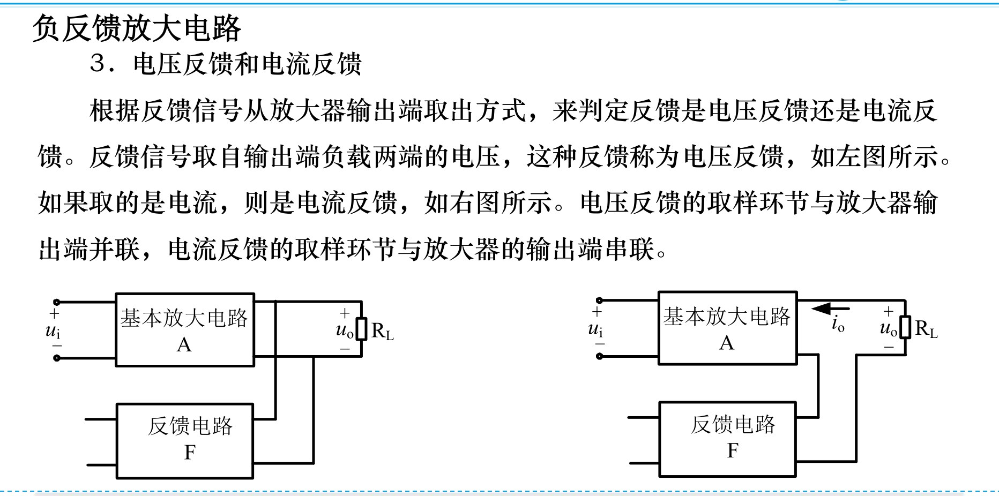

> 课件原图（P29）：**电压反馈**的取样环节与输出端**并联**（反馈信号取自负载两端电压，如左图）；**电流反馈**的取样环节与输出端**串联**（反馈信号取自输出电流，如右图）。

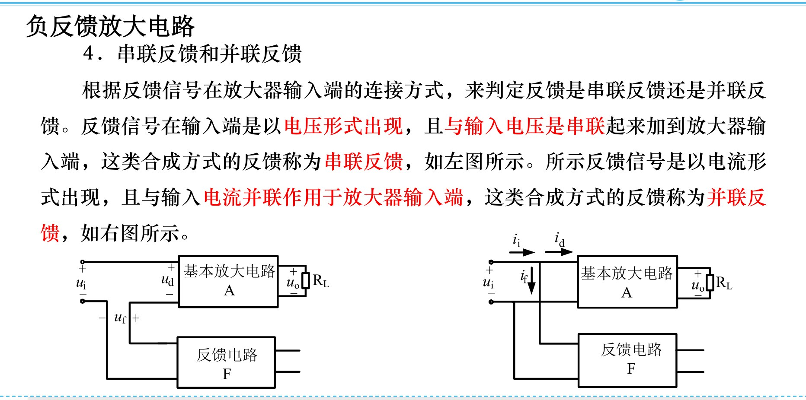

> 课件原图（P30）：**串联反馈**——反馈信号以电压形式出现，与输入电压串联加到放大器输入端（左图）；**并联反馈**——反馈信号以电流形式出现，与输入电流并联作用于输入端（右图）。

**三种实用的判断方法**（课件 P31）：

1. **正/负反馈**：用瞬时极性法——设输入为"＋"，逐级标出极性，看反馈信号回到输入端时的极性；使净输入增强为正反馈，减弱为负反馈。
2. **电压/电流反馈**：**输出端短路法**——假设 uo = 0（输出端短路），若反馈仍存在，说明反馈量不与输出电压成正比，是**电流反馈**；若反馈消失，是**电压反馈**。
3. **串联/并联反馈**：**输入短接法**——把输入端短路，若反馈信号也被短路，是**并联反馈**；反之是**串联反馈**。另有**快速法**：反馈信号接到输入端点（基极/栅极）为并联，接到非输入端点（发射极/源极）为串联。

> **课件原图（P32）**：课件在此处给出两个反馈判断例题（射极输出器、两级放大电路），图见本节「例题 1」。判断顺序是：**输出短路法定电压/电流 → 输入短接法定串联/并联 → 瞬时极性法定正负**。

### 9. 负反馈对性能的影响

1. **放大倍数降低，但稳定性提高**：Af = A/(1 + AF)，分母 1 + AF 为反馈深度。
2. **非线性失真减小**：输出幅度被压缩，工作范围更线性。
3. **输入电阻**：**串联**负反馈使输入电阻**变大**；**并联**负反馈使输入电阻**变小**。
4. **输出电阻**：**电压**负反馈使输出电阻**减小**（恒压输出）；**电流**负反馈使输出电阻**增大**（恒流输出）。

### 10. 开环工作的比较器

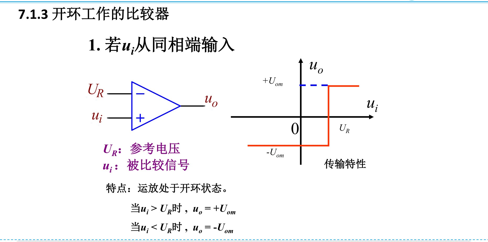

> 课件原图（P36）：运放处于开环状态即为比较器。UR 为参考电压，ui 为被比较信号。**信号从同相端输入**时：ui > UR → uo = +Uom；ui < UR → uo = −Uom。传输特性在 ui = UR 处垂直跳变。

信号从**反相端**输入时，逻辑正好相反：ui < UR → uo = +Uom；ui > UR → uo = −Uom。

**过零比较器**：当 UR = 0 时，比较器在输入过零点翻转。

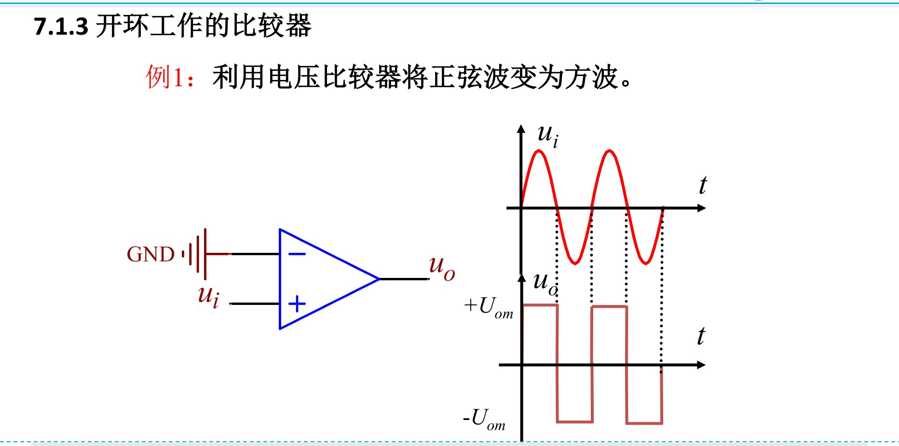

> 课件原图（P39）：比较器的典型用途——**把正弦波变换为方波**。输入正弦波过参考电平时输出在 ±Uom 之间跳变，得到占空比 50% 的方波。

### 11. 迟滞比较器（施密特触发器型比较器）

开环比较器在输入信号带噪声时会在阈值附近反复翻转。引入**正反馈**后形成两个不同的门限，即可消除这一问题。

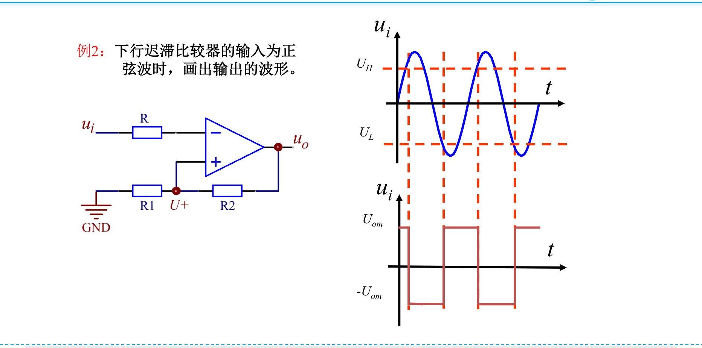

> 课件原图（P42）：**下行迟滞比较器**输入正弦波时的输出波形。由于存在上门限 UH 与下门限 UL，输出不是在一个电平上翻转，而是在两个电平之间"回差"，形成典型的迟滞回线，输出边沿干净。

设正反馈网络由 R1、R2 分压，则：

```
uo = +Uom 时：  UH = R1/(R1+R2) · Uom        （上门限）
uo = −Uom 时：  UL = −R1/(R1+R2) · Uom       （下门限）
回差电压：      ΔU = UH − UL = 2R1/(R1+R2) · Uom
```

若在同相端另加参考电压 UR，两个门限整体平移，**回差宽度不变**。

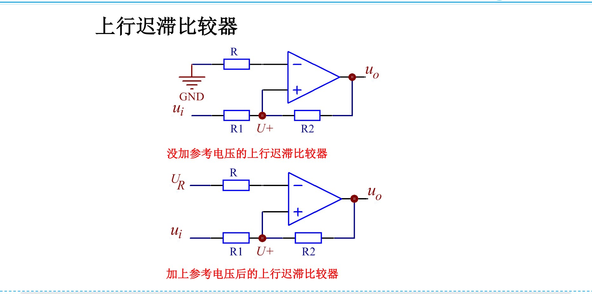

> 课件原图（P45）：**上行迟滞比较器**与**下行迟滞比较器**的对比。二者电路结构相同，区别在于被比较信号加在哪个输入端（或参考电压的接入端不同），导致传输特性的跳变方向相反：上行型在 ui 上升时先跳到低电平，下行型先跳到高电平。加参考电压后，两个门限随之整体移动。

## 三、符号与图形

### 集成运放三种输入方式速记

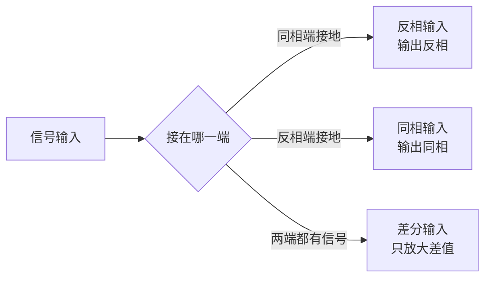

### 运放工作状态判断

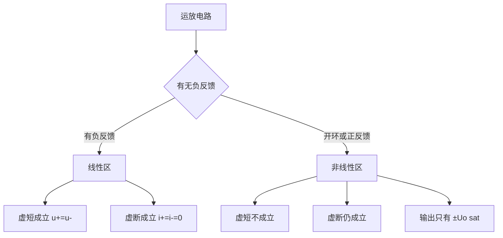

## 四、典型例题/应用

### 例题 1：判断反馈类型（课件 P32 例1，两个电路）

**题干**：判别图（a）和图（b）两个电路中，反馈元件 Rf 引进的是哪一种反馈类型？

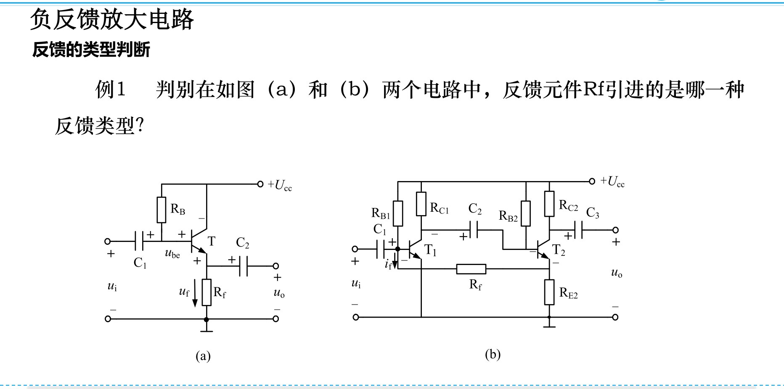

**（a）射极输出器电路**

Rf 接在 T 的发射极与地之间，输出电压 uo 从发射极引出（经 C2），反馈电压 uf 就是 Rf 两端的电压。

1. **电压/电流**：输出短路法——令 uo = 0（发射极对地交流短路），uf 随之消失 → 反馈量正比于输出电压 → **电压反馈**。
2. **串联/并联**：输入短接法——把输入端短路，反馈信号加在发射极（非输入端点），不被短路 → **串联反馈**。
3. **正/负**：瞬时极性法——ui 升高 → ue 升高 → uf 升高 → ube = ui − uf 减小 → 净输入减弱 → **负反馈**。

**结论（a）：电压串联负反馈**（这是典型的射极输出器）。

**（b）两级阻容耦合放大电路**

Rf 一端接 T2 的发射极（RE2 上端），另一端接回 T1 的基极。

1. **电压/电流**：输出 uo 取自 T2 **集电极**，而反馈取自 T2 **发射极**。若令 uo = 0（集电极对地短路），T2 发射极电流依然存在、Rf 上依然有反馈电压 → 反馈不随 uo 消失 → **电流反馈**。
2. **串联/并联**：反馈信号送回到 T1 的**基极**（正是输入节点），输入端一短接反馈就被短路 → **并联反馈**（也可用快速法：接基极为并联）。
3. **正/负**：ui 升高 → T1 基极升高 → T1 集电极降低 → T2 基极降低 → T2 发射极降低 → 经 Rf 使 T1 基极降低，削弱净输入 → **负反馈**。

**结论（b）：电流并联负反馈**。

**易错点**：
- 只看 Rf 接在发射极上就判成串联——（b）中 Rf 虽然接在 T2 发射极，但它回接的是 T1 的**基极**，所以是并联。
- 只看 Rf 取自发射极就判成电流——（a）中 Rf 也是发射极电阻，但输出 uo 恰好在发射极，故而是电压反馈。**判断电压/电流要看"输出端取在哪里"，不是看"反馈端接在哪里"。**

### 例题 2：用比较器把正弦波变成方波

**题干**：输入 ui = 5sin(ωt) V，参考电压 UR = 0，运放开环，±Uom = ±12 V，画输出波形。

**思路**：过零比较器，ui 每次过零时输出翻转。

**解答**：

```
ui > 0  →  uo = +12 V
ui < 0  →  uo = −12 V
```

输出为与输入同频、幅度 ±12 V、占空比 50% 的方波。

**易错**：若信号从反相端输入，输出极性要整体反过来（ui > 0 时输出 −12 V）。

### 例题 3：迟滞比较器门限计算

**题干**：迟滞比较器中 R1 = 10 kΩ、R2 = 20 kΩ，Uom = ±10 V，求上、下门限与回差。

**解答**：

```
UH = R1/(R1+R2)·Uom = 10/30 × 10 = +3.33 V
UL = −R1/(R1+R2)·Uom = −3.33 V
ΔU = UH − UL = 6.67 V
```

**易错**：把 UH 当成 Uom 本身。门限一定小于饱和输出电压，比例由分压电阻决定。

## 五、易错点

1. **虚短只在负反馈（线性区）成立**，开环或正反馈时运放处于非线性区，u+ ≠ u−，但虚断仍然成立。
2. **共模信号被完全抑制的前提是电路完全对称**；单端输出时共模抑制能力下降。
3. **差模放大倍数等于半边电路放大倍数**，但输入/输出电阻要按双端计（2rbe、2Rc），别混用。
4. **电压/电流反馈看取样方式，串联/并联看比较方式**，两个维度独立，不要合并成一个判断。
5. **正反馈不一定是坏事**：迟滞比较器、多谐振荡器都是靠正反馈工作的。
6. **比较器的输出电平由饱和电压决定**，与输入差值大小无关，不能当放大器用。

## 六、知识点总结

| 概念 | 核心结论 |
|------|----------|
| 理想运放 | Auo→∞、rid→∞、ro→0、KCMR→∞、无失调 |
| 线性区 | 虚短 u+=u−，虚断 i+=i−=0 |
| 非线性区 | 虚短失效，虚断仍成立，输出 ±Uo(sat) |
| 差分放大 | Ad = 半边电路放大倍数；KCMR = \|Ad/Ac\| |
| 反馈判断 | 极性法定正负，输出短路法定电压/电流，输入短接法定串/并联 |
| 负反馈影响 | 串联 Ri↑、并联 Ri↓；电压 Ro↓、电流 Ro↑ |
| 比较器 | 开环工作，输出只有高低两态，阈值由 UR 决定 |
| 迟滞比较器 | 正反馈产生双门限，回差 ΔU = 2R1/(R1+R2)·Uom |

运放这一节的全部分析都建立在一句话上：**"负反馈 → 线性区 → 虚短虚断；开环或正反馈 → 非线性区 → 只剩虚断"**。判断电路属于哪一种，再套对应工具，就不会错。
