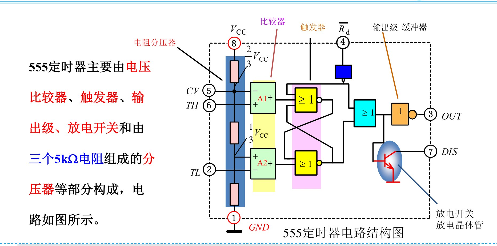
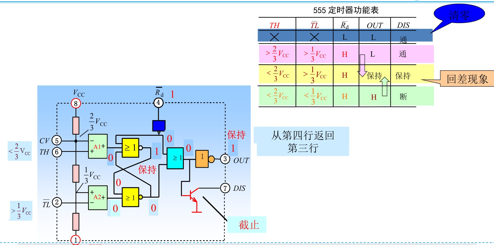
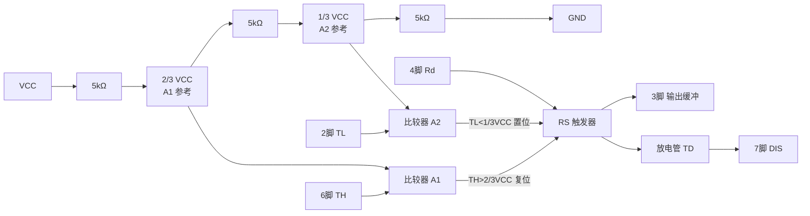

# 6.3 集成 555 定时器（555 Timer）

> 对应课件《07.集成运算放大器和脉冲波形的产生与变换》7.3 节，本资料按章节顺序编号为 6.3。

## 一、是什么（概念与定位）

**555 定时器**（又称时基电路）是一种用途广泛的**模拟—数字混合集成电路**。它内部同时包含模拟的比较器和数字的 RS 触发器，只需外接少量电阻电容，就能构成单稳态触发器、多谐振荡器、施密特触发器、压控振荡器等多种脉冲电路。

它是本章的核心器件：6.4–6.6 三节讲的三种脉冲电路，全部是 555 + 少量外围元件构成的。

## 二、原理与特性

### 1. 内部结构



> 课件原图（P55）：555 定时器由**电阻分压器、两个比较器、RS 触发器、输出级（缓冲器）、放电开关（放电晶体管）**五部分构成。
> - **电阻分压器**：三个 5 kΩ 电阻串联在 VCC 与地之间（"555"这个名字就来自这三个 5 kΩ）。上比较器 A1 的参考端取 **2/3 VCC**，下比较器 A2 的参考端取 **1/3 VCC**。
> - **比较器 A1**：同相端接 2/3 VCC，反相端接高触发端 TH（6 脚）。TH > 2/3 VCC 时 A1 输出高电平，使触发器**复位（R）**。
> - **比较器 A2**：反相端接 1/3 VCC，同相端接低触发端 TL（2 脚）。TL < 1/3 VCC 时 A2 输出高电平，使触发器**置位（S）**。
> - **RS 触发器**：接收两个比较器的信号，决定输出状态；同时控制放电管 TD 的导通与截止。
> - **放电开关 TD**：输出为低时 TD 导通（7 脚对地短路），输出为高时 TD 截止（7 脚悬空）。
> - **输出级缓冲器**：提高带负载能力。

### 2. 引脚功能（8 脚双列直插）

| 引脚 | 名称 | 功能 |
|------|------|------|
| 1 | GND | 接地 |
| 2 | TL（低触发端） | 电压 < 1/3 VCC 时使输出置位（高电平） |
| 3 | OUT | 输出端 |
| 4 | Rd（复位端） | 低电平有效，强制输出清零（低电平） |
| 5 | CV（电压控制端） | 外接电压可改变上比较器的参考电平（2/3 VCC），平时经 0.01 μF 电容接地 |
| 6 | TH（高触发端） | 电压 > 2/3 VCC 时使输出复位（低电平） |
| 7 | DIS（放电端） | 内部放电管的集电极，输出低电平时对地导通 |
| 8 | VCC | 正电源（+4.5 ~ +16 V） |

### 3. 功能表（核心，必须背）



> 课件原图（P57）：555 定时器功能表与对应的工作状态示意。表格从上到下四种情况：
>
> | Rd（4脚） | TH（6脚） | TL（2脚） | OUT（3脚） | DIS（7脚） |
> |-----------|-----------|-----------|------------|------------|
> | L | × | × | **L** | 通（导通） |
> | H | > 2/3 VCC | > 1/3 VCC | **L** | 通（导通） |
> | H | < 2/3 VCC | > 1/3 VCC | **保持** | 保持 |
> | H | < 2/3 VCC | < 1/3 VCC | **H** | 断（截止） |
>
> 图中特别标注了**「回差现象」**：第二行与第四行是同一种输入组合之外的两种极端，第三行是"保持"。由于 RS 触发器具有记忆功能，当输入从第四行返回第三行时，输出**保持为高**（不会立刻变低），必须等 TH 升到 2/3 VCC 才会复位——这正是施密特触发器回差的来源。

**速记口诀**（课件 P58）：

```
2 脚 —— S（低电平置位）   → 输出置 1
6 脚 —— R（高电平复位）   → 输出清 0
4 脚 —— 直接清零         → 优先级最高
```

两条重要推论：
1. 555 有**两个阈值**：1/3 VCC 和 2/3 VCC。
2. 7 脚与 3 脚状态相反：输出低时 TD 导通、7 脚为低；输出高时 TD 截止、7 脚悬空。若 7 脚外接上拉电阻，则 7 脚电平与 3 脚相同。

## 三、符号与图形

### 555 内部逻辑关系



### 三种工作模式的接法差异

| 模式 | 2 脚 | 6 脚 | 7 脚 | 典型用途 |
|------|------|------|------|----------|
| 多谐振荡器 | 与 6 脚并接电容 | 同左 | 接在两电阻之间 | 产生矩形波 |
| 施密特触发器 | 与 6 脚并接输入 | 同左 | 悬空或接上拉 | 波形整形、幅度鉴别 |
| 单稳态触发器 | 接触发输入 | 接 RC 充电点 | 接 RC 放电点 | 定时、延时 |

## 四、典型例题/应用

### 例题 1：判断输出状态

**题干**：555 定时器 VCC = 12 V，Rd 接高电平，TH = 9 V，TL = 6 V，求输出与放电管状态。

**思路**：先算两个阈值：1/3 VCC = 4 V，2/3 VCC = 8 V。

**解答**：

```
TH = 9 V > 8 V（2/3 VCC）→ 上比较器动作 → 复位
TL = 6 V > 4 V（1/3 VCC）→ 下比较器不动作

→ OUT = 低电平，放电管 TD 导通，7 脚对地导通
```

**易错**：只看一个引脚就下结论。555 的输出由**两个比较器共同**决定，必须两个都检查。

### 例题 2：解释回差现象

**题干**：为什么 555 的输入电压从低往高升、再从高往低降时，翻转点不在同一电压？

**解答**：这是 RS 触发器的**记忆特性**造成的。输入上升时，必须先让 TH 超过 2/3 VCC 才复位；输入下降时，必须先让 TL 低于 1/3 VCC 才置位。两个动作阈值不同，中间区间（1/3 VCC ~ 2/3 VCC）内触发器保持原状态，于是形成 1/3 VCC 宽度的回差。

**易错**：误以为 555 是线性器件。它内部是比较器 + 数字触发器，输出只有高低两态。

### 例题 3：改变阈值电压

**题干**：如何让 555 的两个阈值都降低？

**解答**：在 5 脚（CV，电压控制端）外加一个电压 Ucv。此时上比较器参考变为 Ucv，下比较器参考变为 Ucv/2。因此只要 Ucv < VCC，两个阈值都随之降低，回差也按比例缩小。

## 五、易错点

1. **4 脚 Rd 优先级最高**，低电平时不论 2、6 脚如何，输出一律清零。
2. **两个阈值是 1/3 VCC 与 2/3 VCC**，不是 1/2 VCC，也不是固定的电压值——随电源变化。
3. **5 脚平时必须接 0.01 μF 电容到地**，否则易受干扰导致阈值漂移。
4. **7 脚是集电极开路输出**，不能直接当电压源用，需外接上拉电阻。
5. **2 脚与 6 脚状态相反**：2 脚低电平置位，6 脚高电平复位，别记反。
6. 双极型 555 的电源范围约 4.5–16 V，CMOS 型（7555）可达 2–18 V，二者不可混用参数。

## 六、知识点总结

| 项目 | 结论 |
|------|------|
| 内部组成 | 三个 5kΩ 分压 + 两个比较器 + RS 触发器 + 放电管 + 输出缓冲 |
| 两个阈值 | 1/3 VCC（下）、2/3 VCC（上） |
| 置位/复位 | 2 脚 < 1/3 VCC 置位（输出高）；6 脚 > 2/3 VCC 复位（输出低） |
| 4 脚 Rd | 低电平强制清零，优先级最高 |
| 7 脚 DIS | 输出低时导通、输出高时截止 |
| 5 脚 CV | 外接电压可改变两个阈值 |
| 回差 | 1/3 VCC，源于 RS 触发器的记忆特性 |

555 的全部应用都归结为**控制 2 脚和 6 脚这两根线**：让 RC 电路自动去"碰"这两个阈值，就得到振荡器、单稳态或施密特触发器。
