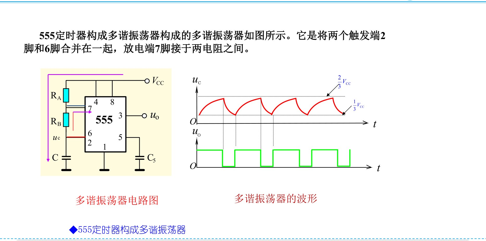
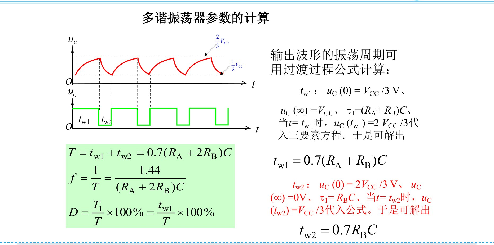
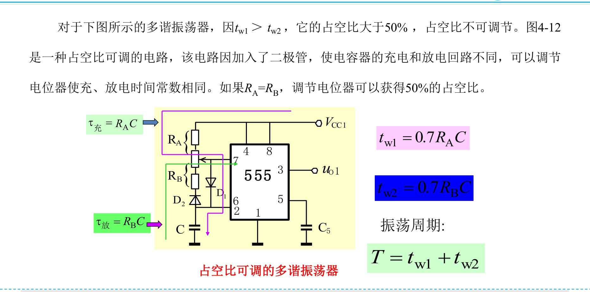
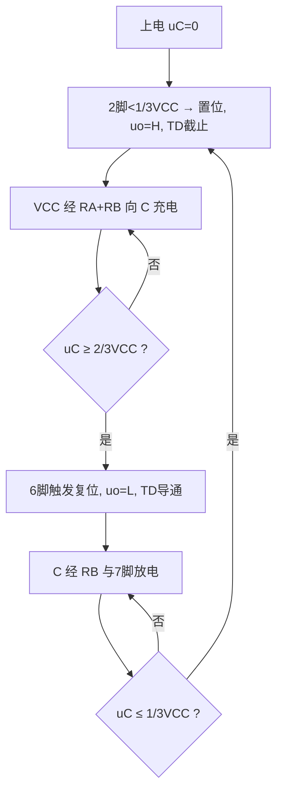

# 6.4 555 构成的多谐振荡器（555 Astable Multivibrator）

> 对应课件《07.集成运算放大器和脉冲波形的产生与变换》7.4 节，本资料按章节顺序编号为 6.4。

## 一、是什么（概念与定位）

用 555 定时器外接两只电阻（R_A、R_B）和一只电容 C，即可构成**多谐振荡器**——不需要任何触发信号，通电能自行输出连续矩形波。

接法要点：把两个触发端 **2 脚（TL）和 6 脚（TH）并接在一起**，接到电容 C 上；**放电端 7 脚接在两电阻之间**。这样电容电压 uC 的自动升降，就等价于同时驱动"置位"和"复位"两个比较器，形成自激振荡。

## 二、原理与特性

### 1. 电路结构



> 课件原图（P59）：555 多谐振荡器电路与波形。左图为电路：VCC 经 R_A、R_B 向 C 充电，7 脚接在 R_A 与 R_B 之间；2、6 脚并接于电容上端。右图为波形：uC 在 **1/3 VCC 与 2/3 VCC 之间**往复充放电，uo 输出对应的高低电平矩形波。
> 图中可以看到：**充电时电流走 R_A + R_B**（7 脚内部截止，R_A、R_B 串联），**放电时电流只走 R_B**（7 脚内部导通，把 R_A 短路到地）。这就注定 tw1 > tw2，输出占空比大于 50%。

### 2. 工作过程

**① 充电阶段（tw1）**

刚接通电源时 uC = 0，2 脚电压低于 1/3 VCC，触发器置位，uo = 高电平，放电管 TD 截止。VCC 经 R_A、R_B 向 C 充电，uC 由 0 向 VCC 上升。

当 uC 升到 **2/3 VCC** 时，6 脚触发上比较器，触发器复位，uo 翻为低电平。

**② 放电阶段（tw2）**

uo 为低 → TD 导通 → 7 脚接地。此时电容 C 经 R_B 和 7 脚放电，uC 由 2/3 VCC 向 0 下降（放电路径不再经过 R_A）。

当 uC 降到 **1/3 VCC** 时，2 脚触发下比较器，触发器又置位，uo 回到高电平，充电重新开始。

如此循环，输出连续矩形波。

### 3. 波形与参数计算



> 课件原图（P60）：多谐振荡器参数的计算依据。用 RC 过渡过程三要素公式分段计算 tw1、tw2。
> - **tw1**：uC(0) = VCC/3，uC(∞) = VCC，τ1 = (R_A + R_B)C，终值到 2/3 VCC
> - **tw2**：uC(0) = 2VCC/3，uC(∞) = 0，τ2 = R_B·C，终值到 1/3 VCC

代入三要素公式化简得：

```
tw1 = (R_A + R_B)·C·ln2 ≈ 0.7(R_A + R_B)C      （高电平时间）
tw2 = R_B·C·ln2           ≈ 0.7 R_B·C           （低电平时间）
T   = tw1 + tw2           ≈ 0.7(R_A + 2R_B)C    （振荡周期）
f   = 1/T ≈ 1.43 / [(R_A + 2R_B)C]
q   = tw1/T = (R_A + R_B) / (R_A + 2R_B) × 100%  （占空比）
```

**重要结论**：由于充电必须经过 R_A + R_B 而放电只经过 R_B，恒有 **tw1 > tw2**，所以基本型 555 多谐振荡器的**占空比总是大于 50%**，且不可调节。

### 4. 占空比可调的 555 多谐振荡器



> 课件原图（P61）：在 R_A、R_B 两端各反并联一只二极管，使充电电流只能走 R_A 支路、放电电流只能走 R_B 支路，从而把充放电回路彻底分开。
> 这样 tw1 ≈ 0.7 R_A C，tw2 ≈ 0.7 R_B C，占空比 q = R_A/(R_A + R_B)。调节电位器即可在 0% ~ 100% 范围内改变占空比；当 **R_A = R_B 时正好得到 50% 的方波**。
> 注意：图中把 R_A、R_B 做成一只电位器（或串联电位器）来调节，才能做到"周期基本不变、占空比连续可调"。

## 三、符号与图形

### 充放电路径对比

```
充电（uo=H，7脚截止，TD 断开）：
   VCC ── R_A ──┬── R_B ──┬── C ── GND
                7脚(悬空)  │
                          2、6脚
   τ充 = (R_A + R_B)C

放电（uo=L，7脚导通，TD 接地）：
   C ── R_B ── 7脚 ── 内部TD ── GND
   （R_A 被 7 脚短路，不参与）
   τ放 = R_B·C
```

### 工作循环



## 四、典型例题/应用

### 例题 1：计算周期、频率与占空比

**题干**：555 多谐振荡器中 R_A = 10 kΩ，R_B = 20 kΩ，C = 0.1 μF，求 tw1、tw2、T、f 与占空比。

**解答**：

```
tw1 = 0.7 × (10 + 20)×10³ × 0.1×10⁻⁶ = 0.7 × 3×10⁻³ = 2.1 ms
tw2 = 0.7 × 20×10³ × 0.1×10⁻⁶        = 1.4 ms
T   = 2.1 + 1.4 = 3.5 ms
f   = 1/3.5ms ≈ 286 Hz
q   = 2.1/3.5 × 100% = 60%
```

**易错**：漏掉 R_A 只参与充电、不参与放电这一事实，把 tw2 也算成 0.7(R_A+R_B)C。

### 例题 2：要求输出方波

**题干**：要求输出占空比为 50% 的方波，如何改接？

**解答**：基本电路做不到（占空比恒 > 50%）。必须在 R_A、R_B 上反并联二极管，把充放电路径分开，然后取 R_A = R_B，此时

```
q = R_A/(R_A + R_B) = 50%
T ≈ 0.7(R_A + R_B)C
```

### 例题 3：已知频率求电阻

**题干**：要求 f = 1 kHz，C = 0.01 μF，取 R_A = R_B = R，求 R。

**解答**：占空比 50% 时 T ≈ 0.7 × 2R × C = 1.4RC

```
1×10⁻³ = 1.4 × R × 0.01×10⁻⁶
R = 1×10⁻³ / (1.4 × 10⁻⁸) ≈ 71.4 kΩ
```

**易错**：直接用 T ≈ 0.7(R_A + 2R_B)C 而忘记说明是哪种接法。两种接法的公式不同，必须按实际电路选。

## 五、易错点

1. **基本型占空比恒大于 50%**，原因就是充电路径比放电路径多一个 R_A。
2. **放电不经过 R_A**——7 脚导通时把 R_A 的下端直接接到地。
3. **2 脚和 6 脚必须并接**，否则无法自激；这是与其他两种模式最直观的区别。
4. **tw1、tw2 的起止电压是 1/3 VCC 与 2/3 VCC**，不是 0 与 VCC，因此系数是 ln2 ≈ 0.7 而非 1。
5. **C 不能太小**（一般 ≥ 1000 pF），否则分布电容和 555 的输入电容会影响频率稳定性。
6. **5 脚要接 0.01 μF 去耦电容**，否则振荡频率易受干扰。

## 六、知识点总结

| 项目 | 基本型 | 占空比可调型 |
|------|--------|--------------|
| 2、6 脚 | 并接于 C | 并接于 C |
| 7 脚 | 接 R_A、R_B 之间 | 接 R_A、R_B 之间 |
| 充电路径 | R_A + R_B | 经二极管走 R_A |
| 放电路径 | R_B | 经二极管走 R_B |
| tw1 | 0.7(R_A+R_B)C | 0.7 R_A C |
| tw2 | 0.7 R_B C | 0.7 R_B C |
| T | 0.7(R_A+2R_B)C | 0.7(R_A+R_B)C |
| 占空比 | (R_A+R_B)/(R_A+2R_B)，恒 > 50% | R_A/(R_A+R_B)，可 0~100% |

记住三个数：**阈值 1/3、2/3 VCC，系数 0.7，占空比天然偏大**。
