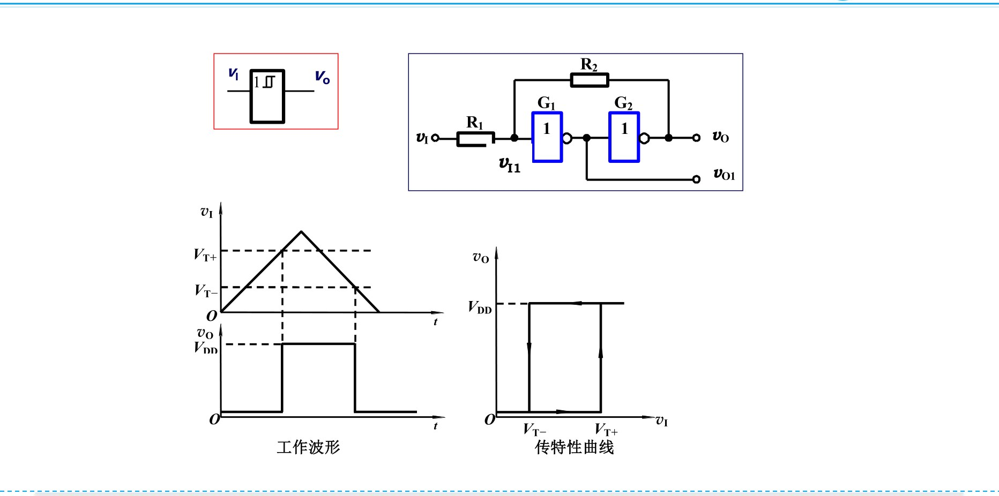
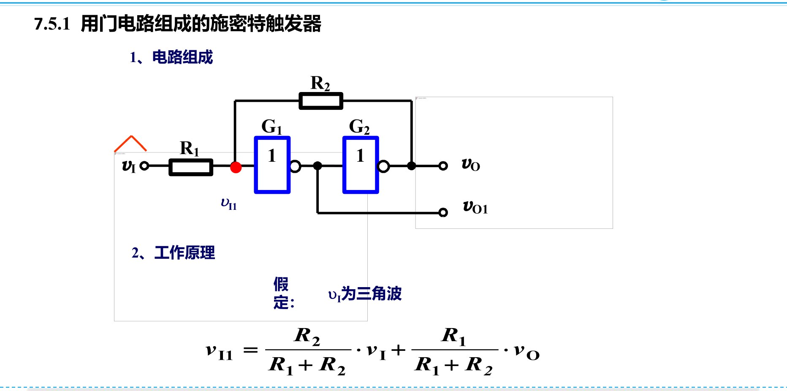
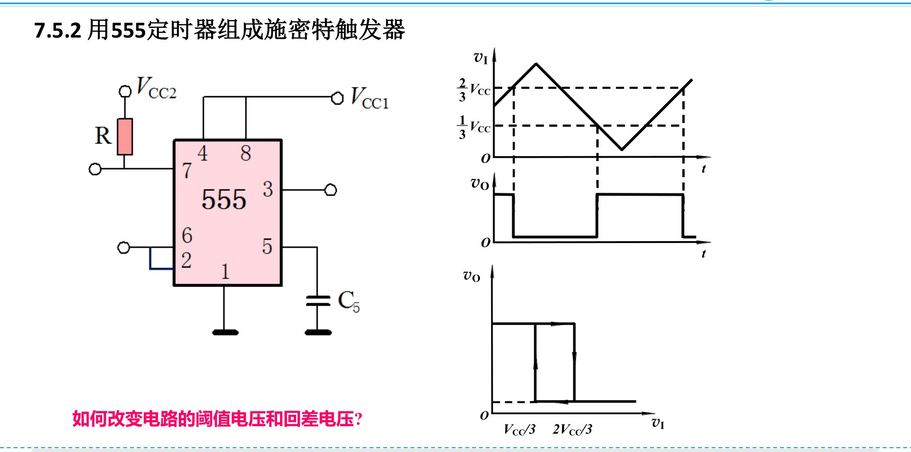
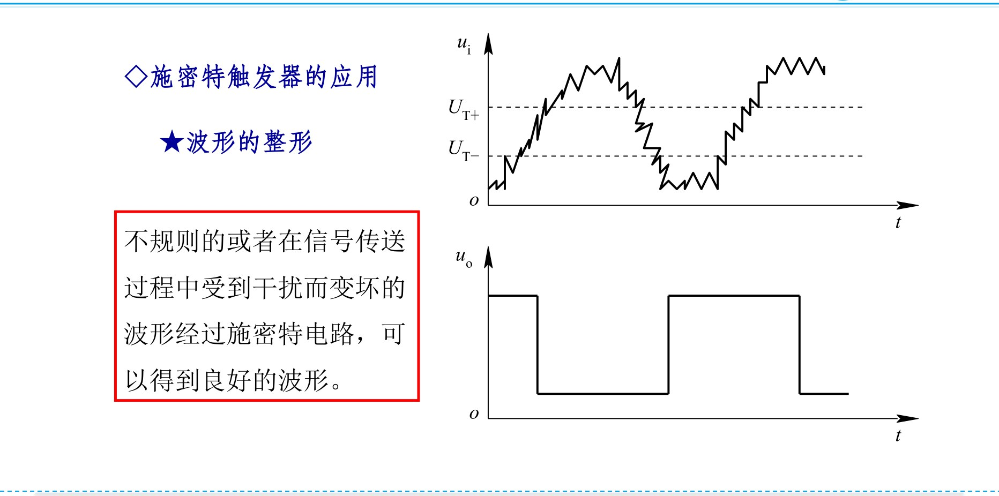
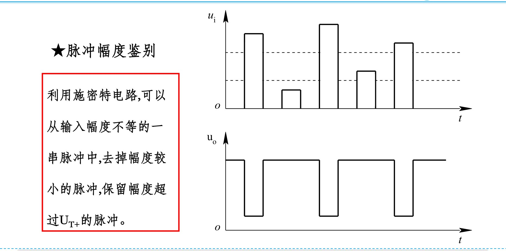

# 6.5 555 构成的施密特触发器（Schmitt Trigger）

> 对应课件《07.集成运算放大器和脉冲波形的产生与变换》7.5 节，本资料按章节顺序编号为 6.5。

## 一、是什么（概念与定位）

**施密特触发器**是一种**电平触发**器件：当输入信号达到某一电压值时，输出电压发生突变。它属于**整形电路**——不产生新波形，而是把已有的坏波形（边沿缓慢、带干扰）整理成边沿陡峭的矩形波。

两个核心特征：
1. **电平触发**，不是边沿触发；
2. **有两个阈值电压**：输入上升时的正向阈值 **VT+**、输入下降时的负向阈值 **VT−**，二者之差称为**回差电压** ΔVT。

## 二、原理与特性

### 1. 电压传输特性



> 课件原图（P66）：施密特触发器的电压传输特性曲线与工作波形。
> 传输特性呈**滞回形状**：输入从低往高升，到达 **VT+** 时输出由高跳到低（反相型）；输入从高往低降，到达 **VT−** 时才由低跳回高。两条路径不重合，中间的宽度就是回差 ΔVT = VT+ − VT−。
> 右侧波形图显示：输入是一个缓慢变化、带毛刺的信号，输出却是干净的矩形波——因为只要毛刺幅度不超过回差，就不会引起误翻转。

按输出极性可分为**同相型**与**反相型**：同相型输入升高时输出由低变高，反相型输入升高时输出由高变低。二者逻辑关系相反，但传输特性的滞回形状相同。

### 2. 用门电路组成的施密特触发器



> 课件原图（P63）：由两个非门 G1、G2 和电阻 R1、R2 组成的施密特触发器。
> **电路结构**：输入 vI 经 **R1** 加到 G1 的输入端（该点记为 vI1）；G2 的输出 vO 经 **R2** 反馈回 vI1；G1 输出 vO1 再经 G2 反相得到 vO。由于经过两级反相，vO 与 vI1 同相，故这是**正反馈**。
> 课件直接给出节点电压关系：
>
> ```
> vI1 = R2/(R1+R2) · vI + R1/(R1+R2) · vO
> ```
>
> **为什么会有两个门限**：
> - **输入上升时**，vO 为低电平（≈0），vI1 只由 vI 分压得到，必须等 vI 升到较高值才使 vI1 达到门限 VT → 得到**正向阈值 VT+**；
> - 一旦翻转，vO 变为高电平 VOH，经 R2 把 vI1 抬高，形成正反馈锁定；
> - **输入下降时**，vO 保持高电平，vI1 被反馈抬高，必须等 vI 降到更低值才使 vI1 降到 VT → 得到**负向阈值 VT−**。
>
> 正反馈是产生回差的根本原因；**R2 是反馈电阻，R2 越小反馈越强、回差越大**。

由上式令 vI1 = VT 解得：

```
VT+ = VT·(R1 + R2)/R2                  （vO 为低，无反馈上拉）
VT− = VT·(R1 + R2)/R2 − VOH·R1/R2       （vO 为高，反馈上拉）
ΔVT = VT+ − VT− = VOH·R1/R2
```

**要点**：回差电压只由 **R1/R2 的比值**和输出高电平 VOH 决定，与输入信号无关。要**减小**回差就**减小 R1** 或**增大 R2**；要增大回差则反之。

### 3. 用 555 组成的施密特触发器



> 课件原图（P67）：把 555 的 **2 脚（TL）与 6 脚（TH）并接**作为信号输入端，输出即为施密特触发器。因为 555 内部的两个阈值就是 1/3 VCC 和 2/3 VCC，所以

```
VT+ = 2/3 VCC      （输入上升、使 6 脚动作的门限）
VT− = 1/3 VCC      （输入下降、使 2 脚动作的门限）
ΔVT = VT+ − VT− = 1/3 VCC
```

**如何改变阈值与回差**：在 5 脚（CV 电压控制端）外加电压 Ucv，则上阈值变为 Ucv、下阈值变为 Ucv/2，两个阈值同向平移、回差按比例变化；也可在输入端加分压电阻网络重新分配阈值。

## 三、符号与图形

### 传输特性示意（反相型）

```
        vO
    VOH ┤        ┌────────────
        │        │
        │        │
    VOL ┤────────┘
        └────┬───┬─────────── vI
            VT− VT+
             └─ΔVT─┘
    输入上升：vI 达 VT+ 时 vO 由 VOH 跳到 VOL
    输入下降：vI 达 VT− 时 vO 由 VOL 跳回 VOH
```

### 三种实现方式对比

| 实现方式 | VT+ | VT− | 回差调节手段 |
|----------|-----|-----|--------------|
| 门电路 + R1R2 正反馈 | 见公式 | 见公式 | 改变 R1/R2 比值 |
| 555 定时器 | 2/3 VCC | 1/3 VCC | 改变 5 脚 CV 电压 |
| 运放 + 正反馈 | R1/(R1+R2)·Uom | −R1/(R1+R2)·Uom | 改变正反馈分压比 |

## 四、典型例题/应用

### 例题 1：计算 555 施密特触发器的阈值

**题干**：555 接成施密特触发器，VCC = 9 V，求 VT+、VT− 与回差。

**解答**：

```
VT+ = 2/3 × 9 = 6 V
VT− = 1/3 × 9 = 3 V
ΔVT = 6 − 3 = 3 V
```

输入信号在 3 V 以下时输出恒为高，在 6 V 以上时输出恒为低，中间 3~6 V 区间**保持原状态**。

**易错**：认为输入在 3~6 V 之间输出会"随输入变化"。施密特触发器是数字器件，该区间内输出保持，不跟随输入。

### 例题 2：波形整形



> 课件原图（P70）：**波形的整形**。一个不规则、或在传输中受干扰而变坏的波形，经过施密特电路后得到边沿陡峭、干净良好的矩形波。原理是：只要干扰幅度小于回差 ΔVT，就不会引起输出误翻转；而一旦越过阈值，正反馈使输出瞬间跳变，边沿变得很陡。

**题干**：输入为上升沿缓慢（1 ms）的脉冲，叠加了 0.5 V 的噪声，回差设为 2 V，输出会怎样？

**解答**：噪声幅度 0.5 V < 回差 2 V，在阈值附近不会反复翻转；输出只在真正越过阈值时翻转一次，得到干净矩形波，且边沿由正反馈速度决定，远比输入陡峭。

### 例题 3：脉冲幅度鉴别



> 课件原图（P68）：**脉冲幅度鉴别**。利用施密特电路可以从输入幅度不等的一串脉冲中，**去掉幅度较小的脉冲，只保留幅度超过 UT+ 的脉冲**。因为小幅度脉冲达不到上门限，输出不翻转；只有超过 UT+ 的脉冲才能触发输出。

**题干**：输入脉冲幅度分别为 2 V、4 V、7 V，VT+ = 5 V，输出保留哪些？

**解答**：只有 7 V 的脉冲超过 VT+ = 5 V，被保留并整形成等幅矩形脉冲；2 V、4 V 的脉冲不足以触发，输出无响应。

### 例题 4：光控开关

> 课件原图（P69）：**光控施密特触发器**——RG 为光敏电阻，光强时呈低阻，2 脚被拉低，555 置位，继电器 J 不动作；光弱时 RG 呈高阻，6 脚电位升高到 2/3 VCC 以上，555 复位，J 吸合。利用两个阈值的差异，可使继电器在光照临界点附近不频繁抖动。

## 五、易错点

1. **施密特触发器是电平触发**，不是边沿触发；它靠输入电压"跨过阈值"翻转，与触发器（FF）的边沿触发不同。
2. **一定要有两个阈值**。只有一个阈值的电路是比较器，不是施密特触发器。
3. **回差不是缺陷，而是抗干扰手段**。但回差过大会降低灵敏度、造成迟滞误差，需折中。
4. **输入落在两个阈值之间时输出保持**，不要写成"输出跟随输入"。
5. **555 施密特触发器的 2、6 脚必须并接**，若只接一脚就变成普通比较器。
6. **门电路型中 R2 是反馈电阻、R1 是输入串联电阻**（别记反），回差 ΔVT = VOH·R1/R2，即**反馈越强（R2 越小）回差越大**。

## 六、知识点总结

| 项目 | 结论 |
|------|------|
| 本质 | 电平触发的整形电路，具有滞回特性 |
| 两个阈值 | VT+（上升）、VT−（下降），回差 ΔVT = VT+ − VT− |
| 555 型阈值 | VT+ = 2/3 VCC，VT− = 1/3 VCC，ΔVT = 1/3 VCC |
| 门电路型 | 回差由正反馈电阻比 R1/R2 决定 |
| 调节手段 | 555 改 5 脚 CV 电压；门电路改 R1/R2 |
| 三大应用 | 波形整形、脉冲幅度鉴别、光控/电平检测 |

一句话：**施密特触发器 = 比较器 + 正反馈**，正反馈造出两个阈值，两个阈值换来抗干扰能力。
