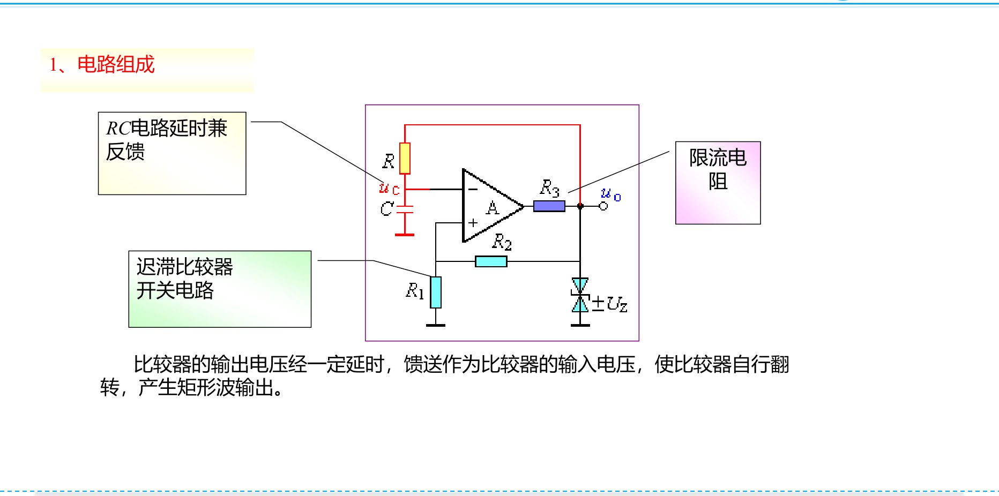
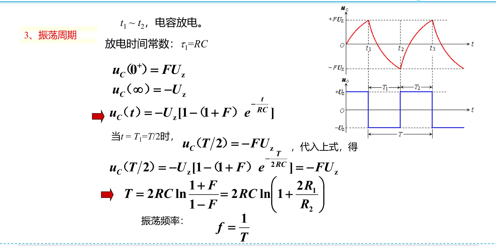
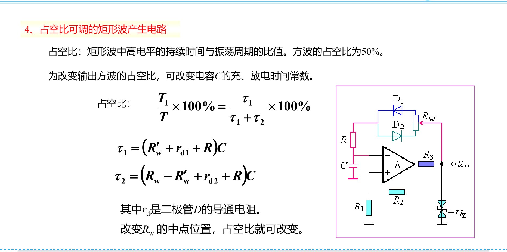
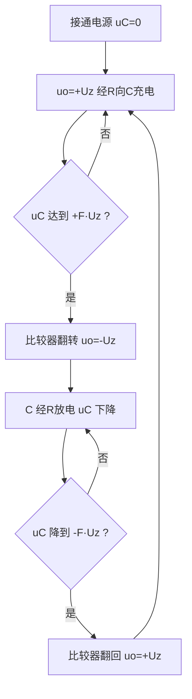

# 7.2 放大器构成的多谐振荡器（Astable Multivibrator with Op-Amp）

> 对应课件《07.集成运算放大器和脉冲波形的产生与变换》7.2 节，本资料按章节顺序编号为 7.2。

## 一、是什么（概念与定位）

**多谐振荡器**是一种矩形波产生电路。它**不需要外加触发信号**，通电后便能连续、周期性地自行产生矩形脉冲。因该脉冲由基波和多次谐波叠加而成，故得名"多谐"。

脉冲信号的获得有两种途径：
1. **振荡电路直接产生**所需矩形脉冲——多谐振荡器；
2. **整形电路变换**已有信号——单稳态触发器、施密特触发器。

这些单元电路既可用集成逻辑门构成，也可用集成定时器（555）构成。本节先用**运放构成的迟滞比较器 + RC 延时**实现，7.4 节再用 555 实现。

## 二、原理与特性

### 1. RC 电路的过渡过程（数学基础）



> 课件原图（P49）：多谐振荡器由**迟滞比较器**（开关电路）、**RC 延时兼反馈**、**限流电阻**三部分构成。比较器的输出电压经 RC 延时后反馈回比较器输入端，使比较器自行翻转，从而产生矩形波。

RC 电路中电容电压按指数规律变化，三要素公式：

```
uC(t) = uC(∞) + [uC(0) − uC(∞)]·e^(−t/τ)

τ = RC    （时间常数，单位 s）
```

**RC 电路的核心作用**：利用**电容电压不能突变**这一特性，在充电、放电过程中实现时间的控制。

充电：uC(0) = 0，uC(∞) = VCC，则 uC(t) = VCC(1 − e^(−t/τ))

### 2. 振荡原理

设比较器的正反馈系数

```
F = R1 / (R1 + R2)
```

则比较器的两个门限为

```
uT+ = +F·Uz
uT− = −F·Uz
```

其中 Uz 为输出端的稳压值（由双向稳压管限幅得到）。

工作循环（设 t = 0 时 uC = 0，uo = +Uz）：

1. **充电阶段**：uo = +Uz，Uz 经 R 向 C 充电，uC 按指数规律上升；当 uC 升到 uT+ = +F·Uz 时，比较器翻转。
2. **翻转**：uo 由 +Uz 跳到 −Uz，uT 随之由 +F·Uz 跳到 −F·Uz（正反馈使翻转极快，输出边沿陡峭）。
3. **放电阶段**：C 经 R 放电，uC 指数下降；当 uC 降到 uT− = −F·Uz 时，比较器再次翻转。
4. **再翻转**：uo 回到 +Uz，电容重新充电。

如此周而复始，输出端得到连续矩形波。

### 3. 振荡周期



> 课件原图（P52）：利用 RC 过渡过程公式分段计算。充电段从 −F·Uz 充到 +F·Uz，放电段从 +F·Uz 放到 −F·Uz，两段时间相等，故输出为**对称方波**（占空比 50%）。

由三要素公式推导可得：

```
T = 2RC·ln[ (1 + F) / (1 − F) ]
```

其中 F = R1/(R1 + R2)。当 R1 = R2 时 F = 0.5，ln3 ≈ 1.1，则

```
T ≈ 2.2 RC
```

**要点**：周期只由 R、C 和正反馈系数 F 决定，与输出稳压值 Uz 无关——这是该电路的优点，电源波动不影响频率。

### 4. 占空比可调的矩形波产生电路



> 课件原图（P53）：**占空比**定义为矩形波中高电平持续时间与振荡周期的比值，即 q = tw1/T × 100%。方波的占空比为 50%。
> 若想让充电与放电时间不等，只需让充电回路与放电回路经过不同的电阻：在电容两端反并联两只二极管，充电电流走 R_A 支路、放电电流走 R_B 支路，调节电位器即可改变占空比，而周期基本不变。

```
占空比  q = tw1 / T × 100% = R_A / (R_A + R_B) × 100%
```

当 R_A = R_B 时 q = 50%，得到方波；调节电位器可得到任意占空比。

## 三、符号与图形

### 振荡建立过程



### 输出波形特征

```
uo:  ┌────┐    ┌────┐    ┌────┐
     │    │    │    │    │    │
 ────┘    └────┘    └────┘    └────
     tw1  tw2  tw1  tw2
uC:   /\    /\    /\    /\
    /  \  /  \  /  \  /  \
 ──/────\/────\/────\/────\──
   -FUz          +FUz
```

## 四、典型例题/应用

### 例题 1：计算振荡频率

**题干**：运放构成的多谐振荡器中 R = 10 kΩ、C = 0.1 μF、R1 = R2 = 10 kΩ，求振荡周期与频率。

**思路**：R1 = R2 → F = 0.5，用 T = 2RC·ln3 计算。

**解答**：

```
F = R1/(R1+R2) = 0.5
T = 2 × 10×10³ × 0.1×10⁻⁶ × ln3
  = 2 × 10⁻³ × 1.0986 = 2.2 ms
f = 1/T ≈ 455 Hz
```

**易错**：把 R1、R2 当成定时电阻。R1、R2 只决定门限（即占空比与周期中的 F 因子），决定充放电快慢的是 R、C。

### 例题 2：占空比调节

**题干**：若要求方波周期不变而占空比从 50% 变为 25%，应如何调整？

**解答**：在电容回路加装双向二极管引导充放电路径，使充电电阻 R_A 与放电电阻 R_B 分别可调。保持 R_A + R_B 不变（周期不变），令 R_A : R_B = 1 : 3，则

```
q = R_A/(R_A+R_B) = 25%
```

**易错**：只改一个电阻会同时改变周期，必须成对调节以保持总阻值不变。

### 例题 3：判断电路能否起振

**题干**：某多谐振荡器接成负反馈形式，问能否振荡。

**解答**：不能。多谐振荡器依赖**正反馈**使比较器在两个门限间往返翻转。若接成负反馈，运放被稳定在线性区，uC 一旦达到门限就被负反馈拉回，无法形成持续翻转。

## 五、易错点

1. **多谐振荡器必须有正反馈**：正反馈负责"快速翻转"，RC 负责"延时到下一次翻转"。
2. **周期与电源电压无关**（靠稳压管限幅），但若没有限幅，周期会随 Uom 变化。
3. **τ = RC 中的 R 是定时电阻**，别与构成门限的 R1、R2 混淆。
4. **电容电压不能突变**是全部推导的前提，充放电都从当前值出发，不能假设每次从 0 开始。
5. **占空比调节要改变充放电路径**，不能只改一个电阻。

## 六、知识点总结

| 项目 | 结论 |
|------|------|
| 电路组成 | 迟滞比较器 + RC 延时反馈 + 限流电阻 |
| 正反馈系数 | F = R1/(R1+R2)，门限 ±F·Uz |
| 周期 | T = 2RC·ln[(1+F)/(1−F)]；F=0.5 时 T ≈ 2.2RC |
| 输出 | 对称方波，占空比 50%（基本型） |
| 占空比 | q = R_A/(R_A+R_B)，靠二极管分离充放电路径实现可调 |
| 关键前提 | 电容电压不能突变；必须正反馈才能起振 |

一句话记住：**RC 决定"多久翻一次"，正反馈决定"翻得干不干净"**。
