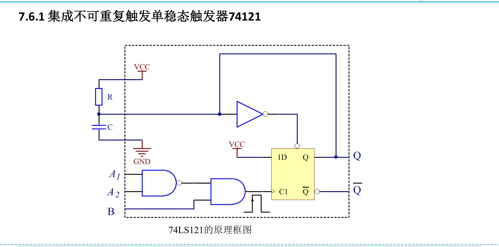
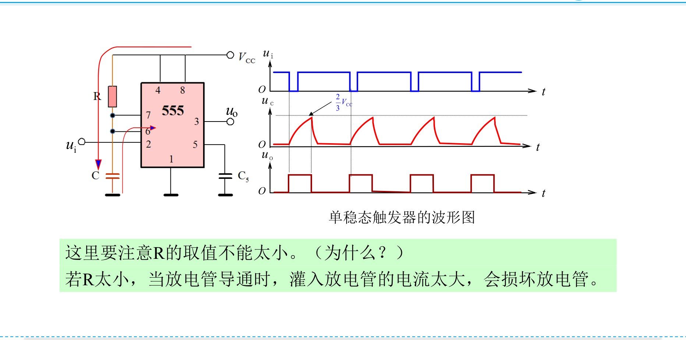
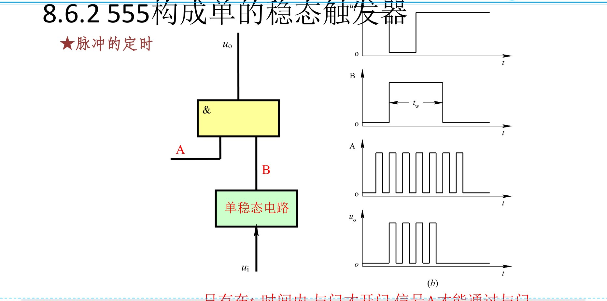
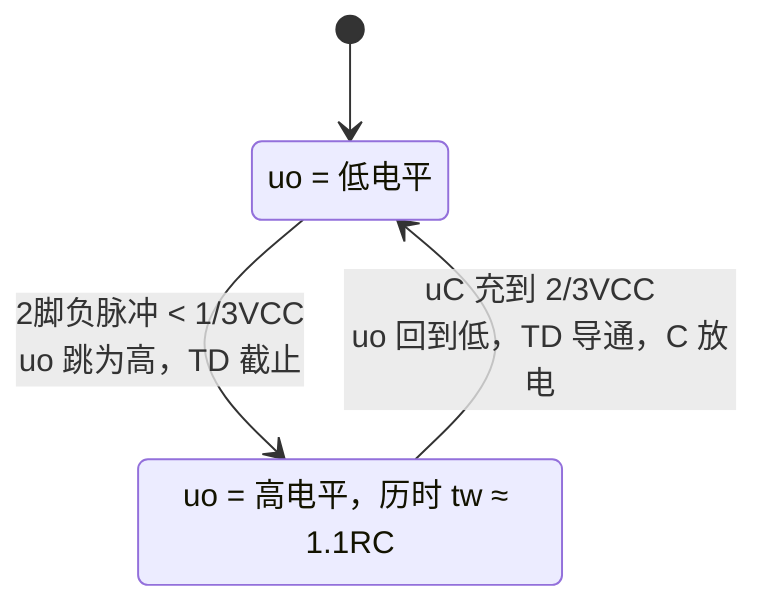
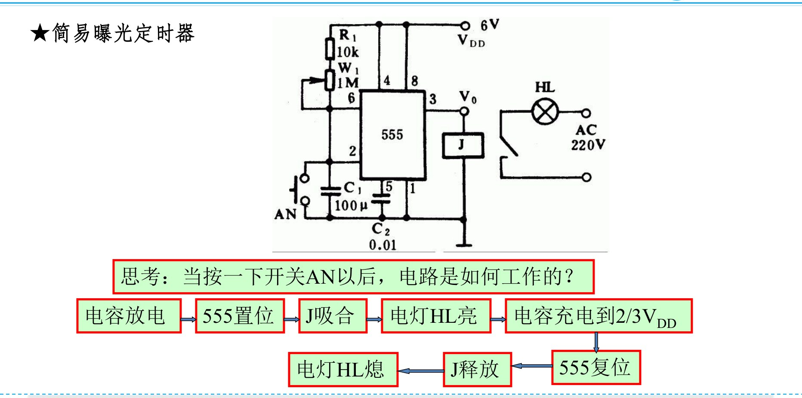

# 7.6 555 构成的单稳态触发器（Monostable Multivibrator）

> 对应课件《07.集成运算放大器和脉冲波形的产生与变换》7.6 节，本资料按章节顺序编号为 7.6。

## 一、是什么（概念与定位）

**单稳态触发器**只有一个**稳态**和一个**暂稳态**。它的工作特点（课件 P71 原文三条）：

1. 电路在没有触发信号作用时处于一种**稳定状态**；
2. 在外来触发信号作用下，电路由稳态**翻转**到暂稳态；
3. 由于电路中 RC 延时环节的作用，暂稳态不能长久保持，经过一段时间后**自动返回**稳态，**暂稳态持续时间仅与 RC 参数值有关**。

正因为它输出脉宽只由外接 R、C 决定，单稳态触发器成为**定时、延时**电路的标准器件。

按电路形式分：门电路组成的、MSI 集成（如 74121）、555 组成的；
按工作特点分：**不可重复触发**与**可重复触发**。



> 课件原图（P74）：集成不可重复触发单稳态触发器 **74121** 的原理框图。内部由触发输入网络、比较器、RS 触发器、输出缓冲和定时电容/电阻端构成，只需外接一只电阻 R 和一只电容 C 即可设定脉宽。

**不可重复触发 vs 可重复触发**（课件 P73）：

```
不可重复触发：输出脉宽 tw 期间，新的触发脉冲被忽略，
              输出波形宽度保持不变（第一个 tw 走完为止）。

可重复触发：输出脉宽 tw 期间，若又来触发脉冲，
              则重新计时，输出脉宽被延长（tw 重新开始）。
```

## 二、原理与特性

### 1. 555 构成的单稳态触发器



> 课件原图（P76）：555 单稳态触发器的电路与波形。
> **电路结构**：2 脚（TL）接输入触发信号 ui（平时经 R 接高电平）；6 脚（TH）与 7 脚（DIS）并接在电容 C 上端；C 另一端接地；VCC 经定时电阻 R 向 C 充电。
> **稳态**：ui 为高，2 脚电压 > 1/3 VCC，触发器保持复位后的状态，uo = **低电平**，放电管 TD 导通，C 被 7 脚短路，uC = 0，电路稳定。
> **触发翻转**：ui 出现负脉冲，2 脚电压降到 1/3 VCC 以下 → 触发器置位 → uo 跳为**高电平**，TD 截止，VCC 经 R 向 C 充电，uC 由 0 指数上升，进入**暂稳态**。
> **自动返回**：当 uC 升到 **2/3 VCC** 时，6 脚触发上比较器 → 触发器复位 → uo 回到**低电平**，TD 重新导通，C 迅速放电到 0，电路回到稳态。

> 图中绿框特别提示：**R 的取值不能太小**。因为暂稳态结束时 TD 导通，电容上的残余电荷会经 TD 迅速泄放；若 R 太小，则稳态时流入放电管的电流过大，会**损坏放电管**。

### 2. 暂稳态时间 tw 的计算



> 课件原图（P79）：单稳态触发器的**脉冲定时**应用——输入 ui 的边沿触发后，输出 uo 产生一个固定宽度 tw 的脉冲，用作门控信号（图中与门 B 端）。

按三要素公式：uC(0) = 0 V，uC(∞) = VCC，τ = RC，当 t = tw 时 uC = 2/3 VCC，代入

```
uC(t) = VCC(1 − e^(−t/RC))
2/3 VCC = VCC(1 − e^(−tw/RC))
e^(−tw/RC) = 1/3
```

解得

```
tw = RC·ln3 ≈ 1.1 RC
```

**重要结论**：输出脉宽 **tw ≈ 1.1RC**，只由外接 R、C 决定，**与触发脉冲的宽度、幅度无关**，也与电源电压无关（因阈值按 VCC 的比例设定）。这就是它能做精确定时的原因。

### 3. 与外触发信号的配合

- 触发脉冲必须是**负脉冲**（使 2 脚低于 1/3 VCC），宽度应**小于 tw**，否则会影响下一次触发；
- 若触发脉冲过宽，可在输入端加微分电路（RC 微分 + 二极管）把它变成窄脉冲；
- 两次触发之间必须留出**恢复时间**（电容放电到 0 的时间），否则脉宽会变短。

## 三、符号与图形

### 状态转换



### 三种脉冲电路的接法对比（本章总表）

| 电路 | 2 脚 | 6 脚 | 7 脚 | 输出特征 |
|------|------|------|------|----------|
| 多谐振荡器 | 与 6 脚并接于 C | 同左 | 接 R_A、R_B 之间 | 自激，连续矩形波 |
| 施密特触发器 | 与 6 脚并接于输入 | 同左 | 悬空/上拉 | 整形，输出随输入跳变 |
| 单稳态触发器 | 接触发输入 | 接 C 上端 | 接 C 上端 | 每触发一次输出一个 tw 脉冲 |

## 四、典型例题/应用

### 例题 1：计算输出脉宽

**题干**：555 单稳态电路中 R = 100 kΩ，C = 1 μF，求输出脉宽 tw。

**解答**：

```
tw ≈ 1.1 RC = 1.1 × 100×10³ × 1×10⁻⁶
   = 0.11 s = 110 ms
```

**易错**：把 tw 写成 RC（漏掉系数 1.1）。这个 1.1 来自 ln3，因为电容只充到 2/3 VCC 而不是充满。

### 例题 2：设计 5 秒定时器

**题干**：要求输出脉宽 tw = 5 s，取 C = 10 μF，求 R。

**解答**：

```
R = tw / (1.1C) = 5 / (1.1 × 10×10⁻⁶) ≈ 455 kΩ
```

取标称值 470 kΩ 即可（实际 tw ≈ 5.17 s）。若需要精确 5 s，可用 455 kΩ 精密电阻或用电位器微调。

**易错**：忽略 R 的上限。R 过大会使输入偏置电流的影响显著、定时精度下降，一般 R ≤ 1 MΩ。

### 例题 3：脉冲延时

> 课件原图（P80）：**脉冲的延时**应用。输入脉冲经单稳态触发器后，输出脉冲相对输入**延迟了一个 tw**，可用于时序配合——例如让后级电路在前级动作完成后再启动。

**题干**：输入脉冲在 t = 0 时刻到来，单稳态 tw = 2 ms，延迟输出接在何处？

**解答**：利用触发沿与输出沿之间的固定时差 tw 实现延时。若用上升沿触发、输出取下降沿，则延迟量即为 tw = 2 ms。

### 例题 4：失落脉冲报警

> 课件原图（P78）：**可重复触发的单稳态触发器**接成失落脉冲报警器。正常时输入脉冲周期性到来，每次都把暂稳态"续上"，输出保持高电平；一旦脉冲丢失，超过 tw 没有新触发，输出就翻回低电平，触发报警。这是单稳态"检测脉冲是否按时到达"的经典用法。

### 例题 5：简易曝光定时器



> 课件原图（P81）：**简易曝光定时器**。按下开关 AN 后：电容放电 → 555 置位 → 继电器 J 吸合 → 电灯 HL 点亮；随后电容经 R 充电，充到 2/3 VDD 时 555 复位 → J 释放 → 电灯 HL 熄灭。灯泡点亮时间即 tw ≈ 1.1RC，改变 R 或 C 即可改变曝光时间。

**题干**：要求曝光 8 s，C = 22 μF，求 R。

**解答**：

```
R = 8 / (1.1 × 22×10⁻⁶) ≈ 330 kΩ
```

## 五、易错点

1. **tw ≈ 1.1RC 中的 1.1 = ln3**，因为只充到 2/3 VCC；写成 tw = RC 是最常见的错误。
2. **输出脉宽与触发脉冲无关**，只由 R、C 决定；但触发脉冲必须足够窄且足够低。
3. **相邻两次触发之间要有恢复时间**，否则电容未放完电，下次脉宽会变短。
4. **R 不能太小**，否则稳态时放电管电流过大而损坏；**R 也不宜过大**（一般 ≤ 1 MΩ），否则漏电流影响精度。
5. **555 单稳态的稳态输出是低电平**，触发后输出高电平。不要把稳态搞反。
6. **不可重复触发型在 tw 期间忽略新触发**，可重复触发型则重新计时——两者输出波形不同，考试常考波形对比。

## 六、知识点总结

| 项目 | 结论 |
|------|------|
| 状态数 | 一个稳态 + 一个暂稳态 |
| 触发方式 | 2 脚加负脉冲（< 1/3 VCC） |
| 暂稳态结束 | 电容充到 2/3 VCC，6 脚复位 |
| 脉宽 | tw ≈ 1.1 RC（= RC·ln3） |
| 脉宽决定因素 | 只由 R、C 决定，与触发信号、电源电压无关 |
| 稳态输出 | 低电平；暂稳态输出高电平 |
| 分类 | 不可重复触发（74121）/ 可重复触发 |
| 典型应用 | 定时、延时、失落脉冲报警、曝光定时 |

单稳态的三句话：**一个稳态、一个暂稳态；负脉冲触发进入、电容充到 2/3 退出；宽度 1.1RC，只认电阻电容**。
